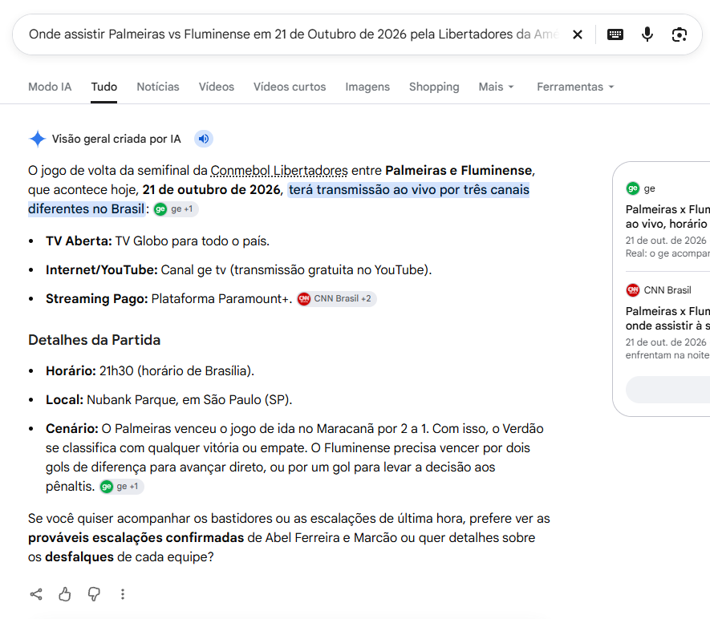
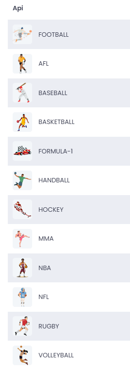
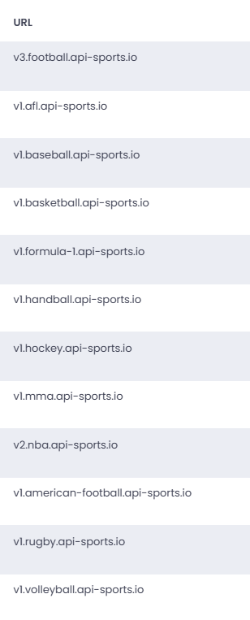
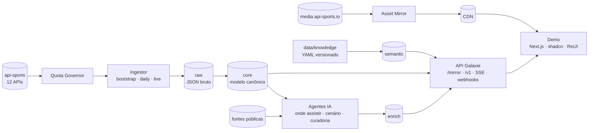

# Galaxie Sports

**API de dados esportivos para a América Latina — o evento como entidade principal, com contexto, onde assistir e a alma da torcida.**

Galaxie Sports espelha internamente toda a [api-sports.io](https://api-sports.io) (12 APIs), normaliza tudo em um modelo canônico orientado a evento e acrescenta o que nenhum fornecedor de dados entrega pronto: **onde assistir por país**, **base semântica de clássicos e torcidas** ("Choque-Rei", "Avanti, Palestra!"), **cenário pré-jogo calculado** e **agendamento inteligente ao vivo** — tudo dentro de um orçamento rigoroso de chamadas.

> 📌 Backlog e andamento: [GitHub Project · Galaxie Sports](https://github.com/users/galaxie-works/projects/4) · Status: **planejamento concluído, implementação iniciando**.

---

## Sumário

- [Por que existe](#por-que-existe)
- [Módulos](#módulos)
- [Esportes e fontes](#esportes-e-fontes)
- [Arquitetura](#arquitetura)
- [Economia de chamadas](#economia-de-chamadas)
- [Base semântica](#base-semântica)
- [IA ao vivo e enriquecimento](#ia-ao-vivo-e-enriquecimento)
- [App de demonstração](#app-de-demonstração)
- [Estrutura do repositório](#estrutura-do-repositório)
- [Como rodar](#como-rodar)
- [Documentação](#documentação)
- [Roadmap](#roadmap)

---

## Por que existe

Plataformas de vídeo e mídia que querem ser "a casa do esporte" precisam responder, **dentro do próprio produto**, perguntas que hoje o torcedor leva ao buscador:



- *O que está rolando agora e o que importa para mim?*
- *Onde eu assisto este jogo, no meu país?*
- *O que está em jogo? Quem precisa de quê?*
- *É clássico? Qual o retrospecto?*

O Galaxie Sports entrega essas respostas como API, com fontes, níveis de confiança e atualização em tempo real.

## Módulos

| | Módulo | Entrega |
|---|---|---|
| M1 | **Data Mirror** | Cópia interna das 12 APIs da api-sports com **o mesmo envelope de resposta**, servida por `/mirror/{sport}/...` — a demo e os clientes nunca gastam cota do fornecedor |
| M2 | **Event Foundation** | Entidade `event` canônica multiesporte, máquina de estados, *last-known-good*, momentum e importância |
| M3 | **Onde assistir** | Opções de transmissão por evento × país (TV aberta, paga, streaming, YouTube) com fonte, confiança e correção em ≤ 5 min |
| M4 | **Base semântica** | Clássicos, apelidos, mascotes, gritos de torcida, apelidos de competições e copy localizada para 8 mercados |
| M5 | **IA ao vivo e enriquecimento** | Agendador inteligente de polling, cenário pré-jogo, resumo pós-jogo, curadoria semântica |
| M6 | **Olimpíadas & Pan** | Quadro de medalhas, agenda por modalidade, delegações latino-americanas e histórico |

Detalhes, personas e pacotes comerciais: [docs/01-visao-de-produto.md](docs/01-visao-de-produto.md).

## Esportes e fontes

Uma única chave do dashboard da api-sports dá acesso às 12 APIs; **cada API tem sua própria cota diária** (100 requisições/dia no plano gratuito).

| | Esporte | Base URL do fornecedor | Nosso espelho |
|:-:|---|---|---|
|  | **Futebol** (foco inicial) | `v3.football.api-sports.io` | `/mirror/football` |
|  | AFL | `v1.afl.api-sports.io` | `/mirror/afl` |
|  | Beisebol | `v1.baseball.api-sports.io` | `/mirror/baseball` |
|  | Basquete | `v1.basketball.api-sports.io` | `/mirror/basketball` |
|  | Fórmula 1 | `v1.formula-1.api-sports.io` | `/mirror/formula-1` |
|  | Handebol | `v1.handball.api-sports.io` | `/mirror/handball` |
|  | Hóquei | `v1.hockey.api-sports.io` | `/mirror/hockey` |
|  | MMA | `v1.mma.api-sports.io` | `/mirror/mma` |
|  | NBA | `v2.nba.api-sports.io` | `/mirror/nba` |
|  | NFL / futebol americano | `v1.american-football.api-sports.io` | `/mirror/american-football` |
|  | Rúgbi | `v1.rugby.api-sports.io` | `/mirror/rugby` |
|  | Vôlei | `v1.volleyball.api-sports.io` | `/mirror/volleyball` |

<details>
<summary>Referência: telas do dashboard da api-sports</summary>

 

</details>

**Foco do futebol**: Brasil (Série A–D, Copa do Brasil, estaduais), CONMEBOL (Libertadores, Sul-Americana, Recopa, Eliminatórias, Copa América), ligas de Argentina, Chile, Uruguai, Colômbia, Peru, Equador, Paraguai, Bolívia, Venezuela e México, as grandes ligas e copas europeias e as competições FIFA — **76 competições** catalogadas com ID verificado em [`config/competitions/football.yaml`](config/competitions/football.yaml).

**Olimpíadas e Pan-Americano** combinam a api-sports (torneios coletivos) com fontes abertas e licenciadas — ver [docs/08](docs/08-olimpiadas-e-panamericano.md).

## Arquitetura



- **Node.js 24 + TypeScript** (Fastify, Zod, Drizzle), **PostgreSQL 17** (JSONB para o raw), **Redis/Valkey** + BullMQ, object storage S3-compatível, **Claude API** para os agentes.
- Camadas `raw → core → semantic/enrich → serving`; o raw é imutável e permite reprocessar tudo **sem gastar cota**.
- Deploy inicial em VPS com Docker/Portainer.

Detalhes: [docs/02-arquitetura.md](docs/02-arquitetura.md) · Modelo de dados: [docs/04-modelo-de-dados.md](docs/04-modelo-de-dados.md) · Contrato da API: [docs/05-api-publica.md](docs/05-api-publica.md).

## Economia de chamadas

A meta é copiar "tudo" e manter atualizado com **100 chamadas por dia por API**. Os pilares:

1. **Chamadas de alto rendimento** — `/leagues` sem parâmetros traz todas as ligas com todas as temporadas e cobertura; `fixtures?league&season` traz uma temporada inteira; `fixtures?date=` traz a agenda mundial do dia; `fixtures?ids=` traz até 20 partidas com eventos, escalações e estatísticas embutidos; `fixtures/headtohead` traz o histórico completo de um confronto.
2. **Raw imutável + cache por endpoint** — nenhuma requisição idêntica sai duas vezes dentro do seu TTL.
3. **Quota Governor** — orçamento diário por API e prioridade (bootstrap, sync diário, ao vivo, sob demanda) com reserva de segurança.
4. **Bootstrap distribuído em dias** — a carga histórica é um plano executado em lotes diários, retomável.
5. **Live por janela** — uma única chamada `fixtures?live=<ligas>` cobre todos os jogos ao vivo das ligas prioritárias; o intervalo se ajusta ao orçamento.
6. **Assets fora da cota** — logos, bandeiras, estádios e fotos são extraídos das URLs presentes no raw e baixados da CDN de mídia ([`scripts/pwsh/Sync-ApiSportsAssets.ps1`](scripts/pwsh/Sync-ApiSportsAssets.ps1)).

> **Atenção — o free mudou.** Desde 2024 o plano gratuito limita temporadas: em 2026 só **2022–2024** são acessíveis por `season`, a janela de datas é **ontem → amanhã** e `ids`/`last`/`next` são bloqueados. A temporada atual não pode ser listada no free. A recomendação é **assinar o plano Pro por 30 dias (US$ 19)** para o bootstrap completo (~22 mil chamadas, ~3 dias) e manter o espelho no free depois. Múltiplas contas para somar cota são proibidas pelos termos — e não fazemos isso.

Estratégia completa, números e cronograma do bootstrap: [docs/03-ingestao-e-economia-de-chamadas.md](docs/03-ingestao-e-economia-de-chamadas.md).

> **Licença**: os termos da api-sports proíbem revender os dados. O espelho é base de desenvolvimento e demonstração; em produção, a camada de provedores permite usar uma fonte licenciada — **candidata principal: [Sportmonks](docs/research/sportmonks.md)** (Enterprise com redistribuição) — ou a do próprio cliente, sem mudar a API. Ver [docs/11](docs/11-seguranca-licenciamento-e-compliance.md).

## Base semântica

Pré-cadastrada, versionada em YAML e revisada por humanos — hoje com **187 times e seleções, 82 clássicos e 43 competições** (Brasil, América do Sul, México, Europa e seleções). A API **não** precisa consultar nada externo para saber que:

| Confronto | Clássico |
|---|---|
| Palmeiras × Corinthians | Derby Paulista |
| Palmeiras × São Paulo | Choque-Rei |
| Corinthians × São Paulo | Majestoso |
| Flamengo × Fluminense | Fla-Flu |
| Grêmio × Internacional | Gre-Nal |
| Boca Juniors × River Plate | Superclásico |
| América × Guadalajara | Clásico Nacional |
| Real Madrid × Barcelona | El Clásico |

…e que o palmeirense grita "Avanti, Palestra!", o corintiano "Vai, Corinthians!". Cada time tem apelidos, mascote, torcida, estádio, rivais e dicas de copy por mercado (pt-BR e sete variantes de espanhol), com regras de linguagem segura: copy de rivalidade só para rival **declarado**, nunca ofensa.

Schema: [data/knowledge/SCHEMA.md](data/knowledge/SCHEMA.md) · Conceitos e serviços derivados: [docs/06-semantica-e-conteudo.md](docs/06-semantica-e-conteudo.md).

## IA ao vivo e enriquecimento

> **Fatos vêm da fonte de dados. A IA decide quando buscar, onde procurar o que a fonte não tem e como contar.**

| Agente | Função |
|---|---|
| **Live Scheduler** | Monta janelas ao vivo dos jogos importantes (Série A, estaduais, Copa do Brasil, Libertadores, Sul-Americana, ligas da América Latina e Europa) e distribui o orçamento de chamadas |
| **Onde Assistir** | Pesquisa transmissões por país a partir de uma tabela de direitos e fontes primárias; validador determinístico publica só o que tem evidência e confiança |
| **Cenário / Resumo** | Redige "quem precisa de quê" a partir de regras calculadas (ex.: *avança com empate; o rival precisa vencer por dois gols*) e resumos pós-jogo factuais |
| **Curador Semântico** | Mantém a base viva abrindo PRs com fontes (novos clássicos, naming rights, promovidos) |

Detalhes: [docs/07-ia-tempo-real-e-enriquecimento.md](docs/07-ia-tempo-real-e-enriquecimento.md).

## App de demonstração

`apps/demo` — Next.js + **shadcn/ui** + **ReUI**, consumindo **somente** a API Galaxie (zero chamadas à api-sports). Telas: Meu dia esportivo, Ao vivo, Radar, Competição, Evento (com onde assistir), Time (com cartão semântico), Clássicos, Olimpíadas & Pan e Painel de operação (cota por API). Outras bibliotecas de componentes serão incorporadas e documentadas.

Detalhes: [docs/09-app-demonstracao.md](docs/09-app-demonstracao.md).

## Estrutura do repositório

```
galaxie-sports/
├── apps/                       # api (Fastify) · demo (a criar)
├── services/                   # ingestor · ai-agents (esqueleto)
├── packages/                   # db (schema + migrations) · apisports-client · contracts · rules
├── infra/                      # docker-compose.yml (Postgres, Valkey, RustFS)
├── config/
│   └── competitions/football.yaml   # 76 competições com IDs verificados e tiers
├── data/
│   └── knowledge/              # base semântica (times, clássicos, seleções, competições)
├── scripts/
│   └── pwsh/                   # Sync-ApiSportsAssets.ps1 · Get-ApiSportsStatus.ps1
├── docs/                       # documentação (ver abaixo) + research/ + images/
├── .env.example
└── README.md
```

## Como rodar

Pré-requisitos: **Node.js 24**, **pnpm 11**, **Docker** (Desktop ou Engine).

```bash
cp .env.example .env            # preencha APISPORTS_KEY, ANTHROPIC_API_KEY...
pnpm install
pnpm infra:up                   # Postgres 17 (porta 5433), Valkey (6379), RustFS/S3 (9000) + bucket de assets
pnpm build
pnpm db:migrate                 # aplica as migrations (idempotente)
pnpm test                       # testes unitários
pnpm test:integration           # testes de integração contra o Postgres local
pnpm --filter @galaxie/api dev  # API em http://localhost:8080/health
```

| Comando | O que faz |
|---|---|
| `pnpm lint` · `pnpm format:check` · `pnpm typecheck` | Qualidade (também rodam no CI) |
| `pnpm db:generate` | Gera migration a partir do schema Drizzle (`packages/db/src/schema`) |
| `pnpm db:studio` | Drizzle Studio para inspecionar o banco |
| `pnpm infra:down` | Para a infra local (volumes preservados) |
| `pnpm --filter @galaxie/ingestor quota` | Cota do dia por API (lê `/status`, que não consome cota) |
| `pnpm --filter @galaxie/ingestor raw:import` | Importa respostas brutas salvas em `data/raw/<esporte>/*.json` (zero chamadas) |
| `pnpm --filter @galaxie/ingestor bootstrap:catalog --plan` | Mostra o que o bootstrap do catálogo gastaria de cota; sem `--plan`, executa |

> A porta do Postgres é **5433** para não colidir com instalações nativas na 5432. Ajuste `POSTGRES_PORT`/`DATABASE_URL` no `.env` se precisar.

Ainda por vir (backlog): `pnpm db:seed:semantic`, `pnpm snapshot:restore`, workers de ingestão e o app de demonstração.

Ferramentas já disponíveis:

```powershell
# Cota e plano de cada uma das 12 APIs (endpoint /status)
$env:APISPORTS_KEY = '<sua chave>'; ./scripts/pwsh/Get-ApiSportsStatus.ps1 | Format-Table

# Espelha todos os assets referenciados nas respostas brutas exportadas
./scripts/pwsh/Sync-ApiSportsAssets.ps1 -SourcePath ./data/raw -Destination ./data/assets
```

## Documentação

| # | Documento | Conteúdo |
|---|---|---|
| 01 | [Visão de produto](docs/01-visao-de-produto.md) | Problema, módulos, personas, experiências, pacotes comerciais, KPIs |
| 02 | [Arquitetura](docs/02-arquitetura.md) | Componentes, fluxos, ADRs, NFRs, ambientes |
| 03 | [Ingestão e economia de chamadas](docs/03-ingestao-e-economia-de-chamadas.md) | Plano gratuito, endpoints de alto rendimento, bootstrap, sync diário, live, assets |
| 04 | [Modelo de dados](docs/04-modelo-de-dados.md) | Schemas raw/core/semantic/enrich/ops, entidade evento, máquina de estados |
| 05 | [API pública](docs/05-api-publica.md) | Espelho compatível, /v1, onde assistir, SSE/webhooks, cache |
| 06 | [Semântica e conteúdo](docs/06-semantica-e-conteudo.md) | Base semântica, linguagem, badges, momentum, locales |
| 07 | [IA: tempo real e enriquecimento](docs/07-ia-tempo-real-e-enriquecimento.md) | Agentes, guardrails, avaliação |
| 08 | [Olimpíadas e Pan-Americano](docs/08-olimpiadas-e-panamericano.md) | Fontes, modelo multiesporte, Lima 2027, LA 2028 |
| 09 | [App de demonstração](docs/09-app-demonstracao.md) | Stack, telas, perfis de demo |
| 10 | [Roadmap e backlog](docs/10-roadmap-e-backlog.md) | Fases, marcos e issues |
| — | [Como contribuir](CONTRIBUTING.md) | Convenções de código, testes, migrations e PRs |
| 11 | [Segurança, licenciamento e compliance](docs/11-seguranca-licenciamento-e-compliance.md) | Licenças de dados, IA, LGPD, segurança |

Pesquisas de apoio (com fontes): [api-sports futebol](docs/research/api-sports-football.md) · [demais esportes](docs/research/api-sports-outros-esportes.md) · [catálogo de competições](docs/research/catalogo-competicoes.md) · [onde assistir](docs/research/onde-assistir.md) · [Olimpíadas e Pan](docs/research/olimpiadas-e-panamericano.md) · [Sportmonks](docs/research/sportmonks.md).

## Roadmap

| Fase | Entrega | Meta |
|---|---|---|
| F0 | Fundação (monorepo, infra, schema, CI) | 31/10/2026 |
| F1 | Data Mirror (bootstrap, assets, sync diário) | 14/11/2026 |
| F2 | Event Foundation & API v1 | 28/11/2026 |
| F3 | Base semântica revisada | 28/11/2026 |
| F4 | Onde assistir | 12/12/2026 |
| F5 | Live & IA | 12/12/2026 |
| F6 | App de demonstração | 19/12/2026 |
| F8 | Produção & comercial | 31/01/2027 |
| F7 | Olimpíadas & Pan-Americano (Lima 2027) | 31/03/2027 |

Cada item é uma issue no [GitHub Project](https://github.com/users/galaxie-works/projects/4). Visão detalhada em [docs/10-roadmap-e-backlog.md](docs/10-roadmap-e-backlog.md).

---

<sub>Galaxie Works · Projeto privado. Dados esportivos de terceiros sujeitos aos termos de seus fornecedores — ver [docs/11](docs/11-seguranca-licenciamento-e-compliance.md).</sub>
