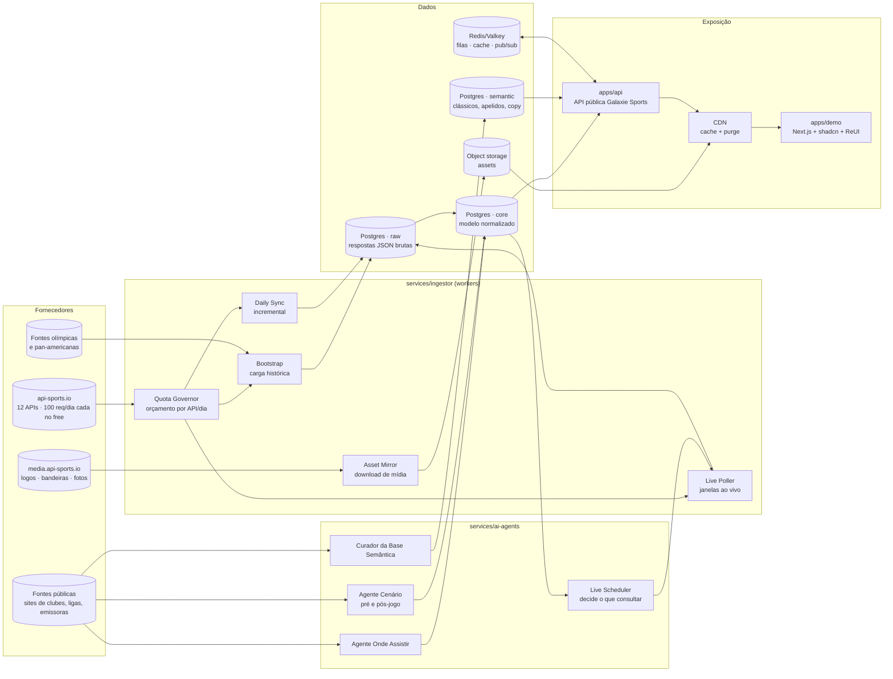
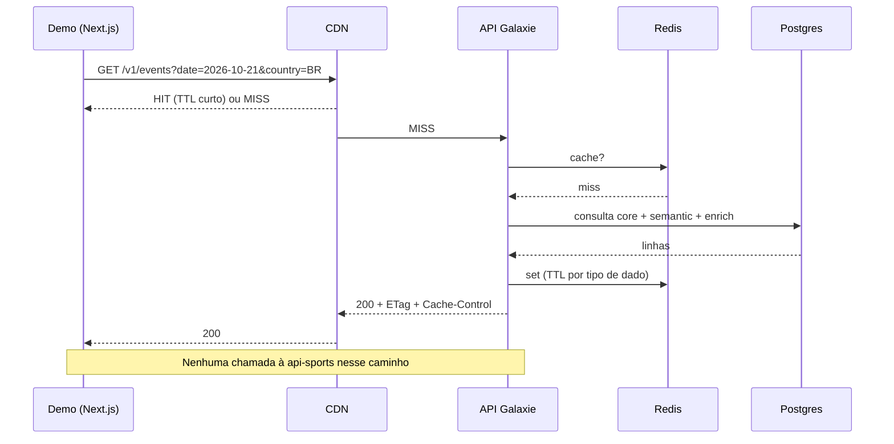
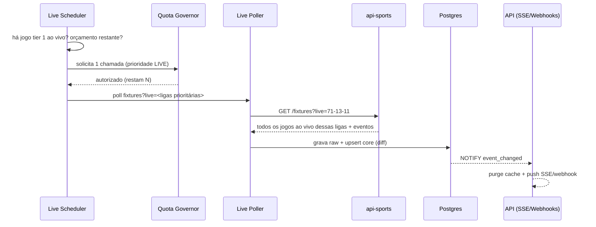
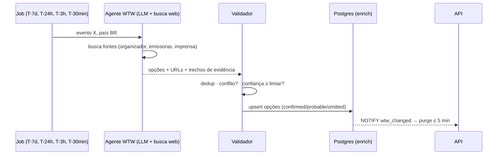

# 02 · Arquitetura

## 1. Visão geral



## 2. Componentes

| Componente | Responsabilidade | Tecnologia proposta |
|---|---|---|
| `apps/api` | API pública: espelho compatível com a api-sports (`/mirror/...`) + API canônica (`/v1/...`), autenticação por tenant, cache, SSE/webhooks | Node.js 24 + TypeScript, Fastify, Zod, OpenAPI 3.1 |
| `apps/demo` | App de demonstração que consome **apenas** a nossa API | Next.js (App Router), shadcn/ui, ReUI, Tailwind CSS, TanStack Query |
| `services/ingestor` | Workers de bootstrap, sync diário, live poller e espelho de assets, sob controle do Quota Governor | Node.js + BullMQ (filas em Redis/Valkey) |
| `services/ai-agents` | Agentes agendados: live scheduler, onde assistir, cenário pré/pós-jogo, curadoria semântica | Claude API / Claude Agent SDK com ferramenta de busca web |
| `packages/db` | Schema, migrations e seeds (inclui carga da base semântica YAML) | PostgreSQL 17, Drizzle ORM |
| `packages/apisports-client` | Cliente tipado da api-sports com contabilização de cota e gravação do raw | TypeScript |
| `packages/contracts` | Tipos/DTOs da API pública compartilhados com o demo | TypeScript + Zod → OpenAPI |
| `scripts/pwsh` | Utilitários operacionais em PowerShell 7 (download de assets, inspeção de cota) | PowerShell 7 |
| `data/knowledge` | Base semântica versionada em YAML (fonte da verdade editorial) | YAML + validação por JSON Schema |
| `config/competitions` | Catálogo de competições, tiers e prioridades de live | YAML |

## 3. Estrutura do monorepo (alvo)

```
galaxie-sports/
├── apps/
│   ├── api/                  # API pública
│   └── demo/                 # app de demonstração (shadcn + ReUI)
├── services/
│   ├── ingestor/             # bootstrap, daily-sync, live-poller, asset-mirror
│   └── ai-agents/            # live-scheduler, where-to-watch, match-context, kb-curator
├── packages/
│   ├── db/                   # schema Drizzle, migrations, seeds
│   ├── apisports-client/     # cliente tipado + quota ledger
│   └── contracts/            # DTOs e OpenAPI
├── config/
│   └── competitions/         # catálogo de competições por esporte
├── data/
│   └── knowledge/            # base semântica (YAML)
├── scripts/
│   └── pwsh/                 # scripts PowerShell operacionais
├── infra/
│   ├── docker-compose.yml    # Postgres, Redis, MinIO, API, workers
│   └── portainer/            # stacks para VPS
└── docs/                     # esta documentação
```

Gerenciado com **pnpm workspaces + Turborepo**.

## 4. Camadas de dados

| Camada | Schema | Conteúdo | Regra |
|---|---|---|---|
| **Raw (bronze)** | `raw` | Resposta JSON integral de cada chamada à api-sports, com endpoint, parâmetros, hash, headers de cota e `fetched_at` | Imutável; nunca é apagada. Permite reprocessar tudo sem gastar cota |
| **Core (silver)** | `core` | Modelo normalizado por esporte (`football_fixture`, `basketball_game`…) + entidade canônica `event` | Upsert idempotente a partir do raw |
| **Semantic** | `semantic` | Clássicos, apelidos, gritos, competições, copy por locale | Carregado do YAML versionado; edição editorial via PR |
| **Enrichment** | `enrich` | Saídas de IA: onde assistir, cenários, resumos — com fonte e confiança | Versionado; nunca sobrescreve `core` |
| **Serving** | views/materialized views + cache Redis | Respostas prontas da API pública | Invalidação por evento de mudança |

Detalhes em [04-modelo-de-dados.md](04-modelo-de-dados.md).

## 5. Fluxos principais

### 5.1 Requisição do app de demonstração



### 5.2 Atualização ao vivo



### 5.3 Onde assistir



## 6. Decisões de arquitetura (ADRs resumidos)

| # | Decisão | Alternativas consideradas | Motivo |
|---|---|---|---|
| ADR-01 | Guardar **toda** resposta bruta (raw) antes de normalizar | Normalizar direto | Reprocessamento sem custo de cota; auditoria; compatibilidade 1:1 com a estrutura da api-sports |
| ADR-02 | Expor um **espelho compatível** (`/mirror/{sport}/...`) além da API canônica | Só API canônica | Times que já conhecem a api-sports usam a mesma estrutura; demo pode trocar a URL base |
| ADR-03 | PostgreSQL com JSONB como banco único | MongoDB + SQL | Um só motor para raw (JSONB) e relacional; menos operação |
| ADR-04 | Quota Governor central com orçamento por prioridade | Chamadas livres por worker | Plano free = 100/dia/API; sem governança a cota acaba antes do jogo |
| ADR-05 | IA somente para enriquecimento, nunca para fatos ao vivo | IA gerando placar/narração | Risco de alucinação em dado factual sensível |
| ADR-06 | Base semântica em YAML versionado no Git | CMS | Revisão por PR, histórico, diffs legíveis; CMS pode vir depois |
| ADR-07 | SSE + webhooks para mudanças | Polling do cliente | Correções de "onde assistir" em ≤ 5 min e placares sem reload |
| ADR-08 | Deploy inicial em VPS com Docker/Portainer | Kubernetes gerenciado | Custo e velocidade ("tempo recorde"); migração posterior possível |
| ADR-09 | **Camada de provedores plugável** (api-sports é o primeiro, não o único) | Acoplar o core à api-sports | Os termos da api-sports proíbem revender os dados; em produção usamos um provedor licenciado — **candidato principal: Sportmonks (contrato Enterprise com redistribuição)** — ou o que o cliente já licencia, mantendo semântica, onde assistir e IA |
| ADR-10 | Bootstrap com **plano Pro por 30 dias**, manutenção no free | Só free | O free não acessa a temporada atual nem `ids=`; Pro custa US$ 19 e faz em ~3 dias o que o free levaria um ano |

## 7. Requisitos não funcionais

| Requisito | Alvo |
|---|---|
| Disponibilidade da API | 99,9% (mensal) |
| Latência p95 (cache quente) | ≤ 150 ms |
| Propagação de mudança ao vivo (fonte → cliente) | ≤ 5 s após ingestão |
| Propagação de correção de "onde assistir" | ≤ 5 min |
| Resiliência a falha do fornecedor | Last-known-good + transição temporal por horário previsto |
| Observabilidade | Logs estruturados, métricas (Prometheus/OpenTelemetry), painel de cota por API |
| Segurança | API keys por tenant, rate limit por tenant, segredos fora do repositório |
| Localização | 8 locales (pt-BR, es-AR, es-MX, es-CO, es-CL, es-PE, es-UY, es-EC) |

## 8. Ambientes e deploy

| Ambiente | Onde | Dados |
|---|---|---|
| `local` | Docker Compose (`infra/docker-compose.yml`) | Snapshot do raw (dump) — zero chamadas ao fornecedor |
| `staging` | VPS + Portainer | Ingestão real com chave free |
| `production` | VPS dedicada ou nuvem gerenciada | Plano pago do fornecedor + CDN |

Variáveis de ambiente principais (nunca versionadas):

```dotenv
APISPORTS_KEY=...                 # chave do dashboard api-sports (vale para todas as APIs)
DATABASE_URL=postgres://...
REDIS_URL=redis://...
S3_ENDPOINT=... S3_BUCKET=galaxie-sports-assets
ANTHROPIC_API_KEY=...             # agentes de IA
QUOTA_RESERVE_PERCENT=15          # reserva de segurança por API/dia
```
