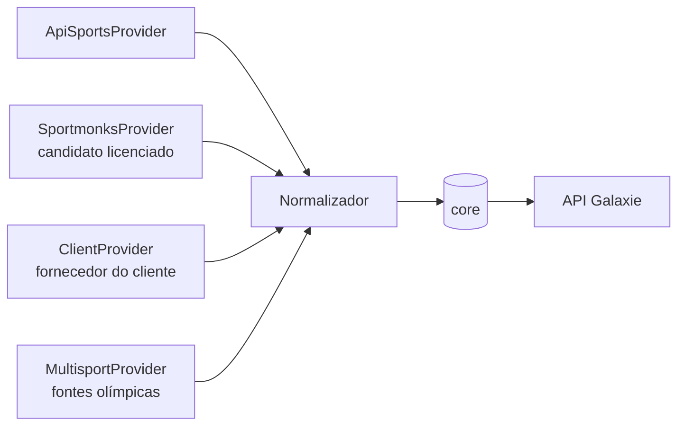
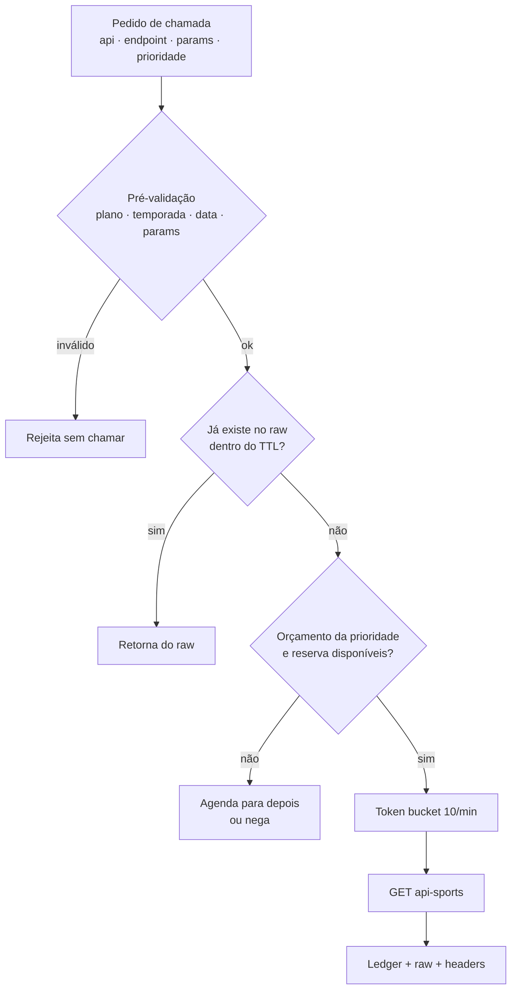

# 03 · Ingestão e economia de chamadas

> Objetivo: ter uma **cópia interna de absolutamente tudo** o que a api-sports oferece, com a mesma estrutura, e mantê-la atualizada diariamente e ao vivo **gastando o mínimo de requisições**.
>
> Pesquisas de base (com fontes e evidências): [research/api-sports-football.md](research/api-sports-football.md) · [research/api-sports-outros-esportes.md](research/api-sports-outros-esportes.md).

## 1. As regras do jogo (plano gratuito, out/2026)

| Item | Valor | Impacto no desenho |
|---|---|---|
| Cota | **100 requisições/dia por API** (cada esporte tem a sua) | 12 APIs × 100 = 1.200/dia no total, sem transferência entre esportes |
| Limite por minuto | **10/min** | Token bucket de 1 chamada a cada 6 s por API |
| Reset | **00:00 UTC** | Jobs pesados rodam logo após a meia-noite UTC (21h em Brasília) |
| `/status` | **Não conta** na cota | Reconciliação de contagem e painel de cota gratuitos |
| Paginação | **Cada página = 1 requisição**; no free, `page ≤ 3` | Evitar endpoints paginados; preferir chamadas "largas" |
| Erros | HTTP 200 com objeto `errors`; recusas por plano **provavelmente consomem cota** | **Pré-validar** temporada, data e parâmetros antes de chamar |
| Temporadas no free (futebol) | **Só 2022, 2023 e 2024** em qualquer endpoint com `season` | A temporada atual **não** pode ser listada por `season` |
| Janela de datas no free | `date=` só aceita **ontem, hoje e amanhã (UTC)** | A temporada corrente só pode ser construída **daqui para frente** |
| Parâmetros bloqueados no free | `ids`, `last`, `next` | Detalhe de partida custa 1 chamada por jogo (`fixtures?id=`) |
| Mídia (`media.api-sports.io`) | **Não conta** na cota; tem limite por segundo/minuto | Assets espelhados a partir das URLs presentes no raw |
| Webhooks/push | **Não existem** | Ao vivo é sempre polling |
| Múltiplas contas | **Proibido** para somar cota | Não fazemos. Ponto. |

A janela de temporadas do free se desloca (2021–2023 em 2025 → 2022–2024 em 2026); é provável que vá para 2023–2025 no início de 2027. O Quota Governor lê a mensagem de erro e se ajusta.

### 1.1 Validação com a nossa chave (21/10/2026)

Executado com ~10 chamadas do futebol e 1 de basquete, hóquei e vôlei; **todas as respostas foram guardadas** em `data/raw/` (fora do Git) e entram no bootstrap.

| Teste | Resultado |
|---|---|
| `/status` das 12 APIs | Todas **Free**, 100/dia, **cota separada por esporte**; `/status` **não consome** cota. A assinatura free mostra data de fim (25/10/2026) — acompanhar se renova sozinha |
| `/leagues` sem parâmetros | **1.249 competições**, até 17 temporadas cada (Série A: 2010 → 2026) — 1 chamada |
| `fixtures?league=71&season=2026` | ❌ `Free plans do not have access to this season, try from 2022 to 2024.` |
| `fixtures?league=71&season=2024` | ✅ 380 jogos numa resposta, sem paginação |
| `fixtures?date=2026-10-21` | ✅ 273 jogos do mundo (26 de competições do nosso catálogo) |
| `fixtures?date=2026-10-17` | ❌ `try from 2026-10-20 to 2026-10-22` — janela confirmada: **ontem → amanhã** |
| **`fixtures/headtohead?h2h=121-131`** (Palmeiras × Corinthians) | ✅ **46 jogos de 2010 a 2026, inclusive a temporada atual** (Série A, Paulistão, Copa do Brasil). O `h2h` **não** sofre a restrição de temporadas |
| `players/squads?team=121` | ✅ elenco atual (sem `season`) |
| `transfers?team=121` | ✅ 388 transferências — histórico inteiro |
| `teams?country=Brazil` | ✅ **1.596 times** numa resposta |
| `games?date=` em basquete / hóquei / vôlei | ✅ 140 / 96 / 44 jogos — hóquei **aceita** `date` sem `season` (o relato contrário não se confirmou) |
| Erros de plano consomem cota? | **Inconclusivo**: as respostas de erro vieram sem headers de cota e a contagem final (90 restantes após 11 envios, 2 erros e 1 *timeout*) sugere que erros não são cobrados. O `/status` e o header `x-ratelimit-requests-remaining` são **eventualmente consistentes** (oscilam entre chamadas) — o `ops.quota_ledger` próprio é a fonte da verdade |
| Respostas grandes | `fixtures?date=` com `timezone` excedeu 60 s de *timeout* — usar *timeout* ≥ 180 s e UTC |

**Consequência prática — o `h2h` como chave-mestra do histórico.** Como `fixtures/headtohead` devolve todos os confrontos entre dois times em todas as competições e temporadas (inclusive a atual), uma liga de 20 clubes tem 190 pares: **190 chamadas reconstroem todo o histórico de confrontos da liga desde 2010, incluindo os jogos já disputados da temporada corrente** — algo que o `season` bloqueado não permite. Para o Brasileirão, isso cabe em 2 dias de cota free. É uso legítimo de um endpoint documentado dentro da cota (não contorna limites), mas o fornecedor pode mudar esse comportamento; o Quota Governor deve detectar se o `h2h` passar a filtrar temporadas.

### 1.2 Como era possível "baixar todos os anos com uma requisição"

Até ago/2024 o plano gratuito não restringia temporadas. Além disso, alguns endpoints **não têm parâmetro de temporada** e devolvem a história inteira numa chamada — continuam funcionando no free:

| Chamada única | O que traz |
|---|---|
| `GET /leagues` (sem parâmetros) | **Todas** as ~1.200 competições × **todas** as temporadas × `coverage` de cada uma |
| `GET /fixtures/headtohead?h2h=A-B` | Todos os confrontos históricos entre dois times |
| `GET /transfers?team=X` | Todo o histórico de transferências do clube |
| `GET /coachs?team=X` | Técnicos com a carreira completa |
| `GET /players/teams?player=X` | Todos os times e temporadas da carreira |
| `GET /trophies?players=a-b-…` / `/sidelined?players=…` | Títulos e afastamentos de até 20 pessoas |
| `GET /teams?country=X` / `/venues?country=X` | Todos os times / estádios de um país |
| `GET /players/squads?team=X` | Elenco atual |
| `GET /fixtures?date=D` | Todos os jogos do mundo naquele dia |
| `GET /fixtures?live=all` | Todos os jogos ao vivo do mundo, com eventos |

## 2. Estratégia recomendada: "Pro por um mês, free para sempre"

A única forma limpa (sem violar termos) de ter **a temporada atual completa e o histórico profundo** é uma **assinatura curta do plano Pro** (US$ 19/mês, 7.500/dia, 300/min, todas as temporadas, `ids=` liberado) durante o bootstrap. Depois, a manutenção roda no free — ou num plano pago, se o live a 15 s for necessário.

```mermaid
flowchart LR
  subgraph Fase A — Pro 30 dias
    A1[Catálogo global] --> A2[Temporadas completas<br/>atual + histórico]
    A2 --> A3[Detalhe em lotes<br/>fixtures?ids= ×20]
    A3 --> A4[Pessoas e times<br/>squads · transfers · trophies · sidelined]
    A4 --> A5[H2H de todos os clássicos]
  end
  subgraph Fase B — Free contínuo
    B1[fixtures?date= D-1 · D0 · D+1] --> B2[Detalhe dos encerrados<br/>fixtures?id=]
    B2 --> B3[Tabelas calculadas localmente]
    B1 --> B4[Live por janela<br/>fixtures?live=ligas]
  end
  A5 --> B1
```

| Comparação | Só free | Pro por 30 dias + free |
|---|---|---|
| Temporada atual completa | ❌ só daqui para frente | ✅ |
| Histórico 2022–2024 (40 competições) com detalhe | ~1 ano de cota | < 1 dia |
| Histórico anterior a 2022 | ❌ | ✅ (até onde houver cobertura) |
| Custo | US$ 0 | US$ 19 (+ US$ 19 por esporte adicional que precise do mesmo) |

> ⚠️ **Licença**: os termos permitem uso interno com cache e **proíbem revender/vender diretamente os dados**. Construir um produto próprio é permitido; **oferecer os dados a terceiros como API comercial exige acordo por escrito com o fornecedor** ou outra fonte licenciada. Por isso a arquitetura tem uma **camada de provedores plugável** (§8) e o espelho api-sports é a base de **desenvolvimento e demonstração**. Ver [11](11-seguranca-licenciamento-e-compliance.md).

## 3. Fase A — Bootstrap do futebol (plano Pro)

Ordem de execução e custo estimado para as **76 competições** do catálogo (46 tier 1 + 30 tier 2):

| # | Passo | Chamadas | Observação |
|---|---|---|---|
| 1 | Referência global: `/timezone`, `/countries`, `/leagues`, `/leagues/seasons`, `/teams/countries`, `/odds/bookmakers`, `/odds/bets`, `/odds/live/bets` | 8 | Uma vez; `/leagues` depois 1×/dia |
| 2 | Por competição × temporada: `fixtures?league&season`, `teams?league&season` (traz o estádio), `standings`, `fixtures/rounds?dates=true`, `injuries?league&season`, 4 rankings (`players/top*`) | 9 por temporada | Ler `coverage` antes: não chamar o que é `false` |
| 3 | Detalhe de partidas: `fixtures?ids=` com 20 jogos | jogos ÷ 20 | Eventos, escalações, estatísticas e jogadores embutidos |
| 4 | Estatísticas de jogadores: `players?league&season` (20/pág.) | ~30 por temporada | Só tier 1; tier 2 usa o que vem no detalhe da partida |
| 5 | Por time: `players/squads`, `coachs?team`, `transfers?team` | 3 por time | ~1.100 times únicos |
| 6 | Por pessoa em lotes de 20: `trophies?players`, `sidelined?players` | 2 por 20 pessoas | Somente elencos atuais tier 1 |
| 7 | H2H de todos os clássicos da base semântica: `fixtures/headtohead?h2h=` | 1 por clássico | ~100 clássicos |
| 8 | `venues?country` para os países do catálogo | 1 por país | ~30 |

> ✅ **Passo 1 executado em 21/10/2026** (`pnpm --filter @galaxie/ingestor bootstrap:catalog`): 170 países, **1.249 competições**, **8.781 temporadas** com cobertura e 1.418 logos/bandeiras registrados para o Asset Mirror — custo de **6 chamadas** (`/countries` e `/leagues` vieram do raw). As 76 competições de `config/competitions/football.yaml` conferem com o `/leagues` real. Como a política padrão protege 80 chamadas para DAILY/LIVE e cede só 5 ao BOOTSTRAP, o job aceita `--sem-live` para planejar o dia sem ao vivo enquanto não houver jogos sendo acompanhados.

**Estimativa** (temporada atual + 5 temporadas históricas para tier 1; atual + 2 para tier 2):

| Bloco | Cálculo | Chamadas |
|---|---|---|
| Listas por temporada | (46 × 6 + 30 × 3) × 9 | ≈ 3.300 |
| Detalhe de partidas | ≈ 110.000 jogos ÷ 20 | ≈ 5.500 |
| Jogadores tier 1 | 46 × 6 × 30 | ≈ 8.300 |
| Times (squads/coachs/transfers) | 1.100 × 3 | ≈ 3.300 |
| Pessoas (trophies/sidelined) | ≈ 15.000 ÷ 20 × 2 | ≈ 1.500 |
| H2H + venues + referência | | ≈ 150 |
| **Total** | | **≈ 22.000 → ~3 dias de Pro** |

Com 30 dias de Pro, sobra cota para estender o histórico (todas as temporadas disponíveis das competições tier 1) e para fazer o mesmo nas outras APIs que precisarem.

### 3.1 Alternativa só com plano gratuito

Se o Pro não for contratado, o bootstrap do futebol fica assim:

| Bloco | Custo no free | Tempo |
|---|---|---|
| Referência global | 8 | 1 dia |
| Listas 2022–2024 das competições tier 1 (46 × 3 × 9) | ≈ 1.250 | ~15 dias (85 úteis/dia) |
| Detalhe 2022–2024 | 1 por jogo (sem `ids`) | inviável em escala → **só clássicos e jogos decisivos** |
| Temporada atual | **não listável por `season`**; reconstruída via `fixtures/headtohead` por par de clubes (190 chamadas por liga de 20 times, todas as temporadas desde 2010) + `fixtures?date=` daqui para frente | ~2 dias por liga |
| Elencos atuais (`players/squads?team`) | ≈ 700 times tier 1 | ~8 dias |

## 4. Fase B — Atualização diária (free)

Executada às 00:05 UTC pelo **Daily Sync**, sob o Quota Governor:

| Item | Chamadas/dia | Detalhe |
|---|---|---|
| `fixtures?date=` ontem, hoje e amanhã | 3 | Cobre **todas** as competições do mundo; filtragem local pelo catálogo |
| `injuries?date=` hoje (+ amanhã) | 1–2 | Desfalques do dia no mundo |
| `/leagues` | 1 | Novas temporadas e `coverage` |
| `/status` | 0 | Reconciliação |
| Detalhe dos jogos encerrados ontem (`fixtures?id=`) | 35–45 | Prioridade: tier 1 → clássicos → tier 2 |
| Rodízio de entidades (squads, transfers, coachs, trophies/sidelined em lotes de 20) | 5–10 | Ciclo semanal/mensal |
| `predictions?fixture=` (opcional) | 0–5 | Jogos-chave |
| **Subtotal** | **≈ 50–65** | Sobram ~35–50 para o ao vivo |

Regras de economia aplicadas pelo `packages/apisports-client`:

1. **Nunca chamar duas vezes** a mesma `request_hash` dentro do TTL do endpoint (tabela abaixo).
2. **Pré-validar** temporada/data/parâmetros contra as restrições do plano vigente.
3. **Ler `coverage`** antes de pedir eventos, escalações, estatísticas, jogadores, injuries ou odds.
4. **Tabelas da temporada atual são calculadas localmente** a partir dos resultados (o free não acessa `standings` da temporada corrente); com o bootstrap Pro, partimos da tabela completa e só aplicamos os novos resultados.
5. **Fila de detalhe com prioridade**: em fins de semana com 150–250 jogos, tier 2 pode atrasar 1–3 dias — o card mostra o placar (que veio no `fixtures?date=`) e o detalhe chega depois.

| Endpoint | TTL no cache (sem mudança esperada) |
|---|---|
| `/leagues`, `/countries`, `/timezone` | 24 h |
| `/teams`, `/venues`, `/coachs`, `/transfers`, `/players/squads` | 7 dias (rodízio) |
| `fixtures?date=` passado (≥ D-2) | imutável após detalhe completo |
| `fixtures?id=` de jogo `FT` | imutável |
| `fixtures/headtohead` | 7 dias, ou invalidação quando um novo confronto termina |

## 5. Ao vivo

| Cenário | Chamadas | Intervalo resultante |
|---|---|---|
| Free: 45 chamadas numa janela de 10 h (sábado) | 45 | ~13 min |
| Free: 45 chamadas num pico de 3 h (quarta 19h–22h BRT) | 45 | ~4 min |
| Free: 1 jogo prioritário (110 min) com 45 chamadas | 45 | ~2,5 min |
| Pro (7.500/dia): janela de 8 h a cada 15 s | ~1.920 | **15 s** (igual à fonte) |

- Uma chamada `fixtures?live=<ids das ligas com jogo na janela>` traz **todos** os jogos ao vivo dessas ligas com placar, minuto, status e **eventos**.
- Escalações e estatísticas ao vivo exigem `fixtures?id=` por jogo — no free, só para o jogo mais importante da janela.
- O **Live Scheduler** ([07](07-ia-tempo-real-e-enriquecimento.md#21-live-scheduler-o-agendamento-inteligente)) calcula as janelas e o intervalo; o LLM só reordena prioridades quando há mais jogos relevantes do que orçamento.

**Conclusão honesta**: com o free dá para demonstrar um "quase ao vivo" (minutos). Para o produto vendido com SLA de placar ≤ 30 s, é necessário plano pago (ou o provedor licenciado do cliente).

## 6. Demais esportes

Cada uma das outras 11 APIs tem **cota própria de 100/dia**, então o bootstrap roda em paralelo. Padrão comum (detalhes, endpoints e restrições por esporte em [research/api-sports-outros-esportes.md](research/api-sports-outros-esportes.md)):

| Passo | Chamada típica | Rendimento |
|---|---|---|
| Catálogo | `/countries`, `/leagues` (todas as ligas com temporadas), `/seasons` | 2–3 chamadas |
| Temporada inteira | `games?league&season` (F1: `races?season`; MMA: `fights?date`/`fights?season`) | 1 chamada por liga-temporada |
| Tabelas/rankings | `standings?league&season` (F1: `rankings/drivers`, `rankings/teams`) | 1 por liga-temporada |
| Agenda diária | `games?date=` | 1 chamada = todos os jogos do dia daquele esporte |
| Ao vivo | `games?live=all` só em **NFL e NBA**; nos demais, `games?date=hoje` (1 chamada cobre todas as ligas; fonte atualiza a cada 15 s) | 1 chamada por *tick* |

Particularidades confirmadas:

- **Mesma restrição do futebol**: no free só 2022–2024 por `season`; temporada atual apenas pela janela de datas ontem → amanhã. Relato indica que hóquei e NFL recusam `date` sem `season` — se confirmado, o free não dá temporada atual nesses dois.
- **Sem paginação**: uma chamada devolve a temporada inteira (ex.: 2.946 jogos da MLB, 1.387 da NBA na API de basquete, 637 lutas de MMA).
- **Mídia**: o vôlei usa o caminho `/volley/` (não `/volleyball/`); os logos da NBA v2 apontam para Wikimedia, não para `media.api-sports.io` — o script de assets ignora URLs fora da CDN da api-sports e esses logos precisam de tratamento à parte (licença Wikimedia).
- **Cobertura LatAm/olímpica** (IDs confirmados em `/leagues`): basquete — NBB 26, Liga A 18, Champions League Americas 299, AmeriCup 282, Olimpíadas 192/193, Pan-Americano 286/294, Copa do Mundo 281; vôlei — Superliga 25 (masc.) / 24 (fem.), LVA 4, VNL 183/184, Pan-Americano 195/213; beisebol — LMB, LIDOM, LVBP, Série do Caribe, WBC; handebol — só torneios internacionais (sem ligas BR/AR).

Prioridade latino-americana: basquete (NBB, Liga A argentina, NBA), vôlei (Superliga brasileira, LVA, VNL), Fórmula 1, beisebol caribenho/mexicano e MMA.

## 7. Assets (escudos, bandeiras, estádios, jogadores, técnicos…)

URLs de mídia **não consomem cota**. Padrões do futebol:

| Asset | URL |
|---|---|
| Bandeira | `https://media.api-sports.io/flags/{code}.svg` (ex.: `br`, `gb-eng`) |
| Liga/copa | `https://media.api-sports.io/football/leagues/{id}.png` |
| Time | `https://media.api-sports.io/football/teams/{id}.png` |
| Estádio | `https://media.api-sports.io/football/venues/{id}.png` |
| Jogador | `https://media.api-sports.io/football/players/{id}.png` |
| Técnico | `https://media.api-sports.io/football/coachs/{id}.png` |

O script [`scripts/pwsh/Sync-ApiSportsAssets.ps1`](../scripts/pwsh/Sync-ApiSportsAssets.ps1) **não adivinha IDs**: ele varre as respostas JSON do raw e extrai toda URL `media.api-sports.io` — funciona para os 12 esportes e qualquer tipo de imagem. É idempotente (só baixa o que falta), registra 404 para não repetir, grava `manifest.csv` com SHA-256 e respeita o limite da CDN com paralelismo baixo e *backoff*.

```powershell
# 1) exportar o raw para JSON (comando do monorepo)
pnpm raw:export --out ./data/raw
# 2) espelhar os assets
./scripts/pwsh/Sync-ApiSportsAssets.ps1 -SourcePath ./data/raw -Destination ./data/assets -ThrottleLimit 4
```

Os arquivos vão para o object storage (`core.asset`) e a API reescreve as URLs para o nosso CDN.

> Escudos e marcas pertencem a clubes e ligas; o fornecedor os disponibiliza só para identificação. Uso comercial final exige validação jurídica. Atenção: o "logo" que a api-sports serve para o Paulistão (liga 475) é o escudo de um clube homônimo — não usar.

## 8. Camada de provedores (pronta para produção)



- Cada provedor implementa a mesma interface (`listCompetitions`, `listEvents`, `getEventDetail`, `listLive`…) e grava seu próprio raw.
- `core.provider_map` liga IDs de vários provedores à mesma entidade.
- Em produção, o cliente pode usar **o provedor de dados que já licencia**; a camada semântica, o onde assistir e a IA continuam idênticos.

Implementação (issue #23) — pacote `@galaxie/providers`:

- **Interface `SportsDataProvider`**: `listCompetitions`, `listEvents` (temporada, dia ou confronto), `getEventDetail`, `listLive`, `listParticipants`, `listSquad`, `listCoaches`, `listStandings`. Cada consulta devolve `ok` (lote normalizado), `empty` ou `error` (classificado: `http_error`, `timeout`, `plan`, `quota`, `rate_limited`, `auth`…); nunca lança por falha da fonte.
- **Lote neutro (`NormalizedBatch`)**: competições, temporadas como `(competição, ano)`, fases, estádios, participantes, pessoas, eventos (com a observação de estado), timeline, elencos e classificação — tudo referenciado pelo ID **do provedor**. O ingestor (`upsertBatch`) resolve esses IDs via `core.provider_map` e grava o core; `ingestProviderResult` transforma `empty`/`error` em *last-known-good* (docs/04 §3.1).
- **`ApiSportsProvider`** é a primeira implementação (usa o `ApiSportsClient`, então todo raw fica em `raw.api_response` com `provider = 'api-sports'`); `FakeProvider` prova o contrato nos testes.
- **Mesmo evento em dois provedores**: um evento novo de um provedor é ligado a um evento existente quando os participantes (já vinculados no `provider_map`) são os mesmos e o início difere em até 3 h — sem duplicar a entidade.
- **Precedência**: lista ordenada de provedores (`PrecedencePolicy`, padrão `['api-sports']`). Quem tem precedência igual ou maior sobrescreve o estado do evento (`core.event.source_provider`); um provedor de menor precedência só assume quando o dono está `is_stale` ou sem dado novo há mais de 10 min. Cadastros (times, pessoas, estádios) seguem o coalesce de docs/04 §3.4.

### 8.1 Sportmonks como provedor de produção (candidato)

Pesquisa completa: [research/sportmonks.md](research/sportmonks.md).

| Ponto | Sportmonks | api-sports |
|---|---|---|
| Esportes | Futebol (2.200+ ligas), críquete, Fórmula 1 | 12 APIs |
| Preço de prateleira (futebol) | Starter €29 (5 ligas) · Growth €99 (30) · **Pro €249 (120 ligas)** · Enterprise sob consulta | Free · Pro US$ 19 · Ultra 29 · Mega 39 |
| Cota | 2.000–5.000 chamadas **por entidade por hora** | 100–150.000 por dia |
| Histórico | 3 temporadas nos planos self-serve; anterior é *add-on* | Todas no pago; 2022–2024 no free |
| Ao vivo | Polling (`/livescores/latest` a cada 10 s; ~15 s evento→API); sem webhooks | Polling (15 s); sem webhooks |
| **TV Stations** | ✅ emissoras por jogo e país em todos os planos — cobertura e precisão **não documentadas** | ❌ |
| **Redistribuição B2B** | **Só com aprovação por escrito** ("Redistribution as a feed needs written approval") → contrato Enterprise | Proibida (revenda) |
| Imagens | Logos e fotos **não** licenciados pela Sportmonks | Só para identificação |

Lacunas para o nosso catálogo: futebol olímpico sem ao vivo; Copa do Brasil e Sul-Americana sem tabela/artilharia; estaduais sem estatísticas avançadas (Carioca, Baiano, Paranaense, Pernambucano e Catarinense também sem escalações); Liga BetPlay sem escalações; Liga MX sem artilharia; Eliminatórias CONMEBOL sem escalações. Nesses pontos, o espelho api-sports ou o cálculo local continuam úteis.

Implicações para o `SportmonksProvider`: montagem de `include`/`filters`, paginação por cursor, buckets de limite por entidade/hora, conversão ano → `season_id`, tabela de IDs por provedor e mapeamento dos 25 status de partida para o nosso enum (detalhado na pesquisa).

## 9. Quota Governor



| Prioridade | Fatia diária padrão (free) | Pode emprestar de |
|---|---|---|
| LIVE | 45% | BOOTSTRAP, ADHOC |
| DAILY | 40% | — |
| BOOTSTRAP | 0% (dias sem live: até 85%) | — |
| ADHOC (*miss* do espelho) | 0–5% | — |
| Reserva | 10–15% | só LIVE em decisões |

Implementação: [`packages/apisports-client`](../packages/apisports-client/README.md) (`PgQuotaGovernor`, `ApiSportsClient`). Relatório de cota do dia: `pnpm --filter @galaxie/ingestor quota`.

## 10. Pendências de validação (issue de spike)

Testar com a nossa chave:

- Se requisições recusadas por plano ou por limite/min consomem cota.
- Se `injuries?ids`, `odds/live` e `odds?date` funcionam no free.
- Se a janela de datas segue UTC ou o parâmetro `timezone`.
- Se a assinatura free (data de fim 25/10/2026 no `/status`) renova automaticamente.
- Repetir o teste de erros × cota com o ledger próprio ligado.

Já validados em 21/10/2026 (ver §1.1): cota separada por esporte, `/status` gratuito, janela de datas, temporadas 2022–2024, `h2h` com todas as temporadas, hóquei aceitando `date` sem `season`.
