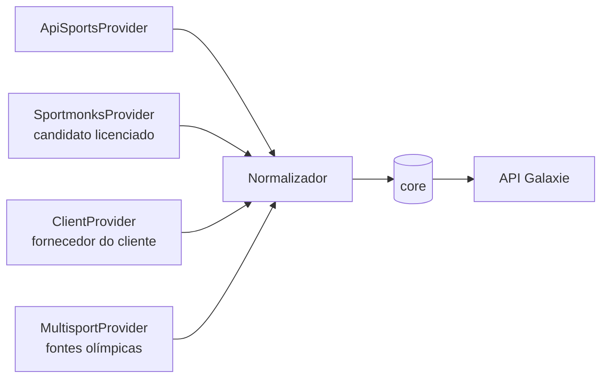
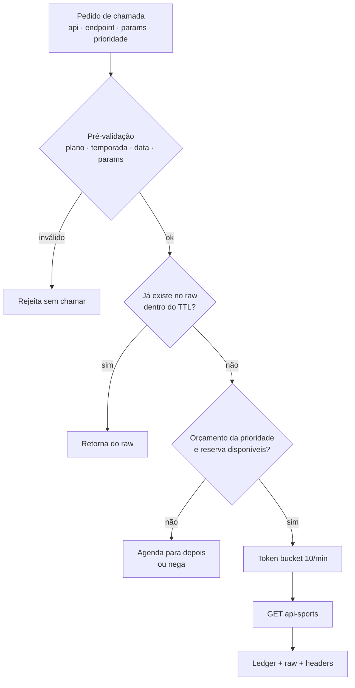

# 03 · Ingestão e economia de chamadas

> Objetivo: ter uma **cópia interna de absolutamente tudo** o que a api-sports oferece, com a mesma estrutura, e mantê-la atualizada diariamente e ao vivo **gastando o mínimo de requisições**.
>
> Pesquisas de base (com fontes e evidências): [research/api-sports-football.md](research/api-sports-football.md) · [research/api-sports-outros-esportes.md](research/api-sports-outros-esportes.md).

## 1. As regras do jogo (plano gratuito, out/2026)

| Item | Valor | Impacto no desenho |
|---|---|---|
| Cota | **100 requisições/dia por API** (cada esporte tem a sua) | 12 APIs × 100 = 1.200/dia no total, sem transferência entre esportes |
| Limite por minuto | **10/min** | 1 chamada a cada 6 s por API, somando todos os processos (token bucket local + vaga no ledger sob o lock do Governor) |
| Reset | **00:00 UTC** | Jobs pesados rodam logo após a meia-noite UTC (21h em Brasília) |
| `/status` | **Não conta** na cota | Reconciliação de contagem e painel de cota gratuitos |
| Paginação | **Cada página = 1 requisição**; no free, `page ≤ 3` | Evitar endpoints paginados; preferir chamadas "largas" |
| Erros | HTTP 200 com objeto `errors`; recusas por plano **provavelmente consomem cota** | **Pré-validar** temporada, data e parâmetros antes de chamar |
| Temporadas no free (futebol) | **Só 2022, 2023 e 2024** em qualquer endpoint com `season` | A temporada atual **não** pode ser listada por `season` |
| Janela de datas no free | `date=` só aceita **ontem, hoje e amanhã (UTC)** | A temporada corrente só pode ser construída **daqui para frente** |
| Parâmetros bloqueados no free | `ids`, `last`, `next` | Detalhe de partida custa 1 chamada por jogo (`fixtures?id=`) |
| Mídia (`media.api-sports.io`) | **Não conta** na cota; tem limite por segundo/minuto | Assets espelhados a partir das URLs presentes no raw |
| Webhooks/push | **Não existem** | Ao vivo é sempre polling |
| Múltiplas contas | **Proibido** para somar cota | Não fazemos. Ponto. |

A janela de temporadas do free se desloca (2021–2023 em 2025 → 2022–2024 em 2026); é provável que vá para 2023–2025 no início de 2027. O Quota Governor lê a mensagem de erro e se ajusta.

### 1.1 Validação com a nossa chave (21/10/2026)

Executado com ~10 chamadas do futebol e 1 de basquete, hóquei e vôlei; **todas as respostas foram guardadas** em `data/raw/` (fora do Git) e entram no bootstrap.

| Teste | Resultado |
|---|---|
| `/status` das 12 APIs | Todas **Free**, 100/dia, **cota separada por esporte**; `/status` **não consome** cota. A assinatura free mostra data de fim (25/10/2026) — acompanhar se renova sozinha |
| `/leagues` sem parâmetros | **1.249 competições**, até 17 temporadas cada (Série A: 2010 → 2026) — 1 chamada |
| `fixtures?league=71&season=2026` | ❌ `Free plans do not have access to this season, try from 2022 to 2024.` |
| `fixtures?league=71&season=2024` | ✅ 380 jogos numa resposta, sem paginação |
| `fixtures?date=2026-10-21` | ✅ 273 jogos do mundo (26 de competições do nosso catálogo) |
| `fixtures?date=2026-10-17` | ❌ `try from 2026-10-20 to 2026-10-22` — janela confirmada: **ontem → amanhã** |
| **`fixtures/headtohead?h2h=121-131`** (Palmeiras × Corinthians) | ✅ **46 jogos de 2010 a 2026, inclusive a temporada atual** (Série A, Paulistão, Copa do Brasil). O `h2h` **não** sofre a restrição de temporadas |
| `players/squads?team=121` | ✅ elenco atual (sem `season`) |
| `transfers?team=121` | ✅ 388 transferências — histórico inteiro |
| `teams?country=Brazil` | ✅ **1.596 times** numa resposta |
| `games?date=` em basquete / hóquei / vôlei | ✅ 140 / 96 / 44 jogos — hóquei **aceita** `date` sem `season` (o relato contrário não se confirmou) |
| Erros de plano consomem cota? | **Inconclusivo**: as respostas de erro vieram sem headers de cota e a contagem final (90 restantes após 11 envios, 2 erros e 1 *timeout*) sugere que erros não são cobrados. O `/status` e o header `x-ratelimit-requests-remaining` são **eventualmente consistentes** (oscilam entre chamadas) — o `ops.quota_ledger` próprio é a fonte da verdade |
| Respostas grandes | `fixtures?date=` com `timezone` excedeu 60 s de *timeout* — usar *timeout* ≥ 180 s e UTC |

**Consequência prática — o `h2h` como chave-mestra do histórico.** Como `fixtures/headtohead` devolve todos os confrontos entre dois times em todas as competições e temporadas (inclusive a atual), uma liga de 20 clubes tem 190 pares: **190 chamadas reconstroem todo o histórico de confrontos da liga desde 2010, incluindo os jogos já disputados da temporada corrente** — algo que o `season` bloqueado não permite. Para o Brasileirão, isso cabe em 2 dias de cota free. É uso legítimo de um endpoint documentado dentro da cota (não contorna limites), mas o fornecedor pode mudar esse comportamento; o Quota Governor deve detectar se o `h2h` passar a filtrar temporadas.

### 1.2 Como era possível "baixar todos os anos com uma requisição"

Até ago/2024 o plano gratuito não restringia temporadas. Além disso, alguns endpoints **não têm parâmetro de temporada** e devolvem a história inteira numa chamada — continuam funcionando no free:

| Chamada única | O que traz |
|---|---|
| `GET /leagues` (sem parâmetros) | **Todas** as ~1.200 competições × **todas** as temporadas × `coverage` de cada uma |
| `GET /fixtures/headtohead?h2h=A-B` | Todos os confrontos históricos entre dois times |
| `GET /transfers?team=X` | Todo o histórico de transferências do clube |
| `GET /coachs?team=X` | Técnicos com a carreira completa |
| `GET /players/teams?player=X` | Todos os times e temporadas da carreira |
| `GET /trophies?players=a-b-…` / `/sidelined?players=…` | Títulos e afastamentos de até 20 pessoas |
| `GET /teams?country=X` / `/venues?country=X` | Todos os times / estádios de um país |
| `GET /players/squads?team=X` | Elenco atual |
| `GET /fixtures?date=D` | Todos os jogos do mundo naquele dia |
| `GET /fixtures?live=all` | Todos os jogos ao vivo do mundo, com eventos |

## 2. Estratégia recomendada: "Pro por um mês, free para sempre"

A única forma limpa (sem violar termos) de ter **a temporada atual completa e o histórico profundo** é uma **assinatura curta do plano Pro** (US$ 19/mês, 7.500/dia, 300/min, todas as temporadas, `ids=` liberado) durante o bootstrap. Depois, a manutenção roda no free — ou num plano pago, se o live a 15 s for necessário.

```mermaid
flowchart LR
  subgraph Fase A — Pro 30 dias
    A1[Catálogo global] --> A2[Temporadas completas<br/>atual + histórico]
    A2 --> A3[Detalhe em lotes<br/>fixtures?ids= ×20]
    A3 --> A4[Pessoas e times<br/>squads · transfers · trophies · sidelined]
    A4 --> A5[H2H de todos os clássicos]
  end
  subgraph Fase B — Free contínuo
    B1[fixtures?date= D-1 · D0 · D+1] --> B2[Detalhe dos encerrados<br/>fixtures?id=]
    B2 --> B3[Tabelas calculadas localmente]
    B1 --> B4[Live por janela<br/>fixtures?live=ligas]
  end
  A5 --> B1
```

| Comparação | Só free | Pro por 30 dias + free |
|---|---|---|
| Temporada atual completa | ❌ só daqui para frente | ✅ |
| Histórico 2022–2024 (40 competições) com detalhe | ~1 ano de cota | < 1 dia |
| Histórico anterior a 2022 | ❌ | ✅ (até onde houver cobertura) |
| Custo | US$ 0 | US$ 19 (+ US$ 19 por esporte adicional que precise do mesmo) |

> ⚠️ **Licença**: os termos permitem uso interno com cache e **proíbem revender/vender diretamente os dados**. Construir um produto próprio é permitido; **oferecer os dados a terceiros como API comercial exige acordo por escrito com o fornecedor** ou outra fonte licenciada. Por isso a arquitetura tem uma **camada de provedores plugável** (§8) e o espelho api-sports é a base de **desenvolvimento e demonstração**. Ver [11](11-seguranca-licenciamento-e-compliance.md).

## 3. Fase A — Bootstrap do futebol (plano Pro)

Ordem de execução e custo estimado para as **145 competições** do catálogo (46 tier 1 + 99 tier 2):

| # | Passo | Chamadas | Observação |
|---|---|---|---|
| 1 | Referência global: `/timezone`, `/countries`, `/leagues`, `/leagues/seasons`, `/teams/countries`, `/odds/bookmakers`, `/odds/bets`, `/odds/live/bets` | 8 | Uma vez; `/leagues` depois 1×/dia |
| 2 | Por competição × temporada: `fixtures?league&season`, `teams?league&season` (traz o estádio), `standings`, `fixtures/rounds?dates=true`, `injuries?league&season`, 4 rankings (`players/top*`) | 9 por temporada | Ler `coverage` antes: não chamar o que é `false` |
| 3 | Detalhe de partidas: `fixtures?ids=` com 20 jogos | jogos ÷ 20 | Eventos, escalações, estatísticas e jogadores embutidos |
| 4 | Estatísticas de jogadores: `players?league&season` (20/pág.) | ~30 por temporada | Só tier 1; tier 2 usa o que vem no detalhe da partida |
| 5 | Por time: `players/squads`, `coachs?team`, `transfers?team` | 3 por time | ~1.900 times únicos |
| 6 | Por pessoa em lotes de 20: `trophies?players`, `sidelined?players` | 2 por 20 pessoas | Somente elencos atuais tier 1 |
| 7 | H2H de todos os clássicos da base semântica: `fixtures/headtohead?h2h=` | 1 por clássico | ~100 clássicos |
| 8 | `venues?country` para os países do catálogo | 1 por país | ~30 |

> ✅ **Passo 1 executado em 21/10/2026** (`pnpm --filter @galaxie/ingestor bootstrap:catalog`): 170 países, **1.249 competições**, **8.781 temporadas** com cobertura e 1.418 logos/bandeiras registrados para o Asset Mirror — custo de **6 chamadas** (`/countries` e `/leagues` vieram do raw). As 76 competições de `config/competitions/football.yaml` daquele dia conferem com o `/leagues` real; as 69 do tier 2 acrescentadas em 22/10 (#166) foram conferidas no `/leagues` do raw. Como a política padrão protege 80 chamadas para DAILY/LIVE e cede só 5 ao BOOTSTRAP, o job aceita `--sem-live` para planejar o dia sem ao vivo enquanto não houver jogos sendo acompanhados.

**Estimativa** (temporada atual + 5 temporadas históricas para tier 1; atual + 2 para tier 2):

| Bloco | Cálculo | Chamadas |
|---|---|---|
| Listas por temporada | (46 × 6 + 99 × 3) × 9 | ≈ 5.200 |
| Detalhe de partidas | (≈ 110.000 + ≈ 22.000) jogos ÷ 20 | ≈ 6.600 |
| Jogadores tier 1 | 46 × 6 × 30 | ≈ 8.300 |
| Times (squads/coachs/transfers) | 1.900 × 3 | ≈ 5.700 |
| Pessoas (trophies/sidelined) | ≈ 15.000 ÷ 20 × 2 | ≈ 1.500 |
| H2H + venues + referência | | ≈ 150 |
| **Total** | | **≈ 27.000 → ~4 dias de Pro** |

As 69 competições do tier 2 acrescentadas em 22/10 (#166) somam ≈ 22.000 jogos em 3 temporadas: cerca de 7.300 por temporada, sobretudo nas 14 segundas divisões (~300 jogos cada), nos 8 femininos (~150) e nos estaduais (~60); as supercopas têm 1 a 3 jogos. Também trazem ≈ 800 times novos, entre estaduais, segundas divisões, femininos e clubes das divisões de baixo que entram nas copas. Os dois números são estimativas: o `--plan` de cada job dá o custo real a partir do raw.

Com 30 dias de Pro, sobra cota para estender o histórico (todas as temporadas disponíveis das competições tier 1) e para fazer o mesmo nas outras APIs que precisarem.

### 3.1 Alternativa só com plano gratuito

Se o Pro não for contratado, o bootstrap do futebol fica assim:

| Bloco | Custo no free | Tempo |
|---|---|---|
| Referência global | 8 | 1 dia |
| Listas 2022–2024 das competições tier 1 (46 × 3 × 9) | ≈ 1.250 | ~15 dias (85 úteis/dia) |
| Detalhe 2022–2024 | 1 por jogo (sem `ids`) | inviável em escala → **só clássicos e jogos decisivos** |
| Temporada atual | **não listável por `season`**; reconstruída via `fixtures/headtohead` por par de clubes (190 chamadas por liga de 20 times, todas as temporadas desde 2010) + `fixtures?date=` daqui para frente | ~2 dias por liga |
| Elencos atuais (`players/squads?team`) | ≈ 700 times tier 1 | ~8 dias |

## 4. Fase B — Atualização diária (free)

Executada às 00:05 UTC pelo **Daily Sync**, sob o Quota Governor:

| Item | Chamadas/dia | Detalhe |
|---|---|---|
| `fixtures?date=` ontem, hoje e amanhã | 3 | Cobre **todas** as competições do mundo; filtragem local pelo catálogo |
| `injuries?date=` hoje (+ amanhã) | 1–2 | Desfalques do dia no mundo |
| `/leagues` | 1 | Novas temporadas e `coverage` |
| `/status` | 0 | Reconciliação |
| Detalhe dos jogos encerrados ontem (`fixtures?id=`) | 35–45 | Prioridade: tier 1 → clássicos → tier 2 |
| Rodízio de entidades (squads, transfers, coachs, trophies/sidelined em lotes de 20) | 5–10 | Ciclo semanal/mensal |
| `predictions?fixture=` (opcional) | 0–5 | Jogos-chave |
| **Subtotal** | **≈ 50–65** | Sobram ~35–50 para o ao vivo |

Regras de economia aplicadas pelo `packages/apisports-client`:

1. **Nunca chamar duas vezes** a mesma `request_hash` dentro do TTL do endpoint (tabela abaixo).
2. **Pré-validar** temporada/data/parâmetros contra as restrições do plano vigente.
3. **Ler `coverage`** antes de pedir eventos, escalações, estatísticas, jogadores, injuries ou odds.
4. **Tabelas da temporada atual são calculadas localmente** a partir dos resultados (o free não acessa `standings` da temporada corrente), com o motor determinístico de `@galaxie/rules` (`config/rules/<slug>.yaml` ou o genérico) e `source = 'computed'`: ao fim do `sync:daily` (temporadas com resultado novo) e a cada jogo encerrado no ao vivo. Espelho dos dados, não do formato: no grupo que já tem tabela calculada, a `standings` do fornecedor fica só no raw (conferência) e o writer não a grava no core; os grupos que não calculamos (promedios, tabela anual, fase nova) entram como reserva, inteiros. Sem `tables:` no regulamento, o grupo do fornecedor em que a maioria dos times já está num grupo nosso calculado e com nome (acumulada, promedios, a mesma liga com outro rótulo) é sombra da nossa tabela: fica no core como reserva e não define grupo (o promovido que só tem linha nos promedios entra na liga). O rótulo que o fornecedor dá ao nosso grupo sem nome ou deduzido continua sendo adotado. Tabela do provedor gravada antes do cálculo e mais nova que o último resultado prevalece; mais velha, é substituída com os mesmos grupos. Reprocessar à mão: `pnpm --filter @galaxie/ingestor standings:recompute`.
   - **Com `tables:` no regulamento** (Argentina, Uruguai, Colômbia, Peru, Liga MX, Libertadores...): o regulamento decide as tabelas (docs/rules §1.4).
   - **Sem regulamento e com mais de uma fase** nas rodadas do fornecedor ("Regular Season - 3", "Second Stage - 2", "North - 5"): uma tabela por fase, só com os jogos dela, e grupo do fornecedor ligado à fase pelo nome ou por ser fechado nela (`services/ingestor/src/standings/phases-auto.ts`). A 1ª fase de nome genérico vira `first_phase` ("1ª fase"); duas ou mais fases com quase todos os times somam em `annual` ("Tabela anual"). Rodada sem número (mata-mata) não entra, e o grupo vazio que misturava as fases sai.
   - **Fornecedor com só parte dos grupos** (Série D 2026: 8 de 16): os times sem grupo ganham grupos deduzidos dos jogos entre eles (`unnamed:1`… — "Grupo sem nome 1").
   - **Jogo entre grupos** da mesma fase (interzonal, entre conferências) conta na tabela do grupo de cada time; o confronto direto só vê os jogos dentro do grupo.
5. **Fila de detalhe com prioridade**: em fins de semana com 150–250 jogos, tier 2 pode atrasar 1–3 dias — o card mostra o placar (que veio no `fixtures?date=`) e o detalhe chega depois.

| Endpoint | TTL no cache (sem mudança esperada) |
|---|---|
| `/leagues`, `/countries`, `/timezone` | 24 h |
| `/teams`, `/venues`, `/coachs`, `/transfers`, `/players/squads` | 7 dias (rodízio) |
| `fixtures?date=` passado (≥ D-2) | imutável após detalhe completo |
| `fixtures?id=` de jogo `FT` | imutável |
| `fixtures/headtohead` | 7 dias, ou invalidação quando um novo confronto termina |

## 5. Ao vivo

Orçamento LIVE do free (política padrão da biblioteca, reserva de 15%): 100 − 15 (reserva) − 40 (saldo protegido do DAILY) = **45 chamadas por dia UTC** — e mais as 15 da reserva, que o LIVE também pode usar —, das quais até
1/4 confirma o placar final de cada jogo (1 `fixtures?id=` quando ele sai do `live`). Números da simulação com relógio e
fornecedor falsos e a cota contada pelo Quota Governor
([`simulation.test.ts`](../services/ingestor/src/live/simulation.test.ts),
[`schedule.test.ts`](../services/ingestor/src/live/schedule.test.ts)):

| Cenário | Janela (min) | Chamadas LIVE | Intervalo médio | Intervalos observados |
|---|---|---|---|---|
| Free · quarta, dia UTC 21/10: Champions 16:45/19:00 + Brasileirão 19h BRT (até 21h BRT) | 395 | 45 (38 ticks + 7 confirmações) | **~10 min** | mediana 10,7 min; reta final ~6 min; mín. 4,5 min |
| Free · mesma noite, dia UTC 22/10: Brasileirão, Argentina, Libertadores (semi), Liga MX (21h–01h BRT) | 250 | 45 (39 + 6) | **~6,4 min** | mediana 6,4 min; reta final ~5 min; mín. 3,8 min |
| Free · 1 jogo prioritário no dia | 135 | 45 (44 + 1) | **~3 min** | minuto normal 3,6 min; reta final 1,8 min; intervalo de jogo pulado |
| Free · sábado de 10 h (7 jogos tier 1, 15h–23h30 UTC) | 545 | 45 (38 + 7) | **~14 min** | jogos de prioridade média e clássicos de liga menor ficam de fora (teto de 15 min) |
| Pro (7.500/dia) · a mesma quarta | 395 + 250 | 1.435 + 1.005 (só o útil; o resto vai ao BOOTSTRAP) | **15 s** (igual à fonte) | 99,6% dos intervalos em 15 s; intervalo de jogo pulado (10 min) |

- Os 10 jogos da quarta terminam no core com o placar certo; tier 1 com **≥ 95% dos minutos** cobertos (leitura da liga a
  até 2 intervalos médios); nenhum dia passa do orçamento LIVE nem toca o saldo do DAILY (o sync de 00:05 UTC gasta o dele).
- A janela de Brasil/Argentina atravessa a virada do dia de cota (00:00 UTC = 21h BRT): cada dia UTC tem os seus 45.
- Uma chamada `fixtures?live=<ids das ligas com jogo na janela>` traz **todos** os jogos ao vivo dessas ligas com placar, minuto, status e **eventos**.
- Escalações e estatísticas ao vivo exigem `fixtures?id=` por jogo — no free, só para o jogo mais importante da janela e
  só se o orçamento permitir (`live:run --destaque auto`: dobra o custo do tick, entra se o intervalo ficar ≤ 3 min).
- O **Live Scheduler** ([07](07-ia-tempo-real-e-enriquecimento.md#21-live-scheduler-o-agendamento-inteligente)) calcula as janelas e o intervalo; o LLM só reordena prioridades quando há mais jogos relevantes do que orçamento.

**Conclusão honesta**: com o free dá para demonstrar um "quase ao vivo" — **3 a 15 minutos** entre leituras, conforme
a quantidade de jogos do dia (o gol aparece no app em até um intervalo + ~5 s do change feed). Para o produto vendido
com SLA de placar ≤ 30 s, é necessário plano pago (15 s) ou o provedor licenciado do cliente.

## 6. Demais esportes

Cada uma das outras 11 APIs tem **cota própria de 100/dia**, então o bootstrap roda em paralelo. Padrão comum (detalhes, endpoints e restrições por esporte em [research/api-sports-outros-esportes.md](research/api-sports-outros-esportes.md)):

| Passo | Chamada típica | Rendimento |
|---|---|---|
| Catálogo | `/countries`, `/leagues` (todas as ligas com temporadas), `/seasons` | 2–3 chamadas |
| Temporada inteira | `games?league&season` (F1: `races?season`; MMA: `fights?date`/`fights?season`) | 1 chamada por liga-temporada |
| Tabelas/rankings | `standings?league&season` (F1: `rankings/drivers`, `rankings/teams`) | 1 por liga-temporada |
| Agenda diária | `games?date=` | 1 chamada = todos os jogos do dia daquele esporte |
| Ao vivo | `games?live=all` só em **NFL e NBA**; nos demais, `games?date=hoje` (1 chamada cobre todas as ligas; fonte atualiza a cada 15 s) | 1 chamada por *tick* |

Particularidades confirmadas:

- **Mesma restrição do futebol**: no free só 2022–2024 por `season`; temporada atual apenas pela janela de datas ontem → amanhã. Relato indica que hóquei e NFL recusam `date` sem `season` — se confirmado, o free não dá temporada atual nesses dois.
- **Sem paginação**: uma chamada devolve a temporada inteira (ex.: 2.946 jogos da MLB, 1.387 da NBA na API de basquete, 637 lutas de MMA).
- **Mídia**: o vôlei usa o caminho `/volley/` (não `/volleyball/`); os logos da NBA v2 apontam para Wikimedia, não para `media.api-sports.io` — o script de assets ignora URLs fora da CDN da api-sports e esses logos precisam de tratamento à parte (licença Wikimedia).
- **Cobertura LatAm/olímpica** (IDs confirmados em `/leagues`): basquete — NBB 26, Liga A 18, Champions League Americas 299, AmeriCup 282, Olimpíadas 192/193, Pan-Americano 286/294, Copa do Mundo 281; vôlei — Superliga 25 (masc.) / 24 (fem.), LVA 4, VNL 183/184, Pan-Americano 195/213; beisebol — LMB, LIDOM, LVBP, Série do Caribe, WBC; handebol — só torneios internacionais (sem ligas BR/AR).

Prioridade latino-americana: basquete (NBB, Liga A argentina, NBA), vôlei (Superliga brasileira, LVA, VNL), Fórmula 1, beisebol caribenho/mexicano e MMA.

### 6.1 Bootstrap do catálogo das 11 APIs (implementado)

`pnpm --filter @galaxie/ingestor bootstrap:sports [--plan] [--sem-live] [--jogos [--tier N] [--temporadas N]] [esportes...]` — código em `services/ingestor/src/catalog/sport-catalog.ts` (perfis e normalização) e `src/bootstrap/sport-catalog-job.ts` (job). Os esportes rodam em paralelo (cota e limite por minuto são por API), tudo com prioridade BOOTSTRAP no Quota Governor; o que já está no raw dentro do TTL não gasta cota, e o que não cabe no orçamento do dia fica **adiado** (o job não falha).

| API | Referência (1 chamada cada, 24 h de TTL) | Vira no `core` |
|---|---|---|
| Basquete | `/timezone`, `/seasons`, `/countries`, `/leagues`, `/bookmakers`, `/bets` | países, 427 competições, ~3.500 temporadas com `coverage` |
| Beisebol, handebol, hóquei, rúgbi, vôlei | `/timezone`, `/seasons`, `/countries`, `/leagues`, `/odds/bets`, `/odds/bookmakers` | países, competições, temporadas |
| AFL | `/timezone`, `/seasons`, `/leagues`, `/odds/bets`, `/odds/bookmakers` | 1 competição (o `/leagues` vem com uma linha por temporada e sem país → Austrália) |
| NFL | `/timezone`, `/seasons`, `/leagues`, `/odds/bets`, `/odds/bookmakers` | NFL e NCAA com `coverage` por temporada |
| Fórmula 1 | `/timezone`, `/seasons`, `/competitions`, `/circuits`, `/teams` | competição sintética `world-championship` (1 temporada por ano), construtores em `core.participant`, circuitos em `core.venue` (com imagem). Os GPs ficam no raw e viram etapas quando as corridas forem normalizadas |
| MMA | `/timezone`, `/seasons`, `/categories`, `/teams`, `/odds/bets`, `/odds/bookmakers` | competição sintética `all-fights` (a API não filtra por organização) |
| NBA v2 | `/seasons`, `/leagues`, `/teams` | 6 "ligas" em texto (`standard`, `vegas`...), temporadas de `/seasons` (2024 = 2024/25), 66 times em `core.participant` (logos da Wikimedia ficam fora do Asset Mirror) |

- **IDs no escopo do esporte**: `core.provider_map (provider, sport, entity_type, provider_id)` — o ID 192 do basquete e o 192 do vôlei são competições diferentes.
- **Catálogo YAML por esporte**: `config/competitions/<esporte>.yaml`, mesmo schema do `football.yaml` (slug, nome/país/tipo como o fornecedor devolve, `api_sports_id`, tier, `live_priority`, labels). Tier 1 = prioridade LatAm (NBB 26, Liga A 18, BCLA 299, AmeriCup, Olímpicos e Pan; Superliga 25/24, LVA 4, VNL 183/184; LMB, LMP, LIDOM, LVBP, Série do Caribe, WBC; Top 12; F1; MMA; NBA `standard`). O resto do `/leagues` entra como tier 3. Os nomes foram conferidos contra o `/leagues` capturado (0 divergências); o job repete a conferência a cada execução.
- **Temporadas inteiras (`--jogos`)**: `games?league&season` (F1 `races?season`, MMA `fights?season`, NBA `games?league=standard&season`) das competições até `--tier` (padrão 1), dentro da janela do plano (free: 2022–2024; planos pagos: as `--temporadas` mais recentes). No basquete a chave vem do `/leagues` (`season=2024-2025`). Junto, a **classificação de cada temporada** (`standings?league&season`; F1 `rankings/drivers?season` e `rankings/teams?season`; MMA não tem) — `--sem-tabelas` desliga. Só grava no raw; `normalize:sports` leva ao core (abaixo).
- **Placar por quarto da AFL**: o `games` da AFL só traz o total (gols, behinds e pontos). Os quartos vêm de `games/quarters?id=`, uma chamada por jogo encerrado: o free recusa `ids`, `date` só aceita ontem–amanhã e o endpoint não aceita `league`/`season` ("The League field do not exist"). Com `--jogos`, o bootstrap enfileira essas chamadas depois da temporada e da tabela, do jogo mais recente para o mais antigo (finais primeiro). Uma temporada tem ~216 jogos, então leva 3 dias no free: o que não cabe fica adiado, e rodar o mesmo comando no dia seguinte continua de onde parou (jogo encerrado há mais de 2 dias não expira no raw; a resposta guardada antes disso, quando o placar ainda podia ser corrigido, é buscada uma última vez — o mesmo vale para o resultado das sessões da F1, definitivo 3 dias depois). O fornecedor manda os quartos acumulados; a normalização guarda o item em `sport_event_detail.detail.quarters` e a API devolve os pontos de cada quarto em `score.periods`, com gols e behinds em `goals_behinds`.
- `--plan` mostra, por esporte, quantas chamadas sairiam do raw e quantas gastariam cota. Sem `/leagues` no raw, estima as temporadas pelo YAML × janela do plano — um limite superior (ex.: Olímpicos só têm 2024 na janela); depois do primeiro catálogo, o plano usa as temporadas reais.

Custo no plano free (janela 2022–2024). A classificação dobra as chamadas de temporada (F1: 2 rankings por temporada; MMA: nenhuma):

| API | Referência | `--jogos` tier 1 (só jogos) | + tabelas | Total tier 1 com tabelas | `--jogos --tier 2` (só jogos) |
|---|---:|---:|---:|---:|---:|
| AFL | 5 | 0 | 0 | 5 | 3 (+ 1 por jogo com `games/quarters`) |
| Beisebol | 6 | 18 | 18 | 42 | 35 |
| Basquete | 6 | 16 | 16 | 38 | 76 |
| Fórmula 1 | 5 | 3 | 6 | 14 | 3 |
| Handebol | 6 | 7 | 7 | 20 | 12 |
| Hóquei | 6 | 2 | 2 | 10 | 5 |
| MMA | 6 | 3 | 0 | 9 | 3 |
| NBA | 3 | 3 | 3 | 9 | 3 |
| NFL | 5 | 0 | 0 | 5 | 3 |
| Rúgbi | 6 | 7 | 7 | 20 | 17 |
| Vôlei | 6 | 19 | 19 | 44 | 47 |
| **Total** | **60** | **78** | **78** | **216** | **207** |

Cada API cabe num único dia com `--sem-live` (85 chamadas de folga para o BOOTSTRAP); com a política padrão (5 para o BOOTSTRAP) o catálogo leva 1–2 dias por API e o restante fica adiado para o dia seguinte. O que já está no raw dentro do TTL não gasta cota de novo.

### 6.2 Normalização raw → core dos demais esportes (implementado)

`pnpm --filter @galaxie/ingestor normalize:sports [--esporte basketball ...] [--tudo] [--relogio]` — zero chamadas ao fornecedor; lê o que o `bootstrap:sports --jogos` (e, no futuro, o diário e o ao vivo) gravou no raw e leva ao core: jogos/corridas/lutas → `core.event` (com N participantes na F1 e os dois cantos no MMA), GPs da F1 → fases `race_weekend`, cards do MMA (a noite de lutas) → fases `fight_card`, tabelas → `core.standing`, times → `core.participant` e o item original em `core.sport_event_detail`. Mapeamento de status, durações (`ends_at_expected`) e regras em [04 §3.5](04-modelo-de-dados.md#35-normalização-raw--core-dos-demais-esportes-issues-25-e-16).

MMA: o card é identificado pelo número do evento (`UFC 308` → `card-ufc-308`) ou, sem número, por organização + dia da noite de lutas (`data(início − 7 h)`, que não parte o card na virada UTC); o nome é o `slug` mais frequente entre as lutas não canceladas. Os nomes do fornecedor chegam com UTF-8 lido como Latin-1 (`Jirí Procházka`) e são corrigidos na normalização. O desfecho (método, golpe, round, tempo e cartões) vem de `fights/results`: no free não há `ids=` nem `date=` fora de ontem → amanhã, então sai **uma chamada por luta** — `pnpm --filter @galaxie/ingestor mma --resultados [--sem-live] [--limite N]` busca em ordem de prioridade (luta principal, card principal, preliminares, preliminares iniciais; PPV antes de Fight Night; cards recentes primeiro) até a cota do dia acabar e normaliza em seguida; `mma --plan` mostra a fila e `mma --cards` reagrupa lutas já gravadas (o `--tudo` não move eventos de fase: a observação repetida é `out_of_order`). A temporada 2024 tem ~520 lutas encerradas: ~6 dias de cota.

Para a F1, resultado e grid de cada corrida (`rankings/races?race=`, `rankings/startinggrid?race=`) são normalizados quando estão no raw, mas o bootstrap ainda não os busca (1 chamada por sessão; ~24 GPs × 2 por temporada): ficam para um job de detalhes da F1.

## 7. Assets (escudos, bandeiras, estádios, jogadores, técnicos…)

URLs de mídia **não consomem cota**. Padrões do futebol:

| Asset | URL |
|---|---|
| Bandeira | `https://media.api-sports.io/flags/{code}.svg` (ex.: `br`, `gb-eng`) |
| Liga/copa | `https://media.api-sports.io/football/leagues/{id}.png` |
| Time | `https://media.api-sports.io/football/teams/{id}.png` |
| Estádio | `https://media.api-sports.io/football/venues/{id}.png` |
| Jogador | `https://media.api-sports.io/football/players/{id}.png` |
| Técnico | `https://media.api-sports.io/football/coachs/{id}.png` |

O Asset Mirror (§7.1) **não adivinha IDs**: ele varre as respostas do raw e extrai toda URL `media.api-sports.io` (`extractMediaUrls`, em `@galaxie/apisports-client`) — funciona para os 12 esportes e qualquer tipo de imagem. É idempotente (só baixa o que falta), registra 404 para não repetir, guarda o SHA-256 em `core.asset` e respeita o limite da CDN com paralelismo baixo e *backoff*. O PowerShell de apoio que fazia a mesma cópia em disco foi removido (#577): só o cliente fala com a api-sports.

### 7.1 Asset Mirror em Node (worker agendado)

O caminho de produção é o worker `services/ingestor` (issue #18), que grava no bucket S3 (RustFS local, `S3_ENDPOINT` com *path-style*) e preenche `core.asset`:

```bash
pnpm --filter @galaxie/ingestor assets:mirror --plan            # quantos faltam (nenhum download)
pnpm --filter @galaxie/ingestor assets:mirror --descobrir-raw   # registra as URLs de mídia do raw novo e espelha
pnpm --filter @galaxie/ingestor assets:mirror --limite 500 --concorrencia 3 --pausa-ms 250
pnpm --filter @galaxie/ingestor assets:mirror --fotos           # só fotos de pessoas, escalados recentes primeiro
```

| Aspecto | Comportamento |
|---|---|
| Fonte | Linhas de `core.asset` ainda não espelhadas (o bootstrap dos catálogos registra bandeiras, logos, imagens de circuitos) e, com `--descobrir-raw`, toda URL `media(-N).api-sports.io` encontrada nos corpos de `raw.api_response` (12 esportes, qualquer tipo de imagem). A descoberta é incremental: fica em `ops.job_run` (`assets:discover-raw`, com a marca d'água em `stats.watermark`: o maior `raw.api_response.id` visível no início e o intervalo de transações ainda em andamento naquele instante) e a seguinte só varre as respostas acima do id ou gravadas por uma daquelas transações, o que inclui as do `raw:import`/`snapshot:import` gravadas com `fetched_at` antigo e as de transações que commitaram depois; a primeira, ou `--raw-completo`, varre a tabela inteira (dentro do mesmo timeout do job agendado) |
| Educação com a CDN | 3 downloads simultâneos, 250 ms de pausa por worker, User-Agent genérico (`galaxie-sports-asset-mirror/0.1`), *backoff* exponencial em 429/5xx respeitando `Retry-After`; um 429 pausa todos os workers e 5 assets seguidos com 429 interrompem a execução. Erro inesperado num asset (storage, banco) conta como falha e o asset segue pendente; 5 seguidos também interrompem |
| 404 | Registrado sem repetir: `fetched_at` preenchido e `storage_key` nulo (estado "ausente"); `--retentar-ausentes` tenta de novo. Logo de time ou competição que volta religa na hora as entidades sem logo que o fornecedor diz usarem aquele arquivo: o par id ↔ logo sai da resposta já gravada no raw (`/teams` e `/leagues`, senão `/fixtures` e `/games`), lida pelos mesmos parsers do catálogo e da normalização, sem chamada à API e sem deduzir a URL pelo caminho (`services/ingestor/src/assets/relink-logos.ts`). Sem resposta no raw, o CLI lista o logo e o vínculo volta na próxima normalização |
| Gravação | Chave `api-sports/<caminho original>` (ex.: `api-sports/football/teams/121.png`), `sha256`, `bytes`, `width`/`height` (PNG, SVG, GIF, JPEG e WebP lidos pelo cabeçalho), `fetched_at` |
| Idempotência | A segunda execução não baixa nada: só entram assets com `storage_key` e `fetched_at` nulos. Falhas transitórias continuam pendentes |
| Lista de bloqueio | `config/assets/denylist.yaml` (também lida pelo script PowerShell): o logo da liga 475 (Paulistão) não é baixado (o asset fica ausente e times e competições perdem o logo na hora, como no 404), e se já tiver sido é desvinculado (`storage_key` nulo); a prévia (`--plan`) já conta esses desligamentos |
| Execução | Registrada em `ops.job_run` (`assets:mirror`) com contagens, 404 e falhas |
| Fotos de pessoas (`--fotos`) | Antes de baixar, liga cada jogador sem foto à URL `football/players/{id}.png`, que sai do id da api-sports (sem cota). Só entra quem jogou (escalação, lance ou elenco) e nunca foi técnico, porque técnicos e jogadores dividem o espaço de ids. O espelho baixa só fotos de pessoas (sem os logos de emissoras): primeiro os escalados nos últimos 365 dias (`--desde-dias`), do jogo mais recente para o mais antigo, depois os elencos atuais (de temporada atual ou o elenco do time sem temporada) e por fim o resto; `--caminho` também vale para essa fila. Com `--plan`, o registro pelo id é contado numa transação só de leitura e entra na prévia |
| Foto genérica | A CDN responde 200 com uma silhueta quando a pessoa não tem foto. Os hashes ficam em `PLACEHOLDER_PHOTO_SHA256` (`services/ingestor/src/assets/person-photos.ts`). Uma foto genérica ou um 404 de foto de pessoa deixa o asset "ausente", fora do bucket, e desliga `core.person.photo_asset_id`: a API devolve `photo: null`. O normalizador não religa esses assets. Ao fim, `--fotos` avisa de hashes repetidos em 20 fotos ou mais, que podem ser imagens genéricas novas |
| Logo genérico | No lugar de muitos escudos de time e de liga, a CDN responde 200 com uma imagem genérica ("image not available", "official logo soon", escudo-contorno cinza). Os hashes ficam em `PLACEHOLDER_LOGO_SHA256` (`services/ingestor/src/assets/palette.ts`). Um logo genérico ou um 404 de `team_logo`/`league_logo` deixa o asset "ausente", fora do bucket, e desliga `core.participant.logo_asset_id` e `core.competition.logo_asset_id`: a API devolve `logo: null` e a demo mostra as iniciais. A normalização e o `bootstrap:catalog` não religam esses assets. Toda execução começa por uma limpeza idempotente (`cleanupLogos`): genéricos gravados antes viram ausentes, e times e competições ligados a qualquer logo ausente perdem o vínculo. `--plan` mostra a prévia |
| Outras imagens genéricas | Estádio, circuito, bandeira, lutador e piloto recebem as mesmas imagens genéricas das fotos e dos logos: em 06/11/2026, 5.847 estádios espelhados eram a câmera "image not available" ou o escudo-contorno cinza. Nesses kinds valem os hashes das duas listas (`PLACEHOLDER_IMAGE_SHA256`, `services/ingestor/src/assets/placeholder-images.ts`). Imagem genérica, 404 ou bloqueio deixa o asset "ausente" e desliga qualquer entidade que o use (`core.venue.image_asset_id`, `core.country.flag_asset_id`, time, pessoa). Sem isso, a API cairia na URL de origem, que é a própria imagem genérica. A limpeza do início (`cleanupImages`) desliga os genéricos gravados antes e qualquer entidade ainda ligada a um asset ausente, de qualquer kind. O estádio é purgado pelo change feed. Nenhum kind ausente é religado pela normalização (`DETACHED_WHEN_MISSING_KINDS`). Os objetos continuam no bucket |
| Pacote local (`--origem-local`) | Para filas grandes (as ~218 mil fotos e escudos de 06/11/2026), o download sai da VPS: `assets:pendentes` exporta a fila (`{"id","kind","url"}` por linha, só leitura, pode ser repetido depois de uma carga), `assets:baixar-local` baixa numa máquina local para `<pasta>/<kind>/<caminho da URL>` com `manifest.jsonl` (mesmo `MediaFetcher`: 429 pausa tudo, retoma pelo manifest; 404 entra no manifest, 429/5xx não; `--retentar-404` tenta de novo os 404 do manifest, para listas exportadas com `--retentar-ausentes`), a pasta sobe para a VPS (rsync/scp) e `assets:mirror --origem-local <pasta>` lê os bytes do pacote em vez da rede. A fila fica limitada aos ids do manifest, sem cursor e sem logos de emissoras; genérico, 404, bloqueio, dimensões, paleta e `core.asset` seguem a mesma regra. Arquivo que não confere com o sha256 do manifest fica pendente |
| Cores dos times | Ao gravar um `team_logo` em PNG, o mesmo update preenche `core.asset.palette` (`{ version, dominant, secondary, monochrome }`) — ver §7.2. Gravar ou zerar a paleta (e desligar um logo) publica `catalog`/`participant` no `ops.change_feed` para os times que usam o asset, o que purga `participant:<id>` no cache da API; paleta igual à gravada não publica, e o backfill publica por lote de 500 numa transação. Logo de competição desligado ainda não publica `competition:<id>` |

### 7.2 Cores dos times (paleta do escudo)

A API expõe em cada `Team` um `colors` (cor predominante, secundária e o **gradiente sugerido** `linear-gradient(9deg, #000 0%, <primária> 100%)`), calculado do escudo que já espelhamos — sem chamada externa. O código está em `services/ingestor/src/assets/palette.ts`:

- **Decodificador PNG próprio** (`node:zlib`, sem dependências): tipos de cor 0, 2, 3 (paleta + `tRNS`), 4 e 6, 1–16 bits, não entrelaçado, os 5 filtros. SVG, entrelaçado ou arquivo corrompido → sem paleta.
- **Algoritmo**: só pixels com alfa ≥ 200; quase-branco, quase-preto e cinzas (croma < 40) ficam fora da escolha; o resto vai para faixas de matiz de 15° (suavizadas com as vizinhas) e, na família vencedora, a cor é a média da faixa de luminosidade mais frequente (`dominant`). `secondary` é a próxima família com matiz a ≥ 40° e ao menos 6% dos pixels coloridos (ou `null`). Com menos de 8% de pixels coloridos o escudo é `monochrome` (Botafogo, Vasco, Santos) e `dominant` vira o cinza-escuro neutro `#3a3a3a`, para o gradiente continuar legível.
- **Placeholders do fornecedor** ("image not available", "official logo soon", escudo-contorno cinza — cada um repetido em dezenas de times) são reconhecidos pelo `sha256` (`PLACEHOLDER_LOGO_SHA256`) e ficam sem paleta: não são cor de time. No banco local eram 309 de 2.101 escudos PNG.
- Alguns "PNG" da CDN são JPEG com extensão `.png` (54 no banco local): o decodificador os recusa, ficam sem paleta e voltam como candidatos (custo: uma leitura do bucket por execução). Com `--limite`, o limite conta só as paletas gravadas: a fila segue depois desses, que não ocupam o lote.
- **Novos escudos** recebem a paleta no próprio Asset Mirror; os já espelhados, pelo backfill:

```bash
pnpm --filter @galaxie/ingestor assets:palette --plan      # quantos team_logo PNG estão sem paleta
pnpm --filter @galaxie/ingestor assets:palette             # lê do bucket, calcula e grava (zero chamadas ao fornecedor)
pnpm --filter @galaxie/ingestor assets:palette --limite 500 --verbose
```

O backfill registra a execução em `ops.job_run` (`assets:palette`) e roda agendado logo depois do espelho (job `assets-palette`). O campo `version` da paleta permite recalcular quando o algoritmo mudar (basta zerar `palette`).

### 7.3 Acervo customizado de logos (opcional)

Escudos em alta de um acervo licenciado, por cima dos logos do fornecedor. `assets:acervo` mapeia o pacote para os nossos times e competições, espelha em `acervo/<id>/...` com `core.asset.origin = acervo` e liga como `custom_logo_asset_id`; o `logo_asset_id` do fornecedor nunca é tocado. A API só usa esses logos com a flag `ASSETS_CUSTOM_LOGOS` ligada no painel (Ajustes → Dados → Escudos e logos), que desliga na hora e sem deploy. Times ligados, desligados ou com o asset regravado são publicados no change feed (`participant:<id>`). Manifesto, curadoria, relatório de cobertura e créditos: [runbooks/acervo-de-logos.md](runbooks/acervo-de-logos.md).
**Reescrita de URLs para o nosso CDN** — funções puras em `@galaxie/apisports-client` (`media.ts`), para a API:

- `rewriteMediaUrl(url, { publicBaseUrl: ASSETS_PUBLIC_BASE_URL, denylist })` → `https://<cdn>/api-sports/football/teams/121.png`; URL bloqueada → `null`; URL fora da CDN da api-sports (ex.: Wikimedia na NBA) volta intacta. `rewriteMediaUrls(envelope, ...)` aplica em um JSON inteiro.
- `publicAssetUrl(asset.storageKey, ASSETS_PUBLIC_BASE_URL, asset.sha256)` → URL a partir de `core.asset`, com `?v=<8 hex do sha256>` para o CDN cachear por muito tempo e mudar de URL quando a imagem mudar. Asset ausente (404 ou bloqueado) = sem imagem.

O script PowerShell continua útil para inspeção local (grava em disco + `manifest.csv`); o worker Node é o que roda agendado e alimenta a API.

> Escudos e marcas pertencem a clubes e ligas; o fornecedor os disponibiliza só para identificação. Uso comercial final exige validação jurídica. Atenção: o "logo" que a api-sports serve para o Paulistão (liga 475) é o escudo de um clube homônimo — está na lista de bloqueio (`config/assets/denylist.yaml`).

## 8. Camada de provedores (pronta para produção)



- Cada provedor implementa a mesma interface (`listCompetitions`, `listEvents`, `getEventDetail`, `listLive`…) e grava seu próprio raw.
- `core.provider_map` liga IDs de vários provedores à mesma entidade.
- Em produção, o cliente pode usar **o provedor de dados que já licencia**; a camada semântica, o onde assistir e a IA continuam idênticos.

Implementação (issue #23) — pacote `@galaxie/providers`:

- **Interface `SportsDataProvider`**: `listCompetitions`, `listEvents` (temporada, dia ou confronto), `getEventDetail`, `listLive`, `listParticipants`, `listSquad`, `listCoaches`, `listStandings`. Cada consulta devolve `ok` (lote normalizado), `empty` ou `error` (classificado: `http_error`, `timeout`, `plan`, `quota`, `rate_limited`, `auth`…); nunca lança por falha da fonte.
- **Lote neutro (`NormalizedBatch`)**: competições, temporadas como `(competição, ano)`, fases, estádios, participantes, pessoas, eventos (com a observação de estado), timeline, elencos e classificação — tudo referenciado pelo ID **do provedor**. O ingestor (`upsertBatch`) resolve esses IDs via `core.provider_map` e grava o core; `ingestProviderResult` transforma `empty`/`error` em *last-known-good* (docs/04 §3.1).
- **`ApiSportsProvider`** é a primeira implementação (usa o `ApiSportsClient`, então todo raw fica em `raw.api_response` com `provider = 'api-sports'`); `FakeProvider` prova o contrato nos testes.
- **Mesmo evento em dois provedores**: um evento novo de um provedor é ligado a um evento existente quando os participantes (já vinculados no `provider_map`) são os mesmos e o início difere em até 3 h — sem duplicar a entidade.
- **Precedência**: lista ordenada de provedores (`PrecedencePolicy`, padrão `['api-sports']`). Quem tem precedência igual ou maior sobrescreve o estado do evento (`core.event.source_provider`); um provedor de menor precedência só assume quando o dono está `is_stale` ou sem dado novo há mais de 10 min. Cadastros (times, pessoas, estádios) seguem o coalesce de docs/04 §3.4.

### 8.1 Sportmonks como provedor de produção (candidato)

Pesquisa completa: [research/sportmonks.md](research/sportmonks.md).

| Ponto | Sportmonks | api-sports |
|---|---|---|
| Esportes | Futebol (2.200+ ligas), críquete, Fórmula 1 | 12 APIs |
| Preço de prateleira (futebol) | Starter €29 (5 ligas) · Growth €99 (30) · **Pro €249 (120 ligas)** · Enterprise sob consulta | Free · Pro US$ 19 · Ultra 29 · Mega 39 |
| Cota | 2.000–5.000 chamadas **por entidade por hora** | 100–150.000 por dia |
| Histórico | 3 temporadas nos planos self-serve; anterior é *add-on* | Todas no pago; 2022–2024 no free |
| Ao vivo | Polling (`/livescores/latest` a cada 10 s; ~15 s evento→API); sem webhooks | Polling (15 s); sem webhooks |
| **TV Stations** | ✅ emissoras por jogo e país em todos os planos — cobertura e precisão **não documentadas** | ❌ |
| **Redistribuição B2B** | **Só com aprovação por escrito** ("Redistribution as a feed needs written approval") → contrato Enterprise | Proibida (revenda) |
| Imagens | Logos e fotos **não** licenciados pela Sportmonks | Só para identificação |

Lacunas para o nosso catálogo: futebol olímpico sem ao vivo; Copa do Brasil e Sul-Americana sem tabela/artilharia; estaduais sem estatísticas avançadas (Carioca, Baiano, Paranaense, Pernambucano e Catarinense também sem escalações); Liga BetPlay sem escalações; Liga MX sem artilharia; Eliminatórias CONMEBOL sem escalações. Nesses pontos, o espelho api-sports ou o cálculo local continuam úteis.

Implicações para o `SportmonksProvider`: montagem de `include`/`filters`, paginação por cursor, buckets de limite por entidade/hora, conversão ano → `season_id`, tabela de IDs por provedor e mapeamento dos 25 status de partida para o nosso enum (detalhado na pesquisa).

## 9. Quota Governor



| Prioridade | Fatia diária padrão (free) | Pode emprestar de |
|---|---|---|
| LIVE | 45% | BOOTSTRAP, ADHOC |
| DAILY | 40% | — |
| BOOTSTRAP | 0% (dias sem live: até 85%) | — |
| ADHOC (*miss* do espelho) | 0–5% | — |
| Reserva | produção 25%, dev ≥ 70% | produção: só LIVE; dev: ninguém |

**Conta compartilhada (lote 3 do raio-X, 28/10/2026).** O dev (NAS) e a produção usam a mesma conta da api-sports, cada um com o seu banco. Por isso:

- **Piso pelo header.** A cada resposta, `limite − x-ratelimit-requests-remaining` (o header conta a conta inteira) vira piso do contador do fornecedor em `ops.quota_snapshot`, como uma leitura do `/status` — que continua de hora em hora, com a mesma regra de nunca baixar o piso. Cada processo grava no máximo a cada 5 s por API. Não vale para `quota_exhausted` (que tem a espera de 15 min) nem nos 5 primeiros minutos do dia UTC.
- **Pausa por limite por minuto.** Um 429 ou um aviso `errors.rateLimit` (HTTP 200) pausa a API por 30 s para todos os jobs daquele banco, inclusive o ao vivo: a reserva espera a pausa acabar (o job que levou o 429 para, como antes).
- **Reserva por ambiente.** `APP_ENV` `production` ou `staging` (as stacks da VPS e do Portainer) é produção: abaixo de `QUOTA_LIVE_RESERVE_PERCENT` (padrão 25%) só o LIVE chama, e só a parte do plano do LIVE que a reserva não cobre fica protegida dos outros. Sem `APP_ENV` é dev: a reserva é de pelo menos 70% e vale para todos, inclusive o LIVE — o dev para quando a conta inteira chega a 30% do dia.

Implementação: [`packages/apisports-client`](../packages/apisports-client/README.md) (`PgQuotaGovernor`, `ApiSportsClient`). Relatório de cota do dia: `pnpm --filter @galaxie/ingestor quota`.

### 9.1 Plano por API

Cada API da api-sports tem **assinatura e cota próprias** — dá para ter o futebol no Pro e os outros 11 esportes no free. Por isso o plano é configurado **por API**:

- `APISPORTS_PLAN` é o plano padrão de todas as APIs (`free` se ausente);
- `APISPORTS_PLAN_<ESPORTE>` sobrescreve uma API: nome da API em maiúsculas, com `-` → `_` (`APISPORTS_PLAN_FOOTBALL=pro`, `APISPORTS_PLAN_FORMULA_1=free`, `APISPORTS_PLAN_AMERICAN_FOOTBALL=...`). Vazio = padrão; nome desconhecido = free (o mais restritivo).

O plano de cada API define, só para ela: a **pré-validação** (temporadas, janela de `date`, `ids`/`last`/`next`, `page`), o **limite por minuto** (6 s no free, 200 ms no Pro; vale para a API inteira, somando os processos filhos do scheduler, porque o Governor espaça as reservas pelo `sent_at` do ledger), o **limite diário** da política do Governor (ingestor, `quota` e métricas) e o fallback de `limit_day` na reconciliação via `/status`. A janela de temporadas aprendida com o erro do fornecedor também fica por API. Configurar o plano errado custa caro nos dois sentidos: um Pro onde a assinatura é free gera chamadas que o fornecedor recusa (gastando cota); um free onde a assinatura é Pro deixa o Pro ocioso. `bootstrap:sports --plan` e `quota` mostram o plano configurado de cada API.

## 10. Pendências de validação (issue de spike)

Testar com a nossa chave:

- Se requisições recusadas por plano ou por limite/min consomem cota.
- Se `injuries?ids`, `odds/live` e `odds?date` funcionam no free.
- Se a janela de datas segue UTC ou o parâmetro `timezone`.
- Se a assinatura free (data de fim 25/10/2026 no `/status`) renova automaticamente.
- Repetir o teste de erros × cota com o ledger próprio ligado.

Já validados em 21/10/2026 (ver §1.1): cota separada por esporte, `/status` gratuito, janela de datas, temporadas 2022–2024, `h2h` com todas as temporadas, hóquei aceitando `date` sem `season`.

## 11. Jobs de ingestão do futebol

Implementação: [`services/ingestor/src/jobs`](../services/ingestor/src/jobs). Todos os jobs:

- chamam **só** pelo `ApiSportsClient` (cache do raw → plano → Quota Governor → rede), com prioridade `BOOTSTRAP` ou `DAILY` e `jobId = job-run:<id>`;
- registram cada execução em `ops.job_run` (status `ok`/`partial`/`error`, chamadas gastas e contagens por passo);
- são **retomáveis**: cada item concluído marca `ops.sync_cursor` — `(football, /fixtures, league=71&season=2024)`, `(football, /fixtures, id=123)` para o detalhe de uma partida (compartilhado entre o bootstrap e o sync diário), `(football, /trophies, player=9)` por pessoa num lote de 20;
- têm `--plan`: mostram, por passo, o que já foi feito, o que sairia do raw (cache) e o que gastaria cota — **sem chamar**; fases que dependem de chamadas anteriores (ex.: pares de h2h, que dependem das listas de times) são montadas a partir do raw atual e marcadas como estimativa por baixo;
- **param graciosamente** quando o Governor nega (`QuotaExceededError`), quando o fornecedor diz que a cota do dia acabou ou ao atingir `--max-chamadas`: o relatório mostra o que ficou pendente e a próxima execução continua de onde parou. Erros de um item (ex.: erro de plano) contam tentativa; após 3, o item é deixado de lado até `--forcar`;
- gravam o raw e, no `sync:daily` e no `bootstrap:details`, levam cada resposta direto ao core pelo gancho `afterFetch(envelope, request)` (`normalizeAfterFetch`: mesma normalização idempotente do `normalize:football`, com o `fetched_at` original como observação — resposta antiga do cache nunca regride um estado mais novo; `--sem-normalizar` desliga). O detalhe (`fixtures?id=`/`ids=`) vira `event_incident` e `football_fixture.detail` (escalações, estatísticas, jogadores) na hora.

| Comando | Issue | O que faz | Ordem / prioridade |
|---|---|---|---|
| `bootstrap:seasons` | #13 | Por competição × temporada: `teams`, `fixtures`, `fixtures/rounds?dates=true`, `standings`¹, `injuries`¹, `players/top{scorers,assists,yellowcards,redcards}`¹; `venues?country` por país | tier → recência (a temporada mais recente de cada liga antes das antigas) → `live_priority` |
| `bootstrap:seasons --h2h-temporada-atual` | #13 | Free: reconstrói a temporada atual das ligas tier 1 por `fixtures/headtohead` (pares de times da temporada acessível mais recente; jogos deduplicados por `fixture.id` em `reconstructSeasonFromH2h`) | 190 chamadas por liga de 20 clubes; times promovidos chegam pelo sync diário |
| `bootstrap:details` | #14 | Detalhe das encerradas conhecidas pelo raw (listas, h2h, agendas): pagos `fixtures?ids=` ×20; free `fixtures?id=` e, por padrão (`--escopo auto`), só clássicos e jogos decisivos (finais, semis, quartas) | tier 1 → clássicos → tier 2; temporada atual e jogos recentes primeiro; pula temporadas sem eventos/escalações/estatísticas no `coverage` |
| `bootstrap:people` | #15 | `players/squads`, `coachs`, `transfers` por time (tier ≤ 2); `trophies`/`sidelined` em lotes de 20 (elencos e técnicos atuais tier 1); `fixtures/headtohead` de todos os clássicos da base semântica (IDs da base ou resolvidos por nome+país nas listas do raw); `--estatisticas-jogadores` para `players?league&season` paginado (tier 1) | squads tier 1 primeiro |
| `sync:daily` | #19 | `fixtures?date=` D-1/D0/D+1, `injuries?date=` D0, `/leagues`, `/status` (sem cota); detalhe dos encerrados de D-1…D-3 sem detalhe; rodízio dos times tier 1 e das pessoas dos elencos atuais (squads e transfers 7 dias, sidelined 2, coachs e trophies 30; até 1.500 chamadas/dia nos planos pagos, em revezamento entre os endpoints para um não deixar o outro sem busca); nos planos pagos, relista da temporada atual (`fixtures?league&season` das temporadas que começam em até 14 dias ou terminaram há menos de 7, inclusive a próxima edição antes de virar `current`, no cursor do `bootstrap:seasons`: nunca listada primeiro, tier 1 a cada 2 dias, os demais a cada 7, até 300/dia, `--listas-temporada N`; a tabela das relistadas é recalculada no fim), para a temporada que começou depois do bootstrap ou de tier fora dele não ficar só com o `fixtures?date=`; nos planos pagos, números dos jogadores da temporada em jogo (`players?league&season`, todas as páginas, nos cursores do `bootstrap:people --estatisticas-jogadores`: a página 1 abre a passada a cada 3 dias no tier 1, as demais páginas vêm pelo `paging` dela; temporadas iniciadas antes de hoje, renovação pelo dia UTC, tier ≤ `--tier-estatisticas` (1), até 1.000 páginas/dia, `--estatisticas-jogadores N`, alimenta `core.person_season_stat`); `--outros-esportes` traz `games/races/fights?date=` das outras 11 APIs; tudo direto ao core e, no fim, tabelas recalculadas localmente. Agendado às 00:05 UTC (job `sync-daily`, já com `--outros-esportes`) | cada item vale 1×/dia UTC: reexecutar no mesmo dia não gasta |
| `sync:mirror` | #855 | Espelho da api-sports: renova no ritmo de cada endpoint o que o `sync:daily` não busca, na temporada em jogo (atual, próxima em até 14 dias, encerrada há até 7). Futebol: `standings` e `injuries` (tier 1 diário), `players/top*`, `fixtures/rounds?dates=true`, `teams`, referência (`/timezone`, `/countries`, `/leagues/seasons`, `/odds/bookmakers`, `/odds/bets`…), `venues?country`, `predictions` e `odds` dos jogos das próximas 48 h (tier ≤ 2), `teams/statistics`, `fixtures/headtohead` dos clássicos e elencos/técnicos/transferências tier 2+. Outros 11 esportes: referência, temporada inteira, classificação (menos beisebol, calculada), times, estatísticas de time, odds e o dado por jogo dos encerrados nos últimos 3 dias (no máximo 1×/dia; encerrado só pelo relógio fica fora). Uma execução por API (cota esgotada ou 429 de uma não para as outras); grupos em ordem de prioridade com rodízio pelos cursores das cargas manuais; item que falhou 3× sai da fila. O `/standings` do fornecedor vai para o raw; no core só entram os grupos sem tabela calculada. Agendado às 08:00 UTC (job `sync-mirror`, fora da janela de jogos das Américas); `--plan`, `--orcamento N`, `--tier-outros N`. Períodos, endpoints ligados, ordem dos grupos e orçamento são do painel ([§11.5](#115-espelho-configurável-pelo-painel)) | `MIRROR_BUDGET_PERCENT` da cota por API e por dia (padrão 20%: Pro 1.500, Ultra 15.000); free: 10, só referência |
| `live:run` | #54 #55 | Live Scheduler + Live Poller (§5, [07 §2.1](07-ia-tempo-real-e-enriquecimento.md#21-live-scheduler-o-agendamento-inteligente)): planeja o LIVE do dia no Governor e faz 1 `fixtures?live=` por tick; `--plan` mostra o plano sem chamar. Job `live-run` a cada 5 min (sai ocioso) | LIVE |
| `standings:recompute` | #19 | Tabelas calculadas a partir dos resultados do core (sem chamadas) | — |
| `assets:palette` | — | Cores dos times: lê do bucket os `team_logo` PNG já espelhados sem `palette`, decodifica e grava a paleta (§7.2); `--plan` só conta, `--limite N`. Job `assets-palette` às 03:10 UTC | zero chamadas (storage + banco) |
| `snapshot:export` / `snapshot:import` | #20 | `raw.api_response` + manifesto de `core.asset` ⇄ `data/snapshots/*.ndjson.gz` (fora do Git), idempotente | zero chamadas |

¹ só quando o `coverage` da temporada não é `false`.

### 11.1 Mapa de frescor

Todo endpoint da api-sports que usamos é renovado por um job diário do scheduler do ingestor, cada um no seu ritmo.
A carga da VPS (`/docker/galaxie-sports/carga-total.sh`, `bootstrap:*`) é só a carga inicial e não é o mecanismo
diário. O período é o do item mais frequente: tier 1 na temporada em jogo. Tier 2 e 3 voltam com o dobro ou mais.
O alerta `RawEndpointOverdue` dispara quando a última busca do endpoint no raw (`last_seen_at` ou `fetched_at`)
passa do período mais 12 h. A tabela tem que andar junto com `packages/observability/src/metrics/raw-cadence.ts`,
que é a fonte do alerta. Nas linhas do `sync:mirror` a tabela mostra o padrão do código: o período efetivo vem do
painel ([§11.5](#115-espelho-configurável-pelo-painel)), e o alerta lê o mesmo valor que o job.

| Endpoint | Período (tier 1) | Job | Onde o dado vai parar |
|---|---|---|---|
| `fixtures?date=`, `?ids=`, `?league&season`, `?live=` | 1 dia (ao vivo: por tick) | `sync:daily`, `live:run`, `postgame:close` | `core.event` e satélites (lances, escalações, estatísticas) |
| `/leagues` | 1 dia | `sync:daily` | catálogo (`core.competition`, temporadas e `coverage`) |
| `/injuries` (`?date=` e `league&season`) | 1 dia | `sync:daily`, `sync:mirror` | raw (widget Desfalques) |
| `/players?league&season` | 3 dias | `sync:daily` | `core.person`, `core.person_season_stat` |
| `/players/squads?team` | 7 dias (tier 2+: 14) | `sync:daily`, `sync:mirror` | `core.team_squad` |
| `/transfers?team` | 7 dias (tier 2+: 30) | `sync:daily`, `sync:mirror` | `core.person_transfer` |
| `/coachs?team` | 30 dias | `sync:daily`, `sync:mirror` | `core.person`, `core.roster` |
| `/trophies?players` / `?coachs` | 30 dias | `sync:daily` | `core.person_trophy` |
| `/sidelined?players` / `?coachs` | 2 dias | `sync:daily` | `core.person_sidelined` |
| `/standings` | 1 dia (demais: 2) | `sync:mirror` | raw; no core só o grupo sem tabela calculada (§4) |
| `/players/topscorers`, `/topassists` | 1 dia (demais: 3) | `sync:mirror` | raw |
| `/players/topyellowcards`, `/topredcards` | 3 dias (demais: 7) | `sync:mirror` | raw |
| `/fixtures/rounds?dates=true` | 7 dias | `sync:mirror` | raw |
| `/teams?league&season` | 7 dias (demais: 14) | `sync:mirror` | `core.participant`, `core.venue` |
| `/venues?country` | 30 dias | `sync:mirror` | raw |
| `/predictions?fixture` | 1 dia por jogo das próximas 48 h, tier ≤ 2 (alerta: 7 dias, pela pausa de calendário) | `sync:mirror` | `core.event_prediction` (no `afterFetch`; reconstrução: `normalize:markets`) |
| `/odds?fixture` | idem | `sync:mirror` | `core.event_odds` e `core.bookmaker` (idem) |
| `/teams/statistics?league&season&team` | 7 dias (tier 2: 14) | `sync:mirror` | `core.team_season_stat` (`afterFetch` do `sync:mirror`, #893), servido em `/v1/teams/{id}/statistics` |
| `/fixtures/headtohead` (clássicos) | 30 dias | `sync:mirror` | `core.event` |
| Referência: `/timezone`, `/countries`, `/leagues/seasons`, `/teams/countries`, `/players/seasons`, `/odds/bookmakers`, `/odds/bets`, `/odds/live/bets` | 7 dias | `sync:mirror` | raw (`/odds/bookmakers` também em `core.bookmaker`) |
| Outros 11 esportes: agenda `games/races/fights?date=` | 1 dia | `sync:daily` | `core.event` (pelo `normalize-sports`) |
| Outros 11 esportes: temporada, classificação, times, por jogo, odds | 1 a 14 dias | `sync:mirror` | raw; core pelo `normalize-sports` (odds: `core.event_odds` no `afterFetch`) |
| Outros 11 esportes: referência (`/timezone`, `/seasons`, `/leagues`, `/countries`, odds…) | 7 dias (`/leagues`: 1) | `sync:mirror` | raw |


As outras 11 APIs estão no plano free: o espelho delas fica em 10 chamadas por dia, só referência. O alerta olha a
agenda diária e a referência delas. A referência é buscada em qualquer plano e o ano todo, então ela mostra o espelho
parado também numa API paga. Os endpoints de temporada, por jogo e por time das outras APIs ficam fora do mapa: eles
somem da fila na entressafra, e o alerta dispararia por meses sem nada errado.

### 11.2 Cota por dia

Futebol no Ultra: 75 mil chamadas por dia, na mesma conta do dev e da produção ([§9](#9-quota-governor)). Abaixo de
25% do dia (18.750), só o ao vivo chama. Sobram 56.250 para o resto. O dev para quando a conta chega a 30% de uso.

| Job | Chamadas por dia (regime) | Primeiros dias | Medido em 31/10 a 06/11 |
|---|---|---|---|
| `live:run` + `postgame:close` | ≈ 3.500 (pico ≈ 5.000) | — | ≈ 3.500 |
| `sync:daily` sem o rodízio (agenda, detalhe, relistas, números dos jogadores) | ≈ 1.500 | — | ≈ 250 a 1.700 |
| Rodízio de pessoas tier 1 (`sync:daily`) | ≈ 965 (teto 1.500) | 1.500 (primeira passada de `sidelined` e `trophies`) | 200 (teto antigo) |
| `sync:mirror` (futebol) | ≈ 3.500 a 4.500 | até 15.000 (20% da cota) por 3 ou 4 dias | — |
| **Total da produção** | **≈ 10.000** | **≈ 21.500** | |
| Dev (NAS) | até 22.500 (30% da conta) | | |

O total da produção cabe nos 56.250. A carga inicial (`carga-total.sh`, BOOTSTRAP) usa o resto, mas roda com
`QUOTA_LIVE_RESERVE_PERCENT=7` e por isso pode levar a conta abaixo dos 25%. A partir daí, o Governor recusa no resto do
dia tudo o que não é LIVE, como o `postgame:close` (ADHOC) da noite. O ao vivo segue no que resta do limite do dia:
o plano dele e o Governor contam a reserva como dele, e o saldo do DAILY que não dá mais para gastar não o trava. O `sync:daily` (00:05 UTC) e o `sync:mirror`
(08:00 UTC) rodam antes de a carga chegar lá. Para o que roda à noite também caber, o `TETO` da carga, que conta só as
chamadas BOOTSTRAP, precisa ficar em no máximo 56.250 menos o total da produção: cerca de 35 mil nos primeiros dias
do espelho e cerca de 46 mil em regime.

### 11.3 Custo estimado (catálogo real: 46 competições tier 1 + 99 tier 2)

Números de `--plan` sobre o catálogo carregado em 21/10/2026 (76 competições, raw só com a referência global) somados, para as 69 do tier 2 acrescentadas em 22/10, à estimativa pelas fórmulas de §3 (3 temporadas cada, ≈ 8 chamadas por temporada, como no `--plan`). Onde o plano depende de listas ainda não baixadas, valem as fórmulas de §3.

| Job | Free | Pro |
|---|---|---|
| `bootstrap:seasons` | **1.573** chamadas medidas para as 76 (197 temporadas 2022–2024; 219 puladas pelo `coverage`) + ≈ 1.650 das 69 (207 temporadas) ≈ **3.200** → ~80 dias a 40/dia | **4.071** medidas para as 76 (514 temporadas: todas as iniciadas no tier 1, as 3 mais recentes no tier 2; 574 puladas) + ≈ 1.650 das 69 ≈ **5.700** → ~1 dia |
| `--h2h-temporada-atual` | ≈ 150 por liga (27 ligas tier 1 → ≈ 4.000; use `--ligas` para priorizar) | 0 (a temporada atual vem por `season`) |
| `bootstrap:details` | 1 por jogo, só clássicos/decisivos (centenas) | ≈ partidas encerradas ÷ 20 (≈ 6.600 para ~132 mil jogos) |
| `bootstrap:people` | ≈ 5.700 (times) + ≈ 2.000 (pessoas) + 82 (clássicos) — mesmo custo do Pro, mas ~195 dias | ≈ 7.800 → ~1 dia |
| `sync:daily` | ≤ 45/dia: 5 fixas + até 35 detalhes + 5 do rodízio | ≈ 5 + ⌈encerrados ÷ 20⌉ + até 1.500 do rodízio (≈ 965 em regime) + até 300 relistas + números dos jogadores (≈ 1.400 páginas a cada 3 dias no tier 1, teto de 1.000/dia) |

A estimativa de dias do `--plan` usa limite − reserva − sync diário (free 40/dia, Pro 6.275/dia), supondo `--sem-live`; ajuste com `--por-dia`. O total do Pro fica em ≈ 19–21 mil chamadas para listas + detalhe + pessoas — dentro dos ~27 mil de §3 (que incluíam `players?league&season` de todas as temporadas tier 1, opcional aqui).

### 11.4 Ambiente local sem chave

```bash
pnpm snapshot:export                      # no ambiente com dados: data/snapshots/raw-<data>.ndjson.gz
pnpm snapshot:restore                     # local: restaura o snapshot mais recente (ou informe o arquivo)
pnpm --filter @galaxie/ingestor bootstrap:catalog   # sem APISPORTS_KEY: modo offline, reprocessa do raw
```

Sem `APISPORTS_KEY`, o `ApiSportsClient` entra em **modo offline**: serve a resposta mais recente do raw (de qualquer idade) e nunca chama o fornecedor (`OfflineMissError`). Os assets em si ficam no object storage; o snapshot leva só o manifesto (URL de origem → `storage_key`, `sha256`). O export grava em `<arquivo>.part` e só renomeia no fim (interrompido, não vira o "mais recente" da pasta); o restore roda numa transação e só confirma se a linha `end` bate com o que foi lido; asset que o banco local já marcou como ausente (tentado e sem arquivo) não é religado pelo manifesto.

### 11.5 Espelho configurável pelo painel

Toda frequência do `sync:mirror` muda em **Ajustes → Dados → Espelho da api-sports**, sem deploy. As flags ficam em
`ops.runtime_setting` (histórico em `ops.runtime_setting_log`), com a precedência de sempre: banco > `.env` da VPS >
padrão do código. O scheduler aplica as sobrescritas no env de cada execução, então a mudança vale na próxima
execução do job (08:00 UTC ou um `sync:mirror` manual).

| Flag | O que controla | Padrão | Limites |
|---|---|---|---|
| `MIRROR_PERIODS_<API>` (uma por API, ex.: `MIRROR_PERIODS_FOOTBALL`) | Período de cada endpoint por tier da competição, e ligar ou desligar o endpoint (ou só um tier). Guarda só o que difere do padrão: `/standings=1,2,4; /venues=60; /odds=off`. Um valor só vale para todos os tiers | vazio (todos no padrão do código, os de §11.1) | 1 a 365 dias; 0 é recusado (para parar de buscar, `off`); endpoint fora do catálogo da API é recusado |
| `MIRROR_BUDGET_PERCENT` | Parte da cota diária de cada API paga que o espelho gasta | 20 | 1 a 50 (na produção 25% ficam para o ao vivo; com 50 sobra ao menos um quarto para o `sync:daily` e as cargas). O free fica em 10 chamadas |
| `MIRROR_GROUP_ORDER_FOOTBALL` | Ordem dos grupos do futebol: o seguinte só recebe o que sobrou do orçamento | `temporada,palpites-odds,estatisticas,tier3,elencos` | cada grupo uma vez |
| `MIRROR_GROUP_ORDER_SPORTS` | A mesma ordem para as outras 11 APIs | `temporada,por-jogo,por-time` | cada grupo uma vez |

Colunas de tier: no futebol, os endpoints por temporada têm tier 1, 2 e 3+ (o 3+ é o grupo `tier3`; o padrão é o
dobro do tier 2); `/teams/statistics`, `/predictions` e `/odds` têm tier 1 e 2+ (o job só cobre até o tier 2: a
coluna é o liga/desliga por tier); elencos, técnicos e transferências têm tier 2 e 3+ (o tier 1 é do sync diário). Nas
outras APIs, a lista da temporada, a classificação e as lesões têm tier 1 e 2+. O resto tem um período só. A coluna de
uma competição é a última cujo rótulo não passa do tier dela (tier 5 cai no 3+; tier 1 num item de tier 2+ cai na
primeira, mas o job não o busca).

**Uma fonte só.** O catálogo com os padrões, os grupos e a validação fica em
[`packages/runtime-config/src/mirror.ts`](../packages/runtime-config/src/mirror.ts). O job lê dele (com as
sobrescritas do env), e as métricas também: `galaxie_raw_endpoint_max_age_seconds` é recalculada a cada coleta com
as flags efetivas (banco > env relatado pelo ingestor > padrão). Por isso a regra `RawEndpointOverdue` do Prometheus
não muda: ela compara com essa métrica. Endpoint desligado em todos os tiers sai da métrica e não dispara o alerta. Desligado, ele também continua contando no orçamento do dia o que
já gastou: desligar e reexecutar no mesmo dia não libera a cota de novo. Com
o tier 1 desligado, vale o tier mais frequente que ficou ligado. Palpites e odds mantêm o piso de 7 dias do alerta.
Os testes conferem que os perfis do ingestor (`SPORT_MIRROR`) e o catálogo listam os mesmos endpoints.

**Estimativa.** Cada execução grava em `ops.sync_cursor` (`endpoint = 'mirror:inventory'`, uma linha por API)
quantos pedidos cada endpoint teria em cada tier, contando também os desligados. O `--plan` grava o mesmo inventário
sem chamar o fornecedor. A contagem já vem sem o que o plano recusa, então leva o plano junto: depois de trocar o
plano da API, a tela descarta a contagem antiga até a próxima execução. Só a execução com os tiers padrão grava o
inventário. A tela divide esses pedidos pelo período escolhido e mostra as chamadas por dia de cada
endpoint e o total, contra o orçamento. Ela avisa quando a estimativa passa do orçamento: o rodízio renova primeiro
os grupos de cima e os itens mais velhos, e o resto atrasa. Também avisa quando o orçamento passa da parte livre da
cota. A conta da api-sports é a mesma no dev e na produção. Na produção, 25% ficam para o ao vivo. No dev, o Governor
guarda pelo menos 70% para a produção ([§9](#9-quota-governor)).

Valor inválido no `.env` (o painel não grava valor inválido) para o `sync:mirror` antes da primeira chamada, com a
flag no erro. Nas métricas e no painel, vale o padrão daquela flag.

### 11.6 Módulos por esporte e tier

A camada que a pessoa reconhece em cima dos endpoints e dos jobs: **escalação, ao vivo, elenco, desfalques, títulos,
palpites, odds, estatísticas…**, cada um ligado ou desligado por esporte e por tier da competição (1, 2 e 3+) em
**Ajustes → Dados → Módulos por esporte**. O catálogo fica em
[`packages/runtime-config/src/modules.ts`](../packages/runtime-config/src/modules.ts); o padrão de cada módulo é o
comportamento do código (as constantes `*_MAX_TIER` de lá, que os jobs também usam), então o estado inicial é o de
sempre e a tela segue o que entrar na `main`.

| Tipo | Módulos | Onde o estado fica | Quem obedece |
|---|---|---|---|
| Espelho | lesões por temporada, palpites, odds, estatísticas de time, confronto direto, artilharia e cartões, classificação, rodadas e times, estádios, referência, elencos tier 2+ (futebol); temporada, classificação, times, estatísticas por jogo, odds, lutadores, elenco, estatísticas de time, lesões (outras APIs) | a coluna do tier em `MIRROR_PERIODS_<API>` (`off` = desligado; religar volta ao período de antes ou ao padrão) | `sync:mirror` e o alerta de frescor, sem outra flag ([§11.5](#115-espelho-configurável-pelo-painel)) |
| Job | lesões do dia, relista da temporada, escalação/eventos/estatísticas do jogo (detalhe dos encerrados), ao vivo, elencos tier 1 (rodízio), afastamentos, títulos, números dos jogadores, Onde Assistir (IA), resumo/cenário/vídeos (IA) | `MODULES_<API>` (ex.: `MODULES_FOOTBALL`): só o que difere do padrão, `modulo=on,off,off` por tier (um valor só vale para todos); vazio = padrão | `sync:daily` (filtra as competições de cada passo pelos tiers ligados: competição de tier desligado sai do detalhe, da relista e dos números dos jogadores; o rodízio pega os times dos tiers ligados em `people-rotation` e as pessoas dos elencos dos tiers ligados em `trophies` e `sidelined`), `live:run` e `live:reconcile` (tier desligado fica fora mesmo com prioridade alta ou clássico; relê a cada minuto), os agentes `recap-run`, `context-run`, `related-run` (`ai-content`) e `wtw-*` (`wtw`), que trocam o `tier ≤ 2` fixo pelos tiers ligados |
| Fixo | agenda do dia (`fixtures?date=`, `/leagues`; `games/races/fights?date=` nas outras APIs) | — | sempre ligada: os outros módulos dependem dela |

Padrões (os de antes do painel): relista nos tiers 1 a 3; detalhe dos encerrados até o tier 2; ao vivo em todos os
tiers (quem entra continua sendo a `live_priority`); rodízio de elencos, afastamentos, títulos e números dos
jogadores só no tier 1; palpites, odds e estatísticas de time até o tier 2 (o tier 3 não tem switch: o job não o
cobre); agentes de IA até o tier 2; nas outras APIs o espelho para no tier 2 (`SPORT_MIRROR_MAX_TIER`). As opções de
tier da CLI (`--tier`, `--tier-estatisticas`) valem por cima do módulo. Valor inválido no `.env` para o `sync:daily`
antes da primeira chamada; o ao vivo e os agentes caem no padrão do módulo. Cada gravação fica em
`ops.runtime_setting_log` com quem mudou e o valor de antes e de depois.

