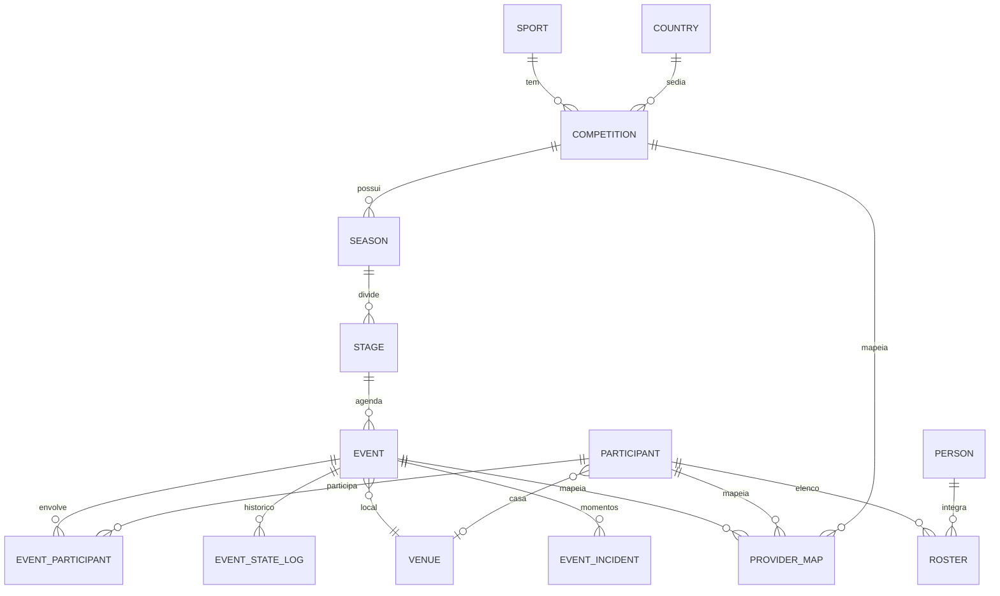
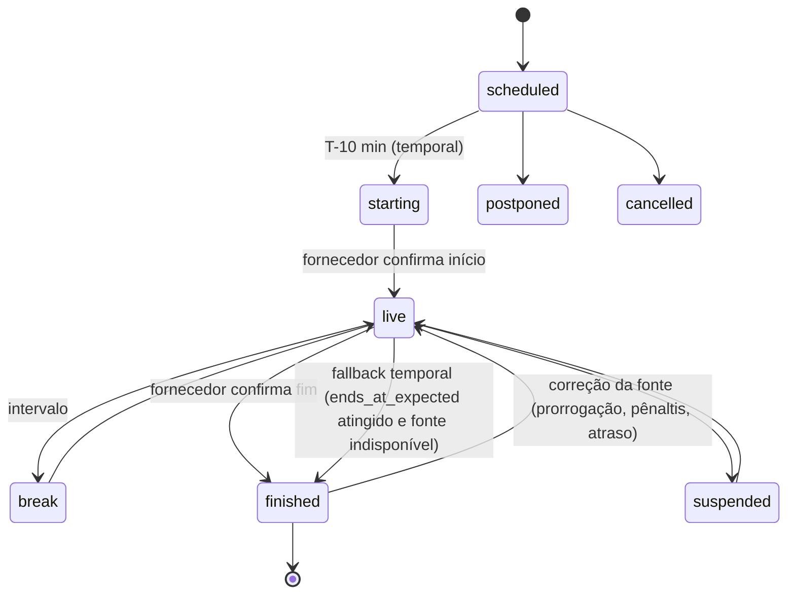

# 04 · Modelo de dados

Banco: **PostgreSQL 17** com seis schemas — `raw`, `core`, `semantic`, `enrich`, `ops` e `api`. Migrations em `packages/db` (Drizzle).

## 1. `raw` — respostas brutas (bronze)

Toda chamada à api-sports é gravada **antes** de qualquer transformação. É o que nos permite reconstruir o banco inteiro, servir o espelho compatível e nunca pagar duas vezes pela mesma informação.

```sql
create table raw.api_response (
  id              bigserial primary key,
  provider        text not null default 'api-sports',
  sport           text not null,              -- football, basketball, formula-1...
  api_version     text not null,              -- v3, v1, v2
  endpoint        text not null,              -- /fixtures, /leagues...
  params          jsonb not null,             -- parâmetros normalizados (ordenados)
  request_hash    text not null,              -- sha256(sport+endpoint+params)
  page            int  not null default 1,
  status_code     int  not null,
  results         int,                        -- campo "results" do envelope
  errors          jsonb,                      -- campo "errors" do envelope
  body            jsonb not null,             -- envelope completo {get, parameters, errors, results, paging, response}
  quota_remaining int,                        -- header x-ratelimit-requests-remaining
  fetched_at      timestamptz not null default now(),
  job_id          text                        -- job que originou a chamada
);
create index on raw.api_response (sport, endpoint, request_hash, fetched_at desc);
```

- O **espelho compatível** (`/mirror/...`) responde servindo o `body` mais recente para o mesmo `request_hash` — ou remontando a resposta a partir do `core` quando a combinação de parâmetros nunca foi pedida ao fornecedor.
- Política de retenção: tudo é mantido; respostas idênticas consecutivas (mesmo hash do `body`) podem ser deduplicadas com ponteiro.

## 2. `core` — modelo normalizado

### 2.1 Entidades comuns (multiesporte)



| Tabela | Campos-chave | Observação |
|---|---|---|
| `core.sport` | `slug`, `name_i18n` | football, basketball, formula-1, volleyball, olympics… |
| `core.country` | `iso2`, `name_i18n`, `flag_asset_id`, `confederation`, `ioc_code` | Inclui "World" e confederações; `confederation`, `ioc_code` e os nomes pt-BR/es vêm de `config/geo/confederations.yaml` (`geo:seed`) |
| `core.competition` | `id`, `sport`, `country_iso2`, `type` (league/cup/tournament/multisport), `tier`, `live_priority` | Liga, copa, GP de F1, evento de MMA, Jogos Olímpicos |
| `core.season` | `competition_id`, `label` ("2026", "2026/27"), `start`, `end`, `current` | |
| `core.stage` | `season_id`, `kind` (regular, group, round_of_16, quarter, semi, final, race_weekend…), `name_i18n`, `order` | Agrupa o calendário por fase/rodada/fim de semana de corrida |
| `core.event` | `id` (UUID nosso), `sport`, `stage_id`, `starts_at`, `ends_at_expected`, `status`, `status_detail`, `status_source`, `clock`, `score` (jsonb), `venue_id`, `last_valid_at`, `is_stale`, `source_provider` | **Entidade canônica** — ver §3 |
| `core.participant` | `id`, `kind` (club, national_team, athlete, driver, constructor, fighter), `name`, `short_name`, `country_iso2`, `logo_asset_id` | Times, seleções e atletas individuais |
| `core.event_participant` | `event_id`, `participant_id`, `side` (home/away/lane/grid), `result` | Suporta 2 lados (futebol) ou N (F1, atletismo) |
| `core.person` | `id`, `name`, `birth_date`, `nationality`, `photo_asset_id` | Jogadores, técnicos, pilotos, lutadores |
| `core.roster` | `participant_id`, `person_id`, `season_id`, `role`, `number`, `position` | Elenco por temporada; `season_id` nulo = elenco atual (único com `NULLS NOT DISTINCT`) |
| `core.venue` | `id`, `name`, `city`, `country_iso2`, `capacity`, `surface`, `image_asset_id` | Estádios, circuitos, arenas |
| `core.event_incident` | `event_id`, `minute`, `extra`, `type` (goal, card, subst, var, period…), `participant_id`, `person_id`, `detail` | Timeline e "momentos-chave" |
| `core.standing` | `season_id`, `group`, `participant_id`, `rank`, `points`, `form`, `description`, `source` | Tabelas e grupos; `source = computed` quando calculada localmente ([docs/rules](rules/README.md)) |
| `core.provider_map` | `entity_type`, `entity_id`, `provider`, `provider_id`, `sport` | Liga nossos IDs aos IDs da api-sports e de outras fontes |
| `core.asset` | `id`, `kind` (team_logo, league_logo, flag, venue, player, coach…), `source_url`, `storage_key`, `sha256`, `width`, `height`, `fetched_at`, `palette` (jsonb `{ version, dominant, secondary, monochrome }`, só `team_logo` PNG) | Espelho de mídia; `palette` alimenta o `colors` do Team ([03 §7.2](03-ingestao-e-economia-de-chamadas.md#72-cores-dos-times-paleta-do-escudo)) |

### 2.2 Tabelas específicas por esporte

Cada esporte mantém tabelas fiéis à estrutura da api-sports para os dados ricos, ligadas ao `core.event`.

> **Implementado no futebol (issue #22):** `core.football_fixture` guarda o resumo (`fixture`/`league`/`teams`/`goals`/`score`) e, em `detail` (JSONB), as partes do detalhe recebidas (`events`, `lineups`, `statistics`, `players`), mescladas por chave — o ao vivo traz só `events` e não apaga as escalações. Escalações e estatísticas ficam no JSONB até alguma consulta precisar de índice; a timeline vai para `core.event_incident` e as pessoas citadas para `core.person`. As tabelas abaixo são o alvo para quando houver consulta que justifique.

| Esporte | Tabelas |
|---|---|
| Futebol (v3) | `football_fixture`, `football_fixture_statistics`, `football_lineup`, `football_player_stats`, `football_injury`, `football_transfer`, `football_trophy`, `football_sidelined`, `football_prediction`, `football_odds` |
| Basquete / NBA | `basketball_game`, `basketball_game_team_stats`, `basketball_player_stats` |
| Fórmula 1 | `f1_race`, `f1_driver_ranking`, `f1_team_ranking`, `f1_pitstop`, `f1_circuit` |
| MMA | `mma_fight`, `mma_fighter_record` |
| Vôlei, handebol, hóquei, rúgbi, beisebol, AFL, NFL | `<sport>_game` + estatísticas disponíveis |

> **Implementado nos outros 11 esportes (issue #25):** um espelho **genérico** em vez de uma tabela por esporte — `core.sport_event_detail` (`event_id`, `sport`, `provider`, `provider_event_id`, `kind` = `game`/`race`/`fight`, `summary` JSONB com o item do fornecedor, `detail` JSONB com as partes vindas de endpoints auxiliares e `detail_fetched_at`). O placar com parciais vai para `core.event.score` (`periods`, `breakdown`) e os N participantes para `core.event_participant`. As tabelas por esporte acima continuam como alvo para quando uma consulta pedir índice. Detalhes em §3.5.

## 3. `core.event` — a entidade canônica

| Campo | Tipo | Descrição |
|---|---|---|
| `id` | uuid | ID estável nosso, independente de fornecedor e de canal |
| `sport` | text | |
| `competition_id`, `season_id`, `stage_id` | uuid | Contexto competitivo |
| `starts_at` | timestamptz | Horário oficial (UTC) |
| `ends_at_expected` | timestamptz | Fim previsto (por esporte: futebol +115 min, etc.) — base para o *fallback* temporal |
| `status` | enum | `scheduled`, `starting`, `live`, `break`, `finished`, `postponed`, `cancelled`, `suspended`, `abandoned` |
| `status_detail` | text | Código original do fornecedor (`1H`, `HT`, `2H`, `ET`, `P`, `FT`, `AET`, `PEN`, `PST`…) |
| `clock` | jsonb | `{ "minute": 67, "extra": null, "period": "2H" }` |
| `score` | jsonb | `{ "home": 1, "away": 0, "halftime": {...}, "extratime": null, "penalty": null, "aggregate": {"home": 3, "away": 1} }` |
| `last_valid_at` | timestamptz | Instante da última observação válida aplicada (o `fetched_at` do raw, não o relógio do processamento) |
| `is_stale` | bool | `true` quando servimos *last-known-good* (fonte falhou ou estado inferido pelo horário) |
| `status_source` | text | `provider` (o fornecedor confirmou) ou `temporal` (inferido pelo horário) |
| `source_provider` | text null | Provedor dono do estado atual — base da precedência entre provedores ([03 §8](03-ingestao-e-economia-de-chamadas.md)) |
| `importance` | int | Score 0–100 calculado (§3.3) |
| `derby_id` | uuid null | Preenchido quando o confronto é um clássico da base semântica |

### 3.1 Máquina de estados e *last-known-good*



Regras:

1. Se o fornecedor retornar erro (4xx/5xx), payload vazio ou nada novo, o evento **mantém o último estado válido** e `is_stale = true`.
2. Enquanto a fonte estiver indisponível, o ciclo temporal continua (`scheduled → starting → live`) pelo horário previsto.
3. Atingido `ends_at_expected` sem fonte, o evento pode ir a `finished` como *fallback*.
4. Quando a fonte normalizar, o estado válido **corrige** o card — inclusive `finished → live` (prorrogação, pênaltis, atraso, bandeira vermelha na F1).

Implementação (issue #26): lógica pura em `@galaxie/providers` (`initialState`, `applyObservation`, `tick`), persistida pelo ingestor (`upsertBatch`, `applyProviderFailure`, `advanceEventClock` — CLI `pnpm --filter @galaxie/ingestor events:clock`). Detalhes que o diagrama não mostra:

- **`starting` é nosso**: nenhum fornecedor tem esse estado. `NS`/`TBD` viram `scheduled` antes de T-10 e `starting` a partir de T-10 (avaliado no instante da observação). Com `NS` **fresco** depois do apito, o evento fica em `starting` (atraso no início).
- **Dado fresco** = última observação válida há no máximo 10 min e `is_stale = false`. Sem dado fresco, `starting → live` acontece no apito e `live`/`break → finished` em `ends_at_expected` (`reason = temporal_fallback`, `status_source = temporal`, `is_stale = true`).
- **Só observações mais novas contam**: uma observação com instante ≤ `last_valid_at` é descartada (`out_of_order`). Reprocessar o raw nunca desfaz o que veio depois — inclusive a inferência temporal.
- **Card nunca regride a estado inválido**: um evento que o **fornecedor** já deu como iniciado ou encerrado (`live`, `break`, `suspended`, `finished`) não volta ao pré-jogo sem mudança de `starts_at` (remarcação). Um estado inferido pelo horário pode ser corrigido para qualquer estado pela fonte.
- **Código desconhecido** é descartado (`unknown_status`); na criação, o evento entra pelo horário.
- **`ends_at_expected`** = início (o real, `fixture.periods.first`, se posterior ao oficial) + duração do esporte: futebol 115 min (+45 com prorrogação/pênaltis), basquete/NBA 135 (+20 na prorrogação), vôlei 120, handebol 105 (+25), hóquei 150 (+30), rúgbi 110 (+25), AFL 165 (+15), futebol americano 210 (+20), beisebol 180 (+40 com entradas extras) e F1 120 (a corrida; treinos 60, Q1/Q2/Q3 25 cada, sprint 60, sprint shootout 20 por parte). No MMA a duração é do **card**: cada luta termina com o bloco do card em que está (nº de lutas do bloco × 30 min, +15 se for o card principal). Demais 180.
- **`core.event_state_log.reason`**: `provider`, `temporal` (scheduled → starting), `temporal_fallback`, `correction` (finished → live ou estado inferido desfeito), `editorial`. O `occurred_at` das transições temporais é o instante-limite (T-10, apito, fim previsto), não o da execução.

Mapeamento dos códigos da api-sports football (`status.short`):

| Código | Estado | Código | Estado |
|---|---|---|---|
| `TBD`, `NS` | `scheduled`/`starting` (pelo horário) | `SUSP`, `INT` | `suspended` |
| `1H`, `2H`, `ET`, `P`, `LIVE` | `live` | `FT`, `AET`, `PEN`, `AWD`, `WO` | `finished` |
| `HT`, `BT` | `break` | `PST` / `CANC` / `ABD` | `postponed` / `cancelled` / `abandoned` |

### 3.2 Momentum temporal (calculado, não armazenado)

| Valor | Regra |
|---|---|
| `D-3+` | ≥ 3 dias civis para o início |
| `D-2`, `D-1` | 2 dias civis / véspera |
| `today` | mesmo dia civil e mais de 60 min para o início |
| `T-60`, `T-30`, `T-10` | 30–60, 10–30 e 0–10 min para o início |
| `starting` | horário oficial já passou e o fornecedor ainda não confirmou o início |
| `live` | em andamento (inclui intervalo e interrupção) |

Os dias são contados no **fuso IANA do cliente** (`America/Sao_Paulo`, `Europe/Madrid`…; fuso inválido cai em UTC); os minutos valem para qualquer fuso e têm precedência sobre os dias (23:30 de um jogo às 00:15 é `T-60`, não `D-1`). Eventos encerrados, adiados, cancelados ou abandonados não têm momentum. Função pura `momentum(event, now, tz)` em `@galaxie/providers` (issue #27).

O *momentum esportivo* (o que está em jogo) é independente: ver `competition_context` em [06](06-semantica-e-conteudo.md).

### 3.3 Importância

`importance = tier + fase + clássico × intensidade + decisão`, limitado a 0–100 (função pura `importance()` em `@galaxie/providers`; o ingestor grava o resultado em `core.event.importance`):

| Componente | Pontos |
|---|---|
| Tier da competição | 1 → 40 · 2 → 25 · 3 → 10 · desconhecido → 5 |
| Fase (`core.stage.kind`) | final 30 · semi 22 · quartas 16 · oitavas 12 · playoff 10 · 3º lugar, 16 avos, rebaixamento 8 · grupos, fase de liga, fase eliminatória 6 · 32 avos 5 · pontos corridos 4 (+ até 6 na reta final) · 64 avos, outra 3 · preliminar 2 · amistoso 0 |
| Clássico | 6 × intensidade (1–5) da base semântica — `DerbyLookup`; padrão no upsert: `createDerbyLookup` de `@galaxie/knowledge` (pares de `semantic.derby` já semeados, uma consulta por lote) |
| Decisão | título 15 · rebaixamento 10 · eliminação 8 · vaga 6 (soma limitada a 20) |

Todo upsert de evento (normalização do raw, `afterFetch` dos jobs, ao vivo) consulta a base semântica do banco: o evento já é gravado com `derby_id` e a intensidade na importância. Com `derbyLookup: false` (busca desligada), o clássico e a importância já calculados são preservados. Para eventos gravados antes do seed (ou depois de mudar a base), `pnpm --filter @galaxie/ingestor events:importance [--esporte football] [--desde AAAA-MM-DD] [--plan]` recalcula `derby_id` (`assignEventDerbies`) e a importância com a mesma fórmula, só nas linhas que mudaram, e purga o cache desses eventos pelo change feed (tópico interno `event.importance_recomputed`).

### 3.4 Normalização raw → core (futebol, issue #22)

`pnpm --filter @galaxie/ingestor normalize:football [--tudo] [--relogio]` lê, para cada `request_hash`, a resposta **mais recente bem-sucedida** (HTTP 2xx e `errors` vazio) de `raw.api_response` — `fixtures` (temporada, dia, ao vivo, detalhe), `fixtures/headtohead`, `teams`, `players/squads`, `coachs`, `players`, `standings` — normaliza para o lote neutro de `@galaxie/providers` e grava no core numa transação por resposta. Zero chamadas ao fornecedor. Sem `--tudo`, processa só o que entrou depois do cursor em `ops.sync_cursor`; cada execução fica em `ops.job_run`.

- **IDs estáveis**: toda entidade é achada por `core.provider_map (provider, sport, entity_type, provider_id)`; IDs novos são UUID v7 gerados no processo.
- **Idempotência**: reprocessar o raw inteiro gera o mesmo estado, inclusive `updated_at` — cada upsert só toca a linha quando algum valor muda.
- **Coalesce**: `null` do fornecedor não apaga valor conhecido. Entidades citadas só como **referência** (time numa partida, jogador numa escalação ou no elenco, estádio da partida) apenas preenchem lacunas; o endpoint próprio (`teams`, `players`, `coachs`) é quem sobrescreve.
- **Competição/temporada/fase**: competições e temporadas ausentes do catálogo são criadas (tier 3; o bootstrap do catálogo continua dono de tier e slug). `league.round` vira `core.stage` (`kind`, nome pt-BR/es/en e ordem: "Regular Season - 12" → `regular`, "Rodada 12").
- **Timeline**: `event_incident.sequence` é a posição no array `events` do fornecedor; itens que somem do array saem. Vale a timeline do detalhe mais recente, mesmo que uma lista de partidas mais nova já tenha atualizado o estado.
- **Elenco atual** (`players/squads`, `coachs`): `season_id` nulo, único por participante/pessoa/papel (`NULLS NOT DISTINCT`); a resposta é uma fotografia — quem não está nela sai do elenco atual.
- **Classificação**: `standings` → `core.standing` com `source = 'provider'`.
- **Tipo do participante**: times vindos de partidas entram como `club` e não sobrescrevem `national_team` informado por `teams`.

### 3.5 Normalização raw → core dos demais esportes (issues #25 e #16)

`pnpm --filter @galaxie/ingestor normalize:sports [--esporte basketball ...] [--tudo] [--relogio] [--detalhe]` faz o mesmo que o futebol (§3.4) para as 11 outras APIs, com um job e um cursor por esporte (`ops.job_run` `normalize:<esporte>`, `ops.sync_cursor` `normalize:core`/`<esporte>`). Normalizadores puros em `@galaxie/providers` (`api-sports/sports/*`), mesmo upsert idempotente do futebol.

| API | Endpoints normalizados | Vira no core |
|---|---|---|
| Basquete, beisebol, handebol, hóquei, rúgbi, vôlei, AFL, NFL | `games`, `games/h2h`, `standings`, `teams` | evento com mandante/visitante (`home`/`away`), placar total + parciais em `score.periods` (`q1`…`q4`/`ot`; `i1`…`i9`/`extra`; `p1`…`p3`/`ot`/`so`; `h1`/`h2`/`ot`/`ot2`; `s1`…`s5`) e `score.breakdown` (AFL goals/behinds, beisebol hits/errors); `week`/`round`/`stage` → `core.stage`; tabela → `core.standing` |
| NBA v2 | `games`, `standings`, `teams` | idem, com `visitors` → `away`, `linescore` → `q1`…/`ot1`…, `stage` numérico (1 pré-temporada, 2 regular, 3+ playoffs — a confirmar) e tabela por conferência |
| F1 | `races`, `rankings/races`, `rankings/startinggrid`, `rankings/drivers`, `rankings/teams` | cada **sessão** (treinos, Q1–Q3, sprint shootout, sprint, corrida) vira evento; o **GP** vira `core.stage` `race_weekend` (`grand-prix-<id>`) da temporada da competição sintética `world-championship`; o circuito é o `venue`; resultado e grid entram como **N participantes** `grid` (posição final em `position`; `result` com posição, tempo, voltas, grid, pits, gap, equipe e tempo de classificação); rankings → duas tabelas (`drivers`, `constructors`) |
| MMA | `fights`, `fights/results` | cada luta vira evento na competição sintética `all-fights`, com os cantos `corner_red` (= `first`) e `corner_blue` (= `second`, na ordem do fornecedor) e `result.winner`; a **categoria de peso** vira `core.stage` (`category-<nome>`, nome traduzido: "Peso-galo", "Peso pluma"…); o card (`slug`, `is_main`) fica no espelho; `fights/results` soma método, round e tempo em `detail.result` |

- **Complementos** (`rankings/races`, `rankings/startinggrid`, `fights/results`) não descrevem o estado do evento: não passam pela máquina de estados, só **mesclam** participantes (`result` somado, `position` nula não apaga a conhecida, nada é removido) e detalhe. O runner os processa depois das listas que criam os eventos.
- **IDs**: pilotos usam o prefixo `driver-<id>` em `core.provider_map` (os IDs de piloto e de equipe da F1 colidem); equipes, circuitos e competições sintéticas usam os mesmos IDs do catálogo (`bootstrap:sports`).
- **Logos**: só URLs de `media.api-sports.io` viram `core.asset` (a NBA v2 aponta para a Wikimedia). Pilotos e lutadores usam os tipos de asset `driver` e `fighter`.
- **Classificação sem pontos** (basquete, beisebol, NBA, NFL): `points` = vitórias; o hóquei soma vitórias/derrotas na prorrogação; pontos fracionados da F1 são arredondados (o valor exato fica no raw). Com mais de uma fase na mesma resposta, o grupo vira `"<fase> · <grupo>"`.

Mapeamento de status por esporte (`status.short`; sem código curto, vale o texto `status.long`):

| Esporte | Pré-jogo (`scheduled`/`starting`) | `live` | `break` | `finished` | Outros |
|---|---|---|---|---|---|
| Basquete | `NS` | `Q1`–`Q4`, `OT` | `HT`, `BT` | `FT`, `AOT`, `AWD` | `POST` adiado · `CANC` cancelado · `SUSP` suspenso · `ABD` abandonado |
| Beisebol | `NS` | `IN1`…`IN9` (e extras `IN10`+) | — | `FT` | `POST` · `CANC` · `INTR` suspenso · `ABD` |
| Hóquei | `NS` | `P1`–`P3`, `OT`, `PT` (shootout) | `BT` | `FT`, `AOT`, `AP` | `POST` · `CANC` · `INTR` · `ABD` · `AW` (decidido) |
| Handebol / rúgbi | `NS` | `1H`, `2H`, `ET`, `PT` | `HT`, `BT` | `FT`, `AET`, `AP`, `AW` | `POST` · `CANC` · `INTR` · `ABD` |
| Vôlei | `NS` | `S1`–`S5` | — | `FT`, `AW` | `POST` · `CANC` · `INTR` · `ABD` |
| AFL | `NS` | `Q1`–`Q4`, `ET` | `QT`, `HT`, `BT` | `FT`, `AET`, `AW` | `POST` · `CANC` · `INTR` · `ABD` |
| NFL/NCAA | `NS` | `Q1`–`Q4`, `OT` | `HT` | `FT`, `AOT`, texto `Final/OT` (sem código curto) | `PST`/`POST` · `CANC` · `SUSP`/`INTR` · `ABD` |
| NBA v2 | `short` 1 / `Scheduled` | `short` 2 / `In Play` | `In Play` com `halftime` ou `endOfPeriod` | `short` 3 / `Finished` | `Postponed` · `Canceled` |
| F1 (texto) | `Scheduled` | `Live` | — | `Completed` | `Postponed` · `Cancelled` |
| MMA | `NS`, `IN` (apresentação), `PF` (pré-luta), `WO` (walkout — no MMA não é W.O.) | `LIVE` | `EOR` (fim de round) | `FT` | `PST`/`POST` · `CANC` |

Códigos observados nas respostas capturadas: basquete `FT`/`AOT`/`CANC`; beisebol `FT`/`POST`/`ABD`/`CANC`; hóquei `FT`/`AOT`/`AP`/`CANC`; rúgbi `FT`/`AET`; vôlei `FT`/`CANC`; AFL `FT`/`CANC`; NFL `FT`/`NS`/`Final/OT`; MMA `FT`/`CANC`/`PF`/`NS`; F1 `Completed`; NBA `Scheduled`. Os demais vêm das specs oficiais ou do padrão da plataforma — código desconhecido é descartado (`unknown_status`) e o evento segue pelo horário.

## 4. `semantic` — base de conhecimento

Carregada a partir de [`data/knowledge`](../data/knowledge/SCHEMA.md) por `pnpm db:seed:semantic`. Desde a issue #44 a base tem pastas por esporte (`football/`, `basketball/`, `volleyball/`, `formula-1/`…): os perfis de outros esportes entram em `semantic.team_profile` com `kind` do arquivo (`club`, `driver`, `constructor`…), mas ainda **sem** vínculo com `core.participant` (o vínculo por `api_sports.team_id` e o `resolve:ids` são só do futebol).

| Tabela | Conteúdo |
|---|---|
| `semantic.team_profile` | Por `participant_id`: nomes, apelidos, mascote, demônimo da torcida, gritos, estádio e apelidos, fatos de identidade, `review_status` |
| `semantic.derby` | Clássicos: nome, aliases, labels por locale, escopo, intensidade (1–5), primeiro jogo, origem, curiosidades |
| `semantic.derby_team` | Times de cada clássico |
| `semantic.competition_profile` | Apelidos de competições ("Glória Eterna", "Orelhuda"…) |
| `semantic.copy_template` | Biblioteca de microcopy por `locale × sport × copy_intent × tone_intensity × confidence` |
| `semantic.source` | Fontes de cada fato (URL, data de consulta) |

## 5. `enrich` — saídas de IA e fontes externas

```sql
create table enrich.broadcast_option (
  id               uuid primary key,
  event_id         uuid not null references core.event(id),
  country_iso2     text not null,
  region           text,                     -- ex.: praça/afiliada regional
  provider_name    text not null,            -- nome da emissora/plataforma
  channel_name     text,
  medium           text not null,            -- free_tv | pay_tv | streaming_svod | streaming_free | youtube | official_app | radio
  access_model     text not null,            -- free | subscription | ppv | unknown
  url              text,
  language         text,
  status           text not null,            -- confirmed | probable | omitted | retracted
  confidence       numeric(3,2) not null,    -- 0.00–1.00
  evidence         jsonb not null,           -- [{url, excerpt(≤200 chars), fetched_at, publisher}]
  first_seen_at    timestamptz not null,
  last_verified_at timestamptz not null,
  produced_by      text not null,            -- agent:wtw@v3 | editorial:<user> | feed:<name>
  superseded_by    uuid
);

-- Implementado (migration 0006): broadcast_option ganhou broadcaster_id (id do dicionário),
-- source_kind, conflict, flags[], run_id, created_at (criação da versão) e superseded_at.
-- Versão vigente = superseded_by is null (remoção = versão 'retracted'). Tabelas novas:
--   enrich.wtw_run              execuções do agente por (evento, país, janela), run_key único
--   enrich.broadcast_correction trilha de correções editoriais (add/correct/remove/rerun)
--   enrich.broadcast_audit      fila de auditoria amostral (veredito humano)
--   ops.llm_usage               ledger de uso de LLM (orçamento diário de tokens de todos os agentes)
-- Detalhes: docs/07 §2.2.1 e §3.1.

create table enrich.event_context (
  event_id     uuid not null references core.event(id),
  locale       text not null,
  kind         text not null,               -- preview | scenario | recap | key_facts
  content      jsonb not null,              -- texto + fatos estruturados (ex.: "precisa empatar")
  sources      jsonb not null,
  model        text not null,
  confidence   numeric(3,2),
  review_status text not null default 'auto', -- auto | reviewed | rejected
  created_at   timestamptz not null default now(),
  primary key (event_id, locale, kind, created_at)
);
```

Conteúdo relacionado (migration 0012, [12 §6](12-conteudo-relacionado.md#6-modelo-de-dados-enrich)): `enrich.related_content` — um vídeo por evento × plataforma, só metadados e link/embed oficial, classificado por `content_type` (enum `enrich.related_content_type`) e `format` (`short` | `long`), versionado como o onde assistir (`superseded_by`; status `published` | `pending` | `rejected` | `retracted` | `expired`) — e `enrich.related_run`, as execuções do agente com o ledger de cota do YouTube por dia do Pacífico (`quota_day`, `quota_units`).

## 6. `ops` — operação e cota

| Tabela | Uso |
|---|---|
| `ops.quota_ledger` | Uma linha por chamada ao fornecedor: `api`, `day_utc`, `priority` (BOOTSTRAP/DAILY/LIVE/ADHOC), `job_id`, `remaining_after` |
| `ops.quota_budget` | Orçamento planejado por `api × dia × prioridade` |
| `ops.sync_cursor` | Marca d'água por `(sport, endpoint, chave)` — ex.: último `fixtures?league=71&season=2026` sincronizado |
| `ops.job_run` | Execuções de jobs, duração, chamadas gastas, erros |
| `ops.change_feed` | Mudanças publicadas (para SSE/webhooks e purge de cache/CDN) — gravadas por triggers (`core.event`, `core.event_incident`, `enrich.broadcast_option`, `enrich.event_context`) ou por `publishChange()`; ambos usam `ops.publish_change()`, que deduplica por transação e faz `pg_notify('ops_change_feed', id)` (docs/05 §5) |

## 6.1 `api` — tenants, chaves e backfill do espelho

| Tabela | Uso |
|---|---|
| `api.tenant` | Cliente da API: `slug`, `plan`, `modules[]`, `markets[]` (vazio = todos), `sports[]` (vazio = todos), `rate_limit_per_minute`, `status` |
| `api.api_key` | Chaves do tenant: `prefix` (único, em claro), `secret_hash` (scrypt com sal), `scopes[]` (restringe módulos), `expires_at`, `revoked_at`, `last_used_at` |
| `api.backfill_request` | Combinações pedidas ao `/mirror` sem raw: `sport`, `endpoint`, `params`, `request_hash` (único), `priority` ADHOC, `status`, `hits` — consumidas pelo ingestor |
| `api.webhook_endpoint` | Webhook de um tenant: `url`, `secret` (HMAC-SHA256), `topics[]` (vazio = todos do plano), `filters` (`events`/`competitions`/`sports`), `active` (docs/05 §5.2) |
| `api.webhook_delivery` | Uma entrega por (endpoint, mudança do change feed), única: `payload` congelado, `status` (`pending`/`delivered`/`dead` = DLQ), `attempts`, `next_retry_at`, `response_code`, `last_error` |
| `api.webhook_cursor` | Marca d'água do enfileirador de webhooks sobre `ops.change_feed` |

Regras de autenticação, planos e rate limit: [05 §1.1](05-api-publica.md#11-implementação-schema-api).

## 7. Convenções

- IDs próprios em **UUID v7**; IDs do fornecedor apenas em `provider_map` e nas tabelas espelho.
- Datas em UTC (`timestamptz`); conversão de fuso na API conforme `tz` do cliente.
- Textos multilíngues em `jsonb` (`{"pt-BR": "...", "es-AR": "..."}`), com *fallback* `es-AR → es` e `pt-BR`.
- Toda tabela de `enrich` e `semantic` tem `review_status` e fonte.
