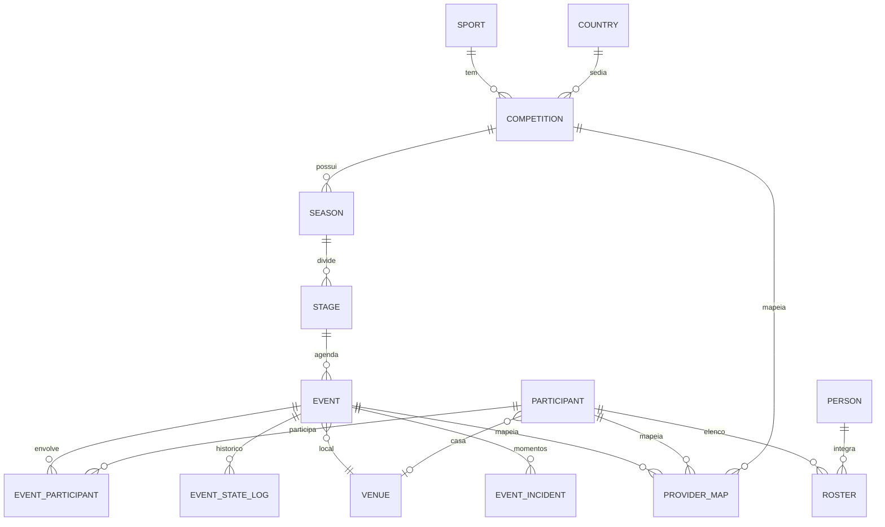
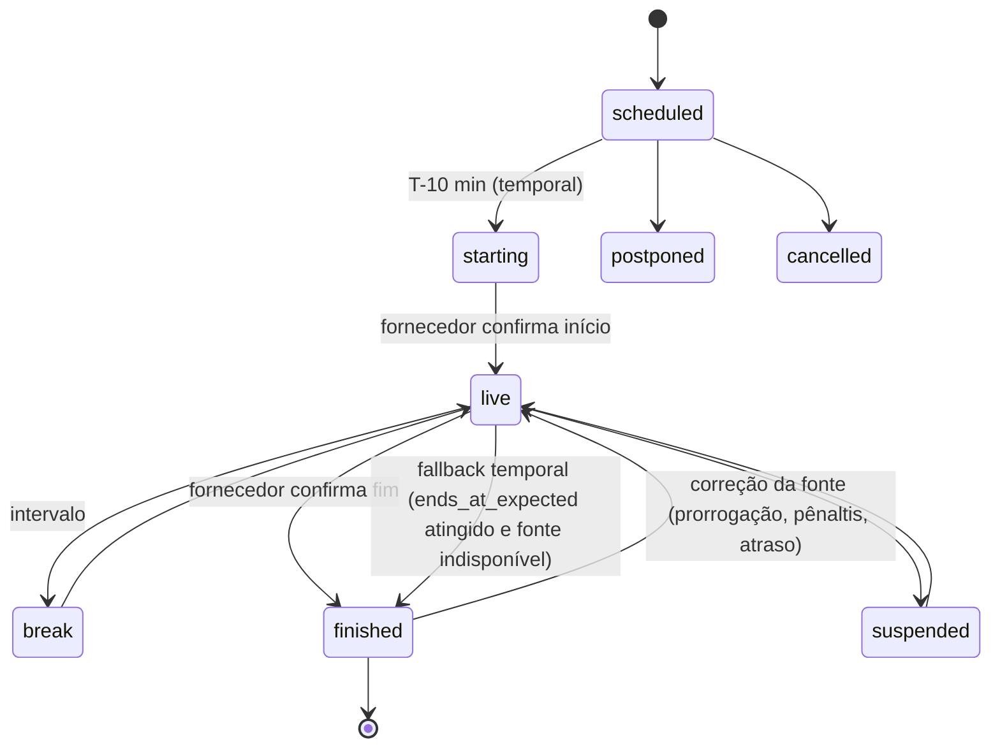

# 04 · Modelo de dados

Banco: **PostgreSQL 17** com cinco schemas — `raw`, `core`, `semantic`, `enrich` e `ops`. Migrations em `packages/db` (Drizzle).

## 1. `raw` — respostas brutas (bronze)

Toda chamada à api-sports é gravada **antes** de qualquer transformação. É o que nos permite reconstruir o banco inteiro, servir o espelho compatível e nunca pagar duas vezes pela mesma informação.

```sql
create table raw.api_response (
  id              bigserial primary key,
  provider        text not null default 'api-sports',
  sport           text not null,              -- football, basketball, formula-1...
  api_version     text not null,              -- v3, v1, v2
  endpoint        text not null,              -- /fixtures, /leagues...
  params          jsonb not null,             -- parâmetros normalizados (ordenados)
  request_hash    text not null,              -- sha256(sport+endpoint+params)
  page            int  not null default 1,
  status_code     int  not null,
  results         int,                        -- campo "results" do envelope
  errors          jsonb,                      -- campo "errors" do envelope
  body            jsonb not null,             -- envelope completo {get, parameters, errors, results, paging, response}
  quota_remaining int,                        -- header x-ratelimit-requests-remaining
  fetched_at      timestamptz not null default now(),
  job_id          text                        -- job que originou a chamada
);
create index on raw.api_response (sport, endpoint, request_hash, fetched_at desc);
```

- O **espelho compatível** (`/mirror/...`) responde servindo o `body` mais recente para o mesmo `request_hash` — ou remontando a resposta a partir do `core` quando a combinação de parâmetros nunca foi pedida ao fornecedor.
- Política de retenção: tudo é mantido; respostas idênticas consecutivas (mesmo hash do `body`) podem ser deduplicadas com ponteiro.

## 2. `core` — modelo normalizado

### 2.1 Entidades comuns (multiesporte)



| Tabela | Campos-chave | Observação |
|---|---|---|
| `core.sport` | `slug`, `name_i18n` | football, basketball, formula-1, volleyball, olympics… |
| `core.country` | `iso2`, `name_i18n`, `flag_asset_id` | Inclui "World" e confederações |
| `core.competition` | `id`, `sport`, `country_iso2`, `type` (league/cup/tournament/multisport), `tier`, `live_priority` | Liga, copa, GP de F1, evento de MMA, Jogos Olímpicos |
| `core.season` | `competition_id`, `label` ("2026", "2026/27"), `start`, `end`, `current` | |
| `core.stage` | `season_id`, `kind` (regular, group, round_of_16, quarter, semi, final, race_weekend…), `name_i18n`, `order` | Agrupa o calendário por fase/rodada/fim de semana de corrida |
| `core.event` | `id` (UUID nosso), `sport`, `stage_id`, `starts_at`, `ends_at_expected`, `status`, `status_detail`, `minute`, `score` (jsonb), `venue_id`, `last_valid_at`, `is_stale` | **Entidade canônica** — ver §3 |
| `core.participant` | `id`, `kind` (club, national_team, athlete, driver, constructor, fighter), `name`, `short_name`, `country_iso2`, `logo_asset_id` | Times, seleções e atletas individuais |
| `core.event_participant` | `event_id`, `participant_id`, `side` (home/away/lane/grid), `result` | Suporta 2 lados (futebol) ou N (F1, atletismo) |
| `core.person` | `id`, `name`, `birth_date`, `nationality`, `photo_asset_id` | Jogadores, técnicos, pilotos, lutadores |
| `core.roster` | `participant_id`, `person_id`, `season_id`, `role`, `number`, `position` | Elenco por temporada |
| `core.venue` | `id`, `name`, `city`, `country_iso2`, `capacity`, `surface`, `image_asset_id` | Estádios, circuitos, arenas |
| `core.event_incident` | `event_id`, `minute`, `extra`, `type` (goal, card, subst, var, period…), `participant_id`, `person_id`, `detail` | Timeline e "momentos-chave" |
| `core.standing` | `season_id`, `group`, `participant_id`, `rank`, `points`, `form`, `description` | Tabelas e grupos |
| `core.provider_map` | `entity_type`, `entity_id`, `provider`, `provider_id`, `sport` | Liga nossos IDs aos IDs da api-sports e de outras fontes |
| `core.asset` | `id`, `kind` (team_logo, league_logo, flag, venue, player, coach…), `source_url`, `storage_key`, `sha256`, `width`, `height`, `fetched_at` | Espelho de mídia |

### 2.2 Tabelas específicas por esporte

Cada esporte mantém tabelas fiéis à estrutura da api-sports para os dados ricos, ligadas ao `core.event`:

| Esporte | Tabelas |
|---|---|
| Futebol (v3) | `football_fixture`, `football_fixture_statistics`, `football_lineup`, `football_player_stats`, `football_injury`, `football_transfer`, `football_trophy`, `football_sidelined`, `football_prediction`, `football_odds` |
| Basquete / NBA | `basketball_game`, `basketball_game_team_stats`, `basketball_player_stats` |
| Fórmula 1 | `f1_race`, `f1_driver_ranking`, `f1_team_ranking`, `f1_pitstop`, `f1_circuit` |
| MMA | `mma_fight`, `mma_fighter_record` |
| Vôlei, handebol, hóquei, rúgbi, beisebol, AFL, NFL | `<sport>_game` + estatísticas disponíveis |

## 3. `core.event` — a entidade canônica

| Campo | Tipo | Descrição |
|---|---|---|
| `id` | uuid | ID estável nosso, independente de fornecedor e de canal |
| `sport` | text | |
| `competition_id`, `season_id`, `stage_id` | uuid | Contexto competitivo |
| `starts_at` | timestamptz | Horário oficial (UTC) |
| `ends_at_expected` | timestamptz | Fim previsto (por esporte: futebol +115 min, etc.) — base para o *fallback* temporal |
| `status` | enum | `scheduled`, `starting`, `live`, `break`, `finished`, `postponed`, `cancelled`, `suspended`, `abandoned` |
| `status_detail` | text | Código original do fornecedor (`1H`, `HT`, `2H`, `ET`, `P`, `FT`, `AET`, `PEN`, `PST`…) |
| `clock` | jsonb | `{ "minute": 67, "extra": null, "period": "2H" }` |
| `score` | jsonb | `{ "home": 1, "away": 0, "halftime": {...}, "extratime": null, "penalty": null, "aggregate": {"home": 3, "away": 1} }` |
| `last_valid_at` | timestamptz | Última atualização válida recebida |
| `is_stale` | bool | `true` quando servimos *last-known-good* |
| `importance` | int | Score calculado (tier da competição + fase + clássico + interesse) |
| `derby_id` | uuid null | Preenchido quando o confronto é um clássico da base semântica |

### 3.1 Máquina de estados e *last-known-good*



Regras:

1. Se o fornecedor retornar erro (4xx/5xx), payload vazio ou nada novo, o evento **mantém o último estado válido** e `is_stale = true`.
2. Enquanto a fonte estiver indisponível, o ciclo temporal continua (`scheduled → starting → live`) pelo horário previsto.
3. Atingido `ends_at_expected` sem fonte, o evento pode ir a `finished` como *fallback*.
4. Quando a fonte normalizar, o estado válido **corrige** o card — inclusive `finished → live` (prorrogação, pênaltis, atraso, bandeira vermelha na F1).

### 3.2 Momentum temporal (calculado, não armazenado)

| Valor | Regra |
|---|---|
| `D-3+` | ≥ 3 dias para o início |
| `D-2`, `D-1` | 2 dias / véspera |
| `today` | mesmo dia (fuso do usuário) |
| `T-60`, `T-30`, `T-10` | minutos para o início |
| `starting` | entre T-10 e o apito |
| `live` | em andamento |

O *momentum esportivo* (o que está em jogo) é independente: ver `competition_context` em [06](06-semantica-e-conteudo.md).

## 4. `semantic` — base de conhecimento

Carregada a partir de [`data/knowledge`](../data/knowledge/SCHEMA.md) por `pnpm db:seed:semantic`.

| Tabela | Conteúdo |
|---|---|
| `semantic.team_profile` | Por `participant_id`: nomes, apelidos, mascote, demônimo da torcida, gritos, estádio e apelidos, fatos de identidade, `review_status` |
| `semantic.derby` | Clássicos: nome, aliases, labels por locale, escopo, intensidade (1–5), primeiro jogo, origem, curiosidades |
| `semantic.derby_team` | Times de cada clássico |
| `semantic.competition_profile` | Apelidos de competições ("Glória Eterna", "Orelhuda"…) |
| `semantic.copy_template` | Biblioteca de microcopy por `locale × sport × copy_intent × tone_intensity × confidence` |
| `semantic.source` | Fontes de cada fato (URL, data de consulta) |

## 5. `enrich` — saídas de IA e fontes externas

```sql
create table enrich.broadcast_option (
  id               uuid primary key,
  event_id         uuid not null references core.event(id),
  country_iso2     text not null,
  region           text,                     -- ex.: praça/afiliada regional
  provider_name    text not null,            -- nome da emissora/plataforma
  channel_name     text,
  medium           text not null,            -- free_tv | pay_tv | streaming_svod | streaming_free | youtube | official_app | radio
  access_model     text not null,            -- free | subscription | ppv | unknown
  url              text,
  language         text,
  status           text not null,            -- confirmed | probable | omitted | retracted
  confidence       numeric(3,2) not null,    -- 0.00–1.00
  evidence         jsonb not null,           -- [{url, excerpt(≤200 chars), fetched_at, publisher}]
  first_seen_at    timestamptz not null,
  last_verified_at timestamptz not null,
  produced_by      text not null,            -- agent:wtw@v3 | editorial:<user> | feed:<name>
  superseded_by    uuid
);

create table enrich.event_context (
  event_id     uuid not null references core.event(id),
  locale       text not null,
  kind         text not null,               -- preview | scenario | recap | key_facts
  content      jsonb not null,              -- texto + fatos estruturados (ex.: "precisa empatar")
  sources      jsonb not null,
  model        text not null,
  confidence   numeric(3,2),
  review_status text not null default 'auto', -- auto | reviewed | rejected
  created_at   timestamptz not null default now(),
  primary key (event_id, locale, kind, created_at)
);
```

## 6. `ops` — operação e cota

| Tabela | Uso |
|---|---|
| `ops.quota_ledger` | Uma linha por chamada ao fornecedor: `api`, `day_utc`, `priority` (BOOTSTRAP/DAILY/LIVE/ADHOC), `job_id`, `remaining_after` |
| `ops.quota_budget` | Orçamento planejado por `api × dia × prioridade` |
| `ops.sync_cursor` | Marca d'água por `(sport, endpoint, chave)` — ex.: último `fixtures?league=71&season=2026` sincronizado |
| `ops.job_run` | Execuções de jobs, duração, chamadas gastas, erros |
| `ops.change_feed` | Mudanças publicadas (para SSE/webhooks e purge de CDN) |

## 7. Convenções

- IDs próprios em **UUID v7**; IDs do fornecedor apenas em `provider_map` e nas tabelas espelho.
- Datas em UTC (`timestamptz`); conversão de fuso na API conforme `tz` do cliente.
- Textos multilíngues em `jsonb` (`{"pt-BR": "...", "es-AR": "..."}`), com *fallback* `es-AR → es` e `pt-BR`.
- Toda tabela de `enrich` e `semantic` tem `review_status` e fonte.
