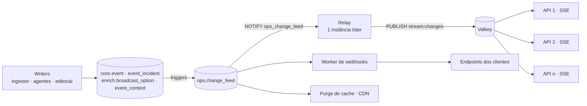

# 05 · API pública Galaxie Sports

A API tem **duas faces**:

1. **Espelho compatível** (`/mirror/{sport}/{endpoint}`) — mesma URL relativa, mesmos parâmetros e **o mesmo envelope** da api-sports. Quem já integrou a api-sports só troca a URL base e a chave.
2. **API canônica** (`/v1/...`) — orientada a evento, multiesporte, localizada e enriquecida (onde assistir, semântica, contexto, momentum).

Especificação formal: OpenAPI 3.1 gerada a partir dos schemas Zod de `packages/contracts` (biblioteca `zod-openapi`), servida em **`/openapi.json`**, com referência interativa (Scalar) em **`/docs`** — ambas públicas. O mesmo pacote exporta o cliente tipado `createGalaxieClient({ baseUrl, apiKey, locale })` usado pelo demo. O CI valida o documento contra o schema oficial do OpenAPI 3.1.

## 1. Autenticação, tenants e limites

| Item | Regra |
|---|---|
| Autenticação | Header `x-galaxie-key: <chave do tenant>` (chaves rotacionáveis, escopos por módulo) |
| Tenant | Cada cliente tem plano (Core Data, Fan Experience, Live Intelligence, Enterprise), mercados ativos e esportes contratados |
| Rate limit | Por tenant e por rota; headers `x-ratelimit-limit`, `x-ratelimit-remaining`, `x-ratelimit-reset` |
| Locale | `Accept-Language` ou `?locale=` (pt-BR, es-AR, es-MX, es-CO, es-CL, es-PE, es-UY, es-EC) |
| Fuso | `?tz=America/Sao_Paulo` (padrão UTC) |
| Cache | `ETag` + `Cache-Control` por tipo de recurso; `If-None-Match` retorna 304 |

### 1.1 Implementação (schema `api`)

**Chaves.** Formato `gs_<live|test>_<prefixo>_<segredo>` — prefixo de 12 caracteres hex (guardado em claro em `api.api_key.prefix` para localizar a chave) e segredo de 32 bytes em base64url, guardado **só como hash scrypt com sal** (`scrypt$N$r$p$sal$hash`, via `node:crypto`). A chave completa é exibida uma única vez, na criação. A verificação positiva fica em cache em memória por 60 s (revogação e mudança de plano valem em até 1 min). `last_used_at` é atualizado no máximo a cada 5 min.

**Tenants e planos.** `api.tenant` guarda `plan`, `modules`, `markets` (países ISO2; vazio = todos), `sports` (vazio = todos), `rate_limit_per_minute` e `status` (`active`/`suspended`). Módulos: `core_data`, `where_to_watch`, `semantic`, `live_intelligence`, `multisport`. Cada chave pode restringir os módulos do tenant (`api.api_key.scopes`; `null` = herda).

| Plano | Módulos padrão |
|---|---|
| `core_data` | `core_data` |
| `fan_experience` | `core_data`, `where_to_watch`, `semantic` |
| `live_intelligence` | + `live_intelligence`, `multisport` |
| `enterprise` | todos |

Cada rota declara o módulo exigido (`/mirror` e o catálogo `/v1` exigem `core_data`). Chave sem o módulo → 403 `MODULE_NOT_IN_PLAN`; esporte fora de `sports` no espelho → 403 `MODULE_NOT_IN_PLAN`; país fora de `markets` (rotas por país, como onde assistir) → 403 `MARKET_NOT_IN_PLAN`.

**Rate limit.** Janela fixa de 60 s por **tenant × rota** (padrão da rota, ex.: `GET /v1/competitions/:id`), com contadores no Valkey (`<prefixo>rl:<tenant>:<rota>`), compartilhados entre instâncias. Headers `x-ratelimit-limit`, `x-ratelimit-remaining`, `x-ratelimit-reset` (segundos) em toda resposta autenticada; 429 inclui `retry-after`. Se o Valkey cair, o limite é ignorado (*fail-open*) e o evento é registrado em log.

**Locale.** `?locale` (um dos 8 locales; outro valor → 400) tem precedência; senão `Accept-Language` (tag exata, ou só o idioma: `es-*` → `es-AR`, `pt-*` → `pt-BR`); padrão `pt-BR`. A resposta traz `Content-Language`. Textos i18n do banco seguem a cadeia `es-XX → es → en` (`pt-BR → pt → en`); sem correspondência, cai no nome oficial. **Fuso:** `?tz` aceita qualquer fuso IANA (inválido → 400); instantes saem em ISO 8601 com o offset do fuso (padrão UTC, sufixo `Z`).

**Chave local para desenvolvimento:**

```bash
pnpm --filter @galaxie/api tenant:create --slug demo-local --plan enterprise --label dev
# opções: --markets BR,AR --sports football --rate-limit 600 --scopes core_data --env live
```

## 2. Espelho compatível — `/mirror`

```http
GET /mirror/football/fixtures?league=71&season=2026&round=Regular Season - 30
x-galaxie-key: gs_live_xxx
```

Resposta (mesmo envelope da api-sports):

```json
{
  "get": "fixtures",
  "parameters": { "league": "71", "season": "2026", "round": "Regular Season - 30" },
  "errors": [],
  "results": 10,
  "paging": { "current": 1, "total": 1 },
  "response": [ { "fixture": { "id": 1234567, "...": "..." }, "league": {}, "teams": {}, "goals": {}, "score": {} } ]
}
```

Extras do espelho (headers, sem alterar o corpo):

| Header | Significado |
|---|---|
| `x-galaxie-source` | `raw-hit` (resposta idêntica já obtida do fornecedor), `rebuilt` (montada a partir do `core`), `stale` (last-known-good) |
| `x-galaxie-fetched-at` | Quando o dado foi obtido do fornecedor |
| `x-galaxie-asset-base` | URL base do nosso CDN de assets (logos/bandeiras reescritos para o nosso storage) |

Esportes do espelho:

| Esporte | Prefixo | Fornecedor original |
|---|---|---|
|  Futebol | `/mirror/football` | `v3.football.api-sports.io` |
|  AFL | `/mirror/afl` | `v1.afl.api-sports.io` |
|  Beisebol | `/mirror/baseball` | `v1.baseball.api-sports.io` |
|  Basquete | `/mirror/basketball` | `v1.basketball.api-sports.io` |
|  Fórmula 1 | `/mirror/formula-1` | `v1.formula-1.api-sports.io` |
|  Handebol | `/mirror/handball` | `v1.handball.api-sports.io` |
|  Hóquei | `/mirror/hockey` | `v1.hockey.api-sports.io` |
|  MMA | `/mirror/mma` | `v1.mma.api-sports.io` |
|  NBA | `/mirror/nba` | `v2.nba.api-sports.io` |
|  NFL | `/mirror/american-football` | `v1.american-football.api-sports.io` |
|  Rúgbi | `/mirror/rugby` | `v1.rugby.api-sports.io` |
|  Vôlei | `/mirror/volleyball` | `v1.volleyball.api-sports.io` |

> O espelho **nunca** repassa a requisição ao fornecedor em tempo real. Se a combinação de parâmetros não existir no `raw` nem puder ser remontada do `core`, a resposta é `results: 0` com `x-galaxie-source: miss` e a combinação entra na fila de *backfill* do Quota Governor (prioridade ADHOC).

Como funciona hoje (`apps/api/src/routes/mirror.ts`):

1. `GET /mirror/{sport}/{endpoint...}` — o endpoint pode ter barras (`/mirror/football/fixtures/headtohead?h2h=121-131`). Os parâmetros são normalizados com `normalizeParams` e a identidade é o mesmo `requestHash('api-sports', sport, endpoint, params)` usado pelo `ApiSportsClient` — a ordem dos parâmetros não importa.
2. **Hit** (`x-galaxie-source: raw-hit`): serve o `body` da resposta **mais recente com sucesso** (HTTP 2xx e `errors` vazio) em `raw.api_response`, com `x-galaxie-fetched-at`. Como o JSONB não preserva a ordem das chaves, o envelope volta na ordem da api-sports (`get, parameters, errors, results, paging, response`); objetos internos podem ter as chaves em outra ordem (mesmo JSON).
3. **Miss** (`x-galaxie-source: miss`): envelope vazio (`parameters: []` quando não há parâmetros, como o fornecedor) e upsert em **`api.backfill_request`** (`request_hash` único; repetições somam `hits`; `status` `pending → done/failed/skipped`, a cargo do ingestor). Respostas *miss* não entram no cache.
4. Cache: TTL igual ao frescor do endpoint no cliente da api-sports (`ttlFor`, entre 15 s e 24 h); tag de purge `api_response:<request_hash>`.
5. `x-galaxie-asset-base` traz `ASSETS_PUBLIC_BASE_URL` quando configurado. Ainda **não** implementados: `rebuilt` (remontar a partir do `core`), `stale` e a reescrita de URLs de mídia dentro do corpo — follow-ups da issue do espelho.
6. Erros de autenticação/plano do espelho também saem em `application/problem+json` (§6), e não no formato de erro da api-sports.

## 3. API canônica — `/v1`

### 3.1 Catálogo

| Método e rota | Descrição |
|---|---|
| `GET /v1/sports` | Esportes disponíveis e cobertura |
| `GET /v1/countries` | Países, bandeiras, confederação |
| `GET /v1/competitions?sport=&country=&tier=` | Competições com apelidos (semântica) |
| `GET /v1/competitions/{id}` | Detalhe + temporadas |
| `GET /v1/competitions/{id}/seasons/{season}/standings` | Tabela/grupos |
| `GET /v1/competitions/{id}/context` | O que está em jogo: líder, G4/G6, Z4, mata-mata, chaveamento, próximos confrontos decisivos |
| `GET /v1/venues/{id}` | Estádio/circuito/arena |

Convenções implementadas:

- Listas completas: `{ "data": [...] }` (`/v1/sports`, `/v1/countries`). Listas paginadas: `{ "data": [...], "next_cursor": "..." | null }` — envie `?cursor=<next_cursor>`; `limit` de 1 a 200 (padrão 50). Detalhes são o objeto sem envelope.
- `/v1/competitions`: filtros `sport`, `country` (código, case-insensitive), `tier` (1–3) e `q` (≥ 2 caracteres; busca em nome oficial, slug, labels e apelidos da base semântica); ordenação por `tier`, nome oficial e id. Cada item traz `name` (localizado), `official_name`, `nicknames` (localizados), `country`, `logo` e `current_season`.
- `/v1/competitions/{id}` aceita **UUID ou slug** e traz `seasons` (mais recente primeiro), `trophy_nickname` e `external_ids` (`{"api-sports": "71"}`).
- Standings: `{season}` é o ano (`2026`) ou `current`; tabela vazia → `groups: []` (a temporada existe, a tabela ainda não foi sincronizada). `updated_at` respeita `?tz`.
- Assets (`logo`, `flag`, `image`): `ASSETS_PUBLIC_BASE_URL` + `core.asset.storage_key` quando o asset já foi espelhado; senão, a `source_url` original.
- `GET /v1/competitions/{id}/context` ainda **não** existe: depende dos eventos (#31).

### 3.2 Eventos

| Método e rota | Descrição |
|---|---|
| `GET /v1/events?date=&from=&to=&sport=&competition=&team=&country=&status=&importance_min=` | Agenda multiesporte paginada por cursor, ordenada por `starts_at` ou `importance` |
| `GET /v1/events/live?sport=&competition=` | Eventos ao vivo |
| `GET /v1/events/{id}` | Evento completo: participantes, placar, estado, momentum, clássico, contexto |
| `GET /v1/events/{id}/timeline` | Momentos-chave por minuto (gols, cartões, VAR, substituições) |
| `GET /v1/events/{id}/lineups` | Escalações e formação |
| `GET /v1/events/{id}/stats` | Estatísticas por time e jogador |
| `GET /v1/events/{id}/where-to-watch?country=BR&region=SP` | Opções de transmissão (§4) |
| `GET /v1/events/{id}/context?locale=pt-BR` | Cenário pré-jogo / resumo pós-jogo gerado por IA, com fontes |
| `GET /v1/events/{id}.ics` | Arquivo de calendário |
| `GET /v1/events/{id}/h2h` | Histórico do confronto (do espelho, sem nova chamada) |

Exemplo de evento canônico:

```json
{
  "id": "0192c7e2-6c1f-7a33-9a51-5b3e0f7c2d10",
  "sport": "football",
  "competition": { "id": "…", "slug": "libertadores", "name": "CONMEBOL Libertadores", "nickname": "Glória Eterna" },
  "stage": { "kind": "semi_final", "leg": 2, "name": "Semifinal · Volta" },
  "starts_at": "2026-10-22T00:30:00Z",
  "status": "scheduled",
  "momentum": "today",
  "participants": [
    { "side": "home", "id": "…", "name": "Palmeiras", "logo": "https://assets.galaxie.sports/api-sports/football/teams/121.png?v=9879fc79" },
    { "side": "away", "id": "…", "name": "Fluminense", "logo": "https://assets.galaxie.sports/api-sports/football/teams/124.png?v=1f0c2a7e" }
  ],
  "score": { "home": null, "away": null, "aggregate": { "home": 2, "away": 1 } },
  "venue": { "name": "…", "city": "São Paulo" },
  "derby": null,
  "competition_context": ["semifinal", "knockout"],
  "stakes": [
    { "team": "home", "code": "advances_with_draw", "text": { "pt-BR": "Avança com empate" } },
    { "team": "away", "code": "needs_win_by_2", "text": { "pt-BR": "Precisa vencer por 2 gols para avançar direto" } }
  ],
  "data_freshness": { "last_valid_at": "2026-10-21T13:00:05Z", "is_stale": false }
}
```

> Os IDs de times acima são ilustrativos; os IDs reais vêm do `provider_map` após o bootstrap. Os códigos de `stakes` e seus textos nos 8 mercados estão catalogados em [docs/rules](rules/README.md#catálogo-de-códigos).

### 3.3 Times, atletas e semântica

| Método e rota | Descrição |
|---|---|
| `GET /v1/teams?sport=&country=&competition=&q=` | Busca de times/seleções |
| `GET /v1/teams/{id}/overview` | Posição no torneio, forma recente (últimos 5), últimos resultados, próximo jogo + onde assistir |
| `GET /v1/teams/{id}/events?from=&to=` | Jogos do time |
| `GET /v1/teams/{id}/squad?season=` | Elenco e comissão técnica |
| `GET /v1/teams/{id}/semantic?locale=` | Apelidos, mascote, torcida, gritos, estádio, rivais, fatos |
| `GET /v1/derbies?country=&team=` | Clássicos |
| `GET /v1/derbies/{slug}` | Clássico + histórico de confrontos (h2h do espelho) |
| `GET /v1/people/{id}` | Jogador/técnico/piloto |
| `GET /v1/copy?locale=&sport=&intent=&affinity=&momentum=&context=` | Microcopy sugerida (badges, chamadas) respeitando `copy_permission` |

### 3.4 Olimpíadas e Pan-Americano

| Método e rota | Descrição |
|---|---|
| `GET /v1/multisport/games` | Edições (Olimpíadas de Verão/Inverno, Pan-Americano) |
| `GET /v1/multisport/games/{slug}/medals?country=` | Quadro de medalhas |
| `GET /v1/multisport/games/{slug}/schedule?sport=&date=&country=` | Agenda por modalidade |
| `GET /v1/multisport/games/{slug}/athletes?country=BR` | Delegação |

## 4. Onde assistir

```http
GET /v1/events/{id}/where-to-watch?country=BR&region=SP&locale=pt-BR
```

```json
{
  "event_id": "0192c7e2-…",
  "country": "BR",
  "status": "resolved",
  "message": null,
  "options": [
    {
      "id": "…",
      "provider": "Emissora de TV aberta X",
      "channel": "Canal X",
      "medium": "free_tv",
      "access_model": "free",
      "region": null,
      "confidence": 0.97,
      "status": "confirmed",
      "last_verified_at": "2026-10-21T12:00:00Z",
      "sources": [ { "publisher": "Organizador da competição", "url": "https://…" } ]
    }
  ],
  "updated_at": "2026-10-21T12:00:00Z"
}
```

Regras de contrato:

| Regra | Comportamento |
|---|---|
| Sem informação confiável | `status: "unknown"`, `options: []` e `message` localizada ("Não temos as informações de transmissão ainda.") — o evento **continua** existindo |
| Conflito entre fontes ou confiança < limiar | Opção **omitida** (registrada internamente como `omitted`) |
| Mesma plataforma vinda de várias fontes | Deduplicada; fontes agregadas em `sources` |
| Correção aceita (inclusão/remoção) | Propagada ao cliente em **≤ 5 min** (purge de cache + SSE + webhook `where_to_watch.changed`). O trigger de `enrich.broadcast_option` publica a mudança no change feed sem depender do writer; purge das tags `where_to_watch:<evento>` e `event:<evento>` em < 1 s (§5, §7.1) |
| Ordenação | A API ordena por `medium`/confiança; a **ordenação final por direito de acesso do usuário** (incluído, ativação, upgrade, extra, externo) é responsabilidade do cliente, que conhece o assinante |
| Limite de exibição | A API retorna todas as opções válidas; recomenda-se exibir até 4 |

## 5. Tempo real

| Mecanismo | Rota | Uso |
|---|---|---|
| **SSE** | `GET /v1/stream?events=<ids>&topics=score,status,incidents,where_to_watch` | Cards ao vivo na TV/web sem recarregar |
| **Webhooks** | Configurados por tenant | `event.status_changed`, `event.score_changed`, `event.incident_added`, `where_to_watch.changed`, `event.context_published` — assinados com HMAC-SHA256 |
| **Polling** | `GET /v1/events/live` com `ETag` | Clientes simples |

**Tópicos** (nome curto em `?topics=` → nome completo no SSE/webhook) e o módulo do plano exigido:

| Curto | Tópico | Quando | Módulo |
|---|---|---|---|
| `status` | `event.status_changed` | Mudou `status`, `status_detail` ou o relógio (`clock`) do evento | `core_data` |
| `score` | `event.score_changed` | Mudou o placar | `core_data` |
| `incidents` | `event.incident_added` | Lance novo na timeline (gol, cartão, VAR...) | `core_data` |
| `where_to_watch` | `where_to_watch.changed` | Opção de transmissão incluída, corrigida ou removida | `where_to_watch` |
| `context` | `event.context_published` | Cenário/resumo de IA publicado ou revisado | `live_intelligence` |

**Payload** (`data:` do SSE e corpo do webhook — schema `RealtimeChange` no OpenAPI), compacto: o evento, o tópico, os campos que mudaram e os novos valores. Para o estado completo, use a rota REST do evento.

```json
{
  "id": "1042",
  "topic": "event.score_changed",
  "event_id": "0192c7e2-6c1f-7a33-9a51-5b3e0f7c2d10",
  "sport": "football",
  "competition_id": "0192c7e1-…",
  "changed": ["score"],
  "data": { "score": { "home": 1, "away": 0 } },
  "occurred_at": "2026-10-21T22:47:12.345Z"
}
```

`data` por tópico: `status`/`status_detail`/`clock` (+ `previous.status`); `score`; `incidents: [{ id, sequence, minute, extra, type, detail, participant_id, person_id }]`; `countries: ["BR"]` (países afetados — recortados aos mercados do tenant); `contexts: [{ locale, kind, review_status }]`.

### 5.1 SSE — `GET /v1/stream`

```http
GET /v1/stream?events=<id>,<id>&topics=score,status,incidents
x-galaxie-key: gs_live_xxx
Last-Event-ID: 1041
```

| Parâmetro | Regra |
|---|---|
| `events` | Até 200 IDs de evento (vírgula). Vazio = todos os eventos do contrato |
| `competitions`, `sports` | Filtros adicionais (até 50 competições, 20 esportes); esporte fora do contrato → 403 |
| `topics` | Nomes curtos ou completos; padrão: todos os do plano. Tópico de módulo não contratado → 403 `MODULE_NOT_IN_PLAN` |
| `Last-Event-ID` / `?last_event_id=` | Retoma: reenvia do `ops.change_feed`, em ordem, as mudanças após esse ID (até 5000; acima disso chega `event: replay_truncated` e o cliente deve recarregar o estado pela REST) |
| `?key=` | Chave para `EventSource` do navegador, que não envia headers (ver *trade-off* abaixo) |

Mensagens: `id:` (ID da mudança), `event:` (tópico), `data:` (JSON). O stream começa com `retry: 3000` e, depois da retomada, `event: ready` com `{ "last_event_id": "...", "topics": [...] }`. Heartbeat a cada 15 s (comentário `: hb <ts>`), que mantém proxies e balanceadores com a conexão aberta.

```js
const es = new EventSource(`${API}/v1/stream?events=${id}&topics=score,status&key=${KEY_DE_LEITURA}`);
es.addEventListener('event.score_changed', (e) => atualizarPlacar(JSON.parse(e.data)));
// reconexão automática: o navegador reenvia Last-Event-ID e a API completa o que faltou
```

**Chave na URL (`?key=`) — *trade-off*.** O `EventSource` nativo não envia headers, então a chave vai na query. Ela pode ficar em histórico do navegador, logs de proxies/CDN e no `Referer`. A API remove `key=` dos próprios logs, mas recomendamos: (1) no servidor ou em apps, usar o header `x-galaxie-key` (ex.: `fetch` com leitura do stream, ou um polyfill de EventSource com headers); (2) no navegador, usar uma **chave dedicada**, restrita por escopo (`--scopes core_data`) e rotacionável, nunca a chave principal do tenant. `?key=` só vale para `/v1/stream`.

**Limites e robustez.**

- **Conexões por tenant:** no máximo `SSE_MAX_CONNECTIONS_PER_TENANT` (padrão 100) simultâneas, somando todas as instâncias (lease por conexão no Valkey, renovado no heartbeat; expira sozinho se a instância cair). Acima → 429 `RATE_LIMITED` com `retry-after: 30`. A abertura também conta no rate limit da rota.
- **Backpressure:** se o cliente não consome (socket cheio), as mensagens ficam numa fila de até 1 MiB; estourou, a conexão é derrubada e o cliente retoma pelo `Last-Event-ID` — um cliente lento nunca segura memória da API.
- **Entrega:** pelo menos uma vez, em ordem de ID na prática; a mesma mudança não é repetida numa conexão (deduplicação por ID). Clientes devem tratar mudanças como idempotentes pelo `id`.

**Arquitetura (fan-out horizontal).**



1. **Captura** (migration `0006_realtime`): triggers em `core.event` (status/detalhe/relógio → `event.status_changed`; placar → `event.score_changed`), `core.event_incident` (INSERT → `event.incident_added`; lances de eventos que começaram há mais de 2 dias — carga histórica — não notificam), `enrich.broadcast_option` (INSERT/UPDATE/DELETE → `where_to_watch.changed`; só reverificar `last_verified_at` não notifica) e `enrich.event_context` (publicado/revisado → `event.context_published`). Todos chamam `ops.publish_change()`, a mesma função usada por `publishChange()` no app: a mesma (tópico, entidade) publicada várias vezes **na mesma transação** vira uma linha só, com os payloads fundidos (listas acumulam). O NOTIFY sai no commit.
2. **Relay**: uma instância por vez (lease `<prefixo>stream:relay` no Valkey, 10 s) lê o change feed — acordada pelo NOTIFY e por varredura a cada 1 s — e publica cada mudança pública no canal `<prefixo>stream:changes`. O cursor tolera IDs que ficam visíveis fora de ordem (transações lentas) e pula lacunas definitivas após 10 s.
3. **Hub**: toda instância assina o canal e entrega às suas conexões, aplicando filtros e o contrato do tenant (módulos, esportes, mercados). Sem Valkey, cada instância é seu próprio relay (desenvolvimento).

**Latência medida** (testes de integração, Postgres + Valkey locais): mudança no banco → mensagem SSE em ~10–20 ms com NOTIFY; ~1 s só com a varredura (sem NOTIFY). Meta: ≤ 5 s. Troca de líder do relay (instância caiu): até 10 s.

### 5.2 Webhooks

Cadastro (por enquanto via CLI de administração; a API de autoatendimento é um follow-up):

```bash
pnpm --filter @galaxie/api webhook create --tenant demo-local --url https://cliente.example/hooks/galaxie \
  --topics score,status,where_to_watch [--events <ids>] [--competitions <ids>] [--sports football]
# exibe o segredo whsec_... uma única vez
pnpm --filter @galaxie/api webhook list [--tenant demo-local]
pnpm --filter @galaxie/api webhook disable|enable --id <endpoint>
pnpm --filter @galaxie/api webhook dlq [--id <endpoint>]
pnpm --filter @galaxie/api webhook replay --id <endpoint> | --deliveries <ids>
```

URL: `https://` (http só para `localhost`, ou com `--allow-http`), sem credenciais. Sem `--topics`, o endpoint recebe todos os tópicos do plano; filtros e contrato do tenant valem como no SSE.

**Requisição** — `POST` com o corpo `RealtimeChange` (acima) e os headers:

| Header | Valor |
|---|---|
| `x-galaxie-signature` | `t=<unix segundos>,v1=<hex de HMAC-SHA256(segredo, "<t>.<corpo bruto>")>` |
| `x-galaxie-event` | Tópico |
| `x-galaxie-delivery` | ID da entrega |
| `x-galaxie-attempt` | Tentativa (1, 2, ...) |
| `idempotency-key` | `<endpoint>:<id da mudança>` — igual em todas as tentativas; descarte duplicatas por ela |
| `user-agent` | `galaxie-sports-webhooks/0.1` |

**Retentativas e DLQ.** Qualquer resposta fora de 2xx (inclusive redirecionamentos, que não são seguidos) ou timeout de 10 s é falha. Retentativa exponencial: 10 s, 20 s, 40 s... (±20% de jitter, teto de 1 h), até 10 tentativas (~2,5 h); depois a entrega vai para a **DLQ** (`status = dead` em `api.webhook_delivery`), listável e reenfileirável pela CLI. O corpo fica congelado no enfileiramento: retentativas reenviam exatamente o mesmo JSON (a assinatura é refeita com o `t` do envio). Configuração do worker: `WEBHOOK_MAX_ATTEMPTS`, `WEBHOOK_RETRY_BASE_MS`, `WEBHOOK_TIMEOUT_MS`.

**Worker** — processo separado da API (`pnpm --filter @galaxie/api webhooks:worker`), para que endpoints lentos nunca disputem recursos com as requisições. Pode rodar em mais de uma instância: o enfileiramento (cursor em `api.webhook_cursor`) e a reivindicação de entregas usam `FOR UPDATE SKIP LOCKED`, e cada entrega é única por (endpoint, mudança). Latência medida (local): mudança → POST no endpoint em ~20–60 ms.

**Verificação da assinatura (Node):**

```js
import { createHmac, timingSafeEqual } from 'node:crypto';

/** Verifica `x-galaxie-signature` sobre o corpo BRUTO (antes de JSON.parse). */
export function verifyGalaxieSignature(rawBody, header, secret, toleranceSec = 300) {
  const parts = Object.fromEntries(header.split(',').map((p) => p.trim().split('=', 2)));
  const t = Number(parts.t);
  if (!Number.isInteger(t) || !parts.v1) return false;
  if (Math.abs(Date.now() / 1000 - t) > toleranceSec) return false; // proteção contra replay
  const expected = createHmac('sha256', secret).update(`${t}.${rawBody}`).digest();
  const received = Buffer.from(parts.v1, 'hex');
  return received.length === expected.length && timingSafeEqual(expected, received);
}

// Express: app.post('/hooks/galaxie', express.raw({ type: 'application/json' }), (req, res) => {
//   if (!verifyGalaxieSignature(req.body.toString('utf8'), req.get('x-galaxie-signature'), SECRET))
//     return res.sendStatus(401);
//   const change = JSON.parse(req.body);   // deduplique por req.get('idempotency-key')
//   res.sendStatus(204);                   // responda rápido; processe de forma assíncrona
// });
```

O segredo fica em `api.webhook_endpoint.secret` (o worker precisa dele para assinar). Rotação: cadastre um novo endpoint, migre o receptor e desative o antigo.

## 6. Erros

Formato RFC 9457 (`application/problem+json`):

```json
{ "type": "https://docs.galaxie.sports/errors/quota", "title": "Plano não inclui o módulo where_to_watch", "status": 403, "code": "MODULE_NOT_IN_PLAN" }
```

| Código | Situação |
|---|---|
| 400 `INVALID_PARAMS` | Parâmetro inválido |
| 401 `INVALID_KEY` | Chave ausente/inválida |
| 403 `MODULE_NOT_IN_PLAN` / `MARKET_NOT_IN_PLAN` | Recurso fora do contrato |
| 404 `NOT_FOUND` | Entidade inexistente |
| 429 `RATE_LIMITED` | Limite do tenant |
| 503 `DEGRADED` | Raro: só quando nem last-known-good existe |
| 500 `INTERNAL_ERROR` | Erro inesperado (registrado em log) |

`type` segue `https://docs.galaxie.sports/errors/<código-em-kebab-case>` (ex.: `.../errors/module-not-in-plan`); `instance` é o caminho da requisição; `INVALID_PARAMS` traz `errors: [{ path, message }]`. Rotas inexistentes também respondem 404 `NOT_FOUND` em `application/problem+json`. Erros nunca são cacheados (`Cache-Control: no-store`).

## 7. TTLs de cache recomendados

| Recurso | TTL (CDN) | Invalidação ativa |
|---|---|---|
| Países, competições, times, venues | 24 h | Na sincronização diária |
| Elencos, tabelas | 1 h | Ao fim de cada rodada |
| Agenda do dia | 5 min | Mudança de horário/status |
| Evento ao vivo | 5–15 s | Mudança de placar/estado (push) |
| Onde assistir | 60 s | Correção aceita (purge) |
| Semântica | 24 h | Merge de PR na base |
| Assets (imagens) | 30 dias, imutável por hash | Nova versão = nova URL (`?v=` com o início do sha256 de `core.asset`) |

### 7.1 Implementação

- **Cache de respostas no Valkey** (`<prefixo>cache:<hash>`): chave = método + caminho + query ordenada + locale resolvido (+ fuso quando a resposta tem instantes). Respostas independem do tenant. Sem Valkey (ou com falha), a resposta sai direto do banco.
- **Headers:** `ETag` (sha1 do corpo), `Cache-Control: public, max-age=min(TTL, 300), s-maxage=TTL, stale-while-revalidate=…` (o navegador revalida em ≤ 5 min; a CDN usa o TTL cheio e é purgada ativamente), `Vary: Accept-Language, x-galaxie-key`, `surrogate-key` com as tags da resposta e `x-galaxie-cache: HIT|MISS`. `If-None-Match` igual ao ETag → 304 sem corpo.
- **Tags de purge:** entidade `<tipo>:<id>` e coleção `<tipo>`. Ex.: detalhe da competição → `competition:<id>`; lista de competições → `competition`, `season`, `competition_profile`, `country`; tabela → `standing:<season_id>`, `competition:<id>`; venue → `venue:<id>`; espelho → `api_response:<request_hash>`.
- **Change feed:** mudanças em `core.event`, `core.event_incident`, `enrich.broadcast_option` e `enrich.event_context` chegam ao `ops.change_feed` sozinhas, por triggers (§5.1). Os demais writers que alteram dado servido pela API chamam `publishChange(db, { topic, entityType, entityId, payload? })` (`@galaxie/db`), que usa a mesma função `ops.publish_change()` (deduplicada por transação) e faz `pg_notify('ops_change_feed', id)`. Entidades dos triggers: `event:<id>` (estado, placar, lances), `where_to_watch:<event_id>` (+ `event:<event_id>`) e `event_context:<event_id>` (+ `event:<event_id>`). A API escuta o canal (LISTEN) e também varre a tabela a cada 5 s (cobre writers que não notificam); cada mudança purga as tags `<entityType>:<entityId>`, `<entityType>` e `payload.tags` no Valkey e na CDN. Propagação típica: < 1 s com NOTIFY, ≤ 5 s só com a varredura — dentro do SLA de 5 min do onde assistir.
- **CDN:** interface `CdnPurger.purgeTags(tags)`; hoje `NoopCdnPurger`. A implementação concreta (purge por `Surrogate-Key` ou `Cache-Tag`, conforme a CDN) entra quando a CDN for escolhida — a API já emite `surrogate-key`.

## 8. Versionamento

- `/v1` estável; mudanças incompatíveis vão para `/v2` com 6 meses de convivência.
- Campos novos podem ser adicionados a qualquer momento (clientes devem ignorar campos desconhecidos).
- O espelho `/mirror` segue a versão do fornecedor (`v3` futebol, `v1`/`v2` demais) — mudança de versão do fornecedor gera um novo prefixo (`/mirror/football-v4`).
