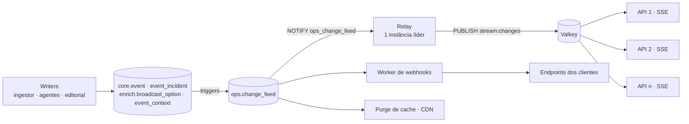

# 05 · API pública Galaxie Sports

A API tem **duas faces**:

1. **Espelho compatível** (`/mirror/{sport}/{endpoint}`) — mesma URL relativa, mesmos parâmetros e **o mesmo envelope** da api-sports. Quem já integrou a api-sports só troca a URL base e a chave.
2. **API canônica** (`/v1/...`) — orientada a evento, multiesporte, localizada e enriquecida (onde assistir, semântica, contexto, momentum).

Especificação formal: OpenAPI 3.1 gerada a partir dos schemas Zod de `packages/contracts` (biblioteca `zod-openapi`), servida em **`/openapi.json`**, com referência interativa (Scalar) em **`/docs`** — ambas públicas. O mesmo pacote exporta o cliente tipado `createGalaxieClient({ baseUrl, apiKey, locale })` usado pelo demo. O CI valida o documento contra o schema oficial do OpenAPI 3.1.

## 1. Autenticação, tenants e limites

| Item | Regra |
|---|---|
| Autenticação | Header `x-galaxie-key: <chave do tenant>` (chaves rotacionáveis, escopos por módulo) |
| Tenant | Cada cliente tem plano (Core Data, Fan Experience, Live Intelligence, Enterprise), mercados ativos e esportes contratados |
| Rate limit | Por tenant e por rota; headers `x-ratelimit-limit`, `x-ratelimit-remaining`, `x-ratelimit-reset` |
| Locale | `Accept-Language` ou `?locale=` (pt-BR, es-AR, es-MX, es-CO, es-CL, es-PE, es-UY, es-EC) |
| Fuso | `?tz=America/Sao_Paulo` (padrão UTC) |
| Cache | `ETag` + `Cache-Control` por tipo de recurso; `If-None-Match` retorna 304 |

### 1.1 Implementação (schema `api`)

**Chaves.** Formato `gs_<live|test>_<prefixo>_<segredo>` — prefixo de 12 caracteres hex (guardado em claro em `api.api_key.prefix` para localizar a chave) e segredo de 32 bytes em base64url, guardado **só como hash scrypt com sal** (`scrypt$N$r$p$sal$hash`, via `node:crypto`). A chave completa é exibida uma única vez, na criação. A verificação positiva fica em cache em memória por 60 s (revogação e mudança de plano valem em até 1 min). `last_used_at` é atualizado no máximo a cada 5 min.

**Tenants e planos.** `api.tenant` guarda `plan`, `modules`, `markets` (países ISO2; vazio = todos), `sports` (vazio = todos), `rate_limit_per_minute` e `status` (`active`/`suspended`). Módulos: `core_data`, `where_to_watch`, `semantic`, `live_intelligence`, `multisport`. Cada chave pode restringir os módulos do tenant (`api.api_key.scopes`; `null` = herda).

| Plano | Módulos padrão |
|---|---|
| `core_data` | `core_data` |
| `fan_experience` | `core_data`, `where_to_watch`, `semantic` |
| `live_intelligence` | + `live_intelligence`, `multisport` |
| `enterprise` | todos |

Cada rota declara o módulo exigido (`/mirror` e o catálogo `/v1` exigem `core_data`). Chave sem o módulo → 403 `MODULE_NOT_IN_PLAN`; esporte fora de `sports` no espelho → 403 `MODULE_NOT_IN_PLAN`; país fora de `markets` (rotas por país, como onde assistir) → 403 `MARKET_NOT_IN_PLAN`.

**Rate limit.** Janela fixa de 60 s por **tenant × rota** (padrão da rota, ex.: `GET /v1/competitions/:id`), com contadores no Valkey (`<prefixo>rl:<tenant>:<rota>`), compartilhados entre instâncias. Headers `x-ratelimit-limit`, `x-ratelimit-remaining`, `x-ratelimit-reset` (segundos) em toda resposta autenticada; 429 inclui `retry-after`. Se o Valkey cair, o limite é ignorado (*fail-open*) e o evento é registrado em log.

**Locale.** `?locale` (um dos 8 locales; outro valor → 400) tem precedência; senão `Accept-Language` (tag exata, ou só o idioma: `es-*` → `es-AR`, `pt-*` → `pt-BR`); padrão `pt-BR`. A resposta traz `Content-Language`. Textos i18n do banco seguem a cadeia `es-XX → es → en` (`pt-BR → pt → en`); sem correspondência, cai no nome oficial. **Fuso:** `?tz` aceita qualquer fuso IANA (inválido → 400); instantes saem em ISO 8601 com o offset do fuso (padrão UTC, sufixo `Z`).

**Chave local para desenvolvimento:**

```bash
pnpm --filter @galaxie/api tenant:create --slug demo-local --plan enterprise --label dev
# padrões do modelo do plano (config/plans.yaml, §1.2); ajustes: --markets BR,AR --sports football
# --rate-limit 600 --daily-quota 50000|none --scopes core_data --env live
```

### 1.2 Onboarding, autoatendimento e uso

**Modelos de plano** — [`config/plans.yaml`](../config/plans.yaml) define, para cada plano comercial (Core Data, Fan Experience, Live Intelligence, Enterprise — docs/01 §6), os módulos, mercados e esportes padrão, `rateLimitPerMinute`, `dailyRequestQuota` (informativa; `null` = sem cota) e o ambiente da chave inicial. O arquivo é validado na subida da API (Zod); o teste unitário garante que os módulos batem com `PLAN_MODULES`. Mudar o arquivo não altera tenants existentes (use `applyTemplate`).

**API administrativa** — `/internal/admin/*`, só registrada quando `ADMIN_KEY_HASHES` está definida. Exige a chave administrativa no header `x-galaxie-admin-key` (`gs_admin_<32 bytes>`; gere com `pnpm --filter @galaxie/api admin:key`, que imprime a chave **uma vez** e o hash `sha256$...` para o ambiente) e, com `ADMIN_IP_ALLOWLIST` (IPs/CIDRs), responde **404** fora da allowlist. O proxy público já devolve 404 para `/internal/*` ([Caddyfile](../infra/caddy/Caddyfile)); o acesso é pela rede privada/VPN. Respostas `no-store`, sem CORS. Corpo e parâmetros validados com Zod (`.strict()`: campo desconhecido → 400).

| Rota | Uso |
|---|---|
| `GET /internal/admin/plans` | Modelos de plano carregados |
| `POST /internal/admin/tenants` | Onboarding: `{ slug, name, plan, modules?, markets?, sports?, rateLimitPerMinute?, dailyRequestQuota?, key?: { label?, scopes?, env?, expiresAt? } \| false }` → 201 com o tenant e a **chave exibida uma única vez**; slug repetido → 409 `CONFLICT` |
| `GET /internal/admin/tenants?status=&plan=&limit=&offset=` | Lista |
| `GET /internal/admin/tenants/{id\|slug}` | Tenant + metadados das chaves (nunca hash/segredo) |
| `PATCH /internal/admin/tenants/{id\|slug}` | Plano, módulos, mercados, esportes, limites, `status` (`suspended` bloqueia todas as chaves); `applyTemplate: true` reaplica o modelo do plano antes dos demais campos |
| `POST /internal/admin/tenants/{id}/keys` | Emite chave (escopos ⊆ módulos do tenant) |
| `POST /internal/admin/tenants/{id}/keys/{keyId}/rotate` | Nova chave (mesmo rótulo/escopos/ambiente); a antiga expira em `graceSeconds` (padrão 86400; 0 = revoga já; máx. 7 dias) |
| `POST /internal/admin/tenants/{id}/keys/{keyId}/revoke` | Revoga |
| `GET /internal/admin/tenants/{id}/usage?from=&to=` | Uso por dia e rota (dias UTC; padrão últimos 7; máx. 92) |
| `GET /internal/admin/usage?from=&to=` | Total por tenant no período |
| `POST /internal/admin/usage/flush` | Força a consolidação Valkey → Postgres |

```bash
curl -X POST http://localhost:8080/internal/admin/tenants \
  -H "x-galaxie-admin-key: $GALAXIE_ADMIN_KEY" -H 'content-type: application/json' \
  -d '{"slug":"portal-esportivo","name":"Portal Esportivo","plan":"fan_experience","markets":["BR","AR"]}'
```

**Autoatendimento do tenant** — `/v1/account/*` exige uma chave válida, mas nenhum módulo (todo tenant gerencia a própria conta). Respostas `no-store`; documentadas no OpenAPI (tag *Conta*).

| Rota | Uso |
|---|---|
| `GET /v1/account` | Plano, módulos, mercados, esportes, limites e a chave em uso (`effectiveModules` = módulos ∩ escopos) |
| `GET /v1/account/keys` | Chaves do tenant (prefixo, rótulo, escopos, status, último uso) |
| `POST /v1/account/keys/rotate` | Rotaciona **a chave usada na requisição**: `{ graceSeconds? }` (padrão 86400) → 201 com a chave nova (exibida uma vez) |
| `GET /v1/account/usage?from=&to=` | Uso por dia e rota + `dailyRequestQuota` |

Revogação, suspensão e mudança de plano valem em até 60 s (cache do autenticador por instância).

**Contadores de uso** — toda requisição autenticada incrementa um `Map` em memória (tenant × dia UTC × padrão de rota; sem I/O na requisição). A cada 1 s (`USAGE_FLUSH_MS`) o buffer agregado vira **um** pipeline de `HINCRBY` no Valkey (`<prefixo>usage:<dia>:<tenant>`, campo = rota; set `<prefixo>usage:<dia>:tenants`; TTL 4 dias). A cada 60 s (`USAGE_PERSIST_MS`) uma instância (trava `SET NX`) consolida ontem e hoje em `api.usage_daily` com `greatest(...)` — idempotente e sem regredir se o Valkey for reiniciado. As consultas combinam o consolidado com os contadores vivos. Em queda abrupta da instância perde-se no máximo o último segundo. A 10k req/s isso dá ~1 round-trip/s por instância.

## 2. Espelho compatível — `/mirror`

```http
GET /mirror/football/fixtures?league=71&season=2026&round=Regular Season - 30
x-galaxie-key: gs_live_xxx
```

Resposta (mesmo envelope da api-sports):

```json
{
  "get": "fixtures",
  "parameters": { "league": "71", "season": "2026", "round": "Regular Season - 30" },
  "errors": [],
  "results": 10,
  "paging": { "current": 1, "total": 1 },
  "response": [ { "fixture": { "id": 1234567, "...": "..." }, "league": {}, "teams": {}, "goals": {}, "score": {} } ]
}
```

Extras do espelho (headers, sem alterar o corpo):

| Header | Significado |
|---|---|
| `x-galaxie-source` | `raw-hit` (resposta idêntica já obtida do fornecedor), `rebuilt` (montada a partir do `core`), `stale` (last-known-good) |
| `x-galaxie-fetched-at` | Quando o dado foi obtido do fornecedor |
| `x-galaxie-asset-base` | URL base do nosso CDN de assets (logos/bandeiras reescritos para o nosso storage) |

Esportes do espelho:

| Esporte | Prefixo | Fornecedor original |
|---|---|---|
|  Futebol | `/mirror/football` | `v3.football.api-sports.io` |
|  AFL | `/mirror/afl` | `v1.afl.api-sports.io` |
|  Beisebol | `/mirror/baseball` | `v1.baseball.api-sports.io` |
|  Basquete | `/mirror/basketball` | `v1.basketball.api-sports.io` |
|  Fórmula 1 | `/mirror/formula-1` | `v1.formula-1.api-sports.io` |
|  Handebol | `/mirror/handball` | `v1.handball.api-sports.io` |
|  Hóquei | `/mirror/hockey` | `v1.hockey.api-sports.io` |
|  MMA | `/mirror/mma` | `v1.mma.api-sports.io` |
|  NBA | `/mirror/nba` | `v2.nba.api-sports.io` |
|  NFL | `/mirror/american-football` | `v1.american-football.api-sports.io` |
|  Rúgbi | `/mirror/rugby` | `v1.rugby.api-sports.io` |
|  Vôlei | `/mirror/volleyball` | `v1.volleyball.api-sports.io` |

> O espelho **nunca** repassa a requisição ao fornecedor em tempo real. Se a combinação de parâmetros não existir no `raw` nem puder ser remontada do `core`, a resposta é `results: 0` com `x-galaxie-source: miss` e a combinação entra na fila de *backfill* do Quota Governor (prioridade ADHOC).

Como funciona hoje (`apps/api/src/routes/mirror.ts`):

1. `GET /mirror/{sport}/{endpoint...}` — o endpoint pode ter barras (`/mirror/football/fixtures/headtohead?h2h=121-131`). Os parâmetros são normalizados com `normalizeParams` e a identidade é o mesmo `requestHash('api-sports', sport, endpoint, params)` usado pelo `ApiSportsClient` — a ordem dos parâmetros não importa.
2. **Hit** (`x-galaxie-source: raw-hit`): serve o `body` da resposta **mais recente com sucesso** (HTTP 2xx e `errors` vazio) em `raw.api_response` enquanto ela estiver dentro do frescor do endpoint (`ttlFor`: 10 s no ao vivo, 5 min na agenda do dia, 1 min por `id`, 24 h em referências, "para sempre" em temporadas e dias encerrados), com `x-galaxie-fetched-at`. Como o JSONB não preserva a ordem das chaves, o envelope volta na ordem da api-sports (`get, parameters, errors, results, paging, response`); objetos internos podem ter as chaves em outra ordem (mesmo JSON).
3. **Remontado** (`x-galaxie-source: rebuilt`): quando não há raw para a combinação — ou o raw passou do frescor e o `core` tem observação mais nova que ele —, partidas de futebol são remontadas de `core.football_fixture` (resumo `fixture/league/teams/goals/score` do fornecedor, na ordem de chaves da api-sports). `x-galaxie-fetched-at` = maior `last_valid_at` das partidas. Combinações remontáveis (`apps/api/src/routes/mirror-rebuild.ts`):
   - `fixtures?id=` e `fixtures?ids=` (até 20) — com `events`, `lineups`, `statistics` e `players` do detalhe (`[]` quando ainda não sincronizado);
   - `fixtures?live=all|<ligas>` — estado ao vivo do `core` (`live`, `break`, `suspended`), com `events`;
   - `fixtures?date=` ou `fixtures?league=&season=` / `fixtures?team=&season=`, com `round`, `status` (`FT-AET`), `from`/`to` e `timezone` opcionais;
   - `fixtures/headtohead?h2h=A-B`, com `last`, `league`, `season`, `status`, `date`, `from`/`to` e `timezone`.

   `timezone` converte `fixture.date` para o fuso (como o fornecedor). Outros parâmetros (`venue`, `next`, `last` fora do h2h…) e demais endpoints/esportes não são remontados. Remontagem sem nenhuma partida conta como *miss*.
4. **Last-known-good** (`x-galaxie-source: stale`): raw fora do frescor e nada mais novo no `core` — serve o raw com `x-galaxie-fetched-at` e fica no cache por no máximo 60 s.
5. **Miss** (`x-galaxie-source: miss`): envelope vazio (`parameters: []` quando não há parâmetros, como o fornecedor) e upsert em **`api.backfill_request`** (`request_hash` único; repetições somam `hits`; `status` `pending → done/failed/skipped`, a cargo do ingestor). Respostas *miss* não entram no cache.
6. Cache: TTL igual ao frescor do endpoint no cliente da api-sports (`ttlFor`, entre 15 s e 24 h); tags de purge `api_response:<request_hash>` (e `event` nas remontadas).
7. **Mídia**: com `ASSETS_PUBLIC_BASE_URL`, toda URL `media(-N).api-sports.io` do corpo é reescrita para o nosso CDN (`rewriteMediaUrls` de `@galaxie/apisports-client`: `<base>/api-sports/<caminho original>`, chave determinística do Asset Mirror) e `x-galaxie-asset-base` traz a base. URLs da lista de bloqueio (`config/assets/denylist.yaml`, ou `MEDIA_DENYLIST_PATH`) viram `null`; URLs fora da CDN do fornecedor ficam intactas.
8. Erros de autenticação/plano do espelho também saem em `application/problem+json` (§6), e não no formato de erro da api-sports.

## 3. API canônica — `/v1`

### 3.1 Catálogo

| Método e rota | Descrição |
|---|---|
| `GET /v1/sports` | Esportes disponíveis e cobertura |
| `GET /v1/countries` | Países, bandeiras, confederação |
| `GET /v1/countries/{code}` | País com confederação (código + nome localizado) e bandeira (§3.1.1) |
| `GET /v1/countries/{code}/competitions?sport=&max_tier=` | Competições do país por esporte e escopo: domésticas, continentais de clubes, seleção, mundiais (§3.1.1) |
| `GET /v1/navigation` | Menu da demo em uma chamada: 12 esportes (contagens, `has_data`) e países da navegação (§3.1.1) |
| `GET /v1/competitions?sport=&country=&tier=` | Competições com apelidos (semântica) |
| `GET /v1/competitions/{id}` | Detalhe + temporadas |
| `GET /v1/competitions/{id}/seasons/{season}/standings` | Tabela/grupos |
| `GET /v1/competitions/{id}/context` | O que está em jogo: líder, G4/G6, Z4, mata-mata, chaveamento, próximos confrontos decisivos |
| `GET /v1/venues/{id}` | Estádio/circuito/arena: nome atual (curadoria vence o fornecedor), `provider_name` (nome cru do fornecedor) e `former_names` (`{ name, from, until, origin, confidence }`: curadoria `high` primeiro, depois pistas do fornecedor `low`) |

Convenções implementadas:

- Listas completas: `{ "data": [...] }` (`/v1/sports`, `/v1/countries`). Listas paginadas: `{ "data": [...], "next_cursor": "..." | null }` — envie `?cursor=<next_cursor>`; `limit` de 1 a 200 (padrão 50). Detalhes são o objeto sem envelope.
- `/v1/competitions`: filtros `sport`, `country` (código, case-insensitive), `tier` (1–3) e `q` (≥ 2 caracteres; busca em nome oficial, slug, labels e apelidos da base semântica); ordenação por `tier`, nome oficial e id. Cada item traz `name` (localizado), `official_name`, `nicknames` (localizados), `country`, `logo` e `current_season`.
- `/v1/competitions/{id}` aceita **UUID ou slug** e traz `seasons` (mais recente primeiro), `trophy_nickname` e `external_ids` (`{"api-sports": "71"}`).
- Standings: `{season}` é o ano (`2026`) ou `current`; tabela vazia → `groups: []` (a temporada existe, a tabela ainda não foi sincronizada). `updated_at` respeita `?tz`.
- Assets (`logo`, `flag`, `image`): `ASSETS_PUBLIC_BASE_URL` + `core.asset.storage_key` quando o asset já foi espelhado; senão, a `source_url` original.
- `GET /v1/competitions/{id}/context?season=current|AAAA` (padrão `current`) — o que está em jogo, a partir de `core.standing`, das partidas do `core` e do regulamento (`config/rules/<slug>.yaml`, [docs/rules](rules/README.md)):
  - `format` do regulamento (`league`, `cup`, `league_phase`, `groups_and_knockout`; `null` sem arquivo próprio);
  - `groups[]`: por tabela/grupo, `leader` e `zones` (`id`, `kind`, `label` localizado, faixa `from`–`to` e os times que estão nela agora). Sem regulamento, as zonas saem das faixas contíguas de `description` do fornecedor;
  - `bracket[]`: fases de mata-mata em ordem, com os confrontos (`participants`, `legs` com perna 1/2, `aggregate`, `winner_id` e `status` `scheduled`/`in_progress`/`decided`). Com regulamento de ida e volta, o confronto só é dado como decidido com as duas pernas no `core`; o vencedor sai do agregado, depois dos pênaltis da última perna e, por fim, do `winner` do fornecedor;
  - `decisive_events[]`: até 10 próximos jogos (não encerrados, a partir de 3 h atrás) com stakes decisivos (título, vaga, rebaixamento, eliminação, mata-mata) ou finais, por `importance`.

#### 3.1.1 Navegação por país (`apps/api/src/routes/v1/navigation.ts`)

Um país participa de confederações e de campeonatos que outros países também jogam (Libertadores e Sul-Americana para os dez da CONMEBOL). O modelo vem de dois arquivos versionados, validados por `packages/geo` (Zod + testes que cruzam com `config/competitions/*.yaml`):

- [`config/geo/confederations.yaml`](../config/geo/confederations.yaml) — as seis confederações com os 218 membros da FIFA (código de país da api-sports, incl. `GB-ENG`/`GB-SCT`/`GB-WLS`/`GB-NIR` e `XK`; código COI; nome `en`/`pt-BR`/`es`), as regiões dos catálogos dos outros esportes (`SOUTH-AMERICA` → CONMEBOL…) e a navegação da demo: os 10 da CONMEBOL + México + Inglaterra, Espanha, Itália, Alemanha, França e Portugal, e a ordem dos 12 esportes.
- [`config/geo/competition-scope.yaml`](../config/geo/competition-scope.yaml) — por esporte, as competições internacionais com `scope` (`continental_clubs`, `national_teams`, `world_clubs`) e participantes (`confederations`, com `FIFA` = global, e/ou `countries`: convidados da Copa América, México e EUA na Leagues Cup). Competições fora do catálogo (Supercopa da UEFA, Intercontinental, Copa Ouro, Finalíssima) casam pelo `api_sports_id` em `core.provider_map`. `featured` dá a ordem editorial das domésticas (Brasileirão e Copa do Brasil antes dos estaduais); `excluded` tira da navegação o que não tem recorte por país (amistosos de clubes, F1, MMA).

`pnpm --filter @galaxie/ingestor geo:seed` (também roda ao fim do `bootstrap:catalog`) grava em `core.country` a confederação, o código COI e os nomes pt-BR/es, preservando o `en` do fornecedor; é idempotente, não gasta cota e só cria os países da navegação que faltarem. A API usa o YAML como fallback (nome, confederação) quando o banco ainda não tem o dado.

| Rota | Resposta |
|---|---|
| `GET /v1/navigation` | `sports[]` — os 12 esportes na ordem do menu (futebol primeiro): `slug`, `name`, `competitions` (todos os tiers), `events`, `has_data` (há competição ou evento no banco), `mirror`; `countries[]` — países da navegação com `name`, `flag` e `confederation` (`code` + nome localizado); `confederations[]` — seções do menu (CONMEBOL, CONCACAF, UEFA) com os códigos dos países |
| `GET /v1/countries/{code}` | `code`, `name`, `ioc_code`, `flag`, `confederation` e `in_navigation`. Código ISO2 ou extensão (`GB-ENG`), em qualquer caixa; fora do banco e do config/geo → 404 |
| `GET /v1/countries/{code}/competitions` | `country` + `sports[]` (futebol primeiro; só esportes com alguma competição), cada um com `groups[]` na ordem `domestic` → `continental_clubs` → `national_teams` → `world_clubs` (grupo vazio é omitido), com `label` localizado e `competitions[]` no formato de `/v1/competitions` + `scope` e `confederations`. Domésticas: `country_code` = país e `tier ≤ max_tier` (padrão 2 = catalogadas; 3 traz todo o espelho). Ordem no grupo: tier, posição editorial (ordem do arquivo de escopo ou `featured`) e nome |

Todas exigem `core_data`, aceitam `?locale`/`Accept-Language` (nomes com a cadeia `es-XX → es → en`) e ficam 24 h no cache (tags `country`, `competition`, `season`, `sport`). As contagens de eventos de `/v1/navigation` podem atrasar até o TTL (a rota não é purgada a cada evento).

```bash
curl -H "x-galaxie-key: $KEY" "http://localhost:8080/v1/countries/BR/competitions?sport=football&locale=pt-BR"
```

```json
{
  "country": { "code": "BR", "name": "Brasil", "ioc_code": "BRA", "flag": "https://cdn…/api-sports/flags/br.svg",
               "confederation": { "code": "CONMEBOL", "name": "CONMEBOL (América do Sul)" }, "in_navigation": true },
  "sports": [{
    "sport": { "slug": "football", "name": "Futebol" },
    "groups": [
      { "scope": "domestic", "label": "Competições nacionais", "competitions": ["Brasileirão Série A", "Copa do Brasil", "Campeonato Baiano", "…"] },
      { "scope": "continental_clubs", "label": "Copas continentais de clubes", "competitions": ["Libertadores", "Copa Sul-Americana", "Recopa Sul-Americana"] },
      { "scope": "national_teams", "label": "Seleção", "competitions": ["Copa do Mundo", "Eliminatórias Sul-Americanas", "Copa América", "…"] },
      { "scope": "world_clubs", "label": "Mundiais de clubes", "competitions": ["Mundial de Clubes", "FIFA Intercontinental Cup"] }
    ]
  }]
}
```

(Exemplo resumido: cada item de `competitions` é um objeto completo — `id`, `slug`, `name`, `official_name`, `nicknames`, `tier`, `country`, `logo`, `current_season`, `scope` e `confederations`.)

### 3.2 Eventos

| Método e rota | Descrição |
|---|---|
| `GET /v1/events?date=&from=&to=&sport=&competition=&team=&country=&status=&importance_min=` | Agenda multiesporte paginada por cursor, ordenada por `starts_at` ou `importance` |
| `GET /v1/events/live?sport=&competition=` | Eventos ao vivo |
| `GET /v1/events/{id}` | Evento completo: participantes, placar, estado, momentum, clássico, contexto |
| `GET /v1/events/{id}/timeline` | Momentos-chave por minuto (gols, cartões, VAR, substituições) |
| `GET /v1/events/{id}/lineups` | Escalações e formação |
| `GET /v1/events/{id}/stats` | Estatísticas por time e jogador |
| `GET /v1/events/{id}/where-to-watch?country=BR&region=SP` | Opções de transmissão (§4) |
| `GET /v1/events/{id}/context?locale=pt-BR` | Cenário pré-jogo / resumo pós-jogo gerado por IA, com fontes |
| `GET /v1/events/{id}.ics` | Arquivo de calendário |
| `GET /v1/events/{id}/h2h` | Histórico do confronto (do espelho, sem nova chamada) |

Exemplo de evento canônico:

```json
{
  "id": "0192c7e2-6c1f-7a33-9a51-5b3e0f7c2d10",
  "sport": "football",
  "competition": { "id": "…", "slug": "libertadores", "name": "CONMEBOL Libertadores", "nickname": "Glória Eterna" },
  "stage": { "kind": "semi_final", "leg": 2, "name": "Semifinal · Volta" },
  "starts_at": "2026-10-22T00:30:00Z",
  "status": "scheduled",
  "momentum": "today",
  "participants": [
    { "side": "home", "id": "0192c7e2-…-palmeiras", "name": "Palmeiras", "logo": "https://assets.galaxie.sports/api-sports/football/teams/121.png?v=9879fc79",
      "nickname": "Verdão",
      "fan_tags": [{ "code": "advances_with_draw", "priority": 34, "text": { "pt-BR": "Avança com empate" } }],
      "cheer": { "text": "Avanti, Palestra!", "source_url": "https://pt.wikipedia.org/wiki/Sociedade_Esportiva_Palmeiras" } },
    { "side": "away", "id": "0192c7e2-…-fluminense", "name": "Fluminense", "logo": "https://assets.galaxie.sports/api-sports/football/teams/124.png?v=1f0c2a7e",
      "nickname": "Tricolor",
      "fan_tags": [
        { "code": "needs_win_by_2", "priority": 31, "text": { "pt-BR": "Precisa vencer por 2 gols" } },
        { "code": "win_by_1_goes_to_penalties", "priority": 36, "text": { "pt-BR": "Vencer por 1 leva aos pênaltis" } }
      ],
      "cheer": null }
  ],
  "score": { "home": null, "away": null, "aggregate": { "home": 2, "away": 1 } },
  "venue": { "id": "…", "name": "Allianz Parque", "city": "São Paulo" },
  "referee": { "name": "Wilton Pereira Sampaio", "country": "Brazil" },
  "derby": null,
  "competition_context": ["semifinal", "knockout"],
  "stakes": [
    { "team": "home", "team_id": "0192c7e2-…-palmeiras", "code": "advances_with_draw", "text": { "pt-BR": "Avança com empate" } },
    { "team": "away", "team_id": "0192c7e2-…-fluminense", "code": "needs_win_by_2", "text": { "pt-BR": "Precisa vencer por 2 gols para avançar direto" } },
    { "team": "away", "team_id": "0192c7e2-…-fluminense", "code": "win_by_1_goes_to_penalties", "text": { "pt-BR": "Vitória por 1 gol leva a decisão aos pênaltis" } }
  ],
  "data_freshness": { "last_valid_at": "2026-10-21T13:00:05Z", "is_stale": false }
}
```

> Os IDs de times acima são ilustrativos; os IDs reais vêm do `provider_map` após o bootstrap. Os códigos de `stakes` e seus textos nos 8 mercados estão catalogados em [docs/rules](rules/README.md#catálogo-de-códigos); a tabela código → tag do torcedor (`fan_tags`), em [docs/rules/tags-torcedor.md](rules/tags-torcedor.md).

Convenções implementadas (`apps/api/src/routes/v1/events.ts`, montagem em `apps/api/src/events/builder.ts`):

- **Agenda** `GET /v1/events`: `{ data, next_cursor }`, `limit` 1–200 (padrão 50). `date` é o dia civil no fuso `tz` e tem precedência; `from`/`to` aceitam dia civil (início/fim inclusivo do dia no fuso) ou instante ISO 8601; **sem nenhum dos três, a agenda começa hoje** (no fuso). `competition` aceita UUID ou slug; `team` é o UUID do participante; `country` casa o país da competição **ou** de um participante; `status` é lista separada por vírgulas; `importance_min` 0–100. `order=starts_at` (padrão, crescente; cursor `starts_at,id`) ou `order=importance` (decrescente, depois horário; cursor `importance,starts_at,id`). Tenant com `sports` restritos só vê esses esportes; pedir outro → 403.
- **Ao vivo** `GET /v1/events/live`: `{ data }` (até 500) com `status` `live`, `break` ou `suspended`, por importância; TTL 10 s.
- **Evento**: `competition` com `nickname` (primeiro apelido de `semantic.competition_profile` no locale) e `logo`; `stage.name` localizado (`core.stage.name`) com a perna — `Semifinal · Volta` / `Semifinales · Vuelta`. A perna vem do confronto: duas partidas do mesmo par na mesma fase (a mais antiga é a ida); com regulamento de jogo único, não há perna. `score` traz `halftime`, `extratime`, `penalty` e `aggregate` (só no jogo de volta, com a ida encerrada: ida + placar atual da volta, nos lados da volta). `participants[]` com `logo`, `nickname` (primeiro apelido da base semântica) e `winner`; `clock` e `status_detail` do fornecedor; `importance` gravada pelo ingestor; `momentum` calculado no fuso pedido (docs/04 §3.2).
- **`derby`**: `{ slug, name (localizado), intensity }` de `core.event.derby_id`.
- **`venue`** e **`referee`** (lista e detalhe): `venue` = `{ id, name, city }` de `core.venue` (estádio e cidade) ou `null`; `referee` = árbitro principal de `core.football_fixture.referee` (`fixture.referee` da api-sports, "Nome, País"), separado em `{ name, country }` — `country` é o trecho depois da última vírgula, como o fornecedor escreve (ex.: `Brazil`), ou `null` sem sufixo. Sem escala (ou fora do futebol) → `null`.
- **`competition_context`**: `regular` (pontos corridos/grupos/fase de liga), `knockout`, `semifinal`, `final`, `playoff` (pela fase), `derby`, `lead` (um dos dois é o 1º da tabela), `title`/`relegation` (quando algum stake trata disso).
- **`stakes`**: só para eventos não encerrados de competições **com regulamento próprio** em `config/rules` (sem arquivo, nada é afirmado). Mata-mata: `knockoutStakes` com as regras da fase (`knockout_round` "1st Round" → `first_round` no YAML); a volta exige a ida encerrada no `core`. Pontos corridos: `leagueMatchStakes` com a tabela de `core.standing` (o grupo que contém os dois times) e os demais jogos da mesma rodada. `text` traz só o locale da resposta. Dados incompatíveis com o regulamento (ex.: mais jogos que o previsto) → `[]`. Cada stake traz `team_id` (o `participants[].id` do lado em `team`; `null` quando `team` é `both`), para o cliente agrupar por time sem depender do mando.
- **`participants[].fan_tags`** (tags do torcedor): até 3 rótulos curtos (~30 caracteres), do ponto de vista de quem torce para aquele time, derivados dos `stakes` por uma tabela fixa (`fanTags` em `@galaxie/rules`; tabela completa em [docs/rules/tags-torcedor.md](rules/tags-torcedor.md)) — nada é gerado livremente. Cada item: `code` (o stake de origem), `priority` (menor = mais importante) e `text` no locale da resposta. Stakes `both` valem para os dois participantes; tags de texto idêntico são fundidas (fica a mais relevante); ordem por faixa: título (10–19) > rebaixamento (20–29) > eliminação/classificação no mata-mata (30–39) > vaga continental/acesso (40–49) > demais (50+). Em pontos corridos, as tags de mera possibilidade exigem proximidade real na tabela (`core.standing`): "Na briga pelo título" só até max(6, rodadas restantes) do líder; "Luta contra o rebaixamento" e as tags de permanência ("Vitória garante a permanência", "Pode se salvar hoje", "Livre do rebaixamento") só na zona ou até 6 pontos acima do primeiro time dentro dela; "De olho na X" só até max(6, rodadas restantes) do último time dentro da zona. Os `stakes` continuam matemáticos e as tags decisivas ("Pode ser campeão hoje", "Vencer ou cair") valem sempre ([regras](rules/tags-torcedor.md#relevância-para-o-torcedor-pontos-corridos)). Sem stakes (jogo encerrado, competição sem regulamento) → `[]`. Exemplos: `in_title_race` → "Na briga pelo título" / "En la pelea por el título"; `at_risk_of_relegation` → "Luta contra o rebaixamento"; `can_qualify_for_libertadores_group_stage` → "De olho na Libertadores"; `qualifies_for_sudamericana` → "Garantido na Sul-Americana".
- **`participants[].cheer`**: grito curto da torcida, da base semântica (`semantic.team_profile`, o mesmo perfil do `nickname`): primeiro `copy_hints.<locale>.cheer` (locale exato e depois o idioma; pt-BR não cai para espanhol), depois `rallying_cries`. Só passa texto aprovado por `checkChant` sem erro nem aviso — letra de hino ou canção nunca é servida. `{ text, source_url? }` (`source_url` = primeira fonte do perfil) ou `null`. Como o `nickname`, não aplica o piso editorial de `SEMANTIC_MIN_REVIEW_STATUS`.
- **Card personalizado pelo clube do torcedor**: o parceiro que conhece o clube do usuário (perfil, favorito) escolhe o participante pelo `id` e monta o card de chamada da partida com `fan_tags[0]` (ou as três) e, se houver, o `cheer`. Em Palmeiras × RB Bragantino (rodada 32 de 2026), o torcedor do Palmeiras vê "Na briga pelo título" e "Avanti, Palestra!"; o do Bragantino, 9 pontos acima do Z4, não recebe "Luta contra o rebaixamento" (fica com o grito "Vamos, Massa Bruta!"), enquanto o do Vitória, 5 pontos acima, recebe. As frases completas (`stakes` filtrados por `team_id`) servem para o detalhe do card.
- **`/timeline`**: `core.event_incident` na ordem do fornecedor (`sequence`), com `team` (lado e logo), `player`/`assist` (`id` do `core.person`, ou `null` com o nome do fornecedor) e `comments`.
- **`/lineups`** e **`/stats`**: do detalhe da partida (`core.football_fixture.detail`); IDs do fornecedor resolvidos para os nossos via `provider_map` (times e pessoas, com foto). Sem detalhe sincronizado: `available: false` e listas vazias. Outros esportes: `available: false` por ora.
- **`/h2h?limit=`** (1–50, padrão 10): confrontos **encerrados** entre os dois participantes no `core` (qualquer competição, exceto o próprio evento), do mais recente ao mais antigo; `summary` (`played`, `draws`, `wins`/`goals` por time) considera todo o histórico. Nunca chama o fornecedor.
- **`/{id}.ics`**: `text/calendar` (RFC 5545) com um `VEVENT`: `UID <id>@galaxie.sports`, `DTSTART`/`DTEND` em UTC (`starts_at` e `ends_at_expected`), `SUMMARY` "Mandante × Visitante · Competição", `LOCATION`, `STATUS` (`CANCELLED` para cancelado/abandonado, `TENTATIVE` para adiado), linhas CRLF dobradas em 75 octetos. O título segue o locale; os horários não dependem de `tz`.
- **`/context?locale=&kind=scenario|recap`** (módulo `live_intelligence`; `apps/api/src/routes/v1/event-context.ts`): cenário pré-jogo e resumo pós-jogo dos agentes de IA (docs/07 §2.3), lidos de `enrich.event_context` por `readEventContext` (`@galaxie/db`, a mesma leitura dos agentes): a versão vigente por tipo no locale pedido, ignorando as rejeitadas pela revisão editorial — sem fallback entre locales (a copy é por mercado; locale sem texto → `data: []`). Cada item traz `text`, `sentences`, `origin` (`llm` aprovado pelos guardrails ou `fallback` determinístico), `model`, `confidence`, `review_status` (`auto`/`reviewed`), `generated_at` (no `tz`), `fits` (TV/mobile/web) e `sources` (core, regulamento com URL). Sem `kind`, os dois tipos. Evento inexistente → 404; esporte fora do plano → 403. TTL 1 h, purgado por `event.context_published` (tags `event_context:<id>` e `event:<id>`).
- **`context` no detalhe**: para tenants com `live_intelligence`, `GET /v1/events/{id}` traz `context: { scenario, recap }` (texto vigente no locale, `origin` e `generated_at`, ou `null`) — uma consulta indexada a mais; para os demais planos o campo não aparece (a resposta em cache varia por isso).
- **Cache**: detalhe com TTL de 10 s se ao vivo ou começando em até 2 h, 5 min se agendado e 1 h se encerrado; agenda até 5 min. Tags `event:<id>` (e `event` nas listas): `publishChange(db, { entityType: 'event', entityId })` purga. O plano do tenant (esporte) é verificado também quando a resposta vem do cache.

### 3.3 Times, atletas e semântica

| Método e rota | Descrição |
|---|---|
| `GET /v1/teams?sport=&country=&competition=&q=` | Busca de times/seleções |
| `GET /v1/teams/{id}` | Detalhe do time (estádio, país, cores e gradiente sugerido, IDs externos) |
| `GET /v1/teams/{id}/overview` | Posição no torneio, forma recente (últimos 5), últimos resultados, próximo jogo + onde assistir |
| `GET /v1/teams/{id}/events?from=&to=` | Jogos do time |
| `GET /v1/teams/{id}/squad?season=` | Elenco e comissão técnica |
| `GET /v1/teams/{id}/semantic?locale=` | Cartão de identidade: apelidos, mascote, torcida, gritos, estádio, rivais, fatos, dicas de copy do mercado |
| `GET /v1/teams/{id}/rivals?locale=` | Rivais e clássicos do time (segmentação/CRM) |
| `GET /v1/derbies?country=&team=` | Clássicos |
| `GET /v1/derbies/upcoming?days=7&country=` | Clássicos dos próximos dias (eventos com `derby_id`) |
| `GET /v1/derbies/{slug}` | Clássico + retrospecto calculado dos eventos do `core` |
| `GET /v1/glossary?locale=&category=` | Glossário esportivo por mercado ("secar", "hinchar por", "le voy al", "hacer fuerza"…) |
| `GET /v1/people/{id}` | Jogador/técnico/piloto |
| `GET /v1/copy?locale=&sport=&intent=&tone=&affinity_type=&affinity_source=&momentum=&context=&team=&rival=&minutes=` | Microcopy sugerida (badges, chamadas) respeitando `copy_permission` |

#### 3.3.1 Implementação da semântica (`apps/api/src/routes/v1/semantic.ts` e `copy.ts`)

- **Módulo `semantic`** em todas as rotas desta tabela a partir de `/v1/teams/{id}/semantic` (planos `fan_experience`, `live_intelligence` e `enterprise`). As demais rotas de times ficam com `/v1/teams` (#32).
- **`{id}` de time** aceita o UUID do participante (`core.participant`, ligado por `semantic.team_profile.participant_id`) ou o slug do perfil (`palmeiras`). Clássico usa o slug (`choque-rei`).
- **Piso editorial (`review_status`).** Cada item da base tem `draft`, `reviewed` ou `approved`. A API serve só itens com status ≥ ao mínimo efetivo = o maior entre o piso do servidor e `?min_review_status=` — o cliente **endurece, nunca afrouxa**. Piso do servidor: variável `SEMANTIC_MIN_REVIEW_STATUS` (padrão **`approved`**, o de produção; em desenvolvimento local use `draft`, já que toda a base ainda está em revisão). Listas filtram; detalhe abaixo do piso → 404 com `detail` explicando o motivo. Um piso por tenant fica para quando houver configuração por tenant no schema `api`.
- **Locale.** Nomes de time/clássico seguem `labels` com a cadeia `es-XX → es → en`; `copy_hints` e glossário usam só o locale e o idioma (`es-AR → es`), nunca outro idioma. `/v1/copy` não tem fallback entre locales (copy é localizada pela intenção).
- **`/v1/derbies`**: lista completa (`{ data }`), por intensidade e slug; `country` casa o país de qualquer um dos dois times; `team` inexistente → 404.
- **`/v1/derbies/upcoming`**: eventos com `core.event.derby_id` entre agora e `days` dias (1–30, padrão 7), sem encerrados/cancelados/adiados; cache de agenda (5 min). Vazia enquanto não houver eventos futuros sincronizados.
- **`/v1/derbies/{slug}`**: retrospecto **calculado só de `core.event`** (status `finished`, placar presente, os dois participantes em qualquer mando) — nunca chama o provedor. Traz vitórias e gols por time, empates, até 3 maiores goleadas (saldo → gols → mais recente), últimos 5, primeiro/último confronto e `next_event`. Pênaltis aparecem em `penalties`, mas o jogo conta como empate. Sem os dois times ligados ao `core`, `retrospect.available = false`. TTL 1 h (muda a cada clássico encerrado).
- **`/v1/teams/{id}/rivals`**: rivais declarados no perfil + clássicos que incluem o time, com `derby`, `intensity` e `mutual` (os dois se declaram rivais); rival abaixo do piso é omitido e clássico abaixo dele vira `derby: null`.
- **`/v1/glossary`**: lido de `data/knowledge/glossary/<locale>.yaml` (validado por `pnpm knowledge:validate`), carregado uma vez por processo; pasta configurável por `KNOWLEDGE_DIR` (padrão: `data/knowledge` do repositório). Cada termo traz `requires` (`declared_rival`/`declared_affinity`) — a mesma regra do `copy_permission`.
- **`/v1/copy`**: templates de `semantic.copy_template` (seed da base) escolhidos por `selectCopy` (`packages/knowledge`). `affinity_source=inferred` → só `inform` tom 1; rivalidade só com `affinity_type=rival&affinity_source=explicit`. `team`/`rival` (UUID ou slug) preenchem `{team}`, `{nickname}` (apelido do mercado) e `{rival}`; `minutes` preenche `{minutes}`; com algum deles, templates com placeholder sem valor são descartados e `text` vem pronto; sem nenhum, `text` é `null` e o cliente preenche o `template`. `variant` é uma semente opaca para variar entre equivalentes — **nunca** envie dado pessoal. Sem template compatível, `selection: null` (200).
- **Cache**: 24 h (`semantic`) com `ETag`/304; tags `derby:<id>`, `team_profile:<slug>`, `derby`, `team_profile`, `copy_template`, `glossary`. O seed semântico ainda não publica no change feed: até lá, mudanças na base valem ao fim do TTL.

Convenções implementadas (`apps/api/src/routes/v1/teams.ts`):

- `GET /v1/teams`: `{ data, next_cursor }` ordenado por nome; `q` (≥ 2 caracteres) busca em nome, nome curto, código e apelidos/nomes da base semântica; `competition` (UUID ou slug) = times com jogos na competição. Cada item traz `nicknames` da base semântica (vazio sem perfil).
- `GET /v1/teams/{id}`: resumo + `country_ref` localizado, `founded`, `venue` (estádio da casa, com imagem e nome curado), `colors`, `external_ids` e `former_names` (nomes anteriores do time derivados dos jogos do fornecedor, `origin: provider`, `confidence: low`; variações de grafia não contam e os nomes da base semântica vencem).
- `former_names` com `confidence: low` (origem `provider`) são **pistas** para busca e casamento de nomes, não fato confirmado editorialmente (podem ser casa provisória ou nome de torneio): nunca substituem o nome atual e não devem ser exibidos ao usuário final como fato. Para exibir, use só `confidence: high` (curadoria).
- Estádio em evento, time e `/v1/venues/{id}`: o nome curado da base semântica vence o do fornecedor (ex.: "Nubank Parque" no lugar de "Allianz Parque", que a api-sports ainda manda em `/teams`); jogos anteriores à troca também mostram o nome atual ([04 — nomes de estádios](04-modelo-de-dados.md#nomes-de-estádios-e-times-curadoria--fornecedor)).
- **`colors`** (também em `overview.team`): cores extraídas do escudo espelhado, sem chamada externa ([03 §7.2](03-ingestao-e-economia-de-chamadas.md#72-cores-dos-times-paleta-do-escudo)) — `primary` (cor predominante, `#rrggbb`), `secondary` (segunda cor com matiz distinto, ou `null`), `monochrome` (escudo preto/branco: `primary` vira o cinza neutro `#3a3a3a`) e `gradient`, o **gradiente sugerido** pronto para CSS: `linear-gradient(9deg, #000 0%, <primary> 100%)`. `null` enquanto o escudo não foi espelhado ou não é um PNG decodificável. Exemplo (Palmeiras): `{ "primary": "#006937", "secondary": null, "monochrome": false, "gradient": "linear-gradient(9deg, #000 0%, #006937 100%)" }`.
- `GET /v1/teams/{id}/overview`: em uma chamada, `team`, `standings` (por competição, a temporada atual ou a mais recente com tabela do time), `competitions` (campanha em cada competição, abaixo), `form` (últimos 5 encerrados, do mais recente ao mais antigo; placar do ponto de vista do time; empate decidido nos pênaltis usa o `winner` do fornecedor), `last_events` (5), `live_event` e `next_event` (próximo `scheduled`/`starting` a partir de 3 h atrás), todos no formato de evento de §3.2 (com stakes). Onde assistir do próximo jogo entra com a issue de onde assistir.
- **`competitions`** (overview): a **campanha** do time na temporada atual (ou, sem ela, na mais recente) de cada competição — inclusive copas sem tabela; temporadas que não são a atual só entram se o time jogou nelas nos últimos 12 meses. Ordem: em disputa (`campaign.ongoing`) primeiro, depois a atividade mais recente. Cada item: `competition`, `season`, `group` (tabela do time, quando a fase tem tabela) e `campaign`:
  - `status`: `champion` (venceu a final, ou terminou em 1º uma liga de pontos corridos encerrada cujo regulamento define campeão), `runner_up`, `third_place` (venceu a disputa de 3º), `in_progress` (ainda na disputa), `eliminated`, `league` (liga de pontos corridos em andamento) e `finished_league` (liga encerrada, posição final). Perder a disputa de 3º = `eliminated` com `stage_kind: third_place` e `rank: 4`.
  - `stage_kind`: em `in_progress`, a fase atual — quem venceu a semifinal e ainda não tem a final marcada já aparece `final` ("Na final"); nos demais, a fase em que a campanha se decidiu.
  - `label` e `detail`: textos fixos (sem geração livre) no locale da resposta, no formato dos stakes (`{ "pt-BR": "Na final" }`); `detail` traz o confronto decisivo com adversário e placar do ponto de vista do time (`Final contra Novorizontino (3–1 no agregado)`, `Derrota para Chelsea (1–2)`, `Eliminou Fluminense nas semifinais (2–2 no agregado, 5–3 nos pênaltis)`, `Contra Estudiantes L.P. (ida: 0–0)`) ou posição e pontos nas fases de tabela (`2º lugar · 11 pts`). Nomes de clubes vão sem artigo (o gênero do nome não está na base). Textos em pt-BR, es (es-AR com "alargue"; demais es-* com "tiempo extra") e en.
  - `rank`/`points`: posição e pontos na fase de tabela (grupo, liga); `opponent`: adversário do confronto decisivo, do último vencido ou do que está em disputa; `decided_by_event_id`: último jogo do confronto que decidiu (ou classificou), `null` enquanto em disputa.
  - Regras (`apps/api/src/teams/campaign.ts`, funções puras): as fases do time são ordenadas por profundidade (`qualifying` < `regular`/`group`/`league_phase` < `playoff` < `knockout_round` < `round_of_128` … `semi_final` < `third_place` < `final`; no mesmo tipo, `core.stage.order`) e vale a mais profunda. Em mata-mata, o confronto (`groupTies`/`goalsOf` do montador de eventos) é decidido pelo **agregado por participante** (os mandos se invertem na volta), depois pelo regulamento (`tieOutcome` de `@galaxie/rules`: gol fora — na prorrogação só se `away_goals_in_extra_time` — e vantagem do empate em jogo único), depois pelos pênaltis (`score.penalty`) e, por fim, pelo `winner` do fornecedor; sem como decidir, segue `in_progress`. Em fase de tabela: com jogo pendente do time = em disputa; se a temporada já tem fase mais profunda sem o time = eliminado; liga pura (sem fases de confronto e `format: league` no regulamento, ou competição `league` sem regulamento) encerrada (nenhum jogo pendente na temporada) = `champion` (1º) ou `finished_league`.
- `GET /v1/teams/{id}/events`: mesmos filtros, ordenação e cursor da agenda (§3.2), sem janela padrão (sem `from`/`to`, todo o histórico em ordem crescente).
- `GET /v1/teams/{id}/squad?season=`: sem `season`, o elenco atual (`core.roster.season_id` nulo); com o ano, os elencos de temporadas daquele ano. `players`, `coaches`, `staff`, ordenados por posição (goleiro → atacante), número e nome; pessoa com `age` calculada.
- `GET /v1/people/{id}`: dados de `core.person`, foto, `age`, `teams` (elencos, atual primeiro) e `external_ids`.
- Cache: times e pessoas 24 h, elenco 1 h, overview/jogos até 5 min (10 s se houver jogo ao vivo ou começando); tags `participant:<id>`, `person:<id>`, `roster`, `event`.

### 3.4 Olimpíadas e Pan-Americano

| Método e rota | Descrição |
|---|---|
| `GET /v1/multisport/games?type=OG,PAN&year=&season=&status=` | Edições (Olimpíadas de Verão/Inverno, Pan-Americano) |
| `GET /v1/multisport/games/{slug}` | Edição |
| `GET /v1/multisport/games/{slug}/medals?sort=gold\|total&region=latam&noc=` | Quadro de medalhas |
| `GET /v1/multisport/games/{slug}/schedule?date=&sport=&noc=&medal_only=&tz=` | Agenda por dia/modalidade/país (paginada por cursor) |
| `GET /v1/multisport/games/{slug}/events/{id}` | Prova: fases, unidades, resultados e medalhas |
| `GET /v1/multisport/games/{slug}/nocs/{noc}/athletes` | Delegação |
| `GET /v1/multisport/games/{slug}/today/{noc}?date=&tz=` | "Brasil hoje" / "Argentina hoy" |
| `GET /v1/multisport/history/medals?noc=BRA,ARG&type=OG,PAN&season=` | Histórico de medalhas por país |

#### 3.4.1 Implementação (`apps/api/src/routes/v1/multisport.ts`)

- **Módulo `multisport`** (planos `live_intelligence` e `enterprise`). Países pelo código COI (`BRA`, `CHI`, `URU`…), case-insensitive; `noc` aceita lista separada por vírgula no histórico.
- **Regra de qualidade (docs/08 §6.4) — escolha: resposta sinalizada, não erro.** Quadro, ranking, medalhas do dia e histórico só são publicados quando `games.medal_data_quality` é `complete` ou `partial`. Fora disso a resposta é **200** com `data_quality: { level, coverage, publishable: false, notice }` e `data: []` (no histórico, a edição vai para `withheld`). Motivos: o cliente renderiza "indisponível" sem tratar erro, a resposta é cacheável e não há como exibir número errado (a lista vem vazia). `partial` sai com `notice` localizado ("Quadro parcial: cobertura de 95,7%…"). `unknown` (sem referência para medir) e edições futuras também não publicam.
- **Quadro**: view `multisport.medal_table` (derivada, sem revogadas); `rank` é a posição no critério pedido (`sort=gold` padrão COI ou `total`), empates dividem a posição; `region=latam` filtra `LATAM_NOCS` mantendo as posições globais. `sources` traz fonte e licença (Wikidata, CC0) para atribuição.
- **Agenda**: unidades (`multisport.unit`) da edição, por início; `date` é o dia **local** no `tz` pedido ou, sem `tz`, no fuso da sede; `sport` aceita código do esporte ou da disciplina (ODF); `noc` filtra unidades com resultado/participante do CON; `medal_only=true` só unidades de medalha. Vazia enquanto a agenda oficial não é carregada (hoje não há fonte de agenda).
- **Delegação** (`basis: medals_and_results`): atletas derivados das medalhas (individuais e integrantes de equipes) e dos resultados, por ouro → prata → bronze → nome. A lista oficial de inscritos é follow-up.
- **"Hoje"**: unidades do dia com o CON e medalhas com `awarded_at` no dia (só se publicável); `medal_chances` e `where_to_watch` vêm `null` (reservados). Sem `date`, "hoje" é calculado no fuso (`tz` ou da sede).
- **Cache**: edições e histórico 24 h; quadro 24 h (encerrada), 60 s (em andamento) ou 1 h (futura); agenda, provas e "hoje" 5 min; delegação 1 h. Tags `games:<id>`, `medal_table:<id>`, `medal`, `unit`.
- **#78**: os torneios coletivos (futebol, basquete, vôlei, handebol…) ficam ligados à edição por `multisport.games_competition` e seus jogos são eventos comuns do `core` (listados por `/v1/events`, #31, pela competição); quando houver agenda por unidade, a ligação unidade ↔ evento canônico sai em `core_event_id`.

## 4. Onde assistir

```http
GET /v1/events/{id}/where-to-watch?country=BR&region=SP&locale=pt-BR
```

```json
{
  "event_id": "0192c7e2-…",
  "country": "BR",
  "status": "resolved",
  "message": null,
  "options": [
    {
      "id": "…",
      "provider": "Emissora de TV aberta X",
      "channel": "Canal X",
      "medium": "free_tv",
      "access_model": "free",
      "region": null,
      "confidence": 0.97,
      "status": "confirmed",
      "last_verified_at": "2026-10-21T12:00:00Z",
      "sources": [ { "publisher": "Organizador da competição", "url": "https://…" } ]
    }
  ],
  "updated_at": "2026-10-21T12:00:00Z"
}
```

Regras de contrato:

| Regra | Comportamento |
|---|---|
| Sem informação confiável | `status: "unknown"`, `options: []` e `message` localizada ("Não temos as informações de transmissão ainda.") — o evento **continua** existindo |
| Conflito entre fontes ou confiança < limiar | Opção **omitida** (registrada internamente como `omitted`) |
| Mesma plataforma vinda de várias fontes | Deduplicada; fontes agregadas em `sources` |
| Correção aceita (inclusão/remoção) | Propagada ao cliente em **≤ 5 min** (purge de cache + SSE + webhook `where_to_watch.changed`). O trigger de `enrich.broadcast_option` publica a mudança no change feed sem depender do writer; purge das tags `where_to_watch:<evento>` e `event:<evento>` em < 1 s (§5, §7.1) |
| Ordenação | A API ordena por `medium`/confiança; a **ordenação final por direito de acesso do usuário** (incluído, ativação, upgrade, extra, externo) é responsabilidade do cliente, que conhece o assinante |
| Limite de exibição | A API retorna todas as opções válidas; recomenda-se exibir até 4 |

### 4.1 Implementação

- **Rota:** `GET /v1/events/{id}/where-to-watch?country=BR[&region=SP][&locale=][&tz=]` (`apps/api/src/routes/v1/where-to-watch.ts`). Exige o módulo `where_to_watch` e o país em `tenant.markets` (`MARKET_NOT_IN_PLAN`); evento inexistente → 404. `country` é ISO2 (case-insensitive); país fora dos 8 mercados responde `unknown`.
- **O que sai:** só a versão vigente com `status: confirmed` de cada opção (`enrich.broadcast_option` com `superseded_by` nulo). `pending` (0,5–0,7, emissora desconhecida), `omitted` (conflito) e `retracted` (removida) ficam só internamente. Campos extras em relação ao exemplo acima: `provider_id` (id do dicionário `config/broadcasters/<iso2>.yaml`) e `watch_url`.
- **Região:** com `region`, devolve as nacionais (`region: null`) + as daquela UF/praça; sem `region`, todas (cada uma com seu `region`).
- **Ordenação:** `free_tv`, `youtube`, `streaming_free`, `pay_tv`, `streaming_svod`, `official_app`, `radio`; depois confiança e nome.
- **Sem informação confiável:** `status: "unknown"`, `options: []`, `message` no locale (pt-BR: "Não temos as informações de transmissão ainda."; es-*: "Todavía no tenemos la información de transmisión.").
- **Cache:** TTL 60 s, tags `where_to_watch:<evento>` e `event:<evento>`. Toda mudança visível publica `where_to_watch.changed` no `ops.change_feed` (`entity_type = where_to_watch`, `entity_id = <evento>`, `payload.country`), o que purga Valkey + CDN em segundos (LISTEN/NOTIFY; ≤ 5 s pela varredura) e alimenta SSE/webhook (#34/#35). O teste de integração `apps/api/test/where-to-watch.integration.test.ts` mede a propagação de uma remoção editorial (meta ≤ 5 min; na prática < 1 s).

### 4.2 Rotas internas (correção editorial, auditoria e métricas)

Mesmo guard de `/internal/admin`: `x-galaxie-admin-key` validada contra `ADMIN_KEY_HASHES` e allowlist `ADMIN_IP_ALLOWLIST` (sem hashes configurados, as rotas respondem 503) e `x-galaxie-actor` com o handle interno de quem age (`[a-z0-9._-]`, sem e-mail) — gravado na trilha `enrich.broadcast_correction`. Respostas com `Cache-Control: no-store`.

| Método e rota | Efeito |
|---|---|
| `GET /internal/where-to-watch/events/{id}?country=BR[&history=true]` | Versões vigentes (todos os status), últimas execuções do agente e, com `history`, todas as versões e a trilha de correções |
| `POST /internal/where-to-watch/events/{id}/options` | Inclui opção `confirmed` (confiança 1,00, `produced_by = editorial:<handle>`): `{country, region?, provider, provider_id?, channel?, medium, access_model, watch_url?, evidence?[{url, excerpt}], reason, reported_at?}` |
| `PATCH /internal/where-to-watch/options/{optionId}` | Corrige a versão vigente (nova versão editorial; versão desatualizada → 409 `CONFLICT`) |
| `DELETE /internal/where-to-watch/options/{optionId}` | Remove (`{reason, reported_at?}`): nova versão `retracted` editorial |
| `POST /internal/where-to-watch/events/{id}/rerun` | Enfileira reexecução do agente (`{country, mode?: full\|revalidate, reason}`) → 202 |
| `GET /internal/where-to-watch/audits` · `POST /internal/where-to-watch/audits/{auditId}` | Fila de auditoria amostral e veredito (`{verdict: correct\|incorrect\|unsure, note?}`) |
| `GET /internal/where-to-watch/metrics[?format=prometheus][&days=30][&countries=BR,AR]` | Métricas e metas de docs/07 §4 (JSON ou formato de texto do Prometheus) |

Versões editoriais **travam** a chave (região × emissora × meio): o agente não as sobrescreve nem as retrai. A blocklist editorial também vale para inclusões e correções (400). `reported_at` (quando o erro foi reportado) alimenta a métrica de tempo de correção.

## 5. Tempo real

| Mecanismo | Rota | Uso |
|---|---|---|
| **SSE** | `GET /v1/stream?events=<ids>&topics=score,status,incidents,where_to_watch` | Cards ao vivo na TV/web sem recarregar |
| **Webhooks** | Configurados por tenant | `event.status_changed`, `event.score_changed`, `event.incident_added`, `where_to_watch.changed`, `event.context_published` — assinados com HMAC-SHA256 |
| **Polling** | `GET /v1/events/live` com `ETag` | Clientes simples |

**Tópicos** (nome curto em `?topics=` → nome completo no SSE/webhook) e o módulo do plano exigido:

| Curto | Tópico | Quando | Módulo |
|---|---|---|---|
| `status` | `event.status_changed` | Mudou `status`, `status_detail` ou o relógio (`clock`) do evento | `core_data` |
| `score` | `event.score_changed` | Mudou o placar | `core_data` |
| `incidents` | `event.incident_added` | Lance novo na timeline (gol, cartão, VAR...) | `core_data` |
| `where_to_watch` | `where_to_watch.changed` | Opção de transmissão incluída, corrigida ou removida | `where_to_watch` |
| `context` | `event.context_published` | Cenário/resumo de IA publicado ou revisado | `live_intelligence` |

**Payload** (`data:` do SSE e corpo do webhook — schema `RealtimeChange` no OpenAPI), compacto: o evento, o tópico, os campos que mudaram e os novos valores. Para o estado completo, use a rota REST do evento.

```json
{
  "id": "1042",
  "topic": "event.score_changed",
  "event_id": "0192c7e2-6c1f-7a33-9a51-5b3e0f7c2d10",
  "sport": "football",
  "competition_id": "0192c7e1-…",
  "changed": ["score"],
  "data": { "score": { "home": 1, "away": 0 } },
  "occurred_at": "2026-10-21T22:47:12.345Z"
}
```

`data` por tópico: `status`/`status_detail`/`clock` (+ `previous.status`); `score`; `incidents: [{ id, sequence, minute, extra, type, detail, participant_id, person_id }]`; `countries: ["BR"]` (países afetados — recortados aos mercados do tenant); `contexts: [{ locale, kind, review_status }]`.

**Ao vivo (Live Poller, #55) — sem tópico próprio.** O poller (`services/ingestor/src/live`) aplica cada tick pela normalização, que grava `core.event` e `core.event_incident`; os triggers de captura publicam então `event.score_changed`, `event.status_changed` e `event.incident_added` — o mesmo caminho de qualquer outro writer, uma vez só por mudança. O sinal `topic = live` que o poller também publica no change feed (gol, encerramento, fonte *stale*/recuperada) é **interno**: purga as tags `live`, `competition:<id>` e `season:<id>` e serve à operação, mas não sai no SSE nem nos webhooks (não é um tópico público), o que evita entregas duplicadas. A fonte fora do ar não gera mudança pública: o último placar válido fica e `data_freshness.is_stale` aparece na REST. Medido (teste `apps/api/test/live-sse.integration.test.ts`: `fixtures?live=` falso → `LivePoller.tick` → cliente SSE): gol no stream em ~80 ms (meta ≤ 5 s).

### 5.1 SSE — `GET /v1/stream`

```http
GET /v1/stream?events=<id>,<id>&topics=score,status,incidents
x-galaxie-key: gs_live_xxx
Last-Event-ID: 1041
```

| Parâmetro | Regra |
|---|---|
| `events` | Até 200 IDs de evento (vírgula). Vazio = todos os eventos do contrato |
| `competitions`, `sports` | Filtros adicionais (até 50 competições, 20 esportes); esporte fora do contrato → 403 |
| `topics` | Nomes curtos ou completos; padrão: todos os do plano. Tópico de módulo não contratado → 403 `MODULE_NOT_IN_PLAN` |
| `Last-Event-ID` / `?last_event_id=` | Retoma: reenvia do `ops.change_feed`, em ordem, as mudanças após esse ID (até 5000; acima disso chega `event: replay_truncated` e o cliente deve recarregar o estado pela REST). O change feed guarda `CHANGE_FEED_RETENTION_DAYS` dias (padrão 7; job `change-feed-prune` do ingestor, que mantém a última mudança de cada entidade e o que os webhooks ainda não leram) |
| `?key=` | Chave para `EventSource` do navegador, que não envia headers (ver *trade-off* abaixo) |

Mensagens: `id:` (ID da mudança), `event:` (tópico), `data:` (JSON). O stream começa com `retry: 3000` e, depois da retomada, `event: ready` com `{ "last_event_id": "...", "topics": [...] }`. Heartbeat a cada 15 s (comentário `: hb <ts>`), que mantém proxies e balanceadores com a conexão aberta.

```js
const es = new EventSource(`${API}/v1/stream?events=${id}&topics=score,status&key=${KEY_DE_LEITURA}`);
es.addEventListener('event.score_changed', (e) => atualizarPlacar(JSON.parse(e.data)));
// reconexão automática: o navegador reenvia Last-Event-ID e a API completa o que faltou
```

**Chave na URL (`?key=`) — *trade-off*.** O `EventSource` nativo não envia headers, então a chave vai na query. Ela pode ficar em histórico do navegador, logs de proxies/CDN e no `Referer`. A API remove `key=` dos próprios logs, mas recomendamos: (1) no servidor ou em apps, usar o header `x-galaxie-key` (ex.: `fetch` com leitura do stream, ou um polyfill de EventSource com headers); (2) no navegador, usar uma **chave dedicada**, restrita por escopo (`--scopes core_data`) e rotacionável, nunca a chave principal do tenant. `?key=` só vale para `/v1/stream`.

**Limites e robustez.**

- **Conexões por tenant:** no máximo `SSE_MAX_CONNECTIONS_PER_TENANT` (padrão 100) simultâneas, somando todas as instâncias (lease por conexão no Valkey, renovado no heartbeat; expira sozinho se a instância cair). Acima → 429 `RATE_LIMITED` com `retry-after: 30`. A abertura também conta no rate limit da rota.
- **Backpressure:** se o cliente não consome (socket cheio), as mensagens ficam numa fila de até 1 MiB; estourou, a conexão é derrubada e o cliente retoma pelo `Last-Event-ID` — um cliente lento nunca segura memória da API.
- **Entrega:** pelo menos uma vez, em ordem de ID na prática; a mesma mudança não é repetida numa conexão (deduplicação por ID). Clientes devem tratar mudanças como idempotentes pelo `id`.

**Arquitetura (fan-out horizontal).**



1. **Captura** (migration `0006_realtime`): triggers em `core.event` (status/detalhe/relógio → `event.status_changed`; placar → `event.score_changed`), `core.event_incident` (INSERT → `event.incident_added`; lances de eventos que começaram há mais de 2 dias — carga histórica — não notificam), `enrich.broadcast_option` (INSERT/UPDATE/DELETE → `where_to_watch.changed`; só reverificar `last_verified_at` não notifica) e `enrich.event_context` (publicado/revisado → `event.context_published`). Todos chamam `ops.publish_change()`, a mesma função usada por `publishChange()` no app: a mesma (tópico, entidade) publicada várias vezes **na mesma transação** vira uma linha só, com os payloads fundidos (listas acumulam). O NOTIFY sai no commit.
2. **Relay**: uma instância por vez (lease `<prefixo>stream:relay` no Valkey, 10 s) lê o change feed — acordada pelo NOTIFY e por varredura a cada 1 s — e publica cada mudança pública no canal `<prefixo>stream:changes`. O cursor tolera IDs que ficam visíveis fora de ordem (transações lentas) e pula lacunas definitivas após 10 s.
3. **Hub**: toda instância assina o canal e entrega às suas conexões, aplicando filtros e o contrato do tenant (módulos, esportes, mercados). Sem Valkey, cada instância é seu próprio relay (desenvolvimento).

**Latência medida** (testes de integração, Postgres + Valkey locais): mudança no banco → mensagem SSE em ~10–20 ms com NOTIFY; ~1 s só com a varredura (sem NOTIFY). Meta: ≤ 5 s. Troca de líder do relay (instância caiu): até 10 s.

### 5.2 Webhooks

Cadastro (por enquanto via CLI de administração; a API de autoatendimento é um follow-up):

```bash
pnpm --filter @galaxie/api webhook create --tenant demo-local --url https://cliente.example/hooks/galaxie \
  --topics score,status,where_to_watch [--events <ids>] [--competitions <ids>] [--sports football]
# exibe o segredo whsec_... uma única vez
pnpm --filter @galaxie/api webhook list [--tenant demo-local]
pnpm --filter @galaxie/api webhook disable|enable --id <endpoint>
pnpm --filter @galaxie/api webhook dlq [--id <endpoint>]
pnpm --filter @galaxie/api webhook replay --id <endpoint> | --deliveries <ids>
```

URL: `https://` (http só para `localhost`, ou com `--allow-http`), sem credenciais. Sem `--topics`, o endpoint recebe todos os tópicos do plano; filtros e contrato do tenant valem como no SSE.

**Requisição** — `POST` com o corpo `RealtimeChange` (acima) e os headers:

| Header | Valor |
|---|---|
| `x-galaxie-signature` | `t=<unix segundos>,v1=<hex de HMAC-SHA256(segredo, "<t>.<corpo bruto>")>` |
| `x-galaxie-event` | Tópico |
| `x-galaxie-delivery` | ID da entrega |
| `x-galaxie-attempt` | Tentativa (1, 2, ...) |
| `idempotency-key` | `<endpoint>:<id da mudança>` — igual em todas as tentativas; descarte duplicatas por ela |
| `user-agent` | `galaxie-sports-webhooks/0.1` |

**Retentativas e DLQ.** Qualquer resposta fora de 2xx (inclusive redirecionamentos, que não são seguidos) ou timeout de 10 s é falha. Retentativa exponencial: 10 s, 20 s, 40 s... (±20% de jitter, teto de 1 h), até 10 tentativas (~2,5 h); depois a entrega vai para a **DLQ** (`status = dead` em `api.webhook_delivery`), listável e reenfileirável pela CLI. O corpo fica congelado no enfileiramento: retentativas reenviam exatamente o mesmo JSON (a assinatura é refeita com o `t` do envio). Configuração do worker: `WEBHOOK_MAX_ATTEMPTS`, `WEBHOOK_RETRY_BASE_MS`, `WEBHOOK_TIMEOUT_MS`.

**Worker** — processo separado da API (`pnpm --filter @galaxie/api webhooks:worker`), para que endpoints lentos nunca disputem recursos com as requisições. Pode rodar em mais de uma instância: o enfileiramento (cursor em `api.webhook_cursor`) e a reivindicação de entregas usam `FOR UPDATE SKIP LOCKED`, e cada entrega é única por (endpoint, mudança). Latência medida (local): mudança → POST no endpoint em ~20–60 ms.

**Verificação da assinatura (Node):**

```js
import { createHmac, timingSafeEqual } from 'node:crypto';

/** Verifica `x-galaxie-signature` sobre o corpo BRUTO (antes de JSON.parse). */
export function verifyGalaxieSignature(rawBody, header, secret, toleranceSec = 300) {
  const parts = Object.fromEntries(header.split(',').map((p) => p.trim().split('=', 2)));
  const t = Number(parts.t);
  if (!Number.isInteger(t) || !parts.v1) return false;
  if (Math.abs(Date.now() / 1000 - t) > toleranceSec) return false; // proteção contra replay
  const expected = createHmac('sha256', secret).update(`${t}.${rawBody}`).digest();
  const received = Buffer.from(parts.v1, 'hex');
  return received.length === expected.length && timingSafeEqual(expected, received);
}

// Express: app.post('/hooks/galaxie', express.raw({ type: 'application/json' }), (req, res) => {
//   if (!verifyGalaxieSignature(req.body.toString('utf8'), req.get('x-galaxie-signature'), SECRET))
//     return res.sendStatus(401);
//   const change = JSON.parse(req.body);   // deduplique por req.get('idempotency-key')
//   res.sendStatus(204);                   // responda rápido; processe de forma assíncrona
// });
```

O segredo fica em `api.webhook_endpoint.secret` (o worker precisa dele para assinar). Rotação: cadastre um novo endpoint, migre o receptor e desative o antigo.

## 6. Erros

Formato RFC 9457 (`application/problem+json`):

```json
{ "type": "https://docs.galaxie.sports/errors/quota", "title": "Plano não inclui o módulo where_to_watch", "status": 403, "code": "MODULE_NOT_IN_PLAN" }
```

| Código | Situação |
|---|---|
| 400 `INVALID_PARAMS` | Parâmetro inválido |
| 401 `INVALID_KEY` | Chave ausente/inválida |
| 403 `MODULE_NOT_IN_PLAN` / `MARKET_NOT_IN_PLAN` | Recurso fora do contrato |
| 404 `NOT_FOUND` | Entidade inexistente |
| 409 `CONFLICT` | Conflito com o estado atual (ex.: slug de tenant já existente; rotas internas de correção quando a versão corrigida não é mais a vigente) |
| 413 `INVALID_PARAMS` | Corpo acima do limite (`API_BODY_LIMIT`, padrão 64 KiB) |
| 429 `RATE_LIMITED` | Limite do tenant |
| 503 `DEGRADED` | Raro: só quando nem last-known-good existe |
| 500 `INTERNAL_ERROR` | Erro inesperado (registrado em log) |

`type` segue `https://docs.galaxie.sports/errors/<código-em-kebab-case>` (ex.: `.../errors/module-not-in-plan`); `instance` é o caminho da requisição; `INVALID_PARAMS` traz `errors: [{ path, message }]`. Rotas inexistentes também respondem 404 `NOT_FOUND` em `application/problem+json`. Erros nunca são cacheados (`Cache-Control: no-store`).

## 7. TTLs de cache recomendados

| Recurso | TTL (CDN) | Invalidação ativa |
|---|---|---|
| Países, competições, times, venues, navegação (`/v1/navigation`, `/v1/countries/{code}/*`) | 24 h | Na sincronização diária |
| Elencos, tabelas | 1 h | Ao fim de cada rodada |
| Agenda do dia | 5 min | Mudança de horário/status |
| Evento ao vivo | 5–15 s | Mudança de placar/estado (push) |
| Onde assistir | 60 s | Correção aceita (purge) |
| Cenário/resumo de IA (`/v1/events/{id}/context`) | 1 h | Nova geração ou revisão (`event.context_published`) |
| Semântica (clássicos, perfis, glossário, copy) | 24 h (retrospecto do clássico: 1 h) | Merge de PR na base / novo seed |
| Quadro de medalhas | 24 h (edição encerrada) · 60 s (em andamento) · 1 h (futura) | Nova carga/QA de medalhas |
| Assets (imagens) | 30 dias, imutável por hash | Nova versão = nova URL (`?v=` com o início do sha256 de `core.asset`) |

### 7.1 Implementação

- **Cache de respostas no Valkey** (`<prefixo>cache:<hash>`): chave = método + caminho + query ordenada + locale resolvido (+ fuso quando a resposta tem instantes). Respostas independem do tenant. Sem Valkey (ou com falha), a resposta sai direto do banco.
- **Headers:** `ETag` (sha1 do corpo), `Cache-Control: public, max-age=min(TTL, 300), s-maxage=TTL, stale-while-revalidate=…` (o navegador revalida em ≤ 5 min; a CDN usa o TTL cheio e é purgada ativamente), `Vary: Accept-Language, x-galaxie-key`, `surrogate-key` com as tags da resposta e `x-galaxie-cache: HIT|MISS`. `If-None-Match` igual ao ETag → 304 sem corpo.
- **Tags de purge:** entidade `<tipo>:<id>` e coleção `<tipo>`. Ex.: detalhe da competição → `competition:<id>`; lista de competições → `competition`, `season`, `competition_profile`, `country`; tabela → `standing:<season_id>`, `competition:<id>`; venue → `venue:<id>`; espelho → `api_response:<request_hash>`.
- **Change feed:** mudanças em `core.event`, `core.event_incident`, `enrich.broadcast_option` e `enrich.event_context` chegam ao `ops.change_feed` sozinhas, por triggers (§5.1). Os demais writers que alteram dado servido pela API chamam `publishChange(db, { topic, entityType, entityId, payload? })` (`@galaxie/db`), que usa a mesma função `ops.publish_change()` (deduplicada por transação) e faz `pg_notify('ops_change_feed', id)`. Entidades dos triggers: `event:<id>` (estado, placar, lances), `where_to_watch:<event_id>` (+ `event:<event_id>`) e `event_context:<event_id>` (+ `event:<event_id>`). A API escuta o canal (LISTEN) e também varre a tabela a cada 5 s (cobre writers que não notificam); cada mudança purga as tags `<entityType>:<entityId>`, `<entityType>` e `payload.tags` no Valkey e na CDN. Propagação típica: < 1 s com NOTIFY, ≤ 5 s só com a varredura — dentro do SLA de 5 min do onde assistir.
- **CDN:** interface `CdnPurger.purgeTags(tags)`; hoje `NoopCdnPurger`. A implementação concreta (purge por `Surrogate-Key` ou `Cache-Tag`, conforme a CDN) entra quando a CDN for escolhida — a API já emite `surrogate-key`.

## 8. Versionamento

- `/v1` estável; mudanças incompatíveis vão para `/v2` com 6 meses de convivência.
- Campos novos podem ser adicionados a qualquer momento (clientes devem ignorar campos desconhecidos).
- O espelho `/mirror` segue a versão do fornecedor (`v3` futebol, `v1`/`v2` demais) — mudança de versão do fornecedor gera um novo prefixo (`/mirror/football-v4`).
