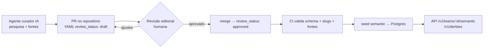

# 06 · Base semântica, linguagem e conteúdo

A camada semântica é o que transforma `team_id: 121 vs team_id: 126` em **"Choque-Rei"**, e o que faz um card dizer **"Avanti, Palestra!"** para quem declarou o Palmeiras como time do coração. Ela é **pré-cadastrada** e versionada — a API não precisa consultar nada externo para responder.

## 1. O que a base contém

| Entidade | Exemplos | Arquivo |
|---|---|---|
| **Clássicos / dérbis** | Derby Paulista (Palmeiras × Corinthians), Choque-Rei (Palmeiras × São Paulo), Majestoso, San-São, Fla-Flu, Gre-Nal, Clássico Mineiro, Ba-Vi, Superclásico (Boca × River), Clásico Nacional (América × Chivas), El Clásico, Derby della Madonnina | `data/knowledge/football/derbies/*.yaml` |
| **Perfil semântico do time** | Apelidos (Verdão, Timão, Tricolor, Mengão), mascote, demônimo da torcida (palmeirense, corintiano), gritos curtos (Avanti, Palestra! · Vai, Corinthians!), estádio e apelidos, fatos de identidade | `data/knowledge/football/teams/<país>.yaml` |
| **Seleções** | Seleção/Canarinho, Albiceleste, La Celeste, La Roja, El Tri, Les Bleus… | `data/knowledge/football/national-teams.yaml` |
| **Competições** | "Glória Eterna" (Libertadores), "Paulistão", "Orelhuda"/"La Orejona" (Champions) | `data/knowledge/competitions/*.yaml` |
| **Biblioteca de copy** | Microcopy por locale × intenção × intensidade | `data/knowledge/copy/<locale>.yaml` → `semantic.copy_template` (ver §4) |
| **Textos por idioma** | Fatos, mascote, cores e torcida em `es` neutro e por país ("chancho" em es-AR, "puerco" em es-MX, "marrano" em es-CO) e em pt-BR para os clubes hispânicos (§3.3) | `data/knowledge/i18n/<locale>.yaml` |
| **Glossário por mercado** | "secar" (pt-BR), "hinchar por"/"alentar" (es-AR), "le voy al" (es-MX), "hacer fuerza" (es-CO), "hincha", "golazo"… | `data/knowledge/glossary/<locale>.yaml` (servido direto do YAML por `GET /v1/glossary`) |

Schema completo e regras editoriais: [`data/knowledge/SCHEMA.md`](../data/knowledge/SCHEMA.md).

## 2. Ciclo editorial

- **Status**: `draft` (gerado/pesquisado), `reviewed` (conferido), `approved` (pode ir para produção). A API expõe o status em cada item e só serve o que atinge o mínimo efetivo: o maior entre o piso do servidor (`SEMANTIC_MIN_REVIEW_STATUS`, padrão `approved` em produção; `draft` em desenvolvimento local) e o `?min_review_status=` do cliente, que só endurece. Detalhes em [docs/05 §3.3.1](05-api-publica.md#331-implementação-da-semântica-appsapisrcroutesv1semanticts-e-copyts).
- **Fontes obrigatórias**: todo fato tem pelo menos uma URL em `sources`.
- **Atualização**: mudanças de nome de estádio (naming rights), novos clássicos (acessos/rebaixamentos) e novos mascotes entram por PR — o agente curador abre PRs automaticamente ao detectar mudanças.

## 3. Como a semântica aparece nos dados

1. **Detecção de clássico**: no upsert de um `core.event` de futebol, se os dois participantes formam um par em `semantic.derby`, o evento recebe `derby_id` e `competition_context` inclui `derby`. Implementação em `packages/knowledge` (casam por `semantic.team_profile.participant_id`): o upsert do ingestor usa `createDerbyLookup(db)` (pares carregados uma vez por lote) e grava `derby_id` e a importância já na escrita; `assignEventDerbies(db, { eventIds })` e `findDerby(db, a, b)` servem ao seed (que recalcula o `derby_id` de todos os eventos) e ao `events:importance` (que também recalcula a importância). `core.event.derby_id` tem FK para `semantic.derby` (`ON DELETE SET NULL`).
2. **Importância** (`core.event.importance`, 0–100, global) e **relevância por mercado** (calculada na requisição): ver §3.1 e §3.2. Usadas para ordenar "Meu dia esportivo" e escolher o que a IA ao vivo prioriza.
3. **Enriquecimento de card**: `GET /v1/events/{id}` traz `derby: { slug, name, intensity }` e, por participante, `nickname` no locale pedido.

### 3.1 Importância (score global)

`importance = min(100, tier + fase + clássico + decisão + prestígio)`, com o detalhamento gravado em `core.event.importance_breakdown` e exposto na API como `importance_breakdown: { tier, phase, derby, decisive, prestige, flags }`. Fórmula pura em `packages/providers/src/event/importance.ts`.

| Componente | Pontos |
|---|---|
| **Tier** da competição (`core.competition.tier`, do catálogo) | 1 → 40 · 2 → 25 · 3 → 10 · desconhecido → 5 |
| **Fase** (`core.stage.kind`) | final 30 · semi 22 · quartas 16 · oitavas 12 · playoff 10 · 3º lugar/32-avos/playoff de rebaixamento 8 · fase de grupos/liga e 1ª fase de copa 6 · 64-avos 5 · rodada 4 · 128-avos/outra 3 · preliminar 2 · amistoso 0 |
| ↳ reta final (pontos corridos: `regular` e `league_phase`) | + até 6 pelo progresso da rodada: `round((rodada − 1) / (total − 1) × 6)`; o total vem de `matches_per_team` do regulamento (`config/rules`) ou da maior rodada conhecida da temporada |
| ↳ jogo de **ida** de confronto de ida e volta | pontos da fase × 0,75 (arredondado): a decisão fica para a volta |
| **Clássico** (`semantic.derby`) | 6 × intensidade (1–5) |
| **Decisão** (sinais, teto 20) | título 15 · rebaixamento 10 · eliminação 8 · vaga 6 |
| **Prestígio** (`core.competition.prestige`, campo `prestige` do catálogo) | 0–10: 10 nas principais copas continentais e torneios de seleções (Libertadores, Champions, Copa do Mundo, Copa América, Eurocopa, Mundial de Clubes); 5 nas secundárias e eliminatórias (Sul-Americana, Europa League, Concachampions, Recopa, Eliminatórias, Liga das Nações da UEFA); 3 nas menores (Conference League, Leagues Cup, Liga das Nações da Concacaf) |

**Sinais de decisão** (`flags`), de duas fontes:

- **Estruturais (mata-mata)**, calculados no upsert da normalização: jogo único e volta valem `elimination`; a final (jogo único ou volta) vale `title` (que já implica a eliminação); ida, disputa de 3º lugar e perna ainda desconhecida não decidem nada; playoff de rebaixamento vale `relegation`. A perna sai dos dados (duas partidas do mesmo par na mesma fase: a mais cedo é a ida) e, com uma só partida conhecida, do regulamento próprio da competição (`config/rules/<slug>.yaml`; sem arquivo, jogo único). Fase com número de rodada no rótulo ("Preliminary Round - 2", "Relegation - 5") é pontos corridos, não mata-mata.
- **Da tabela (pontos corridos, grupos e fase de liga)**, pelo motor de regras (`computeEventStakes` de `@galaxie/rules/db` + `decisiveFlagsFromStakes`): `in_title_race`, `can_clinch_title`, `clinches_title_with_*` → `title`; `at_risk_of_relegation`, `can_be_relegated`, `relegated_*`, `secures_safety_*`, `can_secure_safety` → `relegation`; `eliminated_*`, `can_be_eliminated`, `at_risk_of_elimination` → `elimination`; `can_qualify_for_<zona>`, `can_clinch_<zona>`, `clinches_<zona>_with_*` → `qualification` (ou o tipo da zona no regulamento: acesso/playoff = vaga, playout = rebaixamento). O que já está resolvido (campeão, rebaixado, eliminado ou classificado matematicamente, salvo) não conta. Os códigos de "possibilidade" (`in_title_race`, `can_qualify_for_*`, `at_risk_of_*`) só aparecem na reta final (jogos restantes ≤ max(3, ¼ da fase)) e, como são matemáticos, passam pelo **mesmo corte realista das tags do torcedor** ([docs/rules/tags-torcedor.md](rules/tags-torcedor.md); `isRelevantForFans` + `fanTagStanding` de `@galaxie/rules`, constantes `FAN_TAG_*`): `in_title_race` só conta até max(6, rodadas restantes) pontos do líder; `at_risk_of_relegation` e os de permanência (`secures_safety_*`, `can_secure_safety`) só dentro da zona ou até 6 pontos acima do primeiro time nela; `can_qualify_for_<zona>` só até max(6, rodadas restantes) do último time dentro da zona. Os códigos concretos (`can_clinch_*`, `clinches_*`, `decides_title`, `relegated_if_loses`, `relegated_unless_wins`, `can_be_relegated`, `eliminated_*`…) contam sempre.

**Onde é calculado.** O upsert da normalização (caminho quente, inclusive o ao vivo) grava a parte estrutural — tier, fase, perna, prestígio, clássico e a decisão do mata-mata — e **preserva** os sinais da tabela já gravados (`importance_breakdown.stake_flags`). Os sinais da tabela precisam da classificação, então ficam no recálculo `events:importance` (CLI e job `events-importance` do scheduler, de hora em hora, `--esporte football --proximos-dias 7`): só jogos em aberto que começam entre 6 h atrás e 7 dias à frente passam pelo motor; fora dessa janela os sinais gravados ficam como estão (o jogo encerrado guarda o que estava em jogo antes de começar). O CLI também aplica o `prestige` do catálogo em `core.competition` (sem chamar o fornecedor; o `--plan` já calcula com o YAML novo).

Exemplos (dados locais de 2026-10-22):

| Jogo | Antes | Global | Mercado BR |
|---|---|---|---|
| Libertadores, semifinal (volta): Palmeiras × Fluminense | 62 | 80 (40 + 22 + 8 + 10) | 90 |
| Libertadores, final em jogo único com time brasileiro (fórmula; ainda sem evento no banco) | 70 | 95 (40 + 30 + 15 + 10) | 100 |
| Brasileirão, rodada 32: Palmeiras × RB Bragantino (título a 1 ponto do líder + pode garantir a pré-Libertadores; o risco de queda do Bragantino, a 9 pontos da zona, não passa no corte) | 44 | 69 (40 + 9 + 20) | 79 |
| Brasileirão, rodada 32: Cruzeiro × Remo (Remo na zona + vaga do Cruzeiro; o título, a 16 pontos, não passa no corte) | 44 | 65 (40 + 9 + 16) | 75 |
| Champions, fase de liga (rodada 3) | 46 | 58 (40 + 8 + 10) | 58 |
| Premier League, rodada 8 | 44 | 45 (40 + 5) | 45 |

### 3.2 Relevância por mercado

`importance` é **global**: o mesmo jogo vale o mesmo para todos os clientes. A relevância soma o interesse de um mercado (país ISO2) e é calculada **na requisição**, sem coluna por mercado — o bônus depende só do país dos participantes (`core.participant.country_code`), do país da competição (`core.competition.country_code`) e do escopo continental (`config/geo/competition-scope.yaml` + confederação do país em `config/geo/confederations.yaml`), que cabem numa expressão SQL (ordenação e filtro) e num lookup em lote (resposta). Guardar um score por mercado multiplicaria as escritas por país a cada recálculo sem ganho: o cálculo é barato e sempre coerente com o `importance` atual.

- **+10** quando um participante é do país do mercado;
- **+5** quando a competição é do país, ou é continental/de seleções da confederação do mercado (ou o lista como convidado em `countries`). Competições globais (FIFA) não contam: valeriam para todos os mercados;
- **+5** na **semifinal de mata-mata** quando a outra semifinal da mesma fase tem um time do país: o jogo define o adversário dele na final. É exato porque a outra semifinal é o outro lado da chave (a regra só vale com exatamente duas semifinais na fase). Com a outra semi **em aberto**, contam os dois times dela; **decidida**, conta o classificado (`decides_final_opponent`) e, se a temporada tem disputa de 3º lugar, o eliminado (`decides_third_place_opponent`: o jogo define o adversário dele no 3º lugar). Dois times do país do outro lado contam uma vez só. O confronto é decidido pelo agregado das pernas esperadas no regulamento e, no empate, pelos pênaltis da última perna; sem isso, fica em aberto;
- bônus do país ≤ 10;
- **audiência** da competição no mercado (`market_audience`, 0–40, `config/geo/market-audience.yaml`), fora do teto, inteira até importância 44 e proporcional ao que falta até 100 acima disso (o jogo grande não empata no teto com a rodada comum): a importância é global e não sabe que a Liga MX é o que o México vê — sem a audiência, a rodada da liga nacional no próprio país ficava em ~55–60 e as grandes europeias em ~45 em toda a América Latina. Calibração (out/2026): liga nacional de 1ª divisão no próprio país +35 (rodada comum em 89–100), 2ª linha com público próprio +25 (Série B no Brasil, Liga MX Femenil no México: 64–70), Premier League e LaLiga +20 e Serie A, Bundesliga, Ligue 1 e Champions +16 em todos os mercados (≥ 60, o limiar do Onde Assistir), liga do vizinho com público +10–15 (Liga Profesional no Uruguai e no Paraguai), Libertadores +35 e Sul-Americana +25 nos mercados da CONMEBOL;
- `relevance.score = min(100, importance + bonus)`, com `bonus` = bônus do país + audiência.

Exemplo — Libertadores 2026, semifinal Palmeiras × Fluminense, com Flamengo × Estudiantes do outro lado e a volta ainda por jogar: no **BR**, time do país (+10), CONMEBOL (+5) e o adversário de Flamengo (+5), bônus 10 pelo teto; na **AR**, CONMEBOL (+5) e "define o adversário de Estudiantes L.P. na final" (+5), bônus 10; no **UY** e nos demais da CONMEBOL, só a confederação (+5); no **MX**, nada.

**Quartas e oitavas ficam de fora** (TODO em `loadBrackets`): a api-sports não informa a chave, e nas quartas o vencedor cruza com um de dois confrontos que só o regulamento conhece. Estender o bônus depende de cadastrar o chaveamento em `config/rules/<competição>.yaml` (quem enfrenta quem na fase seguinte).

O mercado vem de `?market=XX` ou, sem ele, do único mercado do plano do tenant (`api.tenant.markets` com exatamente um país); sem mercado, `relevance` é `null`. A API expõe `relevance: { market, score, bonus, reasons, details }` — `reasons` são os códigos (`team_from_market`, `domestic_competition`, `continental_competition`, `decides_final_opponent`, `decides_third_place_opponent`, `market_audience`) e `details` os mesmos motivos com `points` (do motivo isolado; a soma pode passar do teto), `text` no idioma pedido ("Competição da CONMEBOL", "Define o adversário de Estudiantes L.P. na final") e `participant` (o time da outra semifinal citado) — além de `order=relevance` e `relevance_min` nas listas (docs/05 §3.2).

**Vários mercados de uma vez:** o detalhe do evento (`GET /v1/events/{id}`) traz `relevance_by_market`, a mesma conta em todos os **mercados ativos** — `markets` em `config/geo/confederations.yaml` (BR, AR, UY, CL, CO, PY, PE, EC, BO, VE, MX) mais os mercados do plano do tenant —, da maior nota para a menor. Nas listas o campo é `null` (o lote ficaria grande sem uso). A demo usa essa lista no card "Sobre o jogo" (docs/09).

Na ordenação e no filtro em SQL, o bônus da semifinal considera os dois times da outra semifinal mesmo depois de decidida (a expressão não calcula agregado); a `relevance` da resposta é exata. Implementação em `apps/api/src/events/relevance.ts`.

### 3.3 Textos livres por idioma

Fatos (`identity`), mascote, cores e torcida do time, e `origin`/`trivia` do clássico são **texto livre**: cada arquivo os escreve no idioma do país (`text_locale` no topo; padrão `pt-BR`, `es` nos arquivos hispânicos). As traduções ficam em [`data/knowledge/i18n/<locale>.yaml`](../data/knowledge/SCHEMA.md#i18nlocaleyaml) (`pt-BR`, `es` e `es-XX`), com `review_status` próprio, e o seed as grava em `semantic.team_profile.texts` / `semantic.derby.texts` (`{ "<locale>": { ...campos, review_status } }`) ao lado de `text_locale`.

**Escolha na API** (`GET /v1/teams/{id}/semantic`, `GET /v1/derbies/{slug}`): campo a campo, a tradução do locale exato, depois a do idioma (`es-AR → es`), só as que atingem o status editorial mínimo; o original vence assim que a cadeia chega ao idioma dele (uma base `es` responde a `es-MX` sem tradução `es-MX`). Sem tradução publicada, o campo sai no original — melhor o fato no idioma errado do que nenhum — e `text_locale` diz de onde veio o texto principal (`identity`; `origin` no clássico), para o cliente decidir se mostra. É diferente de `labels` (`es-XX → es → en`) e de `copy_hints` (locale e idioma, nunca outro idioma).

**Quando vale um texto por país** (decisão):

| Caso | Onde escrever | Exemplo |
|---|---|---|
| Fato puro: datas, fundadores, títulos, nomes | só `es` (neutro, pan-hispânico, sem voseo nem gíria) | "Fundado en 1910 por obreros en el barrio de Bom Retiro…" |
| Torcida e estádio | `es-XX`, quando a palavra muda | *hinchada* (AR, UY, CL, PE, CO, EC) × *afición*/*porra* (MX); *cancha* (AR, UY); *barra* (CO, PE) |
| Apelido explicado pelo bicho ou objeto local | `es-XX` | Porco: *chancho* (AR, UY, CL, PE, EC), *puerco* (MX), *marrano* (CO); Urubu: *zopilote* (MX), *jote* (CL), *gallinazo* (CO, PE, EC), *cuervo* (UY); Cartola: *galera* (AR, UY) |
| Gíria de brincadeira | `es-XX` | *cargada* (AR, UY), *talla* (CL), *vacilón* (PE) |
| Segunda pessoa (gritos) | `copy_hints.<locale>.cheer` no YAML do time | voseo "¡Dale, Verdão, que hoy lo ganás!" (AR), "que vos podés" (UY); "¡Le voy al Verdão!" (MX); "¡Hágale!" (CO); "ya po" (CL); "de una" (EC) |

A variante herda do `es` campo a campo: `es-AR` pode trazer só `identity` e `mascot` e deixar as cores no `es`. Por isso a tradução é **dos mesmos fatos, na mesma ordem** — nunca fato novo (o validador avisa quando a contagem diverge). `es-PY`, `es-BO` e `es-VE` são aceitos, mas ainda sem variante própria (caem no `es`).

**Produção e manutenção.** Curadoria em YAML, como o resto da base: a tradução entra `draft`, um revisor nativo do mercado a passa a `reviewed`/`approved` (nunca acima do original). `pnpm knowledge:validate` confere schema, slug existente, idioma-base repetido (`i18n-redundant`), fatos a mais ou a menos (`i18n-drift`), heurística de letra e uma heurística de idioma (`text-language`: português num `es`, espanhol num `pt-BR`); `pnpm knowledge:i18n [--locale es] [--arquivo football/teams/br.yaml] --faltando` lista o que ainda cai no original. O Agente Curador já escreve `identity` no idioma do país e marca `text_locale: es` nos arquivos novos de países hispânicos.

**Cobertura (out/2026).** Todo texto livre da base tem `es` neutro e `pt-BR`: em espanhol, os clubes do Brasil e da Europa, as seleções, NBA/NBB, vôlei, F1 e os clássicos escritos em português; em português, os clubes e clássicos hispânicos. Há variantes nos 7 mercados para Palmeiras, Flamengo, Fluminense e Atlético-MG e para os clássicos do Povo e da Amizade, e gritos por mercado (`es` + 7 variantes) para os 12 grandes do Brasil e `es` para os 5 grandes da Argentina. O CI cobra que nada fique sem tradução (`packages/knowledge/src/i18n.test.ts`); `pnpm knowledge:i18n --faltando` mostra o que falta ao acrescentar itens.

## 4. Framework de linguagem, badges e momentum

Camadas **independentes** em todo card (nunca misturar):

| Camada | Exemplo | Fonte |
|---|---|---|
| Estado factual | AO VIVO · 2º tempo · 67' | `core.event.status` |
| Badge semântico (1 por card) | Clássico · Decisão · Final · Pode ser campeão | `competition_context` + semântica |
| Momentum temporal | Hoje · Em 30 min · Começando | calculado |
| Estado comercial | (definido pelo cliente) | fora da nossa API |

### 4.1 Dimensões da copy

| Dimensão | Valores |
|---|---|
| `sport` | football, f1, basketball, tennis, volleyball (V1) |
| `entity_type` | club, national_team, driver, constructor, athlete |
| `affinity_type` | heart (coração), support, sympathy, rival, interest |
| `affinity_source` | explicit (declarada), inferred (comportamento) |
| `event_state` | scheduled, starting, live, break, finished, postponed, cancelled |
| `momentum` | D-3+, D-2, D-1, today, T-60, T-30, T-10, starting, live |
| `competition_context` | regular, derby, playoff, knockout, semifinal, final, title, lead, relegation |
| `audience_signal` | none, viewer_count, most_watched, growing (só se literalmente verdadeiro e auditável) |
| `copy_intent` | inform, anticipate, cheer, rivalry, urgency, social_proof, decisive, recommendation |
| `tone_intensity` | 1 informativo · 2 próximo · 3 torcedor · 4 alta energia |
| `confidence` | HIGH, MEDIUM, EXPERIMENTAL |

### 4.2 `copy_permission` — guardrail central

| Situação | Copy permitida |
|---|---|
| Afinidade **declarada** `heart` | Identidade forte ("Hoje tem Verdão!", gritos do clube) |
| Afinidade **inferida** | Apenas informativa ("Jogo do Palmeiras hoje") — nunca linguagem de identidade |
| Rival **declarado** | Rivalidade lúdica conforme mercado (BR: "secar" permitido) |
| Rival **inferido** | **Nenhuma** copy de rivalidade |
| Qualquer caso | Nunca ofender o rival, nunca discriminação, tragédias, superioridade nacional ou violência |

### 4.3 Diretrizes por mercado

| Mercado | Padrões naturais | Orientação |
|---|---|---|
| Brasil (pt-BR) | "secar", "Vai, [time]!", "Hoje tem…" | Rivalidade lúdica só com rival declarado |
| Argentina (es-AR) | "hinchar por", "alentar", "se viene" | Preferir apoio positivo |
| México (es-MX) | "le voy al…", "¿a quién le vas?" | Identidade forte só com relação estabelecida |
| Colômbia (es-CO) | "hacer fuerza" | Forma negativa como alternativa controlada |
| Chile, Peru, Uruguai, Equador | Linguagem positiva de apoio | Monitoramento indireto do rival; validar variantes locais |

> Copy é localizada **pela intenção**, não traduzida literalmente. Não existe biblioteca genérica "es-LATAM" como fonte primária. Para TV conectada, textos curtos e legíveis à distância.

## 5. Serviços premium derivados da semântica

| Serviço | Descrição | Rota |
|---|---|---|
| **Clássicos da semana** | Lista dos clássicos nos próximos 7 dias com intensidade e histórico | `GET /v1/derbies/upcoming` |
| **Retrospecto do clássico** | Vitórias, empates, maiores goleadas, últimos 5 — calculado do h2h espelhado | `GET /v1/derbies/{slug}` |
| **Cartão de identidade do time** | Apelidos, mascote, estádio, fatos, gritos — para páginas de time e onboarding | `GET /v1/teams/{id}/semantic` |
| **Copy contextual** | Chamadas prontas para push/CRM/cards respeitando `copy_permission` | `GET /v1/copy` |
| **Afinidade para CRM** | Mapeamento time → clássicos/rivais para segmentação de campanhas | `GET /v1/teams/{id}/rivals` |
| **Glossário por mercado** | Termos esportivos por locale (ex.: "secar", "hacer fuerza") | `GET /v1/glossary?locale=` |

### 5.1 Implementação (issues #43 e #45)

Todas as rotas acima estão no ar, no módulo `semantic` (contratos em `packages/contracts/src/semantic.ts`, rotas em `apps/api/src/routes/v1/semantic.ts` e `copy.ts`; regras de contrato e cache em [docs/05 §3.3.1](05-api-publica.md#331-implementação-da-semântica-appsapisrcroutesv1semanticts-e-copyts)).

- **Retrospecto do clássico** é calculado só dos eventos encerrados em `core.event` entre os dois participantes (qualquer mando) — zero chamadas ao provedor. Pênaltis ficam registrados, mas o jogo conta como empate.
- **Clássicos da semana** usam `core.event.derby_id` (preenchido no upsert do evento, pelo seed e por `events:importance`); a lista fica vazia enquanto não houver eventos futuros sincronizados.
- **Copy contextual** aplica o `copy_permission` de `selectCopy`: afinidade inferida (inclusive rival inferido) só recebe `inform` tom 1 — nunca rivalidade; `team`/`rival` (UUID ou slug) preenchem `{team}`, `{nickname}` (apelido preferido do mercado) e `{rival}`; sem fallback entre locales.
- **Glossário**: `data/knowledge/glossary/<locale>.yaml` (schema `glossary.schema.json`), validado por `pnpm knowledge:validate` — chave única por locale, texto curto (heurística de letra), e as regras do `copy_permission`: termo de rivalidade exige `requires: declared_rival` (erro); termo de torcida (`cheer`) sem `requires` gera aviso. Só entram termos **positivos**, com fonte (dicionários: Priberam, Wiktionary, DAMER/ASALE, DEM/El Colegio de México). "hacer fuerza" (es-CO) ainda não tem fonte lexicográfica externa e está marcado para revisão nativa. Todos os termos nascem `draft`.
- O glossário é lido do YAML pela API (uma vez por processo; pasta configurável por `KNOWLEDGE_DIR`), sem tabela no banco: é pequeno, versionado e só muda com deploy. Se ganhar ciclo editorial próprio (curadoria por agente), migra para `semantic.glossary_term` no seed.

## 6. Cobertura inicial

| País/região | Arquivo | Escopo |
|---|---|---|
| Brasil | `teams/br.yaml`, `derbies/br.yaml` | Série A 2026 + grandes tradicionais; clássicos estaduais e regionais |
| Argentina, Uruguai, Chile, Colômbia, Peru, Equador, Paraguai, Bolívia, Venezuela | `teams/<iso2>.yaml`, `derbies/south-america.yaml` | Grandes clubes e clássicos nacionais |
| México | `teams/mx.yaml`, `derbies/mexico.yaml` | Liga MX |
| Europa (ENG, ESP, ITA, ALE, FRA, POR, HOL) | `teams/<code>.yaml`, `derbies/europe.yaml` | Grandes clubes e clássicos |
| Seleções | `national-teams.yaml`, `derbies/international.yaml` | CONMEBOL, CONCACAF principais, potências europeias |

Todo conteúdo inicial nasce como `draft` e passa pela revisão editorial antes de ir a produção (issue no backlog).
