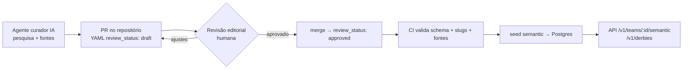

# 06 · Base semântica, linguagem e conteúdo

A camada semântica é o que transforma `team_id: 121 vs team_id: 126` em **"Choque-Rei"**, e o que faz um card dizer **"Avanti, Palestra!"** para quem declarou o Palmeiras como time do coração. Ela é **pré-cadastrada** e versionada — a API não precisa consultar nada externo para responder.

## 1. O que a base contém

| Entidade | Exemplos | Arquivo |
|---|---|---|
| **Clássicos / dérbis** | Derby Paulista (Palmeiras × Corinthians), Choque-Rei (Palmeiras × São Paulo), Majestoso, San-São, Fla-Flu, Gre-Nal, Clássico Mineiro, Ba-Vi, Superclásico (Boca × River), Clásico Nacional (América × Chivas), El Clásico, Derby della Madonnina | `data/knowledge/football/derbies/*.yaml` |
| **Perfil semântico do time** | Apelidos (Verdão, Timão, Tricolor, Mengão), mascote, demônimo da torcida (palmeirense, corintiano), gritos curtos (Avanti, Palestra! · Vai, Corinthians!), estádio e apelidos, fatos de identidade | `data/knowledge/football/teams/<país>.yaml` |
| **Seleções** | Seleção/Canarinho, Albiceleste, La Celeste, La Roja, El Tri, Les Bleus… | `data/knowledge/football/national-teams.yaml` |
| **Competições** | "Glória Eterna" (Libertadores), "Paulistão", "Orelhuda"/"La Orejona" (Champions) | `data/knowledge/competitions/*.yaml` |
| **Biblioteca de copy** | Microcopy por locale × intenção × intensidade | `data/knowledge/copy/<locale>.yaml` → `semantic.copy_template` (ver §4) |
| **Glossário por mercado** | "secar" (pt-BR), "hinchar por"/"alentar" (es-AR), "le voy al" (es-MX), "hacer fuerza" (es-CO), "hincha", "golazo"… | `data/knowledge/glossary/<locale>.yaml` (servido direto do YAML por `GET /v1/glossary`) |

Schema completo e regras editoriais: [`data/knowledge/SCHEMA.md`](../data/knowledge/SCHEMA.md).

## 2. Ciclo editorial

- **Status**: `draft` (gerado/pesquisado), `reviewed` (conferido), `approved` (pode ir para produção). A API expõe o status em cada item e só serve o que atinge o mínimo efetivo: o maior entre o piso do servidor (`SEMANTIC_MIN_REVIEW_STATUS`, padrão `approved` em produção; `draft` em desenvolvimento local) e o `?min_review_status=` do cliente, que só endurece. Detalhes em [docs/05 §3.3.1](05-api-publica.md#331-implementação-da-semântica-appsapisrcroutesv1semanticts-e-copyts).
- **Fontes obrigatórias**: todo fato tem pelo menos uma URL em `sources`.
- **Atualização**: mudanças de nome de estádio (naming rights), novos clássicos (acessos/rebaixamentos) e novos mascotes entram por PR — o agente curador abre PRs automaticamente ao detectar mudanças.

## 3. Como a semântica aparece nos dados

1. **Detecção de clássico**: no upsert de um `core.event` de futebol, se os dois participantes formam um par em `semantic.derby`, o evento recebe `derby_id` e `competition_context` inclui `derby`. Implementação: `assignEventDerbies(db, { eventIds })` e `findDerby(db, a, b)` em `packages/knowledge` (casam por `semantic.team_profile.participant_id`); o seed recalcula todos os eventos e `core.event.derby_id` tem FK para `semantic.derby` (`ON DELETE SET NULL`).
2. **Importância**: `importance = f(tier da competição, fase, clássico × intensidade, decisão de título/rebaixamento, interesse da audiência)`. Usada para ordenar "Meu dia esportivo" e escolher o que a IA ao vivo prioriza.
3. **Enriquecimento de card**: `GET /v1/events/{id}` traz `derby: { slug, name, intensity }` e, por participante, `nickname` no locale pedido.

## 4. Framework de linguagem, badges e momentum

Camadas **independentes** em todo card (nunca misturar):

| Camada | Exemplo | Fonte |
|---|---|---|
| Estado factual | AO VIVO · 2º tempo · 67' | `core.event.status` |
| Badge semântico (1 por card) | Clássico · Decisão · Final · Pode ser campeão | `competition_context` + semântica |
| Momentum temporal | Hoje · Em 30 min · Começando | calculado |
| Estado comercial | (definido pelo cliente) | fora da nossa API |

### 4.1 Dimensões da copy

| Dimensão | Valores |
|---|---|
| `sport` | football, f1, basketball, tennis, volleyball (V1) |
| `entity_type` | club, national_team, driver, constructor, athlete |
| `affinity_type` | heart (coração), support, sympathy, rival, interest |
| `affinity_source` | explicit (declarada), inferred (comportamento) |
| `event_state` | scheduled, starting, live, break, finished, postponed, cancelled |
| `momentum` | D-3+, D-2, D-1, today, T-60, T-30, T-10, starting, live |
| `competition_context` | regular, derby, playoff, knockout, semifinal, final, title, lead, relegation |
| `audience_signal` | none, viewer_count, most_watched, growing (só se literalmente verdadeiro e auditável) |
| `copy_intent` | inform, anticipate, cheer, rivalry, urgency, social_proof, decisive, recommendation |
| `tone_intensity` | 1 informativo · 2 próximo · 3 torcedor · 4 alta energia |
| `confidence` | HIGH, MEDIUM, EXPERIMENTAL |

### 4.2 `copy_permission` — guardrail central

| Situação | Copy permitida |
|---|---|
| Afinidade **declarada** `heart` | Identidade forte ("Hoje tem Verdão!", gritos do clube) |
| Afinidade **inferida** | Apenas informativa ("Jogo do Palmeiras hoje") — nunca linguagem de identidade |
| Rival **declarado** | Rivalidade lúdica conforme mercado (BR: "secar" permitido) |
| Rival **inferido** | **Nenhuma** copy de rivalidade |
| Qualquer caso | Nunca ofender o rival, nunca discriminação, tragédias, superioridade nacional ou violência |

### 4.3 Diretrizes por mercado

| Mercado | Padrões naturais | Orientação |
|---|---|---|
| Brasil (pt-BR) | "secar", "Vai, [time]!", "Hoje tem…" | Rivalidade lúdica só com rival declarado |
| Argentina (es-AR) | "hinchar por", "alentar", "se viene" | Preferir apoio positivo |
| México (es-MX) | "le voy al…", "¿a quién le vas?" | Identidade forte só com relação estabelecida |
| Colômbia (es-CO) | "hacer fuerza" | Forma negativa como alternativa controlada |
| Chile, Peru, Uruguai, Equador | Linguagem positiva de apoio | Monitoramento indireto do rival; validar variantes locais |

> Copy é localizada **pela intenção**, não traduzida literalmente. Não existe biblioteca genérica "es-LATAM" como fonte primária. Para TV conectada, textos curtos e legíveis à distância.

## 5. Serviços premium derivados da semântica

| Serviço | Descrição | Rota |
|---|---|---|
| **Clássicos da semana** | Lista dos clássicos nos próximos 7 dias com intensidade e histórico | `GET /v1/derbies/upcoming` |
| **Retrospecto do clássico** | Vitórias, empates, maiores goleadas, últimos 5 — calculado do h2h espelhado | `GET /v1/derbies/{slug}` |
| **Cartão de identidade do time** | Apelidos, mascote, estádio, fatos, gritos — para páginas de time e onboarding | `GET /v1/teams/{id}/semantic` |
| **Copy contextual** | Chamadas prontas para push/CRM/cards respeitando `copy_permission` | `GET /v1/copy` |
| **Afinidade para CRM** | Mapeamento time → clássicos/rivais para segmentação de campanhas | `GET /v1/teams/{id}/rivals` |
| **Glossário por mercado** | Termos esportivos por locale (ex.: "secar", "hacer fuerza") | `GET /v1/glossary?locale=` |

### 5.1 Implementação (issues #43 e #45)

Todas as rotas acima estão no ar, no módulo `semantic` (contratos em `packages/contracts/src/semantic.ts`, rotas em `apps/api/src/routes/v1/semantic.ts` e `copy.ts`; regras de contrato e cache em [docs/05 §3.3.1](05-api-publica.md#331-implementação-da-semântica-appsapisrcroutesv1semanticts-e-copyts)).

- **Retrospecto do clássico** é calculado só dos eventos encerrados em `core.event` entre os dois participantes (qualquer mando) — zero chamadas ao provedor. Pênaltis ficam registrados, mas o jogo conta como empate.
- **Clássicos da semana** usam `core.event.derby_id` (preenchido pelo seed e por `assignEventDerbies`); a lista fica vazia enquanto não houver eventos futuros sincronizados.
- **Copy contextual** aplica o `copy_permission` de `selectCopy`: afinidade inferida (inclusive rival inferido) só recebe `inform` tom 1 — nunca rivalidade; `team`/`rival` (UUID ou slug) preenchem `{team}`, `{nickname}` (apelido preferido do mercado) e `{rival}`; sem fallback entre locales.
- **Glossário**: `data/knowledge/glossary/<locale>.yaml` (schema `glossary.schema.json`), validado por `pnpm knowledge:validate` — chave única por locale, texto curto (heurística de letra), e as regras do `copy_permission`: termo de rivalidade exige `requires: declared_rival` (erro); termo de torcida (`cheer`) sem `requires` gera aviso. Só entram termos **positivos**, com fonte (dicionários: Priberam, Wiktionary, DAMER/ASALE, DEM/El Colegio de México). "hacer fuerza" (es-CO) ainda não tem fonte lexicográfica externa e está marcado para revisão nativa. Todos os termos nascem `draft`.
- O glossário é lido do YAML pela API (uma vez por processo; pasta configurável por `KNOWLEDGE_DIR`), sem tabela no banco: é pequeno, versionado e só muda com deploy. Se ganhar ciclo editorial próprio (curadoria por agente), migra para `semantic.glossary_term` no seed.

## 6. Cobertura inicial

| País/região | Arquivo | Escopo |
|---|---|---|
| Brasil | `teams/br.yaml`, `derbies/br.yaml` | Série A 2026 + grandes tradicionais; clássicos estaduais e regionais |
| Argentina, Uruguai, Chile, Colômbia, Peru, Equador, Paraguai, Bolívia, Venezuela | `teams/<iso2>.yaml`, `derbies/south-america.yaml` | Grandes clubes e clássicos nacionais |
| México | `teams/mx.yaml`, `derbies/mexico.yaml` | Liga MX |
| Europa (ENG, ESP, ITA, ALE, FRA, POR, HOL) | `teams/<code>.yaml`, `derbies/europe.yaml` | Grandes clubes e clássicos |
| Seleções | `national-teams.yaml`, `derbies/international.yaml` | CONMEBOL, CONCACAF principais, potências europeias |

Todo conteúdo inicial nasce como `draft` e passa pela revisão editorial antes de ir a produção (issue no backlog).
