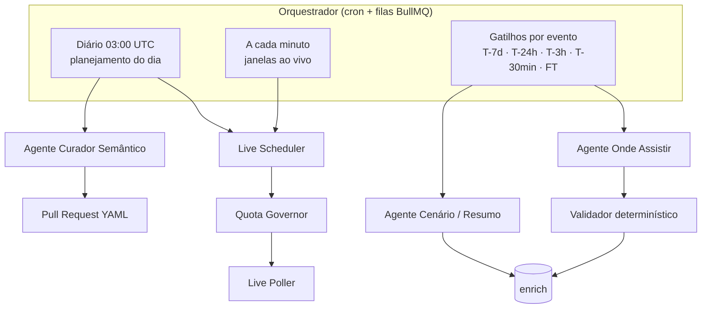
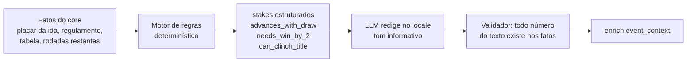

# 07 · IA: tempo real e enriquecimento

## 1. Princípio

> **Fatos vêm da fonte de dados. A IA decide *quando* buscar, *onde* procurar o que a fonte não tem e *como* contar.**

| A IA **faz** | A IA **não faz** |
|---|---|
| Prioriza quais jogos consultar e com que frequência (dentro da cota) | Inventar placar, minuto, gol, cartão ou escalação |
| Descobre onde assistir por país, com fontes | Publicar opção de transmissão sem evidência |
| Redige cenário pré-jogo a partir de fatos calculados ("avança com empate") | Calcular regras de classificação "de cabeça" — isso é código determinístico |
| Resume o pós-jogo a partir da timeline real | Opinar, ofender rival ou especular sobre arbitragem |
| Propõe novos fatos para a base semântica (via PR) | Publicar semântica sem revisão humana |

## 2. Agentes



### 2.1 Live Scheduler (o "agendamento inteligente")

Objetivo: maximizar a cobertura ao vivo dos jogos importantes com a cota disponível.

Entrada: agenda do dia (obtida com **1 chamada** `fixtures?date=` por dia no futebol), tiers do catálogo, clássicos, orçamento restante do Quota Governor.

Algoritmo base (determinístico, auditável):

1. Montar **janelas ao vivo**: para cada jogo de `live_priority` alta/média, `[kickoff − 5 min, kickoff + 130 min]` (futebol; outros esportes têm duração própria).
2. Unir janelas sobrepostas → `minutos_ao_vivo_do_dia`.
3. `intervalo = minutos_ao_vivo_do_dia / orçamento_live` (mínimo 15 s, que é a frequência de atualização do fornecedor).
4. Cada *tick* faz **uma** chamada `fixtures?live=<ids das ligas com jogo na janela>` — uma única chamada retorna todos os jogos ao vivo dessas ligas, com eventos.
5. Ajustes dinâmicos: encurtar intervalo nos minutos finais, prorrogação e pênaltis; pular *ticks* no intervalo de jogo; parar ao receber `FT` de todos.

Papel do LLM (modelo leve, ex.: `claude-haiku-5-5`): **reordenar prioridades** quando há mais jogos relevantes do que orçamento (ex.: final de estadual × rodada de Série A × clássico europeu), considerando o mercado ativo e a importância. Saída estruturada, validada contra o orçamento; se o LLM falhar, o algoritmo base segue sozinho.

Exemplo no plano gratuito (100 chamadas/dia na API de futebol):

| Item | Chamadas |
|---|---|
| Agenda do dia (`fixtures?date=`) | 1 |
| Sync diário incremental (tabelas, rodadas, lesões dos tiers 1) | ~19 |
| Reserva de segurança (15%) | 15 |
| **Orçamento live** | **65** |
| Quarta-feira com jogos de 19h a 23h30 (BRT) → ~330 min de janela | 1 chamada a cada ~5 min |

No plano pago (ex.: 7.500/dia), o mesmo algoritmo chega ao limite de 15 s por *tick*.

### 2.2 Agente Onde Assistir

| Item | Definição |
|---|---|
| Modelo | `claude-sonnet-5-5` com ferramenta de busca web (e *fetch* de páginas) |
| Gatilhos | T-7d, T-24h, T-3h, T-30min; reexecução sob demanda (correção editorial) |
| Escopo | `(evento, país)` para mercados ativos; tier 1 sempre, tier 2 a partir de T-24h |
| Fontes priorizadas | 1) organizador da competição, 2) site/redes oficiais da emissora/plataforma, 3) clubes, 4) imprensa esportiva de referência do país |
| Saída | Lista JSON de opções (schema em [04](04-modelo-de-dados.md#5-enrich--saídas-de-ia-e-fontes-externas)) com `evidence` (URL + trecho ≤ 200 caracteres) |

**Sinal de provedor**: se o provedor de produção for a Sportmonks, o endpoint **TV Stations** (emissoras por jogo e país) entra como sinal de apoio com confiança de agregador até medirmos sua cobertura e precisão no trial — nunca como fonte da verdade.

**Tabela de direitos (prior)**: `config/broadcast-rights/<iso2>.yaml` — competição × país × temporada → quem **pode** transmitir, curada a partir de anúncios oficiais. O agente parte dela e confirma jogo a jogo; uma opção de quem não detém direitos perde confiança ou é descartada.

**Validador determinístico** (código, não IA):

1. Descarta opções sem URL de evidência acessível.
2. Normaliza nomes de provedores/canais contra um dicionário por país (`config/broadcasters/<iso2>.yaml`).
3. Deduplica por `(event, country, broadcaster, region)`.
4. Calcula confiança (0–1): fonte primária (emissora/organizador) 0,9 · imprensa grande 0,7 · agregador 0,4 · **+0,1** se consistente com a tabela de direitos · **+0,1** se duas fontes independentes concordam · **−0,3** se a fonte tem mais de 72 h em liga com escolha por rodada.
5. **Publica** se `confidence ≥ 0,7`; entre 0,5 e 0,7 fica `pending` (não aparece); abaixo de 0,5 descarta. Conflito entre fontes primárias → **omitida** até a próxima checagem.
6. Diff com o estado anterior → `NOTIFY` → purge de cache + webhook (correção em ≤ 5 min).

Cadência: busca completa em T-7d e T-24h; em T-3h e T-30min apenas **revalida as URLs já salvas** (fetch + diff) e só busca de novo se algo mudou — economia de tokens. Detalhes e schema JSON em [research/onde-assistir.md](research/onde-assistir.md).

> Agregadores com termos que proíbem reuso **não** são raspados; servem no máximo como pista para encontrar a fonte primária.

Exemplo do resultado esperado (Brasil, semifinal de Libertadores): TV aberta nacional, canal gratuito no YouTube e streaming por assinatura — exatamente o tipo de resposta que hoje o torcedor busca fora da plataforma.

### 2.3 Agente Cenário (pré-jogo) e Resumo (pós-jogo)

O cenário é **calculado** e só **redigido** pela IA. O motor de regras é o pacote `@galaxie/rules` — catálogo de códigos e regulamentos em [docs/rules](rules/README.md):



Exemplo de `stakes` para um jogo de volta (ida 2 × 1 para o mandante da volta):

```json
[
  { "team": "home", "code": "advances_with_draw" },
  { "team": "away", "code": "needs_win_by_2" },
  { "team": "away", "code": "win_by_1_goes_to_penalties" }
]
```

Texto gerado (pt-BR): *"O mandante venceu a ida por 2 a 1 e se classifica com qualquer vitória ou empate. O visitante precisa vencer por dois gols de diferença para avançar direto; vitória por um gol leva a decisão aos pênaltis."*

Resumo pós-jogo: gerado após `FT` a partir de `core.event_incident` + estatísticas; validador confere que todo jogador, minuto e placar citado existe nos dados.

### 2.4 Agente Curador Semântico

- Roda semanalmente e sob demanda (time novo promovido, mudança de nome de estádio).
- Pesquisa e propõe entradas YAML com fontes; abre **PR** com `review_status: draft`.
- Nunca altera entradas `approved` sem PR revisado.

## 3. Guardrails

| Risco | Mitigação |
|---|---|
| Alucinação factual | Fatos só do `core`; validador de números/nomes; saídas estruturadas (JSON schema) |
| Fonte não confiável | Lista de domínios priorizados por país; confiança mínima 0,8 |
| Conteúdo ofensivo | Prompt com regras de linguagem segura + filtro de termos proibidos por locale |
| Direitos autorais | Evidência limitada a trechos curtos (≤ 200 caracteres); nunca reproduzir matérias |
| Custo descontrolado | Orçamento diário de tokens por agente; cache por `(evento, país)`; modelos menores onde possível |
| Prompt injection via páginas web | Conteúdo web tratado como dado; o agente não executa instruções encontradas em páginas |

## 4. Avaliação contínua

| Métrica | Como medir | Meta |
|---|---|---|
| Precisão do onde assistir | Amostra diária de 20 opções conferidas manualmente | ≥ 98% |
| Cobertura do onde assistir | % de jogos tier 1 com ≥ 1 opção `confirmed` até T-3h | ≥ 95% |
| Fidelidade do cenário | % de textos com 0 divergência factual (validador + amostra humana) | 100% |
| Cobertura ao vivo | % de minutos de jogos tier 1 com atualização ≤ intervalo planejado | ≥ 95% |
| Custo por evento enriquecido | Tokens × preço / eventos | Acompanhar por tier |

## 5. Modelos sugeridos

| Tarefa | Modelo | Motivo |
|---|---|---|
| Onde assistir (busca + raciocínio sobre fontes) | `claude-sonnet-5-5` | Bom equilíbrio entre qualidade de pesquisa e custo |
| Priorização ao vivo, classificação, microcopy | `claude-haiku-5-5` | Baixa latência e custo |
| Curadoria semântica e revisão editorial assistida | `claude-opus-5-5` | Maior qualidade em pesquisa e checagem |
