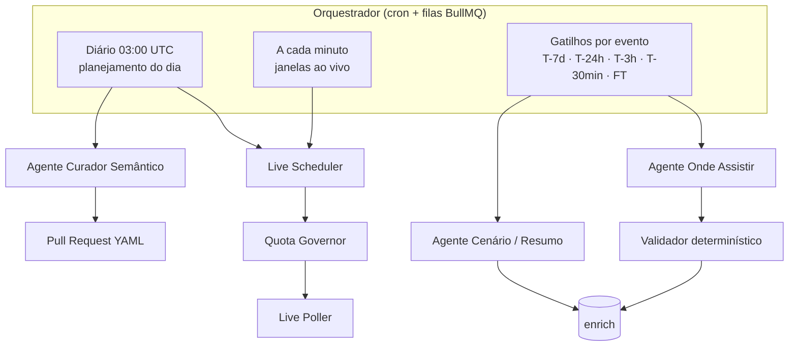
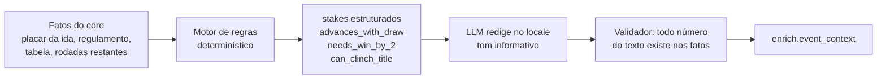

# 07 · IA: tempo real e enriquecimento

## 1. Princípio

> **Fatos vêm da fonte de dados. A IA decide *quando* buscar, *onde* procurar o que a fonte não tem e *como* contar.**

| A IA **faz** | A IA **não faz** |
|---|---|
| Prioriza quais jogos consultar e com que frequência (dentro da cota) | Inventar placar, minuto, gol, cartão ou escalação |
| Descobre onde assistir por país, com fontes | Publicar opção de transmissão sem evidência |
| Redige cenário pré-jogo a partir de fatos calculados ("avança com empate") | Calcular regras de classificação "de cabeça" — isso é código determinístico |
| Resume o pós-jogo a partir da timeline real | Opinar, ofender rival ou especular sobre arbitragem |
| Propõe novos fatos para a base semântica (via PR) | Publicar semântica sem revisão humana |

## 2. Agentes



### 2.1 Live Scheduler (o "agendamento inteligente")

Objetivo: maximizar a cobertura ao vivo dos jogos importantes com a cota disponível.

Entrada: agenda do dia (obtida com **1 chamada** `fixtures?date=` por dia no futebol), tiers do catálogo, clássicos, orçamento restante do Quota Governor.

Algoritmo base (determinístico, auditável):

1. Montar **janelas ao vivo**: para cada jogo de `live_priority` alta/média, `[kickoff − 5 min, kickoff + 130 min]` (futebol; outros esportes têm duração própria).
2. Unir janelas sobrepostas → `minutos_ao_vivo_do_dia`.
3. `intervalo = minutos_ao_vivo_do_dia / orçamento_live` (mínimo 15 s, que é a frequência de atualização do fornecedor).
4. Cada *tick* faz **uma** chamada `fixtures?live=<ids das ligas com jogo na janela>` — uma única chamada retorna todos os jogos ao vivo dessas ligas, com eventos.
5. Ajustes dinâmicos: encurtar intervalo nos minutos finais, prorrogação e pênaltis; pular *ticks* no intervalo de jogo; parar ao receber `FT` de todos.

Papel do LLM (modelo leve, ex.: `claude-haiku-5-5`): **reordenar prioridades** quando há mais jogos relevantes do que orçamento (ex.: final de estadual × rodada de Série A × clássico europeu), considerando o mercado ativo e a importância. Saída estruturada, validada contra o orçamento; se o LLM falhar, o algoritmo base segue sozinho.

Exemplo no plano gratuito (100 chamadas/dia na API de futebol):

| Item | Chamadas |
|---|---|
| Agenda do dia (`fixtures?date=`) | 1 |
| Sync diário incremental (tabelas, rodadas, lesões dos tiers 1) | ~19 |
| Reserva de segurança (15%) | 15 |
| **Orçamento live** | **65** |
| Quarta-feira com jogos de 19h a 23h30 (BRT) → ~330 min de janela | 1 chamada a cada ~5 min |

No plano pago (ex.: 7.500/dia), o mesmo algoritmo chega ao limite de 15 s por *tick*.

### 2.2 Agente Onde Assistir

| Item | Definição |
|---|---|
| Modelo | `claude-sonnet-5-5` com ferramenta de busca web (e *fetch* de páginas) |
| Gatilhos | T-7d, T-24h, T-3h, T-30min; reexecução sob demanda (correção editorial) |
| Escopo | `(evento, país)` para mercados ativos; tier 1 sempre, tier 2 a partir de T-24h |
| Fontes priorizadas | 1) organizador da competição, 2) site/redes oficiais da emissora/plataforma, 3) clubes, 4) imprensa esportiva de referência do país |
| Saída | Lista JSON de opções (schema em [04](04-modelo-de-dados.md#5-enrich--saídas-de-ia-e-fontes-externas)) com `evidence` (URL + trecho ≤ 200 caracteres) |

**Sinal de provedor**: se o provedor de produção for a Sportmonks, o endpoint **TV Stations** (emissoras por jogo e país) entra como sinal de apoio com confiança de agregador até medirmos sua cobertura e precisão no trial — nunca como fonte da verdade.

**Tabela de direitos (prior)**: `config/broadcast-rights/<iso2>.yaml` — competição × país × temporada → quem **pode** transmitir, curada a partir de anúncios oficiais. O agente parte dela e confirma jogo a jogo; uma opção de quem não detém direitos perde confiança ou é descartada.

**Validador determinístico** (código, não IA):

1. Descarta opções sem URL de evidência acessível.
2. Normaliza nomes de provedores/canais contra um dicionário por país (`config/broadcasters/<iso2>.yaml`).
3. Deduplica por `(event, country, broadcaster, region)`.
4. Calcula confiança (0–1): fonte primária (emissora/organizador) 0,9 · imprensa grande 0,7 · agregador 0,4 · **+0,1** se consistente com a tabela de direitos · **+0,1** se duas fontes independentes concordam · **−0,3** se a fonte tem mais de 72 h em liga com escolha por rodada.
5. **Publica** se `confidence ≥ 0,7`; entre 0,5 e 0,7 fica `pending` (não aparece); abaixo de 0,5 descarta. Conflito entre fontes primárias → **omitida** até a próxima checagem.
6. Diff com o estado anterior → `NOTIFY` → purge de cache + webhook (correção em ≤ 5 min).

Cadência: busca completa em T-7d e T-24h; em T-3h e T-30min apenas **revalida as URLs já salvas** (fetch + diff) e só busca de novo se algo mudou — economia de tokens. Detalhes e schema JSON em [research/onde-assistir.md](research/onde-assistir.md).

> Agregadores com termos que proíbem reuso **não** são raspados; servem no máximo como pista para encontrar a fonte primária.

Exemplo do resultado esperado (Brasil, semifinal de Libertadores): TV aberta nacional, canal gratuito no YouTube e streaming por assinatura — exatamente o tipo de resposta que hoje o torcedor busca fora da plataforma.

#### 2.2.1 Implementação

| Peça | Onde | O que faz |
|---|---|---|
| Dicionário de emissoras | `config/broadcasters/<iso2>.yaml` (BR, AR, MX, CO, CL, PE, UY, EC) + `_common.yaml` | Nome canônico, aliases, canais, `medium`, `access_model`, domínios oficiais, grupo de mídia, variantes regionais (afiliadas → UF) e as fontes do país (organizadores, imprensa, agregadores) |
| Tabela de direitos | `config/broadcast-rights/<iso2>.yaml` | Competição × ciclo (`valid_from`/`valid_to`) → `holders` (+0,1), `uncertain_holders` (neutros), `per_round_selection` (ativa a penalidade de fonte velha) e URLs das fontes. Semeada de [research/onde-assistir.md §2](research/onde-assistir.md) |
| Política editorial | `config/broadcasters/_policy.yaml` + `WTW_BLOCKLIST_FILE`/`WTW_BLOCKLIST` | Blocklist aplicada no validador e nas correções. Operadoras omitidas por política não são nomeadas no repositório: a lista efetiva vem de fora do Git |
| Agente | `services/ai-agents/src/wtw/agent.ts` | Nível `research`, busca na web restrita à allowlist do país (organizadores + emissoras + imprensa; ≤ 100 domínios; agregadores fora), consultas sugeridas em pt (BR) ou es, tabela de direitos e opções anteriores como contexto; saída em JSON Schema estrito (`schema.ts`) com evidência (URL + trecho) e `stance` (confirma/nega) |
| Verificação HTTP | `services/ai-agents/src/wtw/evidence.ts`, `fetcher.ts` | Toda URL de evidência é buscada de novo (http(s) público, sem redirecionar para rede interna, User-Agent genérico `galaxie-sports/0.1`, timeout e limite de tamanho): página fora do ar → evidência descartada; página que não cita a emissora → rebaixada ao nível de agregador. Agregadores nunca são buscados |
| Validador | `packages/where-to-watch/src/validator.ts` | Regras de §2.2 (função pura). Detalhes abaixo |
| Versionamento | `packages/where-to-watch/src/store.ts` | Cada mudança material (status, canal, acesso, link, confiança, flags) cria uma versão nova e aposenta a anterior (`superseded_by`/`superseded_at`); sem mudança, só renova `last_verified_at`. Chaves que sumiram viram versão `retracted`. Mudança visível → `where_to_watch.changed` no change feed |
| Agendamento | `services/ai-agents/src/wtw/scheduler.ts`, `runner.ts` | Janelas abaixo; registros idempotentes em `enrich.wtw_run` (`run_key = evento:país:janela`) |
| Correção editorial | `packages/where-to-watch/src/editorial.ts` + rotas `/internal/where-to-watch/*` ([05 §4.2](05-api-publica.md#42-rotas-internas-correção-editorial-auditoria-e-métricas)) | Inclusão/correção/remoção com trilha (`enrich.broadcast_correction`) e propagação pelo change feed; versões editoriais travam a chave contra o agente |
| Auditoria e métricas | `packages/where-to-watch/src/audit.ts`, `metrics.ts`; CLI `wtw:audit` | Ver §4 |

**Regras do validador (código):**

1. Opção sem evidência **acessível** (fetch 2xx) é descartada; nome ou URL na blocklist → descartada sem registrar o nome.
2. Normalização pelo dicionário (sem acento/caixa, `+` = "plus"; aliases, canais e afiliadas). O meio e o modelo de acesso vêm do dicionário, não do LLM. **Nome desconhecido → `pending` com a flag `unknown_broadcaster`** (fila de revisão; nunca publicado).
3. Dedupe por (região, emissora, meio), juntando evidências por URL.
4. Tipo da fonte por domínio, relativo à opção: site da própria emissora (ou do mesmo grupo de mídia) = primária; organizador = primária; site de **outra** emissora = imprensa; imprensa do país = imprensa; agregador ou domínio desconhecido = 0,4.
5. Confiança = melhor fonte + 0,1 (detentor na tabela) − 0,2 (emissora fora da tabela, flag `rights_mismatch`) + 0,1 (≥ 2 domínios registráveis distintos) − 0,3 (competição com escolha por rodada e todas as fontes datadas com mais de 72 h, flag `stale_source`); limitada a [0, 1].
6. ≥ 0,7 → `confirmed`; 0,5–0,7 → `pending`; < 0,5 → descartada. Fonte primária que nega + primária que confirma, ou canais divergentes entre primárias → `omitted` (`conflict = true`). Negação primária sem confirmação primária → descartada.

**Janelas e cadência** (`wtw:run`, cron sugerido a cada 5 min):

| Janela | Tiers | Modo |
|---|---|---|
| T-7d | 1 | Busca completa |
| T-24h | 1 e 2 | Busca completa |
| T-3h | 1 e 2 | Revalidação: refaz o fetch das URLs salvas e compara com o hash da última verificação; hash igual, ou emissora + trecho ainda na página → só renova `last_verified_at` (**zero tokens**). Fonte caiu/mudou ou não há opção confirmada → busca completa |
| T-30min | 1 e 2 | Igual a T-3h |
| manual | — | `POST /internal/.../rerun` ou `wtw:run --evento <id> --pais BR --forcar` |

Vale só a janela mais próxima já aberta (janelas perdidas não são recuperadas). Mercado entra quando há linha na tabela de direitos, a competição é do próprio país ou é internacional. Mercados ativos: `WTW_MARKETS` ou a união dos `markets` dos tenants com o módulo `where_to_watch`. Numa busca completa, as opções já salvas voltam como candidatas (com as evidências antigas rebuscadas) — uma busca que "não achou" não apaga opção boa; ela só cai se a própria fonte não se sustentar.

```bash
pnpm --filter @galaxie/ai-agents wtw:run --plan                     # o que está devido (sem LLM)
pnpm --filter @galaxie/ai-agents wtw:run [--evento <id>] [--pais BR] [--limite 20]
pnpm --filter @galaxie/ai-agents wtw:run --evento <id> --pais BR --forcar
```

**Sinal de provedor (Sportmonks TV Stations):** ainda não plugado — entra como mais uma evidência com confiança de agregador (0,4) quando o provedor de produção existir.

### 2.3 Agente Cenário (pré-jogo) e Resumo (pós-jogo)

O cenário é **calculado** e só **redigido** pela IA. O motor de regras é o pacote `@galaxie/rules` — catálogo de códigos e regulamentos em [docs/rules](rules/README.md):



Exemplo de `stakes` para um jogo de volta (ida 2 × 1 para o mandante da volta):

```json
[
  { "team": "home", "code": "advances_with_draw" },
  { "team": "away", "code": "needs_win_by_2" },
  { "team": "away", "code": "win_by_1_goes_to_penalties" }
]
```

Texto gerado (pt-BR): *"O mandante venceu a ida por 2 a 1 e se classifica com qualquer vitória ou empate. O visitante precisa vencer por dois gols de diferença para avançar direto; vitória por um gol leva a decisão aos pênaltis."*

Resumo pós-jogo: gerado após `FT` a partir de `core.event_incident` + estatísticas; validador confere que todo jogador, minuto e placar citado existe nos dados.

### 2.4 Agente Curador Semântico

- Roda semanalmente e sob demanda (time novo promovido, mudança de nome de estádio).
- Pesquisa e propõe entradas YAML com fontes; abre **PR** com `review_status: draft`.
- Nunca altera entradas `approved` sem PR revisado.

## 3. Guardrails

| Risco | Mitigação |
|---|---|
| Alucinação factual | Fatos só do `core`; validador de números/nomes; saídas estruturadas (JSON schema) |
| Fonte não confiável | Lista de domínios priorizados por país; confiança mínima 0,8 |
| Conteúdo ofensivo | Prompt com regras de linguagem segura + filtro de termos proibidos por locale |
| Direitos autorais | Evidência limitada a trechos curtos (≤ 200 caracteres); nunca reproduzir matérias |
| Custo descontrolado | Orçamento diário de tokens (`AI_DAILY_TOKEN_BUDGET`, global + limites opcionais por agente) com ledger em `ops.llm_usage`; cache por `(evento, país, janela)` (`enrich.wtw_run`); revalidação T-3h/T-30min sem tokens; modelos menores onde possível |
| Prompt injection via páginas web | Conteúdo web tratado como dado (regras no prompt de sistema, `wrapUntrusted` para texto externo); saída presa a JSON Schema; toda URL citada é rebuscada e conferida pelo validador; o LLM não publica nada sozinho |

### 3.1 Camada de LLM (`services/ai-agents/src/llm`)

Contrato único `LlmClient.generateJson` (`types.ts`); provedor por `AI_PROVIDER`:

| Provedor | Implementação |
|---|---|
| `openai` (padrão) | SDK oficial `openai`, **Responses API** com `text.format` `json_schema` estrito e a ferramenta `web_search` (`filters.allowed_domains` ≤ 100, `user_location` com o país do `purpose`); citações `url_citation` + fontes consultadas |
| `anthropic` | SDK `@anthropic-ai/sdk`, Messages API: saída pela ferramenta `submit_<schema>` (`input_schema` = schema pedido; forçada quando não há busca), `web_search_20250305` com `allowed_domains`; continua `pause_turn` e pede a entrega se o modelo terminar sem a ferramenta |

- Toda saída é validada com ajv contra o schema; fora do schema, 429, 5xx, timeout e falha de conexão são retentados com backoff exponencial com jitter (`AI_MAX_RETRIES`, padrão 3). Recusa e resposta incompleta não.
- `pricing.ts`: tabela de preços (US$/MTok, conferida em 2026-10-21) + US$ 10/1.000 buscas → `usage.costUsd`.
- `budget.ts`: `TokenBudget` + `BudgetedLlmClient` (reserva antes, registra depois, inclusive falhas). Outros agentes: `createLlmClientFromEnv(env, { db })` (cliente do provedor já com orçamento) ou `withTokenBudget(qualquerCliente, { db })`; `purpose` no formato `<agente>:...` (o prefixo identifica o agente; terminar em `:<ISO2>` localiza a busca).
- Testes usam `FakeLlmClient` (fila ou função; valida o schema) e SDKs falsos — nenhuma chamada real.

## 4. Avaliação contínua

| Métrica | Como medir | Meta |
|---|---|---|
| Precisão do onde assistir | Amostra diária de 20 opções conferidas manualmente | ≥ 98% |
| Cobertura do onde assistir | % de jogos tier 1 com ≥ 1 opção `confirmed` até T-3h | ≥ 95% |
| Fidelidade do cenário | % de textos com 0 divergência factual (validador + amostra humana) | 100% |
| Cobertura ao vivo | % de minutos de jogos tier 1 com atualização ≤ intervalo planejado | ≥ 95% |
| Custo por evento enriquecido | Tokens × preço / eventos | Acompanhar por tier |

**Onde assistir — como é medido hoje** (`packages/where-to-watch/src/audit.ts` e `metrics.ts`):

- **Amostra diária:** `wtw:audit --amostrar` sorteia 20 opções `confirmed` vigentes ainda não auditadas (sorteio determinístico por dia → idempotente) + **todas** as publicadas com confiança entre 0,70 e 0,75. Fila em `enrich.broadcast_audit`; veredito por `wtw:audit --marcar <id> --veredito correto|incorreto|incerto --revisor <handle>` ou `POST /internal/where-to-watch/audits/{id}`.
- **Precisão:** corretas / (corretas + incorretas) nas auditorias dos últimos 30 dias (meta 98%).
- **Cobertura até T-3h:** pares (jogo tier 1 já iniciado × mercado ativo) com uma versão `confirmed` vigente no instante T-3h (meta 95%). **Verificação em T-3h:** pares com execução concluída entre T-4h e o início (meta 100%).
- **Tempo de correção:** `created_at − reported_at` das correções editoriais (média, p50, máximo). A propagação (correção → cache purgado) é medida no teste de integração da API (SLA ≤ 5 min).
- Painel: `wtw:audit --metricas` (tabela com metas) e `GET /internal/where-to-watch/metrics?format=prometheus` (alvo de scrape enquanto o plugin `/metrics` de observabilidade não existir): `galaxie_wtw_coverage_t3h_ratio`, `galaxie_wtw_verification_t3h_ratio`, `galaxie_wtw_precision_ratio`, `galaxie_wtw_correction_seconds`, `galaxie_wtw_options{status}`, `galaxie_wtw_runs_24h{status}`, `galaxie_llm_tokens_today{agent}`, `galaxie_llm_cost_usd_today{agent}`, `galaxie_wtw_target{metric}`.

## 5. Modelos sugeridos

Os agentes pedem um **nível** (`light`, `standard`, `research`); o modelo concreto vem de `AI_MODEL_LIGHT/STANDARD/RESEARCH` ou do padrão do provedor (conferido nas páginas oficiais em 2026-10-21):

| Nível | Uso | OpenAI (padrão) | Anthropic |
|---|---|---|---|
| `light` | Priorização ao vivo, classificação, microcopy | `gpt-6-luna` (US$ 0,10/0,50 por MTok) | `claude-haiku-5-5` (US$ 0,10/0,50) |
| `standard` | Redação de cenário/resumo a partir de fatos | `gpt-6.1-sol` (US$ 2/10) | `claude-sonnet-5-5` (US$ 2/10) |
| `research` | Onde assistir, curadoria (busca na web) | `gpt-6.1-sol` (US$ 2/10) | `claude-sonnet-5-5` (US$ 2/10) |

Motivo: `gpt-6.1-sol` e `claude-sonnet-5-5` entregam qualidade perto do topo de linha com busca na web e saída estruturada a ~1/5 do preço de `gpt-6-astra` (US$ 10/50) / `claude-opus-5-5` (US$ 4/20); para "achar e citar a grade" o validador determinístico compensa a diferença. Curadoria semântica e revisão editorial assistida podem subir para `gpt-6-astra`/`claude-opus-5-5` via `model` na requisição.
