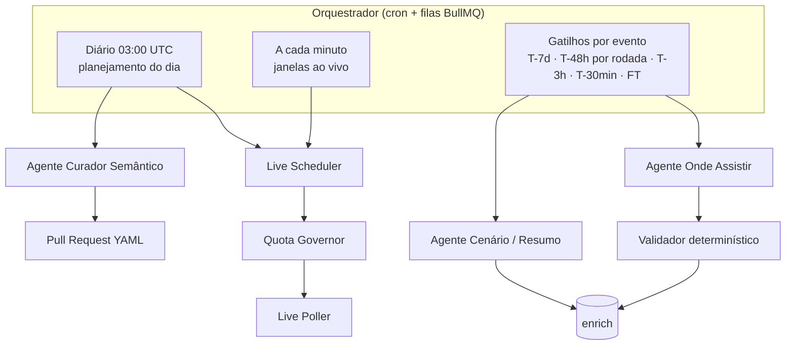
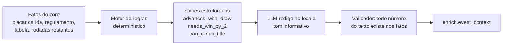

# 07 · IA: tempo real e enriquecimento

## 1. Princípio

> **Fatos vêm da fonte de dados. A IA decide *quando* buscar, *onde* procurar o que a fonte não tem e *como* contar.**

| A IA **faz** | A IA **não faz** |
|---|---|
| Prioriza quais jogos consultar e com que frequência (dentro da cota) | Inventar placar, minuto, gol, cartão ou escalação |
| Descobre onde assistir por país, com fontes | Publicar opção de transmissão sem evidência |
| Redige cenário pré-jogo a partir de fatos calculados ("avança com empate") | Calcular regras de classificação "de cabeça" — isso é código determinístico |
| Resume o pós-jogo a partir da timeline real | Opinar, ofender rival ou especular sobre arbitragem |
| Propõe novos fatos para a base semântica (via PR) | Publicar semântica sem revisão humana |

## 2. Agentes



### 2.1 Live Scheduler (o "agendamento inteligente")

Objetivo: maximizar a cobertura ao vivo dos jogos importantes com a cota disponível.

Entrada: agenda do dia (obtida com **1 chamada** `fixtures?date=` por dia no futebol), tiers do catálogo, clássicos, orçamento restante do Quota Governor.

Algoritmo base (determinístico, auditável):

1. Montar **janelas ao vivo**: para cada jogo de `live_priority` alta/média, `[kickoff − 5 min, kickoff + 130 min]` (futebol; outros esportes têm duração própria).
2. Unir janelas sobrepostas → `minutos_ao_vivo_do_dia`.
3. `intervalo = minutos_ao_vivo_do_dia / orçamento_live` (mínimo 15 s, que é a frequência de atualização do fornecedor).
4. Cada *tick* faz **uma** chamada `fixtures?live=<ids das ligas com jogo na janela>` — uma única chamada retorna todos os jogos ao vivo dessas ligas, com eventos.
5. Ajustes dinâmicos: encurtar intervalo nos minutos finais, prorrogação e pênaltis; pular *ticks* no intervalo de jogo; parar ao receber `FT` de todos.

Papel do LLM (modelo leve, ex.: `claude-haiku-5-5`): **reordenar prioridades** quando há mais jogos relevantes do que orçamento (ex.: final de estadual × rodada de Série A × clássico europeu), considerando o mercado ativo e a importância. Saída estruturada, validada contra o orçamento; se o LLM falhar, o algoritmo base segue sozinho.

**Implementação** (`services/ai-agents/src/priority`, issue #56) — interface pura para o scheduler:

```ts
import { prioritizeLive, recordPriorityDecision } from '@galaxie/ai-agents';

const decision = await prioritizeLive(
  { candidates, budget: 65, activeMarkets: ['BR', 'AR'] }, // candidatos com custo estimado em chamadas
  llm, // LlmClient (tier light) ou null
);
await recordPriorityDecision(db, decision); // ops.job_run, job = ai:live-priority
```

- Demanda ≤ orçamento: nem chama o LLM (`source: 'base'`).
- Demanda > orçamento: o LLM devolve um ranking (`{ eventId, reason }[]`); ids desconhecidos ou repetidos invalidam a resposta (volta ao algoritmo base), ids omitidos entram no fim na ordem base. Os candidatos entram no prompt como dado (`<dados_externos>`).
- A seleção final é **sempre** código (`applyBudget`, guloso na ordem decidida): nunca passa do orçamento. A decisão traz origem, motivo, ranking com justificativas, gasto, modelo e uso de tokens.
- Algoritmo base: `importance` + mercado ativo (+30) + tier (+20 por nível acima do 4) + clássico (+15) + stakes decisivos (+10); desempate por horário e id.

Exemplo no plano gratuito (100 chamadas/dia na API de futebol):

| Item | Chamadas |
|---|---|
| Agenda do dia (`fixtures?date=`) | 1 |
| Sync diário incremental (tabelas, rodadas, lesões dos tiers 1) | ~19 |
| Reserva de segurança (15%) | 15 |
| **Orçamento live** | **65** |
| Quarta-feira com jogos de 19h a 23h30 (BRT) → ~330 min de janela | 1 chamada a cada ~5 min |

No plano pago (ex.: 7.500/dia), o mesmo algoritmo chega ao limite de 15 s por *tick*.

**Implementação (issues #54 e #55)** — [`services/ingestor/src/live`](../services/ingestor/src/live), processo `pnpm --filter @galaxie/ingestor live:run` (job `live-run` do scheduler, a cada 5 min; sai sozinho quando não há janela próxima):

- **Candidatos**: `core.event` de hoje e amanhã (UTC) com `core.competition.live_priority`/`tier`, `core.stage.kind`, `derby_id` e `importance`; entram os de prioridade alta/média e os clássicos (qualquer competição).
- **Janelas** por esporte: futebol `[apito − 5, apito + 130]`, alinhada ao relógio de jogo quando o apito atrasa; mata-mata ganha **+45 min contingentes** (prorrogação + pênaltis), que viram firmes ao aparecer `ET`/`BT`/`P`; jogo ainda em andamento no core mantém a janela aberta (teto de 4 h). Demais esportes: duração esperada (docs/04 §3) + 15 min.
- **Minutos ponderados**: intervalo de jogo vale 0 (pulado), tempo normal 1, reta final (≥ 75'), prorrogação e pênaltis 2. O orçamento é distribuído pelos minutos ponderados: `intervalo(minuto) = máx(15 s, minutos_ponderados ÷ ticks ÷ peso)` — nunca passa do orçamento. Em execução, o peso vem do estado real (HT visto → pula 10 min; `2H` ≥ 75', `ET`, `P` → peso 2).
- **Orçamento LIVE** = limite − reserva − tudo o que já foi usado − **saldo protegido do DAILY** (padrão: a fatia DAILY do dia). Até 1/4 dele fica reservado para confirmar o placar final de cada jogo (`fixtures?id=` quando ele sai do `live`, que também grava escalações e estatísticas e marca o cursor do detalhe para o sync diário não repetir). Gravado no Governor com `governor.plan` (só o útil: com todos os minutos a 15 s, o resto fica para o BOOTSTRAP); **dia sem jogo relevante → LIVE = 0**.
- **Mais jogos que orçamento**: inclusão gulosa por prioridade (alta → média → clássico, tier, importância; jogo já em andamento nunca perde a vaga) enquanto o intervalo médio ficar ≤ 15 min (`LIVE_MAX_INTERVAL_MINUTES`). Um priorizador opcional (`prioritize`, ex.: LLM leve) pode reordenar; se falhar, segue a ordem base.
- **Poller**: cada tick é **uma** chamada `listLive(<ligas em janela>)` com prioridade LIVE pelo `ApiSportsProvider`/`ApiSportsClient` (`fixtures?live=71-128`), diff contra o core (status, placar, relógio, timeline), aplicação pela normalização (máquina de estados, *last-known-good*: 5xx → `is_stale` sem inventar placar, com recuo exponencial após 3 falhas) e sinal `topic = live` no `ops.change_feed` (gol, encerramento, stale/recuperado — mudança só de relógio não é publicada). O `live` é interno (purge e operação): clientes recebem o gol pelos tópicos públicos `event.score_changed`/`event.incident_added`, publicados pelos triggers de `core.event`/`core.event_incident` quando o poller grava — sem duplicata (docs/05 §5). Medido ponta a ponta (poller → SSE): ~80 ms, meta ≤ 5 s. Jogo encerrado → tabela da temporada recalculada (#19). Opcional (`--destaque auto|on`): detalhe ao vivo do jogo principal a cada tick, se o orçamento permitir.
- **Estado publicado** em `ops.sync_cursor` (`live:scheduler`) → métricas `galaxie_live_scheduler_*`. `live:run --plan` mostra janelas, orçamento e intervalo do dia sem chamar nada.

Intervalos simulados (relógio e fornecedor falsos, cota contada pelo Governor) em [03 §5](03-ingestao-e-economia-de-chamadas.md#5-ao-vivo).

### 2.2 Agente Onde Assistir

| Item | Definição |
|---|---|
| Modelo | `claude-sonnet-5-5` com ferramenta de busca web (e *fetch* de páginas) |
| Gatilhos | Direitos por temporada (job `wtw-rights`); **canal do jogo** pela escala da rodada em T-5d, T-48h e T-6h e confirmação depois do jogo (job `wtw-channel`, §2.2.4); T-7d (direitos), T-3h e T-30min (revalidação, sem LLM); reexecução sob demanda (correção editorial) |
| Escopo | Direitos: `(competição, temporada)` para todos os mercados numa chamada · alocação: `(competição, rodada)` para todos os mercados numa chamada, só onde os direitos dividem os jogos · publicação: `(evento, país)` para mercados ativos, tiers 1 e 2 |
| Fontes priorizadas | 1) organizador da competição, 2) site/redes oficiais da emissora/plataforma, 3) clubes, 4) imprensa esportiva de referência do país |
| Saída | Lista JSON de opções (schema em [04](04-modelo-de-dados.md#5-enrich--saídas-de-ia-e-fontes-externas)) com `evidence` (URL + trecho ≤ 200 caracteres) |

**Sinal de provedor**: se o provedor de produção for a Sportmonks, o endpoint **TV Stations** (emissoras por jogo e país) entra como sinal de apoio com confiança de agregador até medirmos sua cobertura e precisão no trial — nunca como fonte da verdade.

**Tabela de direitos (prior)**: `config/broadcast-rights/<iso2>.yaml` — competição × país × temporada → quem **pode** transmitir, curada a partir de anúncios oficiais. O agente parte dela e confirma jogo a jogo; uma opção de quem não detém direitos perde confiança ou é descartada.

**Validador determinístico** (código, não IA):

1. Descarta opções sem URL de evidência acessível.
2. Normaliza nomes de provedores/canais contra um dicionário por país (`config/broadcasters/<iso2>.yaml`).
3. Deduplica por `(event, country, broadcaster, region)`.
4. Calcula confiança (0–1): fonte primária (emissora/organizador) 0,9 · imprensa grande 0,7 · agregador 0,4 · **+0,1** se consistente com a tabela de direitos · **+0,1** se duas fontes independentes concordam · **−0,3** se a fonte tem mais de 72 h em liga com escolha por rodada.
5. **Publica** se `confidence ≥ 0,7`; entre 0,5 e 0,7 fica `pending` (não aparece); abaixo de 0,5 descarta. Conflito entre fontes primárias → **omitida** até a próxima checagem.
6. Diff com o estado anterior → `NOTIFY` → purge de cache + webhook (correção em ≤ 5 min).

Cadência: **direitos primeiro** (determinístico, sem LLM quando a tabela basta), uma pesquisa de direitos por competição × temporada e uma alocação por **rodada** só onde os direitos dividem os jogos; por jogo, só revalidação sem tokens (§2.2.1). Detalhes e schema JSON em [research/onde-assistir.md](research/onde-assistir.md).

> Agregadores com termos que proíbem reuso **não** são raspados; servem no máximo como pista para encontrar a fonte primária.

Exemplo do resultado esperado (Brasil, semifinal de Libertadores): TV aberta nacional, canal gratuito no YouTube e streaming por assinatura — exatamente o tipo de resposta que hoje o torcedor busca fora da plataforma.

#### 2.2.1 Implementação

| Peça | Onde | O que faz |
|---|---|---|
| Dicionário de emissoras | `config/broadcasters/<iso2>.yaml` (BR, AR, MX, CO, CL, PE, UY, EC) + `_common.yaml` | Nome canônico, aliases, canais, `medium`, `access_model`, domínios oficiais, grupo de mídia, variantes regionais (afiliadas → UF) e as fontes do país (organizadores, imprensa, agregadores) |
| Tabela de direitos (curada) | `config/broadcast-rights/<iso2>.yaml` | Competição × ciclo (`valid_from`/`valid_to`) → `holders` (+0,1), `uncertain_holders` (neutros), `per_round_selection` (ativa a penalidade de fonte velha), `distribution` (`exclusive` · `all_matches` · `split` · `selected` · `to_confirm`, padrão), `all_matches: [ids]`, `rules: [{holders, home_teams, teams, rounds}]` (jogos garantidos por mandante, time ou rodada) e URLs das fontes. Validada no loader (detentor existe, regra só com detentores da linha, `exclusive` só com plataformas do mesmo grupo). **Sempre vence** a pesquisada. Semeada de [research/onde-assistir.md §2](research/onde-assistir.md) |
| Direitos pesquisados | `enrich.broadcast_rights` + `packages/where-to-watch/src/rights-research.ts` | Resultado validado da pesquisa por temporada, por competição × temporada × país, versionado (nova versão só quando detentores/distribuição mudam); `rowToRightsEntry` converte para a mesma forma da curada |
| Resposta dos direitos | `packages/where-to-watch/src/rights.ts` | `rightsAnswer(linha, jogo)` → detentores garantidos (publicação sem LLM) × detentores a alocar; `rightsCandidates` vira candidatas de origem `rights` para o validador |
| Biblioteca de emissoras | `enrich.broadcaster` + `packages/where-to-watch/src/library.ts`; `config/broadcasters/_official_logos.yaml` + `_logos.yaml`; `services/ingestor/src/assets/official-logos.ts` e `broadcaster-logos.ts` | Uma entrada por id (nome, aliases, tipo — TV aberta, TV paga por cabo/satélite/IPTV, streaming —, países, canais, site, dados por mercado) sincronizada do dicionário pelo `wtw-rights`. Fonte principal do logo: o **acervo oficial de logos** (Figma), num manifesto versionado com os ids dos nós — cada componente vira logo principal, logo de canal (ESPN 2) ou variante HD de uma emissora, ou fica "sem mapeamento" para a curadoria ([relatório](research/logos-acervo-oficial.md)); o `assets:official-logos` limpa os SVGs exportados (versões clara e escura), grava no nosso storage (`broadcasters/<sha256>.svg`) e liga às emissoras. Sem logo no acervo, vale o da Wikimedia Commons (ligada à emissora pelo Wikidata, conferida pelo site oficial ou pela marca no país), espelhado pelo `assets:mirror`; sem nenhum, fica sem logo. API: `/v1/broadcasters` ([05 §4.1.1](05-api-publica.md#411-biblioteca-de-emissoras--v1broadcasters)) |
| Política editorial | `config/broadcasters/_policy.yaml` + `WTW_BLOCKLIST_FILE`/`WTW_BLOCKLIST` | Blocklist aplicada no validador e nas correções. Operadoras omitidas por política não são nomeadas no repositório: a lista efetiva vem de fora do Git |
| Agente | `services/ai-agents/src/wtw/agent.ts` | Nível `research`, busca na web restrita à allowlist **conjunta** dos países da chamada (organizadores + emissoras — na alocação, só as detentoras — + imprensa em rodízio; ≤ 100 domínios; agregadores fora). Dois pedidos multi-mercado em JSON Schema estrito (`schema.ts`): `researchRights` (direitos por temporada) e `allocate` (rodada: jogos codificados J1…Jn × país × emissora), sempre com evidência (URL + trecho ≤ 160 caracteres, até 2 por item) |
| Verificação HTTP | `services/ai-agents/src/wtw/evidence.ts`, `fetcher.ts` | Toda URL de evidência é buscada de novo (http(s) público, User-Agent genérico `galaxie-sports/0.1`, timeout e limite de tamanho). Contra SSRF, o DNS é conferido **na conexão**: endereço privado, loopback, link-local/metadados, CGNAT (100.64/10), reservado ou IPv4 mapeado em IPv6 recusa o host, inclusive em cada redirecionamento. Página fora do ar → evidência descartada; página que não cita a emissora → rebaixada ao nível de agregador. O jogo naquele canal conta como achado com o trecho na página ou com os dois times a até 10 palavras da emissora sem passar por outro confronto (agenda compacta); a evidência guarda a marca `excerptVerified`. Na revalidação, a fonte que tinha o jogo e o perdeu cai para o nível de agregador; trecho nunca achado (o modelo parafraseia) custa só −0,1 (flag `excerpt_not_found` nos dois casos). Agregadores nunca são buscados |
| Validador | `packages/where-to-watch/src/validator.ts` | Regras de §2.2 (função pura). Detalhes abaixo |
| Versionamento | `packages/where-to-watch/src/store.ts` | Cada mudança material (status, canal, acesso, link, confiança, flags) cria uma versão nova e aposenta a anterior (`superseded_by`/`superseded_at`); sem mudança, só renova `last_verified_at`. Chaves que sumiram viram versão `retracted`. Mudança visível → `where_to_watch.changed` no change feed |
| Agendamento | `services/ai-agents/src/wtw/scheduler.ts`, `runner.ts`, `rights-runner.ts`, `plan.ts` | Janelas abaixo; registros idempotentes em `enrich.wtw_run` (`run_key = evento:país:janela`); chamadas multi-mercado em `enrich.wtw_research` (`research_key` único) |
| Correção editorial | `packages/where-to-watch/src/editorial.ts` + rotas `/internal/where-to-watch/*` ([05 §4.2](05-api-publica.md#42-rotas-internas-correção-editorial-auditoria-e-métricas)) | Inclusão/correção/remoção com trilha (`enrich.broadcast_correction`) e propagação pelo change feed; versões editoriais travam a chave contra o agente |
| Auditoria e métricas | `packages/where-to-watch/src/audit.ts`, `metrics.ts`; CLI `wtw:audit` | Ver §4 |

**Regras do validador (código):**

1. Opção sem evidência **acessível** (fetch 2xx) é descartada; nome ou URL na blocklist → descartada sem registrar o nome.
2. Normalização pelo dicionário (sem acento/caixa, `+` = "plus"; aliases, canais e afiliadas). O meio e o modelo de acesso vêm do dicionário, não do LLM. **Nome desconhecido → `pending` com a flag `unknown_broadcaster`** (fila de revisão; nunca publicado).
3. Dedupe por (região, emissora, meio), juntando evidências por URL. O link para assistir (`watch_url`) só fica quando está num domínio oficial da emissora (ou do grupo dela) ou numa plataforma própria (`watch_domains`) no dicionário; no YouTube, só a transmissão com o id do vídeo (`watch?v=<id>`, `/live/<id>`, `youtu.be/<id>`) de emissora com canal oficial lá (`youtube.com/@canal`); o link genérico `@canal/live` e páginas de canal não são publicados.
4. Tipo da fonte por domínio, relativo à opção: site da própria emissora (ou do mesmo grupo de mídia) = primária; organizador = primária; site de **outra** emissora = imprensa; imprensa do país = imprensa; agregador ou domínio desconhecido = 0,4.
5. Confiança = melhor fonte + 0,1 (detentor na tabela) − 0,2 (emissora fora da tabela, flag `rights_mismatch`) + 0,1 (≥ 2 domínios registráveis distintos) − 0,3 (competição com escolha por rodada e todas as fontes datadas com mais de 72 h, flag `stale_source`); limitada a [0, 1].
6. ≥ 0,7 → `confirmed`; 0,5–0,7 → `pending`; < 0,5 → descartada. Fonte primária que nega + primária que confirma, ou canais divergentes entre primárias → `omitted` (`conflict = true`). Negação primária sem confirmação primária → descartada.
7. Candidatas da **tabela de direitos** (origem `rights`): só valem para detentores da linha efetiva (curada > pesquisada), e só com as URLs da própria linha — conferidas em código, não pelo LLM. Curada = 0,8; pesquisada = a confiança validada da pesquisa (≤ 0,9); + 0,1 do detentor. Detentor com o jogo garantido pela regra (`exclusive`, `all_matches`, `all_matches: [ids]` ou regra por time/rodada) → `confirmed` sem LLM. Detentor sem o jogo garantido → `probable` com a flag `to_confirm` ("canal a confirmar", vai em `to_confirm` na API). "A confirmar" nunca reforça outra fonte: se uma fonte do jogo publica o detentor, vale a fonte; se a fonte não basta (< 0,7), fica o piso `probable`.

**Pipeline em três níveis** (desde a reestruturação por rodada — antes era uma busca completa por jogo × mercado em T-7d, T-24h e, sem opção confirmada, de novo em T-3h e T-30min):

| Nível | Quando | O que faz | LLM |
|---|---|---|---|
| 1. Direitos por temporada | Job `wtw-rights` (05:40 e 17:40 UTC, até 4 pesquisas cada; só pesquisa o que falta) — provedor próprio opcional: `AI_RIGHTS_PROVIDER=gemini` (Grounding with Google Search, `GEMINI_API_KEY`), em dois passos — pesquisa em texto com a busca do Google e a allowlist no prompt (a busca não filtra domínios), depois o JSON montado pelo modelo leve só com as URLs reais das citações do grounding (`groundedUrls`; o agente descarta qualquer outra antes do validador) | Para cada (competição, temporada) com jogos nos próximos 45 dias e relevância ≥ `WTW_MIN_RELEVANCE` em algum mercado configurado (com `--pais`, só nos pedidos; inclusive os que já têm direitos — a liga curada no próprio país ganha a pesquisa nos vizinhos pelo mesmo custo): **uma** chamada pesquisa os detentores em todos os mercados da América Latina sem linha curada (ou poucas, se a allowlist conjunta passar de 100 domínios — hoje os 8 mercados cabem numa). Saída por país: detentores, canais/serviços, tipo (TV aberta, TV paga, streaming), regra de distribuição (`exclusive`, `all_matches`, `split`, `selected`, `to_confirm`) e fontes. O validador de direitos confere cada detentor (dicionário do país, fonte acessível em domínio permitido que cita a emissora; ≥ 0,7 → confirmado) e grava em `enrich.broadcast_rights` (versionado). A linha curada de `config/broadcast-rights` **sempre vence**. Reconfirmação mensal sem tokens (fetch + hash das fontes); fonte que não sustenta mais → nova versão `pending` (`source_changed`) e nova pesquisa | 1 chamada por competição × temporada |
| 2. Alocação por rodada | Janela T-48h do **primeiro** jogo da rodada — **desligada por padrão desde o canal do jogo** (`WTW_ROUND_ALLOCATION=on` religa); o nível 2 agora é o job `wtw-channel` (§2.2.4) | Só nos mercados cujos direitos **dividem** os jogos (`split`, `selected`, `to_confirm`), com relevância ≥ `WTW_MIN_RELEVANCE` e dentro do teto diário do mercado: **uma** chamada por (competição, rodada) para todos os jogos e mercados, restrita aos detentores conhecidos (até 12 jogos por chamada). Sem divisão, sai 100% dos direitos | 1 chamada por rodada (só com divisão) |
| 3. Por jogo | T-7d, T-3h, T-30min | T-7d publica a resposta dos direitos; T-3h e T-30min refazem o fetch das URLs salvas (cache por URL na execução), reaplicam os direitos e revalidam — **nunca** chamam o LLM | — |

**Janelas** (`wtw:run`, cron a cada 5 min; execuções idempotentes em `enrich.wtw_run`, `run_key = evento:país:janela`):

| Janela | Âncora | Modo | O que faz |
|---|---|---|---|
| T-7d | início do jogo | `rights` | Resposta determinística: detentor garantido → `confirmed`; demais → "a confirmar" |
| T-48h | início do **primeiro jogo da rodada** | `allocate` | Agrupa por (competição, rodada do fornecedor — ou data, sem rodada) e faz a alocação acima; quem não precisa (ou não passa no limiar/teto) sai só dos direitos |
| T-3h | início do jogo | `revalidate` | Fetch + hash das evidências salvas, direitos reaplicados (zero tokens). Fonte que caiu/deixou de citar a emissora derruba a opção e volta o "a confirmar" |
| T-30min | início do jogo | `revalidate` | Igual a T-3h |
| manual | — | `full` | `POST /internal/.../rerun` ou `wtw:run --evento <id> --pais BR --forcar`: alocação só daquele jogo (restrita aos detentores; aberta, sem tabela) |

Vale só a janela aberta mais recente (janelas perdidas não são recuperadas). Jogo de competição **sem direitos** (curados ou pesquisados) no mercado não entra na agenda — quem cobre esse buraco é o nível 1. Mercados ativos: `WTW_MARKETS` ou a união dos `markets` dos tenants com o módulo `where_to_watch`. As opções já salvas sempre voltam como candidatas (com as evidências rebuscadas) — uma alocação que "não achou" não apaga opção boa.

**Prioridade e custo** (`services/ai-agents/src/wtw/relevance.ts`, `spend.ts`):

- **Relevância por mercado** = `core.event.importance` + 10 se um participante é do país + 5 se a competição é do país (bônus ≤ 10) + a audiência da competição no país (`config/geo/market-audience.yaml`, 0–40; teto 100) — a mesma conta da relevância por mercado da API, calculada aqui enquanto ela não é gravada no banco (sem o bônus continental e o da semifinal). Com a audiência, a Liga MX no México fica em ~89–100 (antes 54–59, abaixo do limiar) e as grandes europeias ≥ 60 em todos os mercados. Só rodadas com algum jogo de relevância ≥ `WTW_MIN_RELEVANCE` (padrão 60) usam LLM; as demais ficam com os detentores "a confirmar".
- **Fila:** reservada por relevância × proximidade do início (`relevância / (1 + horas/24)`); a reserva de uma execução de alocação traz as irmãs da rodada (outros jogos e mercados). `--chamadas N` limita as chamadas por execução; rodada sem chamada disponível volta para a fila.
- **Teto por mercado:** cada chamada multi-mercado fica em `enrich.wtw_research` e o custo é rateado igualmente entre os mercados dela; `WTW_DAILY_USD_PER_MARKET` (padrão US$ 1) tira da próxima chamada o mercado que estouraria o teto — um mercado não consome o dia dos outros. O teto é conferido antes de **cada** chamada (rodada com mais de 12 jogos vira várias), e o rateio é refeito depois de tirar um mercado. Pesquisa que falhou (provedor fora, timeout) espera 30 min, 1 h, 2 h… e desiste no dia depois de 3 falhas (`failures`, somadas nas chaves da mesma rodada ou competição); no mesmo dia (UTC) a retentativa soma o custo na mesma linha; em outro dia ganha linha nova e a antiga sai da chave (`<chave>#<id>`), com o gasto no dia em que aconteceu, e o timeout sem uso parcial registra a estimativa da chamada. O teto global `AI_DAILY_TOKEN_BUDGET` continua valendo. Cada `wtw_run` guarda a sua parte do custo da chamada (`stats.researchId`, `costShareOf`).

**Modelo de custo** (`wtw:run --plan` calcula com a agenda real; US$ por chamada = média das últimas chamadas em `enrich.wtw_research`). Medido em 2026-10-22 com `gpt-6.1-sol`: direitos do Brasileirão 2026 para os 8 mercados = 90 mil tokens de entrada, 10 buscas, **US$ 0,33**; alocação da rodada 32 (10 jogos × BR, MX, CO) = 97 mil tokens, 11 buscas, **US$ 0,36**. Desenho antigo: ≈ 30 mil tokens, **US$ 0,10 por jogo × mercado × janela**.

| Jogos/dia (tier ≤ 2) | Mercados | Antigo (US$/dia) | Novo (US$/dia) | Novo por mercado (US$/dia) |
|---|---|---|---|---|
| 56 | 1 | 8,54 | 0,61 | 0,61 |
| 56 | 8 | 68,29 | 0,70 | 0,09 |
| 56 | 15 | 128,05 | 1,14 | 0,08 |
| 100 | 1 | 15,24 | 0,81 | 0,81 |
| 100 | 8 | 121,95 | 0,97 | 0,12 |
| 100 | 15 | 228,66 | 1,49 | 0,10 |

Antigo = jogos × mercados × 1,52 buscas por jogo (T-7d no tier 1 + T-24h; sem contar as escaladas de T-3h/T-30min, que no banco de desenvolvimento foram 17 de 24 buscas) × US$ 0,10. Novo = alocações por rodada/dia (0,011 por jogo/dia, medido na agenda de 7 dias dos 8 mercados) × US$ 0,36 × (1 + 5% por mercado extra na chamada) + pesquisas de direitos amortizadas em 30 dias (32 competições × ⌈mercados/8⌉ × US$ 0,33). A pesquisa de direitos é por temporada: depois do primeiro mês, cai para perto de zero (reconfirmação sem tokens). A meta de US$ 0,50–1 por mercado por dia fica com folga — dá para baixar `WTW_MIN_RELEVANCE` e alocar mais rodadas.

```bash
pnpm --filter @galaxie/ai-agents wtw:run --plan [--pais BR] [--dias 7] [--detalhes]   # grupos, decisão e custo (sem LLM)
pnpm --filter @galaxie/ai-agents wtw:run [--evento <id>] [--pais BR] [--limite 100] [--chamadas 2]
pnpm --filter @galaxie/ai-agents wtw:run --evento <id> --pais BR --forcar
pnpm --filter @galaxie/ai-agents wtw:rights --plan                     # direitos que faltam pesquisar
pnpm --filter @galaxie/ai-agents wtw:rights [--competicao <slug>] [--pais BR,AR] [--chamadas 2] [--incluir-curados]
```

**Sinal de provedor (Sportmonks TV Stations):** ainda não plugado — entra como mais uma evidência com confiança de agregador (0,4) quando o provedor de produção existir.

#### 2.2.2 Grade de canais e ofertas das plataformas

O onde assistir diz **quem tem o direito** do jogo (o canal). A grade dá o elo seguinte: **em que plataforma** (operadora de TV paga, vMVPD, combo de telecom ou streaming) e **em que plano** esse canal está, e quais streamings vêm inclusos num plano. Nós mesmos montamos a grade a partir das ofertas que as plataformas publicam no próprio site: pesquisa com IA e fonte citada, tudo entra como rascunho e só vai à API depois de aprovado no painel. O cliente operadora não edita a grade; ele pede revisão pelo portal.

Confidencialidade: o repositório não nomeia nenhuma plataforma. Os nomes reais vivem só no banco, gravados pela pesquisa em tempo de execução. O prompt não leva lista de plataformas: elas saem da busca em fontes públicas, e o que entra no prompt (plataformas e planos já gravados, canais da biblioteca) vem do banco e do dicionário só para o modelo repetir a mesma grafia. Testes e exemplos usam "Operadora Exemplo", "Streaming Exemplo" e "Canal Exemplo".

| Peça | Onde | O que faz |
|---|---|---|
| Tabelas | `enrich.platform`, `enrich.platform_plan`, `enrich.plan_channel`, `enrich.plan_service` (migrations `0029_grade_operadoras` e `0036_grade_validacao_paginas`) | Plataforma por país (`slug` `<iso2>-<nome>`, tipo `pay_tv_operator` · `vmvpd` · `telco_bundle` · `streaming`, site, `official_domains` — domínios oficiais além do site, como o do grupo —, `broadcaster_id` quando é o mesmo serviço de uma entrada da biblioteca); plano com preço em texto, preço estruturado (`price_amount numeric`, `price_currency` ISO 4217), página, vigência (`valid_from`/`valid_to`) e `seen_at`; vínculos plano × canal e plano × streaming (`included`, `addon` ou `unverified`), ambos apontando para `enrich.broadcaster`. Plano e vínculos guardam em `verification` (jsonb) o resultado do validador da pesquisa. Todo item tem `review_status` (`draft` · `reviewed` · `approved` · `rejected`), `sources` (`[{url, seen_at}]`) e `proposed_change` |
| Pedidos da operadora | `ops.lineup_review_request`; em `api.tenant`, `operator_platform_id`, `show_other_operators` e `operator_email_domains` | O tenant operadora fica ligado à própria plataforma e pede revisão de um item da grade dele (plataforma, plano ou vínculo) com mensagem e campos propostos. Aceito com `apply`, a proposta vira dado aprovado com a fonte "informado pela operadora" |
| Funções | `packages/db/src/lineups.ts` (`@galaxie/db` e `@galaxie/db/lineups`) | `listPlatforms`, `getPlatformLineup`, `availabilityForChannels` (leitura; padrão: só o aprovado), `upsertLineupDraft` (gravação da pesquisa), `setLineupReviewStatus` e `dismissLineupChange` (painel), `createLineupReviewRequest`, `listLineupReviewRequests` e `resolveLineupReviewRequest` (portal e painel), `setTenantOperator` e `getTenantOperator` |
| Pesquisa | `services/ai-agents/src/lineups/` + CLI `lineups-research` | Por país (BR, AR, MX, CO e CL no começo): uma chamada com busca descobre as principais plataformas. Os planos de cada plataforma vêm da **página oficial** (`page-research.ts`, migration `0042_grade_paginas_de_planos`): a página de planos guardada em `platform.plan_pages` (sem nenhuma, uma chamada curta com busca acha as URLs, uma vez) é lida do nosso lado e, só se mudou desde a última extração (`plan_pages_hash`), uma chamada de nível `light` **sem busca** extrai planos, preços, grade, inclusos e complementos com o trecho literal da página. `--com-busca` mantém a pesquisa antiga (grounding em cada etapa) para comparar |
| Logos | `services/ingestor/src/assets/platform-logos.ts` + CLI `assets:platform-logos` | No padrão da biblioteca de emissoras, sem IA: (1) a entrada da biblioteca com o **mesmo site oficial** (acervo oficial ou Commons já curados) empresta o logo, com a versão escura; (2) senão, o item do Wikidata cujo site oficial (P856) é o da plataforma — mesmo host, ou o mesmo domínio com o nome igual a um rótulo ou apelido — e o logo dele (P154) na Wikimedia Commons, só com licença livre para uso comercial (domínio público, CC0, CC BY, CC BY-SA). A miniatura PNG vai para `platforms/<sha256>.png`, com `core.asset` (`origin = commons`) e o crédito em `core.asset_credit`; a API devolve `logo_credit`. Sem fonte verificável, sem logo |

**Regras da gravação (código, não prompt):**

1. Sem fonte, sem conteúdo: cada plano, canal e streaming vem com `fonte_url` e trecho, e a URL precisa estar entre as fontes reais do grounding (`groundedUrls`; nos outros provedores, as citações). Item sem fonte ou sem trecho não entra. A pesquisa é por país e por plataforma (com vários países numa chamada, o modelo só cita fonte de metade — teste de 24/10), e a busca dos planos mira o site e os domínios oficiais da plataforma.
2. Nome ou domínio na blocklist editorial (`_policy.yaml` + `WTW_BLOCKLIST_FILE`/`WTW_BLOCKLIST`) descarta o item sem registrar o nome.
3. Canal e streaming precisam casar com uma entrada da biblioteca de emissoras pelo dicionário do país, **no dia** (nome, alias ou canal, como "Canal Exemplo 2 HD" → `canal_exemplo_2`). Apelido com validade (`aliases: [{ name, channel, valid_from, valid_to }]`) modela renomeação: fora do Brasil e da Argentina, "Fox Sports 2/3" é o ESPN 6/7 desde fevereiro de 2024 (conta uma vez só); no Chile, "Fox Sports" é o ESPN 4 desde 2021. Entrada com `valid_to` vencido (GolPerú, fora das grades desde 01/01/2026) é recusada como canal extinto. O meio vem do dicionário: entrada de TV vira canal do plano, entrada de streaming vira streaming incluso. Nome desconhecido fica de fora e aparece no relatório para a curadoria.
3a. **Validador determinístico** (`services/ai-agents/src/lineups/validate.ts`), depois da IA: (i) segue o redirecionamento do grounding (`vertexaisearch.cloud.google.com/grounding-api-redirect/...`) com um GET sem seguir o 302, lendo o `Location`, e guarda a URL final (o link do Google expira); falhou, fica sem verificação; (ii) classifica a fonte pelo domínio final — oficial (site da plataforma, mesmo domínio ou `official_domains`), comparador (selectra e parecidos, agregadores do país), imprensa (inclusive o site de outra emissora), descartada (scribd, lojas de app, redes sociais) ou outro; (iii) confere que o trecho contém o dado: o número do preço em qualquer grafia, o nome do canal ou do streaming sem acento e com os apelidos do dicionário; (iv) exige prova do plano: o trecho cita o nome do plano (sem confundir com o plano de nome mais longo) ou a URL final é a página dele; trecho reaproveitado em vários planos da plataforma só vale se citar o plano; (v) preço: o cheio de lista, nunca o promocional do 1º mês ("50% OFF no 1º mês", "R$ 149,90. R$ 74,95 por mês"), na moeda do país (BRL, ARS, CLP, COP, PEN, UYU, MXN; USD no Equador e no Panamá); (vi) streaming é complemento pago por padrão: só é `included` com prova oficial e específica do plano que diga que vem incluso (com a prova, sem dizer incluso, é `addon`). Canal ou streaming sem prova entra como `unverified`; preço sem prova não é gravado (o que a IA disse fica em `verification.claimed`). Um item também pode ser provado pelo trecho do próprio plano, quando ele cita o item.
3b. `unverified` nunca sai na leitura pública: `getPlatformLineup` e `availabilityForChannels` só o devolvem com `includeUnverified` (o painel), e a API tem uma segunda trava. O painel (`/ajustes/grades`) mostra o preço com a moeda, o nível da fonte, o domínio final, o resultado de cada checagem e o trecho.
3c. **Duas etapas por plataforma** (o modelo achava planos e os perdia ao montar o JSON): (1) a lista dos planos, só nome e fonte, e o catálogo de complementos com preço; (2) uma chamada por plano, para o detalhe. A validação é conjunta (o trecho reaproveitado entre planos aparece) e o plano listado sem detalhe fica com `checks.details = fail` ("plano faltando"). `--max` conta todas as chamadas; o que não couber fica para a próxima execução.
3d. **Vários preços:** cada preço vem com a fonte e a data da fonte (`data_da_fonte`, ex.: a tabela de nov/2025). Todos ficam em `verification.prices`; valores diferentes marcam `price_conflict` e vale o oficial provado mais recente (a página oficial lida hoje vence a tabela antiga).
3e. **Complementos** (`enrich.platform_addon`, migration `0036_grade_validacao_paginas`): serviço ou canal que qualquer plano contrata à parte, com preço, moeda e fidelidade em meses; uma linha por oferta (o Premiere mensal e o com fidelidade de 12 meses são duas). É da plataforma, não do plano: incluso num plano, complemento pago nos outros. Canal também pode ser complemento (a ESPN 6 só existe assim). A API devolve em `platforms[].addons` ("disponível como complemento: Premiere a partir de R$ 49,90") e na grade da plataforma; o widget e a demo mostram.
3f. **Rebrand:** o site oficial que passou a redirecionar para outro domínio vira mudança proposta na plataforma (`proposed_change.website` com `note`), na descoberta, na revisita e na leitura das páginas. A mudança explícita sobrevive à pesquisa que revê o item.

**Pesquisa pela página oficial (padrão do `lineups:research`, desde 25/10/2026).** Na produção, a busca do grounding era quase todo o custo da grade (7 dias: US$ 13 em 83 chamadas de planos, 873 buscas, ~10 por chamada e até 38; os tokens eram ~3,7 mil de entrada) e servia para o modelo ler páginas que o nosso leitor já lê. Agora: (1) URL da página de planos guardada por plataforma (`plan_pages`; sem ela, as páginas oficiais dos planos já gravados; sem nenhuma, uma chamada curta com busca, "no máximo 3 buscas", só domínios oficiais; `--redescobrir` refaz); (2) leitura pelo leitor educado abaixo (estático → JSON embutido → navegador, o mesmo cache); (3) hash do conjunto de páginas igual ao da última extração (`plan_pages_hash`): nenhuma chamada ao modelo, só renova o `seen_at` dos planos; (4) senão, uma extração no nível `light`, sem busca (`webSearch: false`, `purpose` `lineups:extract:<slug>:<país>`), com o schema `lineups_page_extract`: cada plano, preço, canal, streaming e complemento com o trecho copiado da página; (5) o validador de sempre decide a prova, com duas regras a mais da página: o trecho precisa estar na página (`checks.page`), e o trecho dentro do cartão do plano ou da lista aberta pelo botão dele prova o plano. Nada sem prova some: canal ou streaming sem trecho, com trecho fora da página ou de outro plano entra como `unverified`, com a checagem que falhou, para a revisão no painel (só nome fora da biblioteca fica de fora, para a curadoria, porque não tem entrada para ligar). A resposta do modelo não é corrigida: a URL de cada evidência é a página onde o código achou o trecho. Grade completa (o que sumiu vira `proposed_change.removed`) só na revisita com todas as páginas lidas por inteiro. `--plan` mostra as chamadas com busca e sem busca e o custo estimado; `--forcar` relê e extrai mesmo sem mudança; `--max` conta as duas (página igual não conta).

**Leitura da página oficial (`lineups:pages`, sem LLM).** A grade de canais de cada plano quase nunca está nos trechos da busca (no site testado, só aparece num botão "Mostrar lista de canais" que busca uma API do próprio site). Então a página oficial do plano é lida do nosso lado (`services/ai-agents/src/lineups/pages.ts`, `extract.ts`, `confirm.ts`):

- só domínios oficiais (`website` e `official_domains`); redirecionou para fora, para;
- educado: robots.txt respeitado (inclusive `Crawl-delay`), User-Agent do projeto (`GalaxieSports/1.0 (repositório; grade de canais)`, sem dado de pessoa), intervalo mínimo de 3 s por host, teto de páginas por execução e cache por URL em `enrich.lineup_page` com validade de 25 dias;
- nada de login, formulário, captcha ou paywall: a página que pede isso fica `blocked` e a grade daquele plano, não verificada;
- ordem: HTML estático → JSON embutido na página (`__NEXT_DATA__`, `application/json`, estado inicial) → navegador headless, só se o conteúdo não aparecer e houver navegador configurado (sem ele, `needs_render`);
- extração determinística: o cartão de cada plano (do título até o próximo plano ou a seção de complementos) dá o preço cheio e os inclusos (só frases que dizem "incluso"); a lista aberta pelo botão do próprio plano (ou a página que é do plano) dá a grade; marketing no cartão não vira grade. Todo nome casa com o dicionário; apelido curto ("TNT") não conta na página. Plano que aparece na página e não está no banco entra como rascunho;
- proveniência: URL, data da leitura, forma (`static`, `embedded_json`, `render`) e hash do conteúdo em `verification.page`. Mudou o hash e o plano já foi revisado: mudança para revisar.

**Onde rodar o navegador.** A imagem dos agentes leva só o `playwright-core` (o cliente, sem navegador). O Chromium roda num contêiner à parte, o serviço `lineup-render` (perfil `render` do compose, imagem do Playwright na mesma versão do cliente, como o usuário `pwuser`, com `mem_limit: 1g` e na rede `render`, que só os agents dividem com ele: o navegador abre páginas de terceiros e não alcança Postgres, Valkey nem S3, mas ainda alcança o host pelo gateway da rede, inclusive o Traefik e as outras portas abertas nele), ligado só durante a leitura: `LINEUP_RENDER_WS=ws://lineup-render:3000/`. Na VPS, a memória é curta: subir o perfil, rodar `lineups:pages` e derrubar (uma página com 12 cliques leva ~90 s). A alternativa é o NAS (mais memória, Chromium sem disputar com a API), lendo as páginas para o banco do NAS e levando para a produção pelo sync NAS → produção (com dump e prévia); o NAS não alcança o banco da produção diretamente. No desenvolvimento, `--renderizar` abre o Chromium local (`LINEUP_RENDER_CHROMIUM` aponta o executável).

**Curadoria interna (`lineups:curate`).** Quem conhece a oferta por dentro (o dono do produto trabalha em duas operadoras clientes) informa a grade num JSON fora do repositório: plataforma, planos com preço, canais, inclusos e complementos, e `replaces` (as plataformas antigas que viraram esta). Prévia por padrão; `--aplicar` grava a grade completa como aprovada, com a fonte "operadora (curadoria interna)", move os tenants da antiga para a nova e rejeita a antiga.
4. Tudo entra como `draft`. Gravar de novo é idempotente (por slug e país): só renova a fonte e o `seen_at`. Item revisado ou aprovado **nunca volta a rascunho** por ser revisto: a diferença vai para `proposed_change`, e aprovar de novo aplica a mudança. Item rejeitado continua rejeitado.
5. A revisita (`--revisitar`) refaz a pesquisa das plataformas com plano visto há mais de 30 dias (`--dias`) e grava a grade como completa: plano ou vínculo que não apareceu fica com `proposed_change.removed`. Nada é apagado sem aprovação; aprovar a remoção encerra a vigência do plano ou apaga o vínculo. Pesquisa sem nenhum plano com fonte não marca nada.

**Leitura no onde assistir:** `availabilityForChannels({ channelIds, country })` recebe os canais que transmitem o jogo e devolve as plataformas do país com os planos vigentes que têm esses canais (`viaChannels`) ou que incluem esses streamings (`services`), além da plataforma de streaming que é o próprio serviço. Para o cliente operadora que não mostra as outras plataformas, `onlyPlatformId`. Plataforma, plano e vínculo precisam estar no nível de revisão pedido (padrão: aprovado). Jogo com o canal **a confirmar** (sem opção publicada): os canais consultados são os dos detentores dos direitos no país (`to_confirm`), e a resposta sai com `channel_status = to_confirm`.

**Custo:** cada chamada passa pelo orçamento diário e fica em `ops.llm_usage` (agente `lineups`). Sem `--redescobrir` ou `--revisitar`, a execução só pesquisa país sem plataformas e plataforma sem planos; `--max` limita as chamadas.

```bash
pnpm --filter @galaxie/ai-agents lineups:research --plan [--pais BR]          # chamadas com e sem busca e o custo estimado (sem LLM)
pnpm --filter @galaxie/ai-agents lineups:research [--pais BR,AR] [--max 6] [--plataforma <slug>] [--redescobrir] [--forcar] [--max-paginas 20] [--renderizar] [--com-busca]
pnpm --filter @galaxie/ai-agents lineups:research --revisitar [--dias 30]
pnpm --filter @galaxie/ai-agents lineups:research --resumo [--pais BR,AR]      # grade gravada por plataforma (sem LLM), para comparar antes e depois
pnpm --filter @galaxie/ai-agents lineups:pages --plan [--pais BR]               # páginas oficiais que seriam lidas
pnpm --filter @galaxie/ai-agents lineups:pages [--pais BR] [--plataforma <slug>] [--forcar] [--renderizar]
pnpm --filter @galaxie/ai-agents lineups:curate --arquivo <json> [--aplicar]      # curadoria interna (prévia sem --aplicar)
pnpm --filter @galaxie/ingestor assets:platform-logos --plan [--pais BR]        # logos: o que seria ligado
pnpm --filter @galaxie/ingestor assets:platform-logos [--pais BR] [--plataforma <slug>] [--refazer]
```

Os logos rodam depois da pesquisa (plataforma nova entra sem logo); na VPS: `docker compose exec -T ingestor node dist/cli/platform-logos.js --plan` e, conferida a prévia, sem `--plan`.

Na produção, o comando roda na VPS, onde a chave do Gemini funciona: `docker compose run --rm --no-deps -e AI_PROVIDER=gemini agents node ../ai-agents/dist/cli/lineups-research.js --pais BR --max 6`. A revisita é agendada no perfil `agents` do scheduler: job `lineups-revisit`, todo dia às 04:50 UTC, `--revisitar --dias 30 --max 4 --max-paginas 10` (teto de 4 chamadas ao modelo e 10 páginas buscadas por execução; página sem mudança não chama o modelo; `SCHEDULE_LINEUPS_REVISIT` muda a agenda ou desliga com `off`, também em Ajustes → Operação). O job usa o provedor da pesquisa de direitos (`AI_RIGHTS_PROVIDER=gemini` na VPS); sem ele, o `AI_PROVIDER`. A leitura das páginas é o job `lineups-pages`, às 05:20 UTC, `--max-paginas 20` (`SCHEDULE_LINEUPS_PAGES`; o cache faz a maioria das execuções não buscar nada; sem `LINEUP_RENDER_WS`, só HTML estático e JSON embutido).

#### 2.2.3 Lista de canais do cliente

O onde assistir diz quem tem o direito; a lista de canais do cliente diz **em qual canal dele** o jogo passa. O cliente manda só os nomes (M3U ou colados) — nunca o EPG, que é licenciado pelo fornecedor dele — e revisa o casamento no portal (`/cliente/canais`). Mínimo de trabalho para o cliente: o código casa quase tudo, ele só confere divergências e confirma.

**A IA não escreve onde só deveria escolher.** Código antes da IA, IA só nas sobras com saída em índices e enums, validador depois:

1. **Normalização** (`packages/where-to-watch/src/channel-list/analyze.ts`): prefixo de país ("BR:", "ARG |", "[MEX]", "|CO|"; também o `group-title` do M3U e o país padrão da lista), pan-regional ("LATAM:"), marca de praça ("|SP|", "GLOBO RJ", "GLOBO MINAS"), qualidade (HD, SD, FHD, 4K, HEVC…), "VOD" e número de feed ("FOX SPORTS 2", "ESPN 3"). **Praça e afiliada não viram dado**: só saem do nome. A geolocalização é da operadora; se a Globo tem o direito (inclusive regional, como um Carioca), o onde assistir mostra "Globo" e todos os canais Globo da lista.
2. **Casamento determinístico** (`match.ts`), contra o dicionário de emissoras de cada país (nome, apelidos, canais e afiliadas de `config/broadcasters/<iso2>.yaml`): canal do país com o nome da emissora → `exato` (todas as praças entram); canal sem país cuja marca só existe num país ("GLOBO RJ") → é desse país; marca de vários países sem prefixo ("ESPN HD") → `feed_generico` nos países sem o feed próprio na lista; mesma marca com sufixo a mais ("CHILEVISION SPORTS") → `nome_divergente`, com nota. Direito só de streaming nunca casa aqui (canal da lista é linear); VOD nunca casa.
3. **IA nas sobras** (`ai.ts`, job `channel-lists` em `services/ai-agents`): por país, só os pares direito × canal que dividem uma palavra de marca (VOD e canal que o dicionário dá a outra emissora ficam de fora antes). O system instruction, a mensagem e o schema são os validados num teste no AI Studio com o exemplo de referência, com três ajustes: direitos numerados (o modelo não repete `plataforma_id` nem `acesso`), marca de praça casa como `exato` (sem `feed_regional`) e a regra do VOD. Entrada: direitos numerados (`direito_idx` → país, `plataforma_id`, acesso: `aberto` · `assinatura_base` · `ppv` · `streaming_assinatura` · `streaming_gratuito`, do dicionário) e a lista do cliente indexada (`canal_cliente_idx`). Saída `{transmissores: [{direito_idx, canal_cliente_idx, casamento, nota_auditoria}]}`, com os índices em enum (os do próprio pedido), `casamento` em enum e `nota_auditoria` só em `feed_generico` ou `nome_divergente`. Nunca nome de plataforma, canal ou plano em texto livre (uma versão anterior, com texto livre, devolveu "Paramount并发"). Versão do prompt em `CHANNEL_MATCH_PROMPT_VERSION` (`channels@v1`), no `purpose` de cada chamada e em `ai_note`. País sem par possível não vai para a IA.
4. **Validador determinístico** (`validateAiMatches`): todo direito volta exatamente uma vez; índice dentro da lista; canal de outro país só como `feed_generico`; streaming nunca `exato` com canal linear; VOD nunca casa; canal que o dicionário diz ser de outra emissora não casa. Qualquer violação vira `sem_canal_na_lista` com a nota "Validador: …", e o resumo vai para `ai_note`.
5. **Correções do cliente** vencem tudo e não vão para a IA; ficam guardadas pelo nome do canal, então sobrevivem a uma lista nova e ao reprocessamento.

| Peça | Onde | O que faz |
|---|---|---|
| Tabela | `api.tenant_channel_list` (migration `0033_lista_canais_cliente`) | Uma linha por tenant: `channels` (só `{idx, name, group}`), `proposed` (casamento atual), `overrides` (correções), `confirmed` (lista e casamento da última confirmação, o que a API serve), `status` (`review` · `confirmed`), `ai_status` e `ai_note` |
| Funções | `packages/db/src/channel-lists.ts` (`@galaxie/db/channel-lists`) | `saveChannelList` (envio e reprocessamento; sem mudança, mantém a confirmação), `saveChannelListAi` (só grava se a lista não mudou no meio), `setChannelListOverrides`, `confirmChannelList`, `getConfirmedChannelList`, `listChannelListsForAi` |
| Casamento | `packages/where-to-watch/src/channel-list/` | `parseChannelList`, `analyzeChannel`, `ChannelDictionary`, `universeRights`, `matchDeterministic`, `aiBatches`, `channelMatchSchema`, `validateAiMatches`, `processChannelList`, `proposeChannelMatches` (o que a API e o portal usam) |
| Job da IA | `services/ai-agents/src/channels/run.ts` + CLI `channels:match` | Pega as listas com `ai_status = pending` (e `failed`, com `--repetir-falhas`), refaz o código, chama o modelo por país, valida e grava. Falha do provedor deixa `failed` com o casamento por código |
| Exemplo de referência | `packages/where-to-watch/src/channel-list/fixture.ts` | Palmeiras × Fluminense (o teste do AI Studio, com os ids da biblioteca no lugar dos do teste) com 11 canais e os direitos de BR, AR, CL, CO e MX: Globo 0 ("BR: |SP| GLOBO HD") `exato`; Fox Sports AR 3 `exato`; Chilevisión 4 `nome_divergente`; ESPN 5 ("ESPN 2 LATAM") `feed_generico` para CL e CO; Disney+, Paramount+ e Max `sem_canal_na_lista` (o 6 é VOD); os canais 1, 2, 7, 8, 9 e 10 sem casamento no jogo |

O provedor é o Gemini por padrão (`AI_CHANNELS_PROVIDER`, com `GEMINI_API_KEY`; modelo `AI_CHANNELS_MODEL`, nível standard), com o custo em `ops.llm_usage` dentro do `AI_DAILY_TOKEN_BUDGET`. Roda na VPS: job `channel-lists` no perfil `agents` do scheduler, a cada 10 min, `--max 10 --repetir-falhas` (sem lista pendente, só uma consulta ao banco; `SCHEDULE_CHANNEL_LISTS` muda a agenda ou desliga, também em Ajustes → Operação). No dev e nos testes, o provedor falso:

```bash
pnpm --filter @galaxie/ai-agents channels:match --plan         # o que seria enviado à IA (sem chamada)
pnpm --filter @galaxie/ai-agents channels:match --falso        # dev: provedor falso (sem_canal_na_lista para as sobras)
pnpm --filter @galaxie/ai-agents channels:match [--tenant <id>] [--max 10] [--repetir-falhas]
```

#### 2.2.4 Canal do jogo

Os direitos dizem **quem pode** passar; o canal do jogo diz **quem passa este jogo**. No Brasileirão, por exemplo, oito detentores dividem os jogos e a escala sai por rodada nos sites das emissoras e na imprensa. Antes, um jogo encerrado podia seguir com "Canal deste jogo a confirmar — o canal do jogo sai mais perto da partida" (caso Mirassol × São Paulo, rodada 32): o canal nunca tinha sido resolvido e o texto não sabia o momento do jogo.

| Peça | Onde | O que faz |
|---|---|---|
| Job | `wtw-channel` (cron a cada 10 min, `--chamadas 2`), `services/ai-agents/src/cli/wtw-channel.ts` | Grupos devidos → importação → pesquisa → validação → gravação |
| Seleção e janelas | `services/ai-agents/src/wtw/channel/plan.ts`, `windows.ts` | Jogos tier ≤ 2 dos próximos 5 dias e os encerrados há até 72 h, por mercado ativo com direitos conhecidos que **dividem** os jogos (detentor exclusivo já é o canal) e relevância ≥ `WTW_MIN_RELEVANCE` — a **liga principal** do país (futebol, liga nacional tier 1) entra sempre e vai na frente da fila. Jogo × país que já tem canal de fonte oficial (antes) ou já confirmado depois do jogo não volta |
| Pesquisa | `channel/agent.ts`, `prompt.ts`, `schema.ts` | **Uma** chamada `research` por grupo (competição × rodada × janela × dia), todos os jogos (até 12) e mercados juntos, Gemini com grounding em dois passos (`AI_MATCH_CHANNEL_PROVIDER`, padrão `gemini`; `AI_MATCH_CHANNEL_MODEL`). O modelo **só escolhe ids**: o jogo da lista (J1…Jn), o país, a emissora (enum com os detentores da linha de direitos) e o canal dela (enum); e aponta a fonte (URL da busca + trecho com os dois times e o canal). Consulta sugerida: "transmissão rodada 32 Brasileirão Série A 2026" |
| Importação | `channel/runner.ts` | Antes de gastar a chamada: as opções salvas pelo agente com fonte do jogo (alocação anterior) passam pelo mesmo validador, com a página buscada de novo e **obrigatoriamente conferida** — o que passar vira canal do jogo (`window = import`) e o jogo × país sai da pesquisa |
| Validador | `packages/where-to-watch/src/match-channel.ts` (`validateMatchChannels`, função pura) | Regras abaixo |
| Gravação | `applyMatchChannels` → `enrich.match_channel` | Upsert por jogo × país × emissora, com a melhor fonte e as evidências; depois do jogo marca `post_confirmed_at`; publica `where_to_watch.changed` (purge de cache) |
| Leitura | `getPublicWhereToWatch` → `availability.match_channel` ([05 §4.1.2](05-api-publica.md#412-grade-de-canais-e-ofertas--availability-e-v1platforms)) | Canal do jogo vira opção `confirmed`; título por momento (antes, ao vivo, encerrado) |

**Janelas** (por grupo; uma chamada por janela — a mesma janela não pesquisa de novo o mesmo jogo × mercado, `research_key` em `enrich.wtw_research`, `kind = channel`, com os jogos × mercados da chamada em `stats.targets`: o que o teto cortou entra na execução seguinte):

| Janela | Âncora | Fase |
|---|---|---|
| T-5d | primeiro jogo da rodada | antes (a escala costuma sair uma semana antes) |
| T-48h | primeiro jogo da rodada | antes (escala definitiva) |
| T-6h | primeiro jogo de cada **dia** da rodada | antes (troca de última hora) |
| post | 3 h depois do último jogo do dia, até 72 h | depois (quem transmitiu) |

**Regras do validador do canal (código):**

1. A emissora é **detentora conhecida** da competição no país (linha de direitos efetiva, curada > pesquisada); fora da biblioteca → descartada. O canal só entra se for um canal daquela emissora.
2. A URL veio da busca do provedor (`groundedUrls`), é http(s) pública e não está na blocklist. Provedor sem grounding garantido: só com a página conferida (item 4). Só é buscada a URL que pode passar (do grounding e de fonte oficial ou imprensa do dicionário).
3. Tipo da fonte pelo domínio: **oficial** (organizador, a própria emissora ou o grupo dela) = 0,9; **imprensa esportiva** do país (ou site de outra emissora) = 0,7; agregador e domínio desconhecido → descartada.
4. O trecho cita os **dois times** (nome, nome curto ou o núcleo sem "FC", "Clube", "Atlético"…) e a **emissora/canal** (palavra inteira; "Globo" não casa com "Globoplay"). A página é buscada de novo: acessível e sem a emissora → evidência descartada; acessível com os dois times e a emissora → +0,1 (página conferida). O **canal** ("SporTV 2") só é gravado quando o trecho e a página citam aquele canal; a fonte que só cita a emissora ou um canal irmão sustenta a emissora, sem o canal; o canal já gravado só continua se a pesquisa nova não propôs outro. Na leitura, o canal do jogo vale sobre o da opção publicada do agente para a mesma emissora (a editorial mantém o dela).
5. Fonte com data mais de 30 dias antes do jogo → descartada (escala de outra rodada/temporada).
6. +0,1 com duas fontes de domínios independentes. **Grava com ≥ 0,8**: oficial sozinha basta; imprensa sozinha precisa da página conferida ou de uma segunda fonte. **Na dúvida, nada é gravado** e o jogo segue "a confirmar".
7. Fonte oficial vale mais: quando uma pesquisa confirma o jogo por fonte oficial, o canal que só a imprensa sustentava e que ela não repetiu é retirado (`retracted`, "a fonte oficial confirmou o jogo em outro canal"). Correção editorial vence o canal do jogo.

**Custo:** uma chamada por grupo e janela (US$ ≈ 0,15, estimativa até haver histórico em `enrich.wtw_research`), no orçamento global de tokens (`ops.llm_usage`, `AI_DAILY_TOKEN_BUDGET`) e no teto por mercado (`WTW_DAILY_USD_PER_MARKET`). Uma rodada do Brasileirão: 3 chamadas antes (T-5d, T-48h e um T-6h por dia de jogo) + uma por dia depois. Execução sem grupo devido só consulta o banco. A alocação por rodada antiga (T-48h do `wtw-run`) fica desligada para não pagar duas vezes (`WTW_ROUND_ALLOCATION`).

```bash
pnpm --filter @galaxie/ai-agents wtw:channel --plan                                   # grupos devidos agora (sem LLM, sem gravar)
pnpm --filter @galaxie/ai-agents wtw:channel --plan --competicao brasileirao-serie-a --rodada 32 --temporada 2026
pnpm --filter @galaxie/ai-agents wtw:channel --plan --linha-de-base [--dias 7]        # encerrados com canal, por país e competição
pnpm --filter @galaxie/ai-agents wtw:channel [--pais BR] [--chamadas 2] [--sem-importar]
```

### 2.3 Agente Cenário (pré-jogo) e Resumo (pós-jogo)

O cenário é **calculado** pelo motor de regras; a IA **entende a estrutura do jogo pelos fatos** e a redige, sem inventar nada fora deles. O motor de regras é o pacote `@galaxie/rules` — catálogo de códigos e regulamentos em [docs/rules](rules/README.md):



Exemplo de `stakes` para um jogo de volta (ida 2 × 1 para o mandante da volta):

```json
[
  { "team": "home", "code": "advances_with_draw" },
  { "team": "away", "code": "needs_win_by_2" },
  { "team": "away", "code": "win_by_1_goes_to_penalties" }
]
```

Texto gerado (pt-BR): *"O mandante venceu a ida por 2 a 1 e se classifica com qualquer vitória ou empate. O visitante precisa vencer por dois gols de diferença para avançar direto; vitória por um gol leva a decisão aos pênaltis."*

Na final (`knockout.decides_title`), ninguém avança: quem vence é campeão, e os códigos saem nas variantes de título (`needs_win_for_title`…). Os fatos trazem também o histórico (`history`): títulos anteriores de cada time naquela competição e qual busca (`seeks_title_{n}`, de `core.competition_title`, importado do Wikidata) e a última final entre os dois (core). O prompt (`scenario@v3`) explica como ler final, ida e volta, prorrogação e pênaltis, e manda usar o histórico quando houver. Em pontos corridos, o Cenário recebe só os stakes **salientes** (até 3 por time, [docs/rules §3.5](rules/README.md#35-saliência-o-que-mostrar-para-cada-time)) e, por briga saliente, a distância em pontos (`league.<lado>.distances`: `to_leader`, `above_relegation_zone`, `to_zone`); os números entram no `FactSheet`, e o prompt proíbe falar de brigas que não estão nos stakes. Texto esperado para Palmeiras × Estudiantes, final de 2026 (pt-BR): *"Final em jogo único: quem vencer é campeão. O Palmeiras busca o tetra da Libertadores; o Estudiantes, o penta. Empate leva à prorrogação e, se persistir, pênaltis."*

Resumo pós-jogo: gerado após `FT` a partir de `core.event_incident` + estatísticas; validador confere que todo jogador, minuto e placar citado existe nos dados. Em pontos corridos (`recap@v4`), os fatos trazem `league`: posição e pontos antes e depois do jogo, o que estava em jogo (`before`, com a tabela de antes) e o que o resultado mudou (`result`: posição, zona, garantias, distância), só os códigos salientes, com rótulos fixos; e `flow`, da timeline: virada (`winner_max_deficit`), empate buscado e gol decisivo (`late` a partir dos 85', `stoppage_time` só em 90+N). Posições, pontos e distâncias entram no `FactSheet`. Ex. (fallback, pt-BR): *"Fim de jogo: Vasco da Gama 3 x 2 Corinthians, de virada, com o gol da vitória aos 90'. Na tabela, Vasco da Gama subiu para o 13º lugar e fica a 1 ponto da vaga para a Sul-Americana; Corinthians fica a 2 pontos de sair da zona de rebaixamento e segue em 17º lugar."*

**Implementação** (`services/ai-agents/src/context` e `src/recap`, issues #57 e #58):

| Etapa | Cenário (`kind = scenario`) | Resumo (`kind = recap`) |
|---|---|---|
| Candidatos | futebol `scheduled` nas próximas 72 h, competições tier ≤ 2 | `finished` nas últimas 36 h, tier ≤ 2; ou `onEventFinished(db, id, llm)` no gatilho de FT |
| Fatos | `computeEventStakes(..., { titles: true })`: regulamento (`config/rules`, com `default` de reserva), fase, ida/volta (outra partida da mesma fase com mandos invertidos) ou tabela do grupo + jogos da rodada → `knockoutStakes` / `leagueMatchStakes`; em final ou jogo que pode dar o título, `history.titles` (títulos anteriores e o buscado) e, na final, `history.last_final_between`. Sem stakes, não há cenário | placar (intervalo, prorrogação, pênaltis, agregado), desfecho do mata-mata (`tie`: ida, agregado pela ótica do jogo, quem passou, como — agregado, gol fora, pênaltis — e a consequência: fase seguinte ou título, via `computeEventStakes`), estádio pelo nome curado, gols com time beneficiado e placar parcial (gol contra testado nas duas convenções; disputa de pênaltis descartada), pênaltis perdidos, expulsões e estatísticas do espelho |
| LLM | tier `standard`, uma chamada para todos os locales pedidos; 1–3 frases; rótulos fixos de cada stake por locale vão nos fatos como referência de significado; o prompt ensina a ler a estrutura do jogo (final = título, ida e volta, prorrogação/pênaltis) e a usar o histórico; só stakes salientes, com a distância de cada briga — `scenario@v3` | tier `standard`; 2–4 frases; no mata-mata a 1ª frase é o desfecho do confronto (quem passou/campeão, agregado e como); na final com contagem confiável, `champion_titles` dá o número do título ("Palmeiras é tetracampeão"); em pontos corridos, o que o resultado mudou na tabela e a virada/gol decisivo — `recap@v4` |
| Validador | fatos + termos proibidos + tamanho de TV (320 caracteres, 3 frases) + idioma | fatos (placar final, minutos, autoria de gol) + termos + tamanho mobile (600, 4 frases) + idioma |
| Fallback | rótulos fixos de `@galaxie/rules` por time (ex.: "Palmeiras: avança com empate"); na final: "Final em jogo único: quem vencer é campeão. Palmeiras busca o tetracampeonato; Estudiantes busca o pentacampeonato. Empate leva o jogo à prorrogação…" | timeline: "Fim de jogo: Palmeiras 4 x 1 Corinthians. Gols do Palmeiras: Atacante A (12' e 90+4')…"; no mata-mata abre com o desfecho: "Palmeiras se classificou para a final; o agregado ficou 2 x 2 e a vaga foi decidida nos pênaltis." |

Fluxo comum (`writeLocalizedTexts`): o LLM redige → cada locale passa pelos guardrails → os reprovados voltam **uma** vez ao LLM com o motivo → o que continuar reprovado (ou se o LLM falhar, estourar o orçamento ou não estiver configurado) usa o texto determinístico. Texto reprovado **nunca** é publicado.

O validador factual (`checkFacts`, em `guardrails/facts.ts`) reprova: número (algarismo, por extenso ou ordinal de título: bi, tri, tetra, penta… deca, "tetracampeão", "pentacampeón") fora dos fatos; placar ("2 a 1", "2x1", "2-1") que não existiu; placar diferente do final em frase de resultado ("venceu", "empatou", "ganó"…); minuto fora da timeline (`12'`, `45+2'`, "aos 12", "a los 12"); nome próprio (sequência com inicial maiúscula, com conectores "de/da/del") que não é subsequência de um nome dos fatos — apelidos não estão nos fatos, então são reprovados; pessoa citada em frase de gol que não participou de gol.

Gravação em `enrich.event_context` (histórico; uma linha por evento × locale × tipo × geração): `content` com `text`, `sentences`, `origin` (`llm` | `fallback`), tentativas, violações das tentativas reprovadas, `factsHash` (não regenera se os fatos não mudaram; `--forcar` regenera), superfícies em que cabe (`fits`), dados da execução (chamadas, tokens, custo) e dados estruturados (stakes ou placar/gols); `sources` (core, regulamento e suas URLs); `model` (modelo do LLM ou `template:*@v1`); `confidence` 0,9 (aprovado de primeira), 0,8 (na 2ª), 1,0 (determinístico). Cada geração publica `event.context_published` no change feed (tag `event_context:<id>`), base do webhook e do purge. `readEventContext(db, id, { kinds, locales })` (em `@galaxie/db`, reexportada aqui com o conteúdo tipado) devolve a versão mais recente por tipo × locale (ignora `review_status = rejected`) — é a leitura de `GET /v1/events/{id}/context` (módulo `live_intelligence`, [05 §3.2](05-api-publica.md#32-eventos)) e do resumo `context` no detalhe do evento.

```bash
pnpm --filter @galaxie/ai-agents context:run --plan            # o que seria gerado (sem LLM, sem gravar)
pnpm --filter @galaxie/ai-agents context:run [--evento <id>] [--horas 72] [--tier 2] [--locales pt-BR,es-AR] [--forcar] [--sem-llm]
pnpm --filter @galaxie/ai-agents recap:run [--plan] [--evento <id>] [--horas 36]   # a cada 2–5 min: resumo ≤ 10 min após o FT
```

Sem cliente LLM configurado (`src/llm`, por `AI_PROVIDER`), as CLIs avisam e seguem só com o texto determinístico. Com cliente, todas (cenário, resumo, curador, onde assistir) o montam por `createLlmClientFromEnv(env, { db })`, com o orçamento diário no ledger compartilhado `ops.llm_usage`.

### 2.4 Agente Curador Semântico

- Roda semanalmente e sob demanda (time novo promovido, mudança de nome de estádio).
- Pesquisa e propõe entradas YAML com fontes; abre **PR** com `review_status: draft`.
- Nunca altera entradas `approved` sem PR revisado.

**Implementação** (`services/ai-agents/src/curator`, issue #59):

1. **Lacunas** (código, sem IA) a partir do core — clubes de competições tier 1 com jogos nos últimos 120 / próximos 60 dias: `missing_team` (sem entrada no YAML), `unresolved_id` (entrada sem `api_sports.team_id` → `pnpm resolve:ids`, não IA) e `venue_mismatch` (estádio do provedor diferente do nome e dos apelidos do YAML — naming rights).
2. **Pesquisa** (LLM tier `research` com busca web, JSON estruturado): o código monta a entrada, força `review_status: draft`, preenche `api_sports` a partir do banco (nunca do LLM), exige ≥ 1 fonte http(s) (declaradas + citações do provedor) e reprova termo proibido, padrão de prompt injection ou letra de canção. Estádio: só troca com conclusão confiável e fonte; o nome antigo vira apelido e a entrada volta a `draft`. Entrada `approved` **nunca** é alterada: vira nota "para revisão" no relatório.
3. **Validação**: cada proposta é aplicada em memória (acréscimo no fim de `teams`, edição cirúrgica dos nós — o resto do arquivo fica byte a byte igual) e a base inteira passa pelo mesmo `validateKnowledge` do CI; erro novo reverte e reprova a proposta.
4. **Saída**: padrão **dry-run** — `proposals.json`, `report.md` (corpo do PR), `changes.diff` e os YAML propostos em `files/`, num diretório temporário ou em `--saida`. `--open-pr` (opcional) exige árvore Git limpa, cria `curator/<data>`, commita, faz push e roda `gh pr create`.

```bash
pnpm --filter @galaxie/ai-agents curator:run --dry-run [--saida ./tmp/curador] [--tier 1] [--limite 10] [--sem-llm]
pnpm --filter @galaxie/ai-agents curator:run --open-pr       # agendamento sugerido: segunda, 06:00 UTC
```

### 2.5 Agente Conteúdo relacionado

Vídeos diretos por evento (YouTube Data API v3), classificados por tipo e formato: o core monta as consultas (times, competição, autores de gol, apito), a relevância e a política de direitos são código e o LLM tier `light` só **classifica** a lista recebida (JSON Schema, conteúdo como dado, fallback por regras, orçamento compartilhado no agente `related`). Gravação versionada em `enrich.related_content` e `event.related_content_changed` no change feed. CLI `related:run --plan | --evento <id> | --horas 48`. Proposta e implementação em [12](12-conteudo-relacionado.md).

## 3. Guardrails

| Risco | Mitigação |
|---|---|
| Alucinação factual | Fatos só do `core`; validador de números/nomes; saídas estruturadas (JSON schema) |
| Fonte não confiável | Lista de domínios priorizados por país; confiança mínima 0,8 |
| Conteúdo ofensivo | Prompt com regras de linguagem segura + filtro de termos proibidos por locale |
| Direitos autorais | Evidência limitada a trechos curtos (≤ 200 caracteres); nunca reproduzir matérias |
| Custo descontrolado | Orçamento diário de tokens (`AI_DAILY_TOKEN_BUDGET`) e em US$ (`AI_DAILY_USD_BUDGET`, tokens + buscas na web; `AI_AGENT_USD_BUDGETS` por agente, que fica sem IA até a virada do dia UTC ao bater o teto) com ledger em `ops.llm_usage`; teto de buscas por chamada (`AI_MAX_SEARCHES_PER_CALL`: OpenAI e Anthropic aplicam na API, o Gemini recebe no prompt e o painel conta as chamadas acima do teto); cache por `(evento, país, janela)` (`enrich.wtw_run`); revalidação T-3h/T-30min sem tokens; modelos menores onde possível |
| Prompt injection via páginas web | Conteúdo web tratado como dado (regras no prompt de sistema, `wrapUntrusted` para texto externo); saída presa a JSON Schema; toda URL citada é rebuscada e conferida pelo validador; o LLM não publica nada sozinho |

### 3.1 Camada de LLM (`services/ai-agents/src/llm`)

Contrato único `LlmClient.generateJson` (`types.ts`); provedor por `AI_PROVIDER`:

| Provedor | Implementação |
|---|---|
| `openai` (padrão) | SDK oficial `openai`, **Responses API** com `text.format` `json_schema` estrito e a ferramenta `web_search` (`filters.allowed_domains` ≤ 100, `user_location` com o país do `purpose`); citações `url_citation` + fontes consultadas |
| `anthropic` | SDK `@anthropic-ai/sdk`, Messages API: saída pela ferramenta `submit_<schema>` (`input_schema` = schema pedido, `strict`; `tool_choice` sempre `auto` com a instrução de entrega no system, sem `temperature` — os modelos atuais recusam com 400 o `tool_choice` forçado e o `temperature` fora do padrão), `web_search_20250305` com `allowed_domains` e `max_uses` = metade do que sobra do teto de buscas da chamada (cabe ao menos uma continuação); continua `pause_turn` (e pede a entrega se o modelo terminar sem a ferramenta) na mesma conversa enquanto o pior caso couber no teto — senão entrega numa conversa nova, sem busca, com o texto, as fontes e os trechos citados já pagos (e a entrega recusada, se houver) |

- Toda saída é validada com ajv contra o schema; fora do schema, 429, 5xx, timeout e falha de conexão são retentados com backoff exponencial com jitter (`AI_MAX_RETRIES`, padrão 3). Recusa e resposta incompleta não.
- `pricing.ts`: tabela de preços (US$/MTok, conferida em 2026-10-21) + US$ 10/1.000 buscas → `usage.costUsd`.
- `budget.ts`: `TokenBudget` + `BudgetedLlmClient` (reserva antes, registra depois, inclusive falhas). Outros agentes: `createLlmClientFromEnv(env, { db })` (cliente do provedor já com orçamento) ou `withTokenBudget(qualquerCliente, { db })`; `purpose` no formato `<agente>:...` (o prefixo identifica o agente; terminar em `:<ISO2>` localiza a busca).
- Testes usam `FakeLlmClient` (fila ou função; valida o schema) e SDKs falsos — nenhuma chamada real.

**Módulo reutilizável** `@galaxie/ai-agents/guardrails` (`services/ai-agents/src/guardrails`, issue #60):

| Peça | O que faz |
|---|---|
| `checkGeneratedText(text, { locale, facts, surface, allowRivalry })` | Porta única: fatos, termos proibidos, rivalidade, tamanho, idioma (pt × es) e eco de prompt injection; devolve a lista de violações (vazia = aprovado) |
| `checkFacts` / `FactSheetBuilder` | Validador factual (§2.3) a partir dos fatos citáveis (números, placares, nomes, pessoas, minutos) |
| `findForbiddenTerms(text, locale)` | Listas por locale (pt-BR e base es + gírias regionais de AR, MX, CO, CL, PE, UY, EC) nas categorias `insult`, `violence`, `discrimination`, `tragedy` e `rivalry`; termos normalizados (sem acento), `*` = sufixo. Nomes dos fatos são liberados (`allowPhrases`). Expressões do jogo ("tiro livre", "briga pelo título") não são barradas |
| `rivalryAllowed(affinityType, affinitySource)` | Rivalidade só com rival **declarado** (`copy_permission` de `@galaxie/knowledge`); cenário e resumo são para o público geral → nunca |
| `checkLength` / `MAX_LENGTH` | TV 320 caracteres / 160 por frase / 3 frases; mobile 600 / 240 / 4; web 1200 / 320 / 8 |
| `wrapUntrusted`, `UNTRUSTED_DATA_RULE`, `detectPromptInjection`, `sanitizeExcerpt`, `isAllowedUrl` | Conteúdo externo entra no prompt em `<dados_externos>` (delimitadores neutralizados) com a regra de "dado, não instrução"; padrões de injeção (pt, es, en) descartam o conteúdo/proposta; evidência ≤ 200 caracteres sem HTML; URLs só http(s), sem credenciais, com lista de domínios opcional |
| `guardrailSystemRules()` | Regras factuais + linguagem segura + dados externos para o system prompt |

O orçamento diário de tokens por agente fica no módulo de LLM (`src/llm`); os agentes tratam qualquer erro do cliente (inclusive orçamento esgotado) como falha e caem no algoritmo/texto determinístico. O orçamento é recusado **antes** de chamar o provedor: com o ledger no limite, o cenário e o resumo publicam o texto determinístico (`fallbackReason: llm_error`), o curador só reporta as lacunas, a priorização ao vivo usa o algoritmo base e o onde assistir marca a execução como `skipped` (testes `test/budget.integration.test.ts` e `test/wtw-runner.integration.test.ts`).

## 4. Avaliação contínua

| Métrica | Como medir | Meta |
|---|---|---|
| Precisão do onde assistir | Amostra diária de 20 opções conferidas manualmente | ≥ 98% |
| Cobertura do onde assistir | % de jogos tier 1 com ≥ 1 opção `confirmed` até T-3h | ≥ 95% |
| Fidelidade do cenário | % de textos com 0 divergência factual (validador + amostra humana) | 100% |
| Cobertura ao vivo | % de minutos de jogos tier 1 com atualização ≤ intervalo planejado | ≥ 95% |
| Custo por evento enriquecido | Tokens × preço / eventos | Acompanhar por tier |

**Onde assistir — como é medido hoje** (`packages/where-to-watch/src/audit.ts` e `metrics.ts`):

- **Amostra diária:** `wtw:audit --amostrar` sorteia 20 opções `confirmed` vigentes ainda não auditadas (sorteio determinístico por dia → idempotente) + **todas** as publicadas com confiança entre 0,70 e 0,75. Fila em `enrich.broadcast_audit`; veredito por `wtw:audit --marcar <id> --veredito correto|incorreto|incerto --revisor <handle>` ou `POST /internal/where-to-watch/audits/{id}`.
- **Precisão:** corretas / (corretas + incorretas) nas auditorias dos últimos 30 dias (meta 98%).
- **Cobertura até T-3h:** pares (jogo tier 1 já iniciado × mercado ativo) com uma versão `confirmed` vigente no instante T-3h (meta 95%). **Verificação em T-3h:** pares com execução concluída entre T-4h e o início (meta 100%).
- **Tempo de correção:** `created_at − reported_at` das correções editoriais (média, p50, máximo). A propagação (correção → cache purgado) é medida no teste de integração da API (SLA ≤ 5 min).
- Painel: `wtw:audit --metricas` (tabela com metas) e `GET /internal/where-to-watch/metrics?format=prometheus` (alvo de scrape enquanto o plugin `/metrics` de observabilidade não existir): `galaxie_wtw_coverage_t3h_ratio`, `galaxie_wtw_verification_t3h_ratio`, `galaxie_wtw_precision_ratio`, `galaxie_wtw_correction_seconds`, `galaxie_wtw_options{status}`, `galaxie_wtw_runs_24h{status}`, `galaxie_llm_tokens_today{agent}`, `galaxie_llm_cost_usd_today{agent}`, `galaxie_wtw_target{metric}`.

Painel de custo e qualidade: `pnpm --filter @galaxie/ai-agents eval:report [--dias 7] [--json]` (`computeAiMetrics`), calculado do que os agentes gravaram:

- **Por agente** (cenário, resumo): textos, eventos, aprovação do LLM na 1ª e na 2ª tentativa, taxa de fallback e motivos, divergências barradas por tipo (`unknown_name`, `wrong_result`, `forbidden_insult`…), fidelidade pelo validador (meta 100%) e pela amostra humana (`review_status` `reviewed` × `rejected` em `enrich.event_context`).
- **Custo**: chamadas, tokens e US$ (por execução, sem contar duas vezes os locales) e custo por evento enriquecido.
- **Cobertura tier 1**: cenário publicado antes do início; resumo em ≤ 10 min do FT (`core.event_state_log`) com mediana; onde assistir `confirmed` até T-3h.
- Precisão do onde assistir (amostra manual) e cobertura ao vivo (ticks do scheduler) aparecem como "n/d" até terem fonte de dados.

## 5. Modelos sugeridos

Os agentes pedem um **nível** (`light`, `standard`, `research`); o modelo concreto vem de `AI_MODEL_LIGHT/STANDARD/RESEARCH` ou do padrão do provedor (conferido nas páginas oficiais em 2026-10-21):

| Nível | Uso | OpenAI (padrão) | Anthropic |
|---|---|---|---|
| `light` | Priorização ao vivo, classificação, microcopy | `gpt-6-luna` (US$ 0,10/0,50 por MTok) | `claude-haiku-5-5` (US$ 0,10/0,50) |
| `standard` | Redação de cenário/resumo a partir de fatos | `gpt-6.1-sol` (US$ 2/10) | `claude-sonnet-5-5` (US$ 2/10) |
| `research` | Onde assistir, curadoria (busca na web) | `gpt-6.1-sol` (US$ 2/10) | `claude-sonnet-5-5` (US$ 2/10) |

Motivo: `gpt-6.1-sol` e `claude-sonnet-5-5` entregam qualidade perto do topo de linha com busca na web e saída estruturada a ~1/5 do preço de `gpt-6-astra` (US$ 10/50) / `claude-opus-5-5` (US$ 4/20); para "achar e citar a grade" o validador determinístico compensa a diferença. Curadoria semântica e revisão editorial assistida podem subir para `gpt-6-astra`/`claude-opus-5-5` via `model` na requisição.
