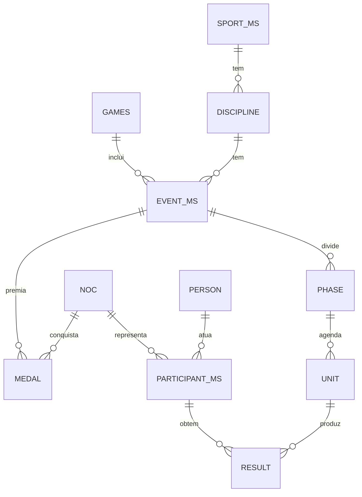

# 08 · Olimpíadas e Jogos Pan-Americanos

> Pesquisa completa, com fontes: [research/olimpiadas-e-panamericano.md](research/olimpiadas-e-panamericano.md).

## 1. Calendário que orienta o roadmap

| Evento | Sede | Datas | Relevância |
|---|---|---|---|
| Jogos Olímpicos de Inverno | Milano-Cortina | 6–22 fev 2026 (realizado) | Histórico: primeiro ouro do Brasil em Jogos de Inverno |
| **Jogos Pan-Americanos** | **Lima (PER)** | **23 jul – 8 ago 2027** (datas alteradas em jan/2026) | **Primeiro grande marco do módulo** — enorme peso no Brasil, México e Colômbia |
| Jogos Olímpicos de Verão | Los Angeles (USA) | 14 – 30 jul 2028 | Segundo marco; fuso UTC-7 favorece horário nobre na América Latina |
| Jogos Olímpicos de Verão | Brisbane (AUS) | 23 jul – 8 ago 2032 | Futuro; fuso UTC+10 exige forte agenda de "a que horas passa" |

## 2. Por que é um módulo à parte

A api-sports cobre apenas **esportes coletivos com bola** (futebol, basquete, vôlei, handebol, hóquei) — os torneios olímpicos e pan-americanos dessas modalidades aparecem como ligas com `country = World`. Ela **não** tem atletismo, natação, judô, ginástica nem **quadro de medalhas**. Por isso o módulo multiesportivo combina fontes:

| Fase | Fonte | Uso |
|---|---|---|
| Agora (entre Jogos) | **Wikidata (CC0)** + conferência no Olympedia | Histórico de medalhas, atletas, delegações; nomes em pt/es |
| Agora | api-sports (ligas olímpicas/pan nas APIs coletivas) | Torneios de futebol, basquete, vôlei, handebol, hóquei |
| Desenvolvimento | Codante Olympic Games API (Paris 2024) | Seed e protótipo do schema — **não** produção |
| Lima 2027 | **Acordo com a Panam Sports / comitê organizador** (plano B: provedor comercial; plano C: medalhas com entrada editorial assistida) | Agenda, resultados, quadro de medalhas ao vivo |
| LA 2028 | Decisão até meados de 2027: distribuidor licenciado com acesso ao feed oficial ou combinação "quadro de medalhas + APIs por esporte" | Cobertura ao vivo |

> ⚠️ Não raspar olympics.com nem sites sem licença de reuso. O feed oficial de resultados é restrito a parceiros licenciados.

## 3. Modelo de dados (inspirado no padrão oficial de dados olímpicos)

Regras-chave:

- **Códigos de país do COI/Panam** (CHI, URU, BRA…) com tabela de equivalência para ISO (usado no resto da API e no "onde assistir").
- **Quadro de medalhas é derivado** da tabela de medalhas, nunca digitado; lutas têm dois bronzes; medalhas podem ser realocadas anos depois (`revoked_at`).
- Ordenação padrão por ouro (`rank_by_gold`) e alternativa por total (`rank_by_total`).
- Cada **unidade** (prova/sessão) vira também um `core.event` com `sport = <modalidade>` e `competition = <Jogos>` — assim aparece na agenda canônica, no "Meu dia esportivo" e no "onde assistir".

## 4. API

| Rota | Descrição |
|---|---|
| `GET /v1/multisport/games?type=OG\|PAN&year=` | Edições |
| `GET /v1/multisport/games/{slug}/medals?sort=gold\|total&region=latam` | Quadro de medalhas |
| `GET /v1/multisport/games/{slug}/schedule?date=&sport=&noc=BRA&medal_only=true&tz=` | Agenda por dia/modalidade/país |
| `GET /v1/multisport/games/{slug}/events/{id}` | Fases, unidades e resultados |
| `GET /v1/multisport/games/{slug}/nocs/{noc}/athletes` | Delegação |
| `GET /v1/multisport/games/{slug}/today/{noc}` | "Brasil hoje" / "Argentina hoy": chances de medalha, resultados e onde assistir |
| `GET /v1/multisport/history/medals?noc=BRA&type=OG,PAN` | Histórico por país |

## 5. Onde a IA ajuda (sem ser fonte de verdade)

1. **Resolução de entidades**: casar o mesmo atleta entre fontes (grafias, acentos, nomes compostos hispânicos), com aprovação por regra/humano.
2. **Localização** de nomes de provas e fases em pt-BR e espanhol com glossário fixo.
3. **Conteúdo ancorado em dados**: "o que esperar hoje", resumo do dia por país, marcos históricos — sempre citando o resultado de origem.
4. **Controle de qualidade**: detectar inconsistências (bronze faltando em luta, soma de medalhas incoerente).
5. **Projeções** rotuladas como projeção (rankings recentes ou licença de projeção de medalhas).

Regra: o modelo **nunca grava** resultado ou medalha; ele sugere, e a gravação passa por fonte licenciada ou aprovação editorial.

## 6. Pendências

- Confirmar IDs das ligas olímpicas/pan-americanas nas APIs coletivas com `/leagues?search=olympic` e `?search=pan american` (1 chamada por esporte).
- Datas do Parapan Lima 2027.
- Contato comercial com a Panam Sports / comitê Lima 2027.
- Revisão jurídica dos termos do Olympedia e de outras fontes históricas.

As tarefas correspondentes estão no épico **Olimpíadas e Jogos Pan-Americanos** do backlog ([10-roadmap-e-backlog.md](10-roadmap-e-backlog.md)).
