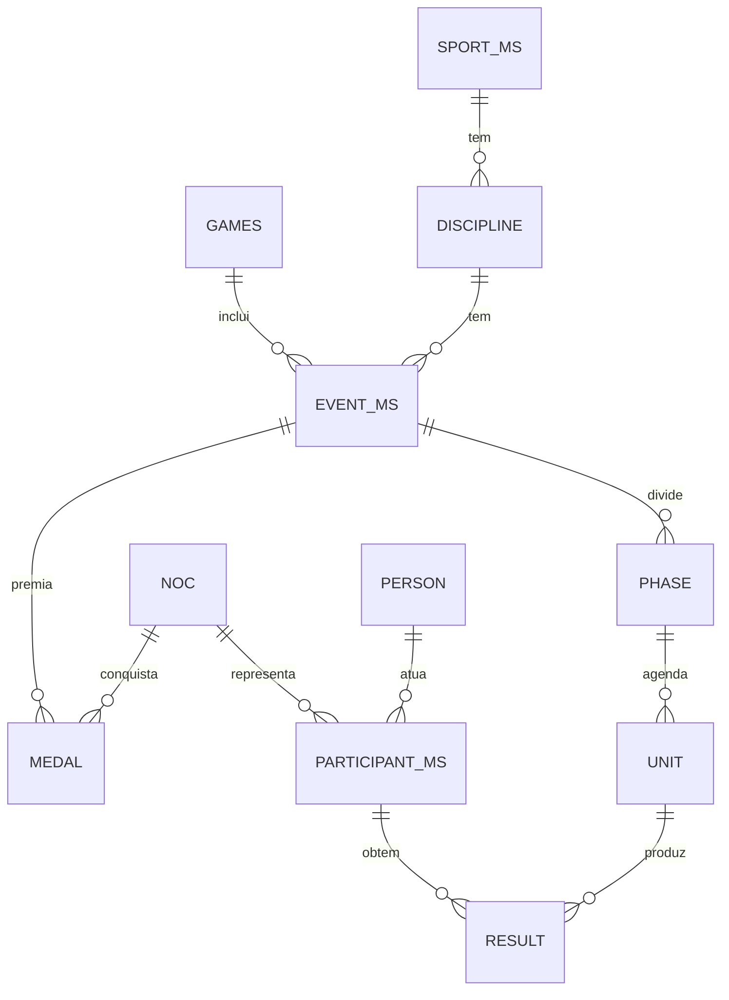

# 08 · Olimpíadas e Jogos Pan-Americanos

> Pesquisa completa, com fontes: [research/olimpiadas-e-panamericano.md](research/olimpiadas-e-panamericano.md).

## 1. Calendário que orienta o roadmap

| Evento | Sede | Datas | Relevância |
|---|---|---|---|
| Jogos Olímpicos de Inverno | Milano-Cortina | 6–22 fev 2026 (realizado) | Histórico: primeiro ouro do Brasil em Jogos de Inverno |
| **Jogos Pan-Americanos** | **Lima (PER)** | **23 jul – 8 ago 2027** (datas alteradas em jan/2026) | **Primeiro grande marco do módulo** — enorme peso no Brasil, México e Colômbia |
| Jogos Olímpicos de Verão | Los Angeles (USA) | 14 – 30 jul 2028 | Segundo marco; fuso UTC-7 favorece horário nobre na América Latina |
| Jogos Olímpicos de Verão | Brisbane (AUS) | 23 jul – 8 ago 2032 | Futuro; fuso UTC+10 exige forte agenda de "a que horas passa" |

## 2. Por que é um módulo à parte

A api-sports cobre apenas **esportes coletivos com bola** (futebol, basquete, vôlei, handebol, hóquei) — os torneios olímpicos e pan-americanos dessas modalidades aparecem como ligas com `country = World`. Ela **não** tem atletismo, natação, judô, ginástica nem **quadro de medalhas**. Por isso o módulo multiesportivo combina fontes:

| Fase | Fonte | Uso |
|---|---|---|
| Agora (entre Jogos) | **Wikidata (CC0)** + conferência no Olympedia | Histórico de medalhas, atletas, delegações; nomes em pt/es |
| Agora | api-sports (ligas olímpicas/pan nas APIs coletivas) | Torneios de futebol, basquete, vôlei, handebol, hóquei |
| Desenvolvimento | Codante Olympic Games API (Paris 2024) | Seed e protótipo do schema — **não** produção |
| Lima 2027 | **Acordo com a Panam Sports / comitê organizador** (plano B: provedor comercial; plano C: medalhas com entrada editorial assistida) | Agenda, resultados, quadro de medalhas ao vivo |
| LA 2028 | Decisão até meados de 2027: distribuidor licenciado com acesso ao feed oficial ou combinação "quadro de medalhas + APIs por esporte" | Cobertura ao vivo |

> ⚠️ Não raspar olympics.com nem sites sem licença de reuso. O feed oficial de resultados é restrito a parceiros licenciados.

## 3. Modelo de dados (inspirado no padrão oficial de dados olímpicos)



Regras-chave:

- **Códigos de país do COI/Panam** (CHI, URU, BRA…) com tabela de equivalência para ISO (usado no resto da API e no "onde assistir").
- **Quadro de medalhas é derivado** da tabela de medalhas, nunca digitado; lutas têm dois bronzes; medalhas podem ser realocadas anos depois (`revoked_at`).
- Ordenação padrão por ouro (`rank_by_gold`) e alternativa por total (`rank_by_total`).
- Cada **unidade** (prova/sessão) vira também um `core.event` com `sport = <modalidade>` e `competition = <Jogos>` — assim aparece na agenda canônica, no "Meu dia esportivo" e no "onde assistir".

## 4. API

| Rota | Descrição |
|---|---|
| `GET /v1/multisport/games?type=OG\|PAN&year=` | Edições |
| `GET /v1/multisport/games/{slug}/medals?sort=gold\|total&region=latam` | Quadro de medalhas |
| `GET /v1/multisport/games/{slug}/schedule?date=&sport=&noc=BRA&medal_only=true&tz=` | Agenda por dia/modalidade/país |
| `GET /v1/multisport/games/{slug}/events/{id}` | Fases, unidades e resultados |
| `GET /v1/multisport/games/{slug}/nocs/{noc}/athletes` | Delegação |
| `GET /v1/multisport/games/{slug}/today/{noc}` | "Brasil hoje" / "Argentina hoy": chances de medalha, resultados e onde assistir |
| `GET /v1/multisport/history/medals?noc=BRA&type=OG,PAN` | Histórico por país |

Implementadas no módulo `multisport` (`apps/api/src/routes/v1/multisport.ts`; contratos em `packages/contracts/src/multisport.ts`; detalhes de contrato e cache em [docs/05 §3.4.1](05-api-publica.md#341-implementação-appsapisrcroutesv1multisportts)). Também há `GET /v1/multisport/games/{slug}`, que lista os torneios coletivos ligados à edição (`games_competition`, #78).

**Regra de qualidade na API (escolha: resposta sinalizada).** Quadro, ranking, medalhas do dia e histórico só saem com `medal_data_quality` `complete` ou `partial`. Nos demais casos (`insufficient`, `unknown`, edição futura) a resposta é **200** com `data_quality.publishable = false`, `notice` localizado e lista vazia; no histórico a edição já iniciada vai para `withheld` (mesmo sem medalha do CON carregada, para não parecer "sem participação"); as futuras não entram no histórico. `withheld` lista só as 10 retidas mais recentes; `withheld_total` diz quantas são. `partial` sai com aviso de cobertura. Exemplo: `GET /v1/multisport/games/pan-2023/medals` → `publishable: false`, `data: []`; `GET /v1/multisport/history/medals?noc=BRA` → edições olímpicas publicáveis em `data` e os Pan-Americanos em `withheld`.

Com a carga real (§6.3), `GET /v1/multisport/games/og-summer-2016/medals?region=latam` devolve BRA 6/6/6 (14º por ouro) com aviso "Quadro parcial: cobertura de 95,7%", e a delegação `og-summer-2024/nocs/BRA/athletes` traz Rebeca Andrade (1 ouro, 2 pratas) no topo. A agenda (`/schedule`) e "hoje" ficam sem unidades até existir uma fonte de agenda.

## 5. Onde a IA ajuda (sem ser fonte de verdade)

1. **Resolução de entidades**: casar o mesmo atleta entre fontes (grafias, acentos, nomes compostos hispânicos), com aprovação por regra/humano.
2. **Localização** de nomes de provas e fases em pt-BR e espanhol com glossário fixo.
3. **Conteúdo ancorado em dados**: "o que esperar hoje", resumo do dia por país, marcos históricos — sempre citando o resultado de origem.
4. **Controle de qualidade**: detectar inconsistências (bronze faltando em luta, soma de medalhas incoerente).
5. **Projeções** rotuladas como projeção (rankings recentes ou licença de projeção de medalhas).

Regra: o modelo **nunca grava** resultado ou medalha; ele sugere, e a gravação passa por fonte licenciada ou aprovação editorial.

## 6. O que está implementado (issues #75 e #78)

### 6.1 Schema `multisport` (`packages/db/src/schema/multisport.ts`, migration `0003_multisport`)

| Tabela / view | Conteúdo |
|---|---|
| `games` | Edições com `slug` (`og-summer-2016`, `og-winter-2026`, `pan-2027`), tipo (`OG`, `PAN`; `YOG`, `PARAPAN`, `PAN_JR` previstos), estação, ano do nome oficial, sede, CON sede, datas, fuso IANA, status (`completed`/`in_progress`/`upcoming`), QID do Wikidata e **selo de qualidade do quadro** (`medal_coverage`, `medal_data_quality`) |
| `noc` | 206 CONs do COI + 41 da Panam Sports + especiais (AIN, EOR, ROT, IOA, IOP, ZZX, ROC, OAR, COR) + históricos (URS, EUN, GDR, FRG, EUA, TCH, YUG, SCG, BOH, ANZ, AHO…), com `iso3`/`iso2`, nomes pt-BR/es/en e sucessor |
| `sport`, `discipline` | Códigos inspirados no ODF (AQU/SWM, ATH, JUD…); `two_bronzes` nas lutas (judô, boxe, taekwondo, wrestling, caratê, squash, raquetebol) |
| `event`, `phase`, `unit`, `result` | Prova → fase → unidade (com `odf_rsc` e ligação futura a `core.event`) → resultado (rank, IRM, recordes) |
| `person`, `participant`, `team_member` | Pessoa (QID, Olympedia), participante = atleta × CON ou equipe (prova × CON × cor) |
| `medal` | **Uma linha = uma medalha no quadro**; `revoked_at`/`revoked_reason`, `source`, `source_key` (upsert idempotente), `confidence` |
| `medal_table` (view) | Quadro **derivado** (nunca digitado): ignora revogadas, `rank_by_gold` (ouro → prata → bronze) e `rank_by_total` (total, desempate por ouro → prata → bronze); empates exatos dividem a posição |
| `medal_table_snapshot` | Quadro materializado, recalculado após cada carga |
| `medal_reference` | Totais de referência **só para QA** (agregados das delegações no Wikidata e números conferidos na Wikipedia) |
| `source_ref` | Proveniência de cada edição/prova/pessoa/medalha, com licença (`CC0-1.0`) |
| `games_provider_league`, `games_competition` | Ligas dos coletivos na api-sports e a ligação edição ↔ `core.competition`/`core.season` (#78) |

### 6.2 Seeds e CLIs (`services/ingestor`)

```bash
pnpm --filter @galaxie/ingestor multisport:seed                 # CONs, edições, esportes, ligas + ligação com o core (zero chamadas)
pnpm --filter @galaxie/ingestor multisport:wikidata             # medalhas de todas as edições encerradas (Wikidata, CC0)
pnpm --filter @galaxie/ingestor multisport:wikidata --games og-summer-2016,pan-2023 [--refresh] [--max-age-days 30] [--aceitar-queda]
pnpm --filter @galaxie/ingestor multisport:qa --noc BRA,ARG     # selo por edição, derivado × referências, histórico por país
```

- **Edições**: Verão 1896–2032 (Tóquio 2020 com datas de 2021; LA 2028 14–30/07; Brisbane 2032 23/07–08/08), Inverno 1924–2030 (Milano Cortina 2026 6–22/02) e Pan-Americanos 1951–2027 (Santiago 2023 20/10–05/11; **Lima 2027 23/07–08/08**). Status calculado pela data da carga.
- **Carga do Wikidata** (`src/multisport/wikidata`): consulta SPARQL paginada (`LIMIT/OFFSET` com `ORDER BY`), sequencial, intervalo mínimo de 1,5 s, novas tentativas com backoff exponencial (respeita `Retry-After` em 429/503), User-Agent genérico `galaxie-sports/0.1 (multisport loader)` e **cache de todas as respostas em `raw.api_response` (`provider = 'wikidata'`)** — rodar de novo não volta ao endpoint. A paginação usa as páginas todas do cache ou todas da rede (nunca mistura respostas de momentos diferentes). Medalha que sumiu da fonte é removida, salvo quando a fonte da edição veio vazia ou com menos da metade do gravado: aí nada sai (medalhas nem agregados por delegação), o motivo é relatado e `--aceitar-queda` remove assim mesmo.
- **Modelo de medalha no Wikidata**: prova (`P361+` → edição) com participação `P710` (na prova) ou `P1344` (no atleta); medalha pelo qualificador `P166` (ouro/prata/bronze) ou pela classificação `P1352` 1–3 **somente sem fase ou na final** (`P2443`: vitória em eliminatória/semifinal não vira ouro). Partidas, fases, itens agregadores ("atletismo nos Jogos de 2016"), concursos de arte e esportes de demonstração são excluídos.
- **CON**: país/delegação na própria declaração → "país para o esporte" (`P1532`) vigente no ano → país do item (equipes) → cidadania (`P27`), mapeados pelo código COI (`P984`); dupla cidadania é desfeita pela interseção entre os passos. Nos Jogos Olímpicos o país atual vira o código da época (URS/EUN, TCH/BOH, YUG/SCG, EUA, RU1, OAR/ROC/AIN).
- **Regras do quadro**: provas individuais = 1 medalha por atleta (empates geram duas; lutas, dois bronzes); provas por equipe (rótulo, item de equipe ou 2+ atletas do mesmo CON com a mesma cor) = 1 medalha por CON × cor, com os integrantes em `team_member`; integrante com dupla nacionalidade é devolvido ao CON majoritário da equipe; declaração depreciada vira medalha **revogada** (`revoked_at`), salvo se o atleta tiver declaração válida.
- **Torneios da api-sports (#78)**: `multisport:seed` liga, sem chamadas, as competições já presentes em `core.competition` (via `core.provider_map`) às edições, **pelas datas da temporada** (janela de 21 dias antes da abertura até 3 dias depois; sem datas, pelo ano). Isso resolve rótulos enganosos (temporada "2020" jogada em 2021, "2023" do vôlei/handebol olímpico = Paris 2024). Ligas de basquete (192/193, Pan 286/294), vôlei (189/190, 195/213), handebol (155/156, 170/169), rúgbi (74/75, 107/108), beisebol (47, 41) e hóquei (131/151) ficam em `games_provider_league` e são ligadas automaticamente quando o catálogo do esporte for carregado.

### 6.3 Carga real de 21/10/2026 e cobertura

Execução completa (`multisport:wikidata`, todas as 74 edições encerradas; 67 têm ao menos uma medalha): **394 consultas ao WDQS** (≈ 11 min, sem erros nem novas tentativas), 438 respostas brutas (5,7 MB) em `raw`; reprocessar tudo a partir do cache fez 2 consultas novas.

| Item | Total |
|---|---|
| Medalhas | 17.896 (9 revogadas) em 6.519 provas |
| Pessoas / participantes | 15.942 / 13.844 |
| CONs com medalha | 156 |
| Referências de QA | 1.778 (agregados de delegação do Wikidata + 49 números da Wikipedia) |
| Torneios ligados (futebol) | 8: Olympics Men 2012/2016/2020/2024, Olympics Women 2016/2020/2024, Pan American Games 2023 |

Selo por edição (cobertura = medalhas carregadas ÷ referência):

| Edições | Cobertura | Selo |
|---|---|---|
| Tóquio 2020 | 99,2% (1.071 de 1.080) | `complete` |
| Rio 2016 · Londres 2012 · Pequim 2008 | 95,7% · 93,2% · 88,5% | `partial` |
| Paris 2024 | 83,1% (868 de 1.044) | `partial` |
| Demais Verão 1896–2004 | 63–97% | `partial` (≥ 75%) ou `insufficient` (1936, 1956–1964, 1976, 1980, 1988) |
| Inverno 1932–1960, 1998–2018 | 75–93% | `partial` |
| Inverno 1924–1928, 1964–1994 | 59–74% | `insufficient` |
| Inverno 2022 e Milano Cortina 2026 | sem agregado de referência | `unknown` |
| **Pan-Americanos (todas as edições)** | **≤ 6%** | `insufficient` |

Conferência América Latina (derivado × Wikipedia, G/P/B):

| Edição | Confere exatamente | Diferenças |
|---|---|---|
| Tóquio 2020 | **BRA 7/6/8**, ARG, COL, CUB, DOM, ECU, VEN | MEX 0/2/4 × 0/0/4 (duas pratas a mais por atribuição de CON); USA 39/40/33 × 39/41/33 |
| Rio 2016 | ARG, COL, CUB, DOM, MEX, PUR, VEN | **BRA 6/6/6 × 7/6/6** — o ouro do futebol masculino não tem medalhistas na prova do Wikidata (só na partida final, que é excluída) |
| Paris 2024 | COL, CUB, DOM, GUA, PER | BRA 3/7/6 × 3/7/10; MEX 0/2/2 × 0/3/2; ECU, CHI, ARG ±1 |
| Milano Cortina 2026 | **BRA 1/0/0** (Lucas Pinheiro Braathen) | — |
| Santiago 2023 | — | **BRA 2/1/0 × 66/73/66 (205)**; cobertura de 2,9% |
| Lima 2019 | — | BRA 0/3/5 × 54/45/70 (169); cobertura de 5,4% |

### 6.4 Ressalvas de qualidade de dados

- **Pan-Americanos: o Wikidata não serve para o quadro.** Há itens de prova para várias edições (ex.: ~330 em Lima 2019), mas quase nenhum tem medalhistas (`P710`/`P1344` com medalha ou classificação): de 0 a 127 declarações por edição, contra 1.300+ medalhas distribuídas; também não há agregados de medalhas nas delegações nem um item "medalha de ouro dos Jogos Pan-Americanos" usado nos atletas. O que existe foi carregado (selo `insufficient`) e **não deve ser publicado como quadro nem ranking**. Caminhos: importar os quadros da Wikipedia (CC BY-SA, exige atribuição e share-alike — decisão jurídica), entrada editorial assistida ou acordo com a Panam Sports.
- **Olimpíadas**: lacunas por prova (`no_gold`/`no_silver`/`no_bronze` no relatório de QA), em especial torneios coletivos cujos medalhistas só aparecem na partida final; CON inferido pela cidadania pode errar com dupla nacionalidade (confiança 0,7 em `medal.confidence`); Alemanha 1968–1988 só sai correta quando o atleta tem `P1532` = Alemanha Oriental/Ocidental; edições antigas com equipes mistas (ZZX) aparecem divididas por CON.
- **Revogações**: só as que o Wikidata marca como declaração depreciada (9 hoje); a data é o fim (`P582`) da declaração ou a data em que a carga detectou.
- **Regra de exibição**: a API deve publicar quadro/ranking só com `medal_data_quality` em `complete` ou `partial` (com aviso de cobertura) e mostrar a fonte (`source_ref`, CC0).

## 7. Pendências

- Agenda oficial por unidade (sessões/baterias) e lista de inscritos por CON — as rotas `/schedule`, `/today` e `/athletes` já existem, mas dependem dessa carga (hoje a delegação é derivada de medalhas e resultados).
- Chances de medalha (`medal_chances`, projeções rotuladas) e onde assistir por unidade (`where_to_watch` via `unit.core_event_id`) em `/today/{noc}`.
- Fonte licenciada para o histórico do Pan-Americano (ver §6.4) e para preencher as lacunas olímpicas (Olympedia mediante licença).
- Carregar os catálogos de basquete, vôlei, handebol, rúgbi, beisebol e hóquei para ligar os torneios olímpicos/pan-americanos já mapeados.
- Confirmar IDs das ligas olímpicas/pan-americanas nas APIs coletivas com `/leagues?search=olympic` e `?search=pan american` (1 chamada por esporte).
- Datas do Parapan Lima 2027.
- Contato comercial com a Panam Sports / comitê Lima 2027.
- Revisão jurídica dos termos do Olympedia e de outras fontes históricas.

As tarefas correspondentes estão no épico **Olimpíadas e Jogos Pan-Americanos** do backlog ([10-roadmap-e-backlog.md](10-roadmap-e-backlog.md)).
