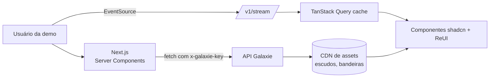

# 09 · App de demonstração

O app de demonstração (`apps/demo`) mostra o serviço funcionando de ponta a ponta para clientes e para o time. Regra de ouro: **ele consome somente a API Galaxie Sports** — nunca a api-sports diretamente — provando que o espelho e a camada canônica bastam.

## 1. Stack

| Camada | Escolha |
|---|---|
| Framework | Next.js (App Router, React Server Components) |
| UI | [shadcn/ui](https://ui.shadcn.com) + [ReUI](https://reui.io) (registry compatível com shadcn: data-grid, filters, kanban, gantt e outros) |
| Estilo | Tailwind CSS com tokens semânticos (tema claro/escuro) |
| Dados | TanStack Query + cliente gerado de `packages/contracts` (OpenAPI) |
| Tempo real | SSE (`/v1/stream`) com reconciliação no cache do TanStack Query |
| Gráficos | Recharts (via componentes de chart do shadcn) |
| i18n | `next-intl` com os 8 locales |
| Outras bibliotecas | **A definir** — novas bibliotecas de componentes serão incorporadas conforme forem enviadas e esta página será atualizada |

Regras de UI (herdadas do ReUI): reutilizar componentes do registry em vez de recriar; tokens semânticos de cor; estados via variantes de Badge; espaçamento com `gap-*`; nenhum texto abaixo de `text-xs`; animações discretas (no máximo 1 entrada por tela, sem *stagger* em tabelas).

## 2. Telas

| # | Tela | O que demonstra | Componentes principais | Endpoints |
|---|---|---|---|---|
| 1 | **Meu dia esportivo** | Eventos de hoje ordenados por relevância para um perfil de teste (time do coração + rivais declarados) | Cards de evento, Badge (estado, clássico, momentum), Avatar (escudos) | `/v1/events?date=today` |
| 2 | **Ao vivo** | Placar e minuto atualizando via SSE, momentos-chave | Card, Timeline, Badge "AO VIVO" | `/v1/events/live`, `/v1/stream` |
| 3 | **Radar / agenda** | Agenda infinita por esporte e torneio, agrupada por data/rodada | Filters (ReUI), lista virtualizada | `/v1/events?sport=&competition=` |
| 4 | **Competição** | Tabela, grupos, chaveamento de mata-mata, "o que está em jogo" | Data Grid (ReUI), Tabs | `/v1/competitions/{id}/context`, `/standings` |
| 5 | **Evento** | Detalhe: escalações (formação em campo), estatísticas, timeline, h2h, cenário IA, **onde assistir** por país | Sheet/Drawer, Tabs, Charts | `/v1/events/{id}/*` |
| 6 | **Time** | Resumo (posição, forma, próximo jogo + onde assistir), elenco, torneios, **cartão semântico** | Card, Data Grid, Badge | `/v1/teams/{id}/overview`, `/semantic` |
| 7 | **Clássicos** | Clássicos da semana, retrospecto, curiosidades | Cards, Charts | `/v1/derbies/upcoming`, `/v1/derbies/{slug}` |
| 8 | **Olimpíadas & Pan** | Quadro de medalhas, agenda por modalidade, delegação do país | Data Grid, Filters | `/v1/multisport/*` |
| 9 | **Seletor de mercado** | Troca de país/locale mostra a localização da copy e do onde assistir | Select, Command | `?locale=`, `?country=` |
| 10 | **Painel de operação** | Cota gasta por API/dia, jobs, frescor dos dados, fila de enriquecimento | Charts, Data Grid (ReUI), Gantt (janelas ao vivo) | `/internal/ops/*` |
| 11 | **Explorador da API** | Documentação OpenAPI interativa + playground do espelho `/mirror` | Scalar/Redoc embutido | `/docs` |

## 3. Perfis de demonstração

Perfis fictícios para mostrar personalização e `copy_permission`:

| Perfil | Mercado | Coração | Simpatia | Rival declarado |
|---|---|---|---|---|
| Ana | BR · pt-BR | Palmeiras | — | Corinthians |
| Bruno | BR · pt-BR | Flamengo | Barcelona | Fluminense |
| Lucía | AR · es-AR | River Plate | — | — (rival inferido: Boca — sem copy de rivalidade) |
| Diego | MX · es-MX | América | Real Madrid | Chivas |
| Valentina | CO · es-CO | Atlético Nacional | — | Millonarios |

## 4. Fluxo de dados na demo

## 5. Ambiente

- `pnpm dev --filter demo` aponta para a API local (Docker Compose) carregada com um **snapshot** do raw → a demo roda **sem gastar nenhuma chamada** do fornecedor.
- Variáveis: `NEXT_PUBLIC_GALAXIE_API_URL`, `GALAXIE_DEMO_KEY`.
- Deploy da demo: mesma VPS da API (stack Portainer) ou Vercel apontando para a API pública.

## 6. Pendências

- [ ] Receber a lista de bibliotecas de componentes adicionais e atualizar §1/§2.
- [ ] Definir identidade visual da demo (neutra, sem marca de cliente).
- [ ] Validar navegação por controle remoto (foco) se a demo for apresentada em TV.
