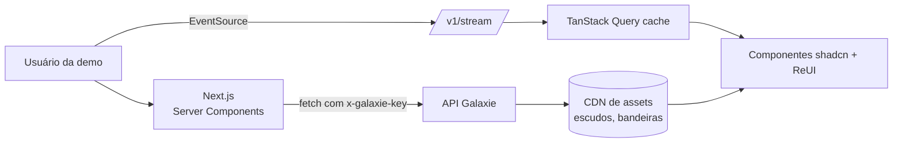

# 09 · App de demonstração

O app de demonstração (`apps/demo`) mostra o serviço funcionando de ponta a ponta para clientes e para o time. Regra de ouro: **ele consome somente a API Galaxie Sports** — nunca a api-sports diretamente — provando que o espelho e a camada canônica bastam.

## 1. Stack

| Camada | Escolha |
|---|---|
| Framework | Next.js (App Router, React Server Components) |
| UI | [shadcn/ui](https://ui.shadcn.com) + [ReUI](https://reui.io) (registry compatível com shadcn: data-grid, filters, kanban, gantt e outros) |
| Estilo | Tailwind CSS com tokens semânticos (tema claro/escuro) |
| Dados | TanStack Query + cliente gerado de `packages/contracts` (OpenAPI) |
| Tempo real | SSE (`/v1/stream`) com reconciliação no cache do TanStack Query |
| Gráficos | Recharts (via componentes de chart do shadcn) |
| i18n | `next-intl` com os 8 locales |
| Outras bibliotecas | Lista recebida em 21/10/2026 — ver §1.1; avaliação e escolha final na issue [#72](https://github.com/galaxie-works/galaxie-sports/issues/72) |

### 1.1 Bibliotecas de componentes candidatas

Todas são do ecossistema shadcn/ui (Tailwind + React). Base: **shadcn/ui + ReUI**; as demais entram por necessidade concreta de tela, depois da avaliação na [#72](https://github.com/galaxie-works/galaxie-sports/issues/72).

| Biblioteca | Link | Uso previsto na demo |
|---|---|---|
| **ReUI** | <https://reui.io/> | Base: data-grid, filters, kanban, gantt (tabelas de classificação, agenda, painel de operação) |
| Aceternity UI | <https://ui.aceternity.com/components> | Efeitos de destaque em telas de apresentação (hero do "Meu dia esportivo") |
| Magic UI | <https://magicui.design/> | Animações e micro-interações (placar ao vivo, contadores) |
| Animate UI | <https://animate-ui.com/> | Variantes animadas de componentes shadcn |
| iconiq UI | <https://iconiqui.com/> | A avaliar |
| Vengeance UI | <https://www.vengenceui.com/> | A avaliar |
| cuicui (Application UI) | <https://cuicui.day/application-ui> | Padrões de aplicação (formulários, listas, navegação) |
| Shadcnblocks | <https://www.shadcnblocks.com/> | Blocos de página prontos |
| shadcn/space | <https://shadcnspace.com/> | Blocos e templates |
| blocks.so | <https://blocks.so/> | Blocos de página prontos |
| Morphin | <https://morphin.dev/> | A avaliar |
| Unlumen UI | <https://ui.unlumen.com/components> | A avaliar |

Critérios da avaliação (#72): instalação via registry do `shadcn` CLI; licença (gratuito × Pro pago — nada de componentes Pro sem licença); compatibilidade com a versão de React/Tailwind do projeto; peso das dependências de animação; acessibilidade e navegação por foco (a demo pode ser apresentada em TV); sobreposição com o que o ReUI já oferece — **reutilizar antes de adicionar**.

Regras de UI (herdadas do ReUI): reutilizar componentes do registry em vez de recriar; tokens semânticos de cor; estados via variantes de Badge; espaçamento com `gap-*`; nenhum texto abaixo de `text-xs`; animações discretas (no máximo 1 entrada por tela, sem *stagger* em tabelas).

## 2. Telas

| # | Tela | O que demonstra | Componentes principais | Endpoints |
|---|---|---|---|---|
| 1 | **Meu dia esportivo** | Eventos de hoje ordenados por relevância para um perfil de teste (time do coração + rivais declarados) | Cards de evento, Badge (estado, clássico, momentum), Avatar (escudos) | `/v1/events?date=today` |
| 2 | **Ao vivo** | Tudo em andamento agora, por esporte e competição (relevância), com placar e minuto atualizando via SSE e o contador da cadência no topo (§2.3) | Card de evento, Badge "AO VIVO", anel de progresso | `/v1/events/live`, `/v1/stream` |
| 3 | **Radar / agenda** | Agenda infinita por esporte e torneio, agrupada por data/rodada | Filters (ReUI), lista virtualizada | `/v1/events?sport=&competition=` |
| 4 | **Competição** | Tabela, grupos, chaveamento de mata-mata, "o que está em jogo" | Data Grid (ReUI), Tabs | `/v1/competitions/{id}/context`, `/standings` |
| 5 | **Evento** | Detalhe: **minuto a minuto** (§2.3), escalações (formação em campo), estatísticas, timeline, h2h, cenário IA, **onde assistir** por país; no card "Sobre o jogo", a **relevância** (global e a lista de países de `relevance_by_market`, da maior nota para a menor, com bandeira, nota e os motivos do bônus; quatro à vista e "ver todos"; o país do idioma — pt-BR → Brasil, es-AR → Argentina — destacado; a conta explicada num popover; o país do "Onde assistir" não interfere) e o que está em jogo agrupado por time (escudo, tags do torcedor `fan_tags`, frases dos stakes e grito da torcida); no fim, **conteúdo relacionado** (cards de vídeo com miniatura, canal, tipo, duração, proporção 16:9/9:16 e filtro por tipo, tocando num painel lateral 9:16 acoplado — [12 §11](12-conteudo-relacionado.md#11-demo)) | Sheet/Drawer, Tabs, Charts | `/v1/events/{id}/*` |
| 6 | **Time** | Resumo (posição, forma, próximo jogo + onde assistir), elenco, torneios, **cartão semântico**; **seletor de temporada** (combobox no topo, `?temporada=2025` na URL, selo "Temporada 2025" fora da atual; identidade e rivais são atemporais) | Card, Data Grid, Badge, Popover + Command | `/v1/teams/{id}/overview?season=`, `/squad?season=`, `/semantic` |
| 7 | **Clássicos** | Clássicos da semana, retrospecto, curiosidades | Cards, Charts | `/v1/derbies/upcoming`, `/v1/derbies/{slug}` |
| 8 | **Olimpíadas & Pan** | Quadro de medalhas, agenda por modalidade, delegação do país | Data Grid, Filters | `/v1/multisport/*` |
| 9 | **Seletor de mercado** | Troca de país/locale mostra a localização da copy e do onde assistir | Select, Command | `?locale=`, `?country=` |
| 10 | **Painel de operação** | Cota gasta por API/dia, jobs, frescor dos dados, fila de enriquecimento | Charts, Data Grid (ReUI), Gantt (janelas ao vivo) | `/internal/ops/*` |
| 11 | **Documentação** | Guias (começando, autenticação, conceitos, módulos e planos, tempo real) e a referência gerada do OpenAPI; botão **Ver código** nas seções (§2.2) | Code block (ReUI, Shiki), Tabs, Sheet | `/openapi.json`, `/docs` da API |
| 12 | **Menu e página do país** | Esportes e países no menu lateral; por país, competições nacionais, copas continentais, seleção e mundiais (§2.1) | Sidebar, Collapsible, Avatar (bandeiras), Badge | `/v1/navigation`, `/v1/countries/{code}/competitions` |
| 13 | **Explorar (home)** | Primeira tela depois do login: cards de esporte e de país com metadados reais em grade bento (§2.1.1) | Card, Lottie (ícones animados), Avatar (escudos e logos) | `/v1/explore/summary` |

### 2.1 Navegação: menu de esportes e páginas de país

O menu lateral da demo nasce de **uma chamada**, `GET /v1/navigation?locale=` ([docs/05 §3.1.1](05-api-publica.md#311-navegação-por-país-appsapisrcroutesv1navigationts)):

```
Esportes                     Países
  ⚽ Futebol        (1249)     CONMEBOL (América do Sul)
  🏀 Basquete       (sem dados)  🇧🇷 Brasil  🇦🇷 Argentina  🇧🇴 Bolívia  🇨🇱 Chile  🇨🇴 Colômbia
  🏐 Vôlei          (sem dados)  🇪🇨 Equador  🇵🇾 Paraguai  🇵🇪 Peru  🇺🇾 Uruguai  🇻🇪 Venezuela
  … os 12 esportes             CONCACAF  🇲🇽 México
                               UEFA  🏴 Inglaterra  🇪🇸 Espanha  🇮🇹 Itália  🇩🇪 Alemanha  🇫🇷 França  🇵🇹 Portugal
```

- **Esportes**: os 12, sempre na mesma ordem (futebol primeiro). `has_data: false` deixa o item esmaecido (sem competições nem eventos no banco); as contagens viram badge.
- **Países**: 17 na primeira versão (os 10 da CONMEBOL, México, Inglaterra, Espanha, Itália, Alemanha, França e Portugal), agrupados por confederação (`confederations[]`), com bandeira do nosso storage. A lista e a ordem vêm de `config/geo/confederations.yaml` — incluir um país é editar o YAML (e rodar `geo:seed`).

A **página do país** chama `GET /v1/countries/{code}/competitions?locale=` (opcional `sport=`) e desenha, por esporte, até quatro seções:

| Seção (`scope`) | Exemplo: Brasil | Exemplo: México | Exemplo: Inglaterra |
|---|---|---|---|
| Competições nacionais (`domestic`) | Brasileirão A–D, Copa do Brasil, Supercopa, Copa do Nordeste, estaduais | Liga MX, Liga MX Femenil | Premier League, FA Cup, Championship |
| Copas continentais de clubes (`continental_clubs`) | Libertadores, Sul-Americana, Recopa | Concacaf Champions Cup, Leagues Cup | Champions, Europa, Conference, Supercopa da UEFA |
| Seleção (`national_teams`) | Copa do Mundo, Eliminatórias, Copa América, Olimpíadas… | Copa do Mundo, Eliminatórias, Copa América (convidado), Nations League, Copa Ouro… | Copa do Mundo, Eliminatórias, Euro, Nations League… |
| Mundiais de clubes (`world_clubs`) | Mundial de Clubes, Intercontinental | idem | idem |

O que liga os países é a confederação: Brasil e Argentina veem a **mesma** Libertadores (mesmo `id`), e o clique leva à página da competição (tela 4). Competições internacionais e seus participantes ficam em `config/geo/competition-scope.yaml`; as domésticas saem do país da competição no catálogo (`max_tier=3` mostra também o restante do espelho). Nos outros esportes vale o mesmo modelo (NBB e FIBA AmeriCup para o Brasil no basquete, Superliga e VNL no vôlei) assim que o catálogo do esporte for carregado.

### 2.1.1 Home "Explorar"

A home (`apps/demo/src/app/[locale]/(app)/page.tsx`) é a porta de entrada da demo e sai de **uma chamada**, `GET /v1/explore/summary` ([docs/05 §3.1.2](05-api-publica.md#312-resumo-da-home-explorar-appsapisrcroutesv1explorets)):

- **Faixa de abertura:** esportes, países, jogos nos próximos 7 dias e ao vivo agora.
- **Esportes (grade bento):** o futebol em destaque (2×2 ou 3×2) e os demais em tamanho padrão. Cada card tem o ícone animado (Lottie, toca no hover), a textura do campo/quadra/pista no matiz do esporte (variações do índigo da marca), competições, participantes, jogos da semana, selo "ao vivo" com ponto pulsando e os logos das competições em destaque. Esporte ainda sem catálogo mostra o espelho compatível (`/mirror/{esporte}`).
- **Países por confederação:** cabeçalho com o nome da confederação, total de jogos e ao vivo do grupo. O card tem a bandeira esmaecida ao fundo (com máscara), liga principal, clubes de maior peso, contadores e o jogo de maior relevância no mercado do país (link para o jogo). Brasil e Argentina (e grupos com até dois países) ganham o card largo, com o confronto ampliado; o mercado do idioma vai à frente (Argentina em `es-AR`).
- Hover com elevação e brilho, respeitando `prefers-reduced-motion`; esqueleto com a mesma grade enquanto carrega; 1 coluna no celular. Sem a API, os cards seguem navegáveis, só sem os contadores.

### 2.2 Documentação e "Ver código"

A seção **Documentação** da sidebar (`/docs/*` na demo) tem cinco guias e a **Referência da API**, uma lista das operações gerada no build a partir de `buildOpenApiDocument()` (`@galaxie/contracts`, o mesmo documento que a API serve em `/openapi.json`). A referência interativa (Scalar, em `/docs` da API) abre em outra aba: a API responde com `X-Frame-Options: DENY` e `frame-ancestors 'none'`, então não pode ser embutida.

Cada seção da demo que mostra dados da API tem o botão **Ver código** (ícone `</>`): um painel com a requisição exata (método, caminho com os IDs da página, query e header), exemplos em curl, TypeScript (`fetch`) e Python (`requests`) com a chave `SUA_CHAVE`, e um trecho da resposta real (lida pelo proxy `/api/galaxie/*`, com listas cortadas). Os descritores das chamadas (`ApiRequest`) ficam ao lado dos fetchers em `apps/demo/src/lib/galaxie/api.ts`; as páginas só passam `api={...}` ao `Section` ou ao `PageHeader`. Um teste confere que cada descritor gera a mesma URL do cliente tipado e que rota e parâmetros existem no OpenAPI.

A URL base mostrada nos exemplos vem de `NEXT_PUBLIC_GALAXIE_DOCS_API_URL` (embutida no build; padrão `https://api.sports.galaxie.works`).

### 2.3 Ao vivo e minuto a minuto

- **Sidebar:** o item **Ao vivo** fica no topo, com ponto pulsante e a contagem de jogos em andamento (`/v1/events/live`, conferida a cada 30 s fora da página).
- **Página `/ao-vivo`:** cards agrupados por esporte e competição, do mais relevante ao menos relevante (`relevance.score` quando a API traz, senão `importance`). O card acende quando o placar muda. Sem jogos, o estado vazio "Nenhum jogo ao vivo agora" mostra os próximos apitos (`/v1/events?from=<agora>&status=scheduled,starting`).
- **Cadência visível:** "Atualizado há 4 s · próxima atualização em 11 s", um anel de progresso até a próxima verificação, o mecanismo real e a cadência da fonte. O mecanismo é o **SSE** de `/v1/stream` (pelo proxy `/api/galaxie/*`, com `events=<ids>&topics=score,status,incidents`): cada mudança dispara uma releitura da REST (com *debounce* de 0,75 s). Além disso, a próxima verificação completa é agendada a partir da última atualização: **30 s** com o SSE conectado, **15 s** sem ele (polling) e **60 s** sem jogo ao vivo. A fonte é o Live Poller do ingestor, que lê o fornecedor no máximo a cada 15 s conforme o orçamento; a demo mostra há quanto tempo foi a última leitura (`data_freshness.last_valid_at`).
- **Detalhes da partida (página do evento):** no topo da coluna principal, um frame colapsável (ReUI `c-frame-5`, aberto por padrão) com as abas **Minuto a minuto | Estatísticas | Escalação**; a escalação tem as sub-abas **Titulares | Reservas | Campo**. A aba ativa vai para a URL (`?detalhes=escalacao&escalacao=campo`) para o link abrir direto nela; aba sem dado não aparece (antes do apito, por exemplo, não há minuto a minuto) e, sem nenhuma, o bloco some. Cada aba tem o "Ver código" da chamada que a alimenta, e os painéis ficam montados ao trocar de aba (o ao vivo segue atualizando).
- **Minuto a minuto:** linha do tempo vertical que se ajusta à largura (container query), com gols (placar parcial e assistência), cartões, substituições (quem entra e quem sai, com foto, camisa e posição), VAR, pênaltis, marcos do jogo e a disputa de pênaltis cobrança a cobrança (quem bateu primeiro, ✓/✗ e placar corrido). Os momentos-chave ficam destacados e o filtro **Só os principais** esconde o resto. Ao vivo, o mais novo fica em cima e a lista se atualiza como a página Ao vivo; encerrado, fica na ordem do jogo e não muda mais. Cada lance mostra o horário de Brasília e o UTC quando a API sabe o instante. O filtro **Só os principais** é um toggle (ligado: índigo, com check e `aria-pressed`).
- **Escalação:** **Titulares** e **Reservas** são tabelas por time com a foto de cada jogador (iniciais de reserva), número, posição e os ícones que saem do cruzamento com `/timeline` (`lib/lineup-marks.ts`): cartão amarelo, segundo amarelo, vermelho, ⚽ por gol (contador se mais de um), gol contra, 👟 assistência e ↓ vermelho com o minuto para quem saiu; nos titulares, o técnico no rodapé; nas reservas, quem entrou primeiro, com a coluna **Entrada** (↑ verde e o minuto). **Campo** desenha os titulares pelo `grid` "linha:coluna" de `/lineups` — mandante na metade de cima, visitante na de baixo, goleiros nas pontas, cada linha do grid numa fileira com os jogadores distribuídos na largura (a coluna 1 é a esquerda do time; o mandante, de frente para quem olha, fica espelhado); cada jogador leva a `/pessoas/{id}`. Sem `grid` nos titulares, a sub-aba Campo não aparece.
- **Estatísticas:** de `/stats` (códigos estáveis da API, docs/05 §3.2), mandante | rótulo | visitante, na ordem posse, chutes, chutes no gol, xG, passes, precisão de passe, escanteios, faltas, impedimentos, cartões e defesas, com barra fina de proporção. O melhor valor de cada linha vai em pílula com a cor do time (`versusColors`, que trata escudo monocromático e cores parecidas); em **faltas, impedimentos e cartões, menor é melhor** e o destaque vai para o menor (`lib/match-stats.ts`). Empate não destaca. Sem estatística, a aba não aparece.
- **Simulação para desenvolvimento:** `SIM_DATABASE_URL=postgres://…/galaxie_sim pnpm --filter @galaxie/ingestor live:simulate [--velocidade 3] [--intervalo 15]` roda o mundo falso dos testes (`services/ingestor/src/testing/live-world.ts`) num banco separado (o nome precisa começar com `galaxie_sim`; nunca em produção): quatro jogos com roteiro relativo a agora, com cartões, substituições, VAR, prorrogação e pênaltis, lidos pelo Live Poller real. Depois, suba a API apontando para esse banco, crie um tenant (`pnpm --filter @galaxie/api tenant:create --slug demo-sim`) e rode a demo com `GALAXIE_API_URL` e `GALAXIE_DEMO_KEY` dessa API.

### 2.4 Painel do cliente e Galaxie Sports Builder

A operadora cliente entra na demo, monta um widget com a identidade dela e instala no app dela como um componente shadcn.

- **Papel `client`** (Better Auth, `lib/auth/roles.ts`), ao lado de `admin` e `user`. O cliente fica ligado a um **tenant da API** (`api.tenant.id`, gravado no usuário como `tenant_id`, que só o admin define). Em **Ajustes → Usuários**, o admin convida com o papel **Cliente** e escolhe o tenant; no detalhe do usuário dá para trocar o papel e o tenant. O cliente navega na demo como um convidado, não abre Ajustes (o proxy responde 403 na API e volta para a home nas páginas) e, no painel, só vê o próprio tenant: o tenant sai sempre da sessão, nunca do navegador. O admin também abre o painel e escolhe qual tenant acompanhar (cookie `galaxie-tenant`, conferido a cada leitura).
- **`/cliente` (visão geral):** plano, situação, módulos, esportes, mercados, limite por minuto, cota diária e o uso consolidado dos últimos 30 dias (`api.usage_daily`, lido direto do Postgres, como a revisão e a operação fazem).
- **`/cliente/chaves`:** chaves publicáveis (`createPublishableKey`/`listPublishableKeys`/`revokePublishableKey` de `@galaxie/db`). Os domínios passam pela mesma regra que a API usa para conferir o `Origin` (`normalizeAllowedOrigin`: `https://app.exemplo.com`, `https://*.exemplo.com`, `http://localhost:3000`). A chave (`gs_pk_live_…`) aparece **uma vez**, com botão de copiar e a variável `NEXT_PUBLIC_GALAXIE_PUBLISHABLE_KEY`; a lista mostra só o prefixo. Revogar vale na API em até 60 s.
- **`/cliente/builder`:** o catálogo de `@galaxie/widgets` (placar, jogos do dia, classificação, onde assistir) e os widgets salvos, com versão, editar e arquivar. No editor (`/cliente/builder/novo?tipo=…` e `/cliente/builder/<id>`):
  - **tema:** temas prontos (`DEFAULT_THEMES`), cores com seletor e campo hexadecimal, raio (slider), fonte, densidade e modo claro/escuro (trocar o modo troca os neutros e mantém a cor da marca);
  - **conteúdo:** idioma do widget (`pt-BR`, `es`, `en`), mercado (os do plano; sem restrição, a lista padrão) e a entidade padrão (jogo ou competição, conforme o tipo), com a mesma busca da paleta (`/v1/search`);
  - **pré-visualização ao vivo:** os componentes reais do pacote com dados reais pelo proxy `/api/galaxie/*`, que injeta a chave interna da demo no servidor (nenhuma chave vai ao navegador). Sem entidade escolhida, os dados de exemplo do pacote (`createPreviewFetch`);
  - **salvar** grava uma nova versão (`saveWidget`); o servidor valida tudo de novo (`lib/builder/config.ts`);
  - **instalação:** `npx shadcn@latest add https://sports.galaxie.works/r/<id>.json`, o uso no código (`import { GalaxieMatchCard } from '@/components/galaxie/<nome>'`) e a variável da chave publicável.
- **Rota pública `/r/<id>.json`** (`app/r/[id]/route.ts`): o registry-item do widget salvo (`buildRegistryItem` de `@galaxie/widgets/registry`), com tema, idioma, mercado e entidade padrão. Abre sem sessão porque o CLI do shadcn baixa direto; não tem segredo (o id é um UUID v7 opaco e a chave publicável não vai no JSON). Widget arquivado ou inexistente responde 404. Está em `lib/public-routes.ts` e no smoke (`infra/vps-telemetry/smoke.mjs`).

## 3. Perfis de demonstração

Perfis fictícios para mostrar personalização e `copy_permission`:

| Perfil | Mercado | Coração | Simpatia | Rival declarado |
|---|---|---|---|---|
| Ana | BR · pt-BR | Palmeiras | — | Corinthians |
| Bruno | BR · pt-BR | Flamengo | Barcelona | Fluminense |
| Lucía | AR · es-AR | River Plate | — | — (rival inferido: Boca — sem copy de rivalidade) |
| Diego | MX · es-MX | América | Real Madrid | Chivas |
| Valentina | CO · es-CO | Atlético Nacional | — | Millonarios |

## 4. Fluxo de dados na demo



## 5. Ambiente

- `pnpm dev --filter demo` aponta para a API local (Docker Compose) carregada com um **snapshot** do raw → a demo roda **sem gastar nenhuma chamada** do fornecedor.
- Variáveis: `NEXT_PUBLIC_GALAXIE_API_URL`, `GALAXIE_DEMO_KEY` e, opcionais, `NEXT_PUBLIC_GALAXIE_DOCS_API_URL` (URL da API nos exemplos da documentação e no componente instalado pelo registry) e `NEXT_PUBLIC_GALAXIE_REGISTRY_URL` (domínio do comando `npx shadcn add`; padrão `https://sports.galaxie.works`).
- Deploy da demo: mesma VPS da API (stack Portainer) ou Vercel apontando para a API pública.

## 6. Pendências

- [ ] Receber a lista de bibliotecas de componentes adicionais e atualizar §1/§2.
- [ ] Definir identidade visual da demo (neutra, sem marca de cliente).
- [ ] Validar navegação por controle remoto (foco) se a demo for apresentada em TV.
