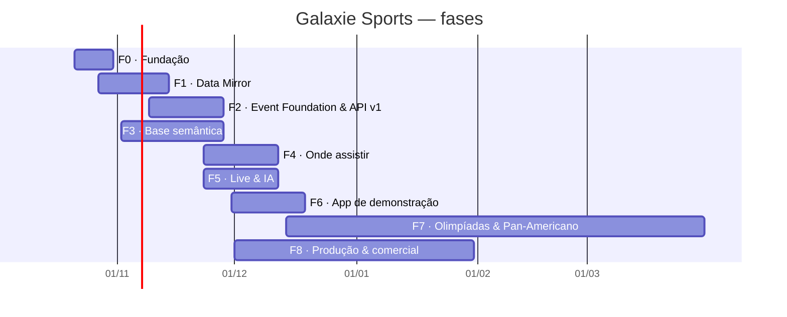
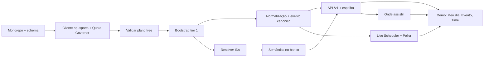

# 10 · Roadmap e backlog

> Fonte da verdade: as issues do repositório, acompanhadas no [GitHub Project · Galaxie Sports](https://github.com/users/galaxie-works/projects/4) (colunas **Todo → In progress → Done**). Este documento é um índice; ao mudar o plano, atualize as issues primeiro.

## 1. Fases e marcos

| Marco | Objetivo | Data-alvo | Issues |
|---|---|---|---|
| **F0 · Fundação** | Monorepo, infraestrutura local, schema do banco, CI e observabilidade. | 31/10/2026 | 5 |
| **F1 · Data Mirror** | Cópia interna da api-sports com economia de chamadas, assets e sync diário. | 14/11/2026 | 12 |
| **F2 · Event Foundation & API v1** | Normalização, entidade evento canônica e API pública (espelho + /v1). | 28/11/2026 | 13 |
| **F3 · Base semântica** | Clássicos, apelidos, gritos, competições e copy localizada. | 28/11/2026 | 8 |
| **F4 · Onde assistir** | Serviço de transmissões por evento e país com IA, validação e correções em ≤ 5 min. | 12/12/2026 | 6 |
| **F5 · Live & IA** | Agendador inteligente ao vivo, cenário pré-jogo, resumo pós-jogo e curadoria. | 12/12/2026 | 7 |
| **F6 · App de demonstração** | Demo em Next.js + shadcn + ReUI consumindo apenas a API Galaxie. | 19/12/2026 | 11 |
| **F7 · Olimpíadas & Pan-Americano** | Módulo multiesportivo: Lima 2027, LA 2028, histórico olímpico. | 31/03/2027 | 5 |
| **F8 · Produção & comercial** | Plano pago, licenças, pacotes comerciais, segurança e testes de carga. | 31/01/2027 | 6 |

## 2. Caminho crítico do MVP de demonstração

## 3. Backlog por épico

### E0 Fundação do projeto

_Base técnica para todo o resto: monorepo, ambiente local reproduzível, schema do banco, CI e observabilidade._ · Marco **F0 · Fundação**

| Issue | Título | Tipo | Prioridade | Tamanho | Depende de |
|---|---|---|---|---|---|
| T0.1 | Monorepo pnpm + Turborepo com TypeScript, lint e CI | task | P0 | M | — |
| T0.2 | Infra local com Docker Compose (Postgres 17, Valkey, MinIO) | task | P0 | S | T0.1 |
| T0.3 | Schema do banco v1: raw, core, semantic, enrich, ops (Drizzle) | task | P0 | L | T0.2 |
| T0.4 | Stack de staging na VPS com Portainer + backups diários | task | P1 | M | T0.2, T0.3 |
| T0.5 | Observabilidade: logs estruturados, métricas e painel de cota | task | P1 | M | T0.1 |

### E1 Data Mirror da api-sports com economia de chamadas

_Cópia interna de tudo o que a api-sports oferece (12 APIs) com a mesma estrutura, construída e mantida dentro de 100 chamadas/dia por API no plano gratuito._ · Marco **F1 · Data Mirror**

| Issue | Título | Tipo | Prioridade | Tamanho | Depende de |
|---|---|---|---|---|---|
| T1.1 | packages/apisports-client: cliente multi-API com gravação raw e quota ledger | feature | P0 | M | T0.3 |
| T1.2 | Quota Governor: orçamento diário por API e prioridade | feature | P0 | M | T1.1 |
| S1.3 | Spike: validar na prática o plano gratuito de cada API (temporadas, endpoints, limites) | spike | P0 | S | T1.1 |
| T1.4 | Bootstrap futebol — catálogo global (countries, leagues, timezone) | task | P0 | S | T1.2, S1.3 |
| T1.5 | Bootstrap futebol — temporadas das competições tier 1 e 2 (fixtures, standings, teams, venues) | feature | P0 | L | T1.4 |
| T1.6 | Bootstrap futebol — detalhes de partidas em lote (fixtures?ids=) | task | P1 | M | T1.5 |
| T1.7 | Bootstrap futebol — elencos, jogadores, técnicos, transferências, títulos, afastamentos | task | P1 | L | T1.5 |
| T1.8 | Bootstrap das demais 11 APIs (AFL, beisebol, basquete, F1, handebol, hóquei, MMA, NBA, NFL, rúgbi, vôlei) | feature | P1 | L | T1.2, S1.3 |
| T1.9 | Resolver IDs do catálogo e da base semântica (provider_map) | task | P0 | S | T1.5 |
| T1.10 | Asset Mirror: script PowerShell + worker de download de mídia | feature | P0 | M | T1.4 |
| T1.11 | Sync diário incremental com cursores (D-1 a D+7) | feature | P0 | M | T1.5, T1.8 |
| T1.12 | Snapshot do raw para desenvolvimento local (zero chamadas) | task | P1 | S | T1.5 |

### E2 Event Foundation e API pública v1

_Transformar o raw em um modelo canônico orientado a evento e expor a API Galaxie Sports (espelho compatível + /v1 enriquecida)._ · Marco **F2 · Event Foundation & API v1**

| Issue | Título | Tipo | Prioridade | Tamanho | Depende de |
|---|---|---|---|---|---|
| T2.1 | Normalização raw→core: futebol | feature | P0 | L | T1.5 |
| T2.2 | Normalização raw→core: demais esportes | feature | P1 | L | T1.8, T2.1 |
| T2.3 | Entidade event canônica: máquina de estados, last-known-good e fallback temporal | feature | P0 | M | T2.1 |
| T2.4 | Momentum temporal e score de importância do evento | feature | P1 | S | T2.3 |
| T2.5 | Motor de regras de contexto competitivo (stakes) | feature | P0 | L | T2.1 |
| T2.6 | API: espelho compatível /mirror/{sport}/{endpoint} | feature | P0 | M | T2.1, T1.10 |
| T2.7 | API /v1: catálogo, competições, tabelas e contexto | feature | P0 | M | T2.1, T2.5 |
| T2.8 | API /v1: eventos (agenda, ao vivo, detalhe, timeline, escalações, stats, h2h, .ics) | feature | P0 | L | T2.3, T2.4 |
| T2.9 | API /v1: times, elencos e pessoas | feature | P1 | M | T2.1 |
| T2.10 | Autenticação por tenant, planos/módulos e rate limit | feature | P0 | M | T0.3 |
| T2.11 | Cache (Redis + CDN), ETag e change feed com purge | feature | P0 | M | T2.8 |
| T2.12 | Tempo real: SSE /v1/stream e webhooks assinados | feature | P0 | M | T2.11 |
| T2.13 | OpenAPI 3.1, documentação interativa e pacote de contratos | docs | P1 | S | T2.7 |

### E3 Base de conhecimento semântico

_Clássicos, apelidos, mascotes, gritos de torcida, competições e copy localizada — pré-cadastrados e versionados, servidos sem consulta externa._ · Marco **F3 · Base semântica**

| Issue | Título | Tipo | Prioridade | Tamanho | Depende de |
|---|---|---|---|---|---|
| T3.1 | JSON Schema + validação da base semântica no CI | task | P0 | S | T0.1 |
| T3.2 | Seed da semântica no Postgres + detecção de clássico no evento | feature | P0 | M | T3.1, T1.9, T2.1 |
| T3.3 | Revisão editorial: times e clássicos do Brasil | editorial | P0 | M | T3.1 |
| T3.4 | Revisão editorial: América do Sul (exceto Brasil) e México | editorial | P1 | M | T3.1 |
| T3.5 | Revisão editorial: Europa, seleções e competições | editorial | P1 | M | T3.1 |
| T3.6 | Biblioteca de copy localizada (8 locales) e copy_permission | feature | P0 | L | T3.2 |
| T3.7 | Expansão semântica para outros esportes (NBA, F1, vôlei e basquete no Brasil) | editorial | P2 | M | T3.1 |
| T3.8 | API /v1: derbies, teams/semantic, rivals e glossary | feature | P0 | M | T3.2, T2.8 |

### E4 Onde assistir (where to watch) por evento e país

_Responder 'onde assistir' dentro da plataforma do cliente, com fonte, confiança, deduplicação, omissão de conflitos e correções em ≤ 5 min._ · Marco **F4 · Onde assistir**

| Issue | Título | Tipo | Prioridade | Tamanho | Depende de |
|---|---|---|---|---|---|
| T4.1 | Dicionário de emissoras e tabela de direitos por país | task | P0 | S | T0.1 |
| T4.2 | Agente Onde Assistir (LLM + busca web) com saída estruturada | feature | P0 | L | T4.1, T2.8 |
| T4.3 | Validador determinístico: confiança, dedupe e omissão de conflitos | feature | P0 | M | T4.2 |
| T4.4 | Agendamento T-7d/T-24h/T-3h/T-30min e reexecução sob demanda | task | P1 | S | T4.3 |
| T4.5 | Correção editorial e propagação em ≤ 5 min | feature | P0 | M | T4.3, T2.11 |
| T4.6 | Auditoria amostral e métricas de precisão/cobertura | task | P1 | S | T4.4 |

### E5 Live e IA: agendador inteligente, cenário e resumos

_Serviço agendado que acompanha jogos importantes ao vivo dentro da cota e enriquece eventos com contexto gerado a partir de fatos calculados._ · Marco **F5 · Live & IA**

| Issue | Título | Tipo | Prioridade | Tamanho | Depende de |
|---|---|---|---|---|---|
| T5.1 | Live Scheduler: janelas ao vivo e intervalo por orçamento | feature | P0 | M | T1.2, T2.3 |
| T5.2 | Live Poller: fixtures?live=<ligas> com diff e change feed | feature | P0 | M | T5.1, T2.12 |
| T5.3 | Priorização por LLM quando a demanda excede o orçamento | feature | P2 | S | T5.1 |
| T5.4 | Agente Cenário pré-jogo (stakes → texto localizado) com validador | feature | P0 | M | T2.5 |
| T5.5 | Agente Resumo pós-jogo | feature | P1 | S | T5.2 |
| T5.6 | Agente Curador Semântico (PRs automáticos) | feature | P2 | M | T3.1 |
| T5.7 | Guardrails, orçamento de tokens e avaliação contínua da IA | task | P1 | S | T4.2, T5.4 |

### E6 App de demonstração (Next.js + shadcn + ReUI)

_Demo que consome somente a API Galaxie e mostra o serviço de ponta a ponta para clientes._ · Marco **F6 · App de demonstração**

| Issue | Título | Tipo | Prioridade | Tamanho | Depende de |
|---|---|---|---|---|---|
| T6.1 | Setup do demo: Next.js, shadcn/ui, ReUI, tema e i18n | task | P0 | S | T0.1, T2.13 |
| T6.2 | Tela: Meu dia esportivo + perfis de demonstração | feature | P0 | M | T6.1, T2.8 |
| T6.3 | Tela: Ao vivo com SSE | feature | P0 | S | T6.1, T2.12 |
| T6.4 | Tela: Radar/agenda com filtros | feature | P1 | S | T6.1, T2.8 |
| T6.5 | Tela: Competição (tabela, chaveamento, contexto) | feature | P1 | M | T6.1, T2.7 |
| T6.6 | Tela: Evento (escalação, estatísticas, timeline, h2h, cenário, onde assistir) | feature | P0 | M | T6.1, T2.8, T4.5 |
| T6.7 | Tela: Time (overview, elenco, cartão semântico) | feature | P1 | S | T6.1, T2.9, T3.8 |
| T6.8 | Tela: Clássicos | feature | P1 | S | T6.1, T3.8 |
| T6.9 | Tela: Olimpíadas & Pan-Americano | feature | P2 | S | T6.1, T7.2 |
| T6.10 | Tela: Painel de operação (cota, jobs, frescor) | feature | P1 | S | T6.1, T0.5 |
| T6.11 | Incorporar bibliotecas de componentes adicionais e atualizar documentação | task | P1 | S | T6.1 |

### E7 Olimpíadas e Jogos Pan-Americanos

_Cobertura de eventos multiesportivos — quadro de medalhas, agenda por modalidade, delegações latino-americanas e histórico._ · Marco **F7 · Olimpíadas & Pan-Americano**

| Issue | Título | Tipo | Prioridade | Tamanho | Depende de |
|---|---|---|---|---|---|
| S7.1 | Spike: decidir fontes de dados olímpicas e pan-americanas | spike | P1 | S | — |
| T7.2 | Modelo multisport + ingestão do histórico olímpico | feature | P1 | M | S7.1, T0.3 |
| T7.3 | Jogos Pan-Americanos Lima 2027: agenda, medalhas e delegações | feature | P1 | L | T7.2, T4.5 |
| T7.4 | Olimpíadas LA 2028: preparação | feature | P2 | M | T7.3 |
| T7.5 | Torneios olímpicos e pan-americanos via api-sports (futebol, basquete, vôlei, handebol) | task | P1 | S | T1.8, T7.2 |

### E8 Produção, licenciamento e oferta comercial

_Levar o serviço de demonstração a produto vendável: licenças, plano pago, pacotes, SLA, segurança e carga._ · Marco **F8 · Produção & comercial**

| Issue | Título | Tipo | Prioridade | Tamanho | Depende de |
|---|---|---|---|---|---|
| T8.1 | Contratar plano pago da api-sports e confirmar licença de redistribuição | task | P0 | S | S1.3 |
| T8.2 | Revisão jurídica: imagens, scraping, conteúdo de IA e LGPD | task | P1 | S | — |
| T8.3 | Pacotes comerciais, precificação e SLAs | task | P1 | S | — |
| T8.4 | Onboarding de tenant e portal de chaves | feature | P2 | M | T2.10 |
| T8.5 | Hardening de segurança, backups e recuperação de desastre | task | P1 | M | T0.4 |
| T8.6 | Testes de carga para picos (clássicos, finais, Pan) | task | P1 | S | T2.12 |

## 4. Convenções do backlog

| Campo | Valores |
|---|---|
| Labels de tipo | `type:epic`, `type:feature`, `type:task`, `type:spike`, `type:docs`, `type:editorial` |
| Labels de área | `area:ingestion`, `area:db`, `area:api`, `area:ai`, `area:semantic`, `area:wtw`, `area:demo`, `area:infra`, `area:ops`, `area:multisport`, `area:commercial` |
| Prioridade | `priority:P0` (MVP), `priority:P1`, `priority:P2` — espelhada no campo *Priority* do Project |
| Tamanho | XS, S, M, L, XL — campo *Size* do Project |
| Hierarquia | Épicos com *sub-issues* do GitHub; cada issue referencia o épico e suas dependências |
| Definição de pronto | Critérios de aceite marcados, testes no CI, documentação atualizada, sem menção a marcas de clientes |
