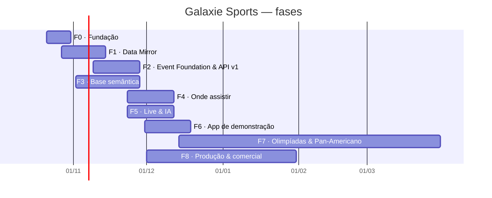
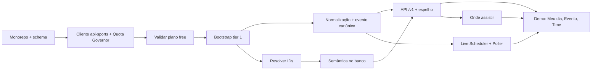

# 10 · Roadmap e backlog

> Fonte da verdade: as issues do repositório, acompanhadas no [GitHub Project · Galaxie Sports](https://github.com/users/galaxie-works/projects/4) (colunas **Todo → In progress → Done**). Este documento é um índice; ao mudar o plano, atualize as issues primeiro.

## 1. Fases e marcos

| Marco | Objetivo | Data-alvo | Issues |
|---|---|---|---|
| **F0 · Fundação** | Monorepo, infraestrutura local, schema do banco, CI e observabilidade. | 31/10/2026 | 5 |
| **F1 · Data Mirror** | Cópia interna da api-sports com economia de chamadas, assets e sync diário. | 14/11/2026 | 13 |
| **F2 · Event Foundation & API v1** | Normalização, entidade evento canônica e API pública (espelho + /v1). | 28/11/2026 | 15 |
| **F3 · Base semântica** | Clássicos, apelidos, gritos, competições e copy localizada. | 28/11/2026 | 8 |
| **F4 · Onde assistir** | Serviço de transmissões por evento e país com IA, validação e correções em ≤ 5 min. | 12/12/2026 | 6 |
| **F5 · Live & IA** | Agendador inteligente ao vivo, cenário pré-jogo, resumo pós-jogo e curadoria. | 12/12/2026 | 7 |
| **F6 · App de demonstração** | Demo em Next.js + shadcn + ReUI consumindo apenas a API Galaxie. | 19/12/2026 | 11 |
| **F7 · Olimpíadas & Pan-Americano** | Módulo multiesportivo: Lima 2027, LA 2028, histórico olímpico. | 31/03/2027 | 5 |
| **F8 · Produção & comercial** | Plano pago, licenças, pacotes comerciais, segurança e testes de carga. | 31/01/2027 | 6 |

## 2. Caminho crítico do MVP de demonstração

## 3. Backlog por épico

### [#1](https://github.com/galaxie-works/galaxie-sports/issues/1) Fundação do projeto

_Base técnica para todo o resto: monorepo, ambiente local reproduzível, schema do banco, CI e observabilidade._ · Marco **F0 · Fundação**

| Issue | Título | Tipo | Prioridade | Tamanho | Depende de |
|---|---|---|---|---|---|
| [#2](https://github.com/galaxie-works/galaxie-sports/issues/2) | Monorepo pnpm + Turborepo com TypeScript, lint e CI | task | P0 | M | — |
| [#3](https://github.com/galaxie-works/galaxie-sports/issues/3) | Infra local com Docker Compose (Postgres 17, Valkey, MinIO) | task | P0 | S | [#2](https://github.com/galaxie-works/galaxie-sports/issues/2) |
| [#4](https://github.com/galaxie-works/galaxie-sports/issues/4) | Schema do banco v1: raw, core, semantic, enrich, ops (Drizzle) | task | P0 | L | [#3](https://github.com/galaxie-works/galaxie-sports/issues/3) |
| [#5](https://github.com/galaxie-works/galaxie-sports/issues/5) | Stack de staging na VPS com Portainer + backups diários | task | P1 | M | [#3](https://github.com/galaxie-works/galaxie-sports/issues/3), [#4](https://github.com/galaxie-works/galaxie-sports/issues/4) |
| [#6](https://github.com/galaxie-works/galaxie-sports/issues/6) | Observabilidade: logs estruturados, métricas e painel de cota | task | P1 | M | [#2](https://github.com/galaxie-works/galaxie-sports/issues/2) |

### [#7](https://github.com/galaxie-works/galaxie-sports/issues/7) Data Mirror da api-sports com economia de chamadas

_Cópia interna de tudo o que a api-sports oferece (12 APIs) com a mesma estrutura, construída e mantida dentro de 100 chamadas/dia por API no plano gratuito._ · Marco **F1 · Data Mirror**

| Issue | Título | Tipo | Prioridade | Tamanho | Depende de |
|---|---|---|---|---|---|
| [#8](https://github.com/galaxie-works/galaxie-sports/issues/8) | packages/apisports-client: cliente multi-API com gravação raw e quota ledger | feature | P0 | M | [#4](https://github.com/galaxie-works/galaxie-sports/issues/4) |
| [#9](https://github.com/galaxie-works/galaxie-sports/issues/9) | Quota Governor: orçamento diário por API e prioridade | feature | P0 | M | [#8](https://github.com/galaxie-works/galaxie-sports/issues/8) |
| [#10](https://github.com/galaxie-works/galaxie-sports/issues/10) | Spike: validar na prática o plano gratuito de cada API (temporadas, endpoints, limites) | spike | P0 | S | [#8](https://github.com/galaxie-works/galaxie-sports/issues/8) |
| [#11](https://github.com/galaxie-works/galaxie-sports/issues/11) | Decisão: contratar plano Pro por 30 dias para o bootstrap | spike | P0 | XS | [#10](https://github.com/galaxie-works/galaxie-sports/issues/10) |
| [#12](https://github.com/galaxie-works/galaxie-sports/issues/12) | Bootstrap futebol — catálogo global (countries, leagues, timezone, seasons) | task | P0 | S | [#9](https://github.com/galaxie-works/galaxie-sports/issues/9), [#10](https://github.com/galaxie-works/galaxie-sports/issues/10) |
| [#13](https://github.com/galaxie-works/galaxie-sports/issues/13) | Bootstrap futebol — temporadas das competições tier 1 e 2 (fixtures, standings, teams, venues) | feature | P0 | L | [#12](https://github.com/galaxie-works/galaxie-sports/issues/12), [#11](https://github.com/galaxie-works/galaxie-sports/issues/11) |
| [#14](https://github.com/galaxie-works/galaxie-sports/issues/14) | Bootstrap futebol — detalhes de partidas em lote (fixtures?ids=) | task | P1 | M | [#13](https://github.com/galaxie-works/galaxie-sports/issues/13) |
| [#15](https://github.com/galaxie-works/galaxie-sports/issues/15) | Bootstrap futebol — elencos, jogadores, técnicos, transferências, títulos, afastamentos | task | P1 | L | [#13](https://github.com/galaxie-works/galaxie-sports/issues/13) |
| [#16](https://github.com/galaxie-works/galaxie-sports/issues/16) | Bootstrap das demais 11 APIs (AFL, beisebol, basquete, F1, handebol, hóquei, MMA, NBA, NFL, rúgbi, vôlei) | feature | P1 | L | [#9](https://github.com/galaxie-works/galaxie-sports/issues/9), [#10](https://github.com/galaxie-works/galaxie-sports/issues/10) |
| [#17](https://github.com/galaxie-works/galaxie-sports/issues/17) | Resolver IDs do catálogo e da base semântica (provider_map) | task | P0 | S | [#13](https://github.com/galaxie-works/galaxie-sports/issues/13) |
| [#18](https://github.com/galaxie-works/galaxie-sports/issues/18) | Asset Mirror: script PowerShell + worker de download de mídia | feature | P0 | M | [#12](https://github.com/galaxie-works/galaxie-sports/issues/12) |
| [#19](https://github.com/galaxie-works/galaxie-sports/issues/19) | Sync diário incremental (janela ontem → amanhã) com cursores | feature | P0 | M | [#13](https://github.com/galaxie-works/galaxie-sports/issues/13), [#16](https://github.com/galaxie-works/galaxie-sports/issues/16) |
| [#20](https://github.com/galaxie-works/galaxie-sports/issues/20) | Snapshot do raw para desenvolvimento local (zero chamadas) | task | P1 | S | [#13](https://github.com/galaxie-works/galaxie-sports/issues/13) |

### [#21](https://github.com/galaxie-works/galaxie-sports/issues/21) Event Foundation e API pública v1

_Transformar o raw em um modelo canônico orientado a evento e expor a API Galaxie Sports (espelho compatível + /v1 enriquecida)._ · Marco **F2 · Event Foundation & API v1**

| Issue | Título | Tipo | Prioridade | Tamanho | Depende de |
|---|---|---|---|---|---|
| [#22](https://github.com/galaxie-works/galaxie-sports/issues/22) | Normalização raw→core: futebol | feature | P0 | L | [#13](https://github.com/galaxie-works/galaxie-sports/issues/13) |
| [#23](https://github.com/galaxie-works/galaxie-sports/issues/23) | Camada de provedores plugável (api-sports + provedor licenciado do cliente) | feature | P0 | M | [#22](https://github.com/galaxie-works/galaxie-sports/issues/22) |
| [#24](https://github.com/galaxie-works/galaxie-sports/issues/24) | Tabelas da temporada atual calculadas localmente | feature | P1 | S | [#22](https://github.com/galaxie-works/galaxie-sports/issues/22) |
| [#25](https://github.com/galaxie-works/galaxie-sports/issues/25) | Normalização raw→core: demais esportes | feature | P1 | L | [#16](https://github.com/galaxie-works/galaxie-sports/issues/16), [#22](https://github.com/galaxie-works/galaxie-sports/issues/22) |
| [#26](https://github.com/galaxie-works/galaxie-sports/issues/26) | Entidade event canônica: máquina de estados, last-known-good e fallback temporal | feature | P0 | M | [#22](https://github.com/galaxie-works/galaxie-sports/issues/22) |
| [#27](https://github.com/galaxie-works/galaxie-sports/issues/27) | Momentum temporal e score de importância do evento | feature | P1 | S | [#26](https://github.com/galaxie-works/galaxie-sports/issues/26) |
| [#28](https://github.com/galaxie-works/galaxie-sports/issues/28) | Motor de regras de contexto competitivo (stakes) | feature | P0 | L | [#22](https://github.com/galaxie-works/galaxie-sports/issues/22) |
| [#29](https://github.com/galaxie-works/galaxie-sports/issues/29) | API: espelho compatível /mirror/{sport}/{endpoint} | feature | P0 | M | [#22](https://github.com/galaxie-works/galaxie-sports/issues/22), [#18](https://github.com/galaxie-works/galaxie-sports/issues/18) |
| [#30](https://github.com/galaxie-works/galaxie-sports/issues/30) | API /v1: catálogo, competições, tabelas e contexto | feature | P0 | M | [#22](https://github.com/galaxie-works/galaxie-sports/issues/22), [#28](https://github.com/galaxie-works/galaxie-sports/issues/28) |
| [#31](https://github.com/galaxie-works/galaxie-sports/issues/31) | API /v1: eventos (agenda, ao vivo, detalhe, timeline, escalações, stats, h2h, .ics) | feature | P0 | L | [#26](https://github.com/galaxie-works/galaxie-sports/issues/26), [#27](https://github.com/galaxie-works/galaxie-sports/issues/27) |
| [#32](https://github.com/galaxie-works/galaxie-sports/issues/32) | API /v1: times, elencos e pessoas | feature | P1 | M | [#22](https://github.com/galaxie-works/galaxie-sports/issues/22) |
| [#33](https://github.com/galaxie-works/galaxie-sports/issues/33) | Autenticação por tenant, planos/módulos e rate limit | feature | P0 | M | [#4](https://github.com/galaxie-works/galaxie-sports/issues/4) |
| [#34](https://github.com/galaxie-works/galaxie-sports/issues/34) | Cache (Redis + CDN), ETag e change feed com purge | feature | P0 | M | [#31](https://github.com/galaxie-works/galaxie-sports/issues/31) |
| [#35](https://github.com/galaxie-works/galaxie-sports/issues/35) | Tempo real: SSE /v1/stream e webhooks assinados | feature | P0 | M | [#34](https://github.com/galaxie-works/galaxie-sports/issues/34) |
| [#36](https://github.com/galaxie-works/galaxie-sports/issues/36) | OpenAPI 3.1, documentação interativa e pacote de contratos | docs | P1 | S | [#30](https://github.com/galaxie-works/galaxie-sports/issues/30) |

### [#37](https://github.com/galaxie-works/galaxie-sports/issues/37) Base de conhecimento semântico

_Clássicos, apelidos, mascotes, gritos de torcida, competições e copy localizada — pré-cadastrados e versionados, servidos sem consulta externa._ · Marco **F3 · Base semântica**

| Issue | Título | Tipo | Prioridade | Tamanho | Depende de |
|---|---|---|---|---|---|
| [#38](https://github.com/galaxie-works/galaxie-sports/issues/38) | JSON Schema + validação da base semântica no CI | task | P0 | S | [#2](https://github.com/galaxie-works/galaxie-sports/issues/2) |
| [#39](https://github.com/galaxie-works/galaxie-sports/issues/39) | Seed da semântica no Postgres + detecção de clássico no evento | feature | P0 | M | [#38](https://github.com/galaxie-works/galaxie-sports/issues/38), [#17](https://github.com/galaxie-works/galaxie-sports/issues/17), [#22](https://github.com/galaxie-works/galaxie-sports/issues/22) |
| [#40](https://github.com/galaxie-works/galaxie-sports/issues/40) | Revisão editorial: times e clássicos do Brasil | editorial | P0 | M | [#38](https://github.com/galaxie-works/galaxie-sports/issues/38) |
| [#41](https://github.com/galaxie-works/galaxie-sports/issues/41) | Revisão editorial: América do Sul (exceto Brasil) e México | editorial | P1 | M | [#38](https://github.com/galaxie-works/galaxie-sports/issues/38) |
| [#42](https://github.com/galaxie-works/galaxie-sports/issues/42) | Revisão editorial: Europa, seleções e competições | editorial | P1 | M | [#38](https://github.com/galaxie-works/galaxie-sports/issues/38) |
| [#43](https://github.com/galaxie-works/galaxie-sports/issues/43) | Biblioteca de copy localizada (8 locales) e copy_permission | feature | P0 | L | [#39](https://github.com/galaxie-works/galaxie-sports/issues/39) |
| [#44](https://github.com/galaxie-works/galaxie-sports/issues/44) | Expansão semântica para outros esportes (NBA, F1, vôlei e basquete no Brasil) | editorial | P2 | M | [#38](https://github.com/galaxie-works/galaxie-sports/issues/38) |
| [#45](https://github.com/galaxie-works/galaxie-sports/issues/45) | API /v1: derbies, teams/semantic, rivals e glossary | feature | P0 | M | [#39](https://github.com/galaxie-works/galaxie-sports/issues/39), [#31](https://github.com/galaxie-works/galaxie-sports/issues/31) |

### [#46](https://github.com/galaxie-works/galaxie-sports/issues/46) Onde assistir (where to watch) por evento e país

_Responder 'onde assistir' dentro da plataforma do cliente, com fonte, confiança, deduplicação, omissão de conflitos e correções em ≤ 5 min._ · Marco **F4 · Onde assistir**

| Issue | Título | Tipo | Prioridade | Tamanho | Depende de |
|---|---|---|---|---|---|
| [#47](https://github.com/galaxie-works/galaxie-sports/issues/47) | Dicionário de emissoras e tabela de direitos por país | task | P0 | S | [#2](https://github.com/galaxie-works/galaxie-sports/issues/2) |
| [#48](https://github.com/galaxie-works/galaxie-sports/issues/48) | Agente Onde Assistir (LLM + busca web) com saída estruturada | feature | P0 | L | [#47](https://github.com/galaxie-works/galaxie-sports/issues/47), [#31](https://github.com/galaxie-works/galaxie-sports/issues/31) |
| [#49](https://github.com/galaxie-works/galaxie-sports/issues/49) | Validador determinístico: confiança, dedupe e omissão de conflitos | feature | P0 | M | [#48](https://github.com/galaxie-works/galaxie-sports/issues/48) |
| [#50](https://github.com/galaxie-works/galaxie-sports/issues/50) | Agendamento T-7d/T-24h/T-3h/T-30min e reexecução sob demanda | task | P1 | S | [#49](https://github.com/galaxie-works/galaxie-sports/issues/49) |
| [#51](https://github.com/galaxie-works/galaxie-sports/issues/51) | Correção editorial e propagação em ≤ 5 min | feature | P0 | M | [#49](https://github.com/galaxie-works/galaxie-sports/issues/49), [#34](https://github.com/galaxie-works/galaxie-sports/issues/34) |
| [#52](https://github.com/galaxie-works/galaxie-sports/issues/52) | Auditoria amostral e métricas de precisão/cobertura | task | P1 | S | [#50](https://github.com/galaxie-works/galaxie-sports/issues/50) |

### [#53](https://github.com/galaxie-works/galaxie-sports/issues/53) Live e IA: agendador inteligente, cenário e resumos

_Serviço agendado que acompanha jogos importantes ao vivo dentro da cota e enriquece eventos com contexto gerado a partir de fatos calculados._ · Marco **F5 · Live & IA**

| Issue | Título | Tipo | Prioridade | Tamanho | Depende de |
|---|---|---|---|---|---|
| [#54](https://github.com/galaxie-works/galaxie-sports/issues/54) | Live Scheduler: janelas ao vivo e intervalo por orçamento | feature | P0 | M | [#9](https://github.com/galaxie-works/galaxie-sports/issues/9), [#26](https://github.com/galaxie-works/galaxie-sports/issues/26) |
| [#55](https://github.com/galaxie-works/galaxie-sports/issues/55) | Live Poller: fixtures?live=<ligas> com diff e change feed | feature | P0 | M | [#54](https://github.com/galaxie-works/galaxie-sports/issues/54), [#35](https://github.com/galaxie-works/galaxie-sports/issues/35) |
| [#56](https://github.com/galaxie-works/galaxie-sports/issues/56) | Priorização por LLM quando a demanda excede o orçamento | feature | P2 | S | [#54](https://github.com/galaxie-works/galaxie-sports/issues/54) |
| [#57](https://github.com/galaxie-works/galaxie-sports/issues/57) | Agente Cenário pré-jogo (stakes → texto localizado) com validador | feature | P0 | M | [#28](https://github.com/galaxie-works/galaxie-sports/issues/28) |
| [#58](https://github.com/galaxie-works/galaxie-sports/issues/58) | Agente Resumo pós-jogo | feature | P1 | S | [#55](https://github.com/galaxie-works/galaxie-sports/issues/55) |
| [#59](https://github.com/galaxie-works/galaxie-sports/issues/59) | Agente Curador Semântico (PRs automáticos) | feature | P2 | M | [#38](https://github.com/galaxie-works/galaxie-sports/issues/38) |
| [#60](https://github.com/galaxie-works/galaxie-sports/issues/60) | Guardrails, orçamento de tokens e avaliação contínua da IA | task | P1 | S | [#48](https://github.com/galaxie-works/galaxie-sports/issues/48), [#57](https://github.com/galaxie-works/galaxie-sports/issues/57) |

### [#61](https://github.com/galaxie-works/galaxie-sports/issues/61) App de demonstração (Next.js + shadcn + ReUI)

_Demo que consome somente a API Galaxie e mostra o serviço de ponta a ponta para clientes._ · Marco **F6 · App de demonstração**

| Issue | Título | Tipo | Prioridade | Tamanho | Depende de |
|---|---|---|---|---|---|
| [#62](https://github.com/galaxie-works/galaxie-sports/issues/62) | Setup do demo: Next.js, shadcn/ui, ReUI, tema e i18n | task | P0 | S | [#2](https://github.com/galaxie-works/galaxie-sports/issues/2), [#36](https://github.com/galaxie-works/galaxie-sports/issues/36) |
| [#63](https://github.com/galaxie-works/galaxie-sports/issues/63) | Tela: Meu dia esportivo + perfis de demonstração | feature | P0 | M | [#62](https://github.com/galaxie-works/galaxie-sports/issues/62), [#31](https://github.com/galaxie-works/galaxie-sports/issues/31) |
| [#64](https://github.com/galaxie-works/galaxie-sports/issues/64) | Tela: Ao vivo com SSE | feature | P0 | S | [#62](https://github.com/galaxie-works/galaxie-sports/issues/62), [#35](https://github.com/galaxie-works/galaxie-sports/issues/35) |
| [#65](https://github.com/galaxie-works/galaxie-sports/issues/65) | Tela: Radar/agenda com filtros | feature | P1 | S | [#62](https://github.com/galaxie-works/galaxie-sports/issues/62), [#31](https://github.com/galaxie-works/galaxie-sports/issues/31) |
| [#66](https://github.com/galaxie-works/galaxie-sports/issues/66) | Tela: Competição (tabela, chaveamento, contexto) | feature | P1 | M | [#62](https://github.com/galaxie-works/galaxie-sports/issues/62), [#30](https://github.com/galaxie-works/galaxie-sports/issues/30) |
| [#67](https://github.com/galaxie-works/galaxie-sports/issues/67) | Tela: Evento (escalação, estatísticas, timeline, h2h, cenário, onde assistir) | feature | P0 | M | [#62](https://github.com/galaxie-works/galaxie-sports/issues/62), [#31](https://github.com/galaxie-works/galaxie-sports/issues/31), [#51](https://github.com/galaxie-works/galaxie-sports/issues/51) |
| [#68](https://github.com/galaxie-works/galaxie-sports/issues/68) | Tela: Time (overview, elenco, cartão semântico) | feature | P1 | S | [#62](https://github.com/galaxie-works/galaxie-sports/issues/62), [#32](https://github.com/galaxie-works/galaxie-sports/issues/32), [#45](https://github.com/galaxie-works/galaxie-sports/issues/45) |
| [#69](https://github.com/galaxie-works/galaxie-sports/issues/69) | Tela: Clássicos | feature | P1 | S | [#62](https://github.com/galaxie-works/galaxie-sports/issues/62), [#45](https://github.com/galaxie-works/galaxie-sports/issues/45) |
| [#70](https://github.com/galaxie-works/galaxie-sports/issues/70) | Tela: Olimpíadas & Pan-Americano | feature | P2 | S | [#62](https://github.com/galaxie-works/galaxie-sports/issues/62), [#75](https://github.com/galaxie-works/galaxie-sports/issues/75) |
| [#71](https://github.com/galaxie-works/galaxie-sports/issues/71) | Tela: Painel de operação (cota, jobs, frescor) | feature | P1 | S | [#62](https://github.com/galaxie-works/galaxie-sports/issues/62), [#6](https://github.com/galaxie-works/galaxie-sports/issues/6) |
| [#72](https://github.com/galaxie-works/galaxie-sports/issues/72) | Incorporar bibliotecas de componentes adicionais e atualizar documentação | task | P1 | S | [#62](https://github.com/galaxie-works/galaxie-sports/issues/62) |

### [#73](https://github.com/galaxie-works/galaxie-sports/issues/73) Olimpíadas e Jogos Pan-Americanos

_Cobertura de eventos multiesportivos — quadro de medalhas, agenda por modalidade, delegações latino-americanas e histórico._ · Marco **F7 · Olimpíadas & Pan-Americano**

| Issue | Título | Tipo | Prioridade | Tamanho | Depende de |
|---|---|---|---|---|---|
| [#74](https://github.com/galaxie-works/galaxie-sports/issues/74) | Spike: decidir fontes de dados olímpicas e pan-americanas | spike | P1 | S | — |
| [#75](https://github.com/galaxie-works/galaxie-sports/issues/75) | Modelo multisport + ingestão do histórico olímpico | feature | P1 | M | [#74](https://github.com/galaxie-works/galaxie-sports/issues/74), [#4](https://github.com/galaxie-works/galaxie-sports/issues/4) |
| [#76](https://github.com/galaxie-works/galaxie-sports/issues/76) | Jogos Pan-Americanos Lima 2027: agenda, medalhas e delegações | feature | P1 | L | [#75](https://github.com/galaxie-works/galaxie-sports/issues/75), [#51](https://github.com/galaxie-works/galaxie-sports/issues/51) |
| [#77](https://github.com/galaxie-works/galaxie-sports/issues/77) | Olimpíadas LA 2028: preparação | feature | P2 | M | [#76](https://github.com/galaxie-works/galaxie-sports/issues/76) |
| [#78](https://github.com/galaxie-works/galaxie-sports/issues/78) | Torneios olímpicos e pan-americanos via api-sports (futebol, basquete, vôlei, handebol) | task | P1 | S | [#16](https://github.com/galaxie-works/galaxie-sports/issues/16), [#75](https://github.com/galaxie-works/galaxie-sports/issues/75) |

### [#79](https://github.com/galaxie-works/galaxie-sports/issues/79) Produção, licenciamento e oferta comercial

_Levar o serviço de demonstração a produto vendável: licenças, plano pago, pacotes, SLA, segurança e carga._ · Marco **F8 · Produção & comercial**

| Issue | Título | Tipo | Prioridade | Tamanho | Depende de |
|---|---|---|---|---|---|
| [#80](https://github.com/galaxie-works/galaxie-sports/issues/80) | Contratar plano pago da api-sports e confirmar licença de redistribuição | task | P0 | S | [#10](https://github.com/galaxie-works/galaxie-sports/issues/10) |
| [#81](https://github.com/galaxie-works/galaxie-sports/issues/81) | Revisão jurídica: imagens, scraping, conteúdo de IA e LGPD | task | P1 | S | — |
| [#82](https://github.com/galaxie-works/galaxie-sports/issues/82) | Pacotes comerciais, precificação e SLAs | task | P1 | S | — |
| [#83](https://github.com/galaxie-works/galaxie-sports/issues/83) | Onboarding de tenant e portal de chaves | feature | P2 | M | [#33](https://github.com/galaxie-works/galaxie-sports/issues/33) |
| [#84](https://github.com/galaxie-works/galaxie-sports/issues/84) | Hardening de segurança, backups e recuperação de desastre | task | P1 | M | [#5](https://github.com/galaxie-works/galaxie-sports/issues/5) |
| [#85](https://github.com/galaxie-works/galaxie-sports/issues/85) | Testes de carga para picos (clássicos, finais, Pan) | task | P1 | S | [#35](https://github.com/galaxie-works/galaxie-sports/issues/35) |

## 4. Convenções do backlog

| Campo | Valores |
|---|---|
| Labels de tipo | `type:epic`, `type:feature`, `type:task`, `type:spike`, `type:docs`, `type:editorial` |
| Labels de área | `area:ingestion`, `area:db`, `area:api`, `area:ai`, `area:semantic`, `area:wtw`, `area:demo`, `area:infra`, `area:ops`, `area:multisport`, `area:commercial` |
| Prioridade | `priority:P0` (MVP), `priority:P1`, `priority:P2` — espelhada no campo *Priority* do Project |
| Tamanho | XS, S, M, L, XL — campo *Size* do Project |
| Hierarquia | Épicos com *sub-issues* do GitHub; cada issue referencia o épico e suas dependências |
| Definição de pronto | Critérios de aceite marcados, testes no CI, documentação atualizada, sem menção a marcas de clientes |
