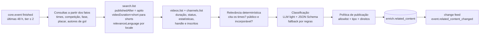

# 12 · Conteúdo relacionado por evento

## 1. Problema e proposta

Pergunte a um chatbot genérico por "5 shorts sobre a classificação do Palmeiras para a final da Libertadores" e a resposta típica é uma lista de **links de busca** ("youtube.com/results?search_query=…"), não de vídeos. Ele não sabe que o jogo aconteceu, quando terminou, quem marcou, nem quais canais são oficiais.

Nós sabemos. O `core` tem o evento (times, competição, fase, placar, autores de gol, horário do apito), e a base semântica tem os nomes certos por locale. Com isso, o módulo **Conteúdo relacionado** entrega, por evento:

- **links diretos** para vídeos (`youtube.com/watch?v=…` e o embed oficial), nunca links de busca;
- cada vídeo classificado por **tipo de conteúdo** (melhores momentos, gol, pênaltis, coletiva, bastidores, reação da torcida, análise…) e por **formato** (vídeo longo × short/vertical);
- canal, selo de **fonte oficial** (clube, competição, detentor de direitos), duração, data, miniatura e visualizações.

É um metadado vendável: o cliente monta a vitrine "Reveja o jogo" no hub esportivo, no card do evento ou no pós-jogo da TV conectada, sem curadoria manual.

> **Fatos vêm do core; a IA só classifica.** O LLM não escolhe quais vídeos existem nem inventa links: os candidatos vêm da busca da YouTube Data API, e a política de publicação é código.

## 2. Regras de direitos

| Fazemos | Não fazemos |
|---|---|
| Guardamos **metadados** (id do vídeo, título, canal, duração, data, estatísticas) e o **link/embed oficial** da plataforma | Baixar, transcodificar, recortar ou **rehospedar** vídeo, áudio ou miniatura |
| Exibimos a miniatura pela URL da própria plataforma (`i.ytimg.com`), sempre linkando para o vídeo | Servir a miniatura do nosso CDN |
| Priorizamos canais **oficiais** (clubes, competição, detentores de direitos do país) | Publicar imagens de jogo (gols, melhores momentos, jogo completo) de canal fora da allowlist — o risco de reupload sem licença é alto |
| Só publicamos vídeo **público e incorporável** (`status.embeddable = true`) | Contornar bloqueio regional ou de idade |
| Revalidamos os metadados e **expiramos** o que não for atualizado em 30 dias (política de desenvolvedor da YouTube API) | Guardar estatísticas e títulos indefinidamente sem atualizar |

Vídeo de criador fora da allowlist só entra se for **conteúdo próprio** (reação, análise) e o canal tiver audiência mínima (`RELATED_CREATOR_MIN_SUBSCRIBERS`, padrão 100 mil inscritos). O que não passa fica `pending` (guardado, não aparece) ou `rejected`.

## 3. Fontes

| Fonte | Situação | Como |
|---|---|---|
| **YouTube Data API v3** | **Principal** | `search.list` (descoberta) → `videos.list` (duração, status, estatísticas) → `channels.list` (handle e inscritos) |
| Instagram (Reels) | Fora do MVP | Não há busca pública por API: a Graph API só pesquisa hashtags para contas Business, com limite de 30 hashtags por semana, e o oEmbed exige app revisado e a URL exata do post |
| TikTok | Fora do MVP | A Research API é restrita a pesquisa acadêmica e a Display API só lê o conteúdo da própria conta autenticada; o oEmbed embute uma URL conhecida, mas não descobre vídeos |
| X / Kwai / Facebook | Fora do MVP | Mesma limitação de descoberta |

**Trabalho futuro (Instagram/TikTok):** receber URLs de posts por parceria (clubes ou detentores de direitos que nos enviem os links, ou um feed oficial) e publicar só o embed oficial (oEmbed), com o mesmo classificador. A descoberta continua sendo o gargalo, não a classificação.

### 3.1 Allowlist de canais

No mesmo espírito da allowlist de domínios do Onde Assistir (`services/ai-agents/src/wtw`), o canal define a confiança:

| `source_tier` | De onde vem | Exemplos de entrada |
|---|---|---|
| `official` | `config/related-content/channels.yaml` → `clubs` e `competitions` | canal do clube, da confederação, da liga |
| `rights_holder` | Detentores de direitos da competição no país (`config/broadcast-rights/<iso2>.yaml`), com o handle do YouTube tirado dos domínios do dicionário de emissoras (`youtube.com/@handle` em `config/broadcasters/<iso2>.yaml`) e de `channels.yaml` → `broadcasters` | canal da emissora detentora |
| `media` | `channels.yaml` → `media` | imprensa esportiva de referência |
| `creator` | Fora da allowlist, conteúdo próprio, ≥ 100 mil inscritos | canal de análise ou de torcida |

O casamento é por **handle** (`snippet.customUrl` do `channels.list`, sem caixa) ou por **id do canal** (`UC…`). A blocklist editorial do Onde Assistir (`_policy.yaml` + `WTW_BLOCKLIST_FILE`/`WTW_BLOCKLIST`) também vale aqui: canal bloqueado não aparece, e o nome não é registrado.

Toda entrada é conferida com `channels.list?forHandle=` antes de entrar (a lista atual foi conferida em 2026-10-22). Handles parecidos com os dos clubes costumam ser de terceiros — na conferência, `@vascotv` era um canal de torcedor com 1,3 mil inscritos e `@penarol` tinha 3 —, por isso o código também exige **10 mil inscritos** (`ALLOWLIST_MIN_SUBSCRIBERS`) para uma entrada casada só pelo handle dar o selo; entrada por id do canal não passa por esse piso.

## 4. Taxonomia

### 4.1 Tipo de conteúdo (`content_type`)

| Código | pt-BR | es | Sinais (regras) |
|---|---|---|---|
| `highlights` | Melhores momentos | Resumen | "melhores momentos", "compacto", "resumo", "highlights", "resumen", "lo mejor" |
| `goal` | Gol | Gol | "gol", "golaço", "golazo", "goal"; vídeo curto |
| `penalties` | Pênaltis | Penales | "pênaltis", "disputa de pênaltis", "penales", "tanda" |
| `press_conference` | Coletiva | Conferencia de prensa | "coletiva", "conferencia/rueda de prensa", "press conference" |
| `interview` | Entrevista | Entrevista | "entrevista", "zona mista", "flash", "fala após" |
| `behind_the_scenes` | Bastidores | Detrás de cámaras | "bastidores", "vestiário", "vestuario", "por dentro" |
| `fan_reaction` | Reação da torcida | Reacción de la hinchada | "reação", "react", "torcida", "hinchada", "afición" |
| `analysis` | Análise | Análisis | "análise", "pós-jogo", "post partido", "mesa redonda", "tática" |
| `full_match` | Jogo completo | Partido completo | "jogo completo", "partido completo", duração ≥ 80 min |
| `other` | Outros | Otros | sem sinal claro |

### 4.2 Formato (`format`)

| Código | Regra |
|---|---|
| `short` | Vídeo vertical curto: duração ≤ 60 s, ou ≤ 180 s com `#shorts` no título, na descrição ou nas tags (o limite dos Shorts é 3 min desde 2024) |
| `long` | Todo o resto (vídeo horizontal, de qualquer duração) |

A API do YouTube não informa a proporção do vídeo; a regra acima é a melhor aproximação disponível e fica registrada em `classified_by`.

## 5. Pipeline



1. **Candidatos**: futebol `finished` com início nas últimas 48 h (`--horas`), competição tier ≤ 2, ordenados por tier e importância; ou um evento (`--evento`).
2. **Consultas** (`buildRelatedQueries`), por idioma do mercado (`pt` se algum time é do Brasil; `es` para os demais mercados hispânicos; ambos em competição internacional com times dos dois idiomas):
   - `highlights`: `Palmeiras x Fluminense melhores momentos Libertadores` (`order=relevance`);
   - `shorts`: `Palmeiras Fluminense #shorts`, com `videoDuration=short`;
   - `postgame`: `Palmeiras Fluminense coletiva|bastidores|torcida|análise`;
   - `goals` (se houve gols): `Palmeiras Fluminense gol <autor 1>|<autor 2>` (até 3 autores de gol do core).
   Todas com `type=video`, `publishedAfter` = início do jogo, `publishedBefore` = início + 7 dias, `videoEmbeddable=true`, `relevanceLanguage` e `regionCode` do locale, `maxResults=25`.
3. **Detalhe**: um `videos.list` por lote de 50 ids (`snippet,contentDetails,statistics,status`) e um `channels.list` por lote de 50 canais (`snippet,statistics`).
4. **Relevância (código)**: o título ou a descrição precisa citar **os dois times** (nome, nome curto, apelidos e rótulos da base semântica, sem acento e sem caixa) — ou um deles, se o canal for oficial de um dos dois. Vídeo privado, não incorporável, publicado antes do apito ou fora do ar → descartado.
5. **Classificação**: o LLM tier `light` recebe os fatos do jogo e os vídeos — em lotes de 20, porque uma lista de ~70 vídeos estourou o limite de saída do modelo leve na primeira execução real — (título, trecho da descrição, canal, duração) **como dado** (`<dados_externos>`), e devolve `{ id, content_type, about_this_event, confidence }` por vídeo, em JSON Schema estrito. Guardrails:
   - id que não estava na entrada é ignorado; vídeo que o LLM omitiu cai no classificador por regras;
   - `about_this_event = false` reprova o vídeo (ex.: jogo de outra temporada com os mesmos times);
   - título com sinal de *prompt injection* (`detectPromptInjection`) não vai ao LLM: é classificado por regras e marcado `injection_signal`;
   - título com termo ofensivo da lista de rivalidade (`findForbiddenTerms`) fica `pending` (`offensive_title`);
   - o orçamento diário de tokens é o compartilhado (`ops.llm_usage`, agente `related`); estourou ou falhou → regras.
6. **Política de publicação (código)**:

   | Canal | Tipos de imagem de jogo (`highlights`, `goal`, `penalties`, `full_match`) | Demais tipos |
   |---|---|---|
   | `official`, `rights_holder` | `published` | `published` |
   | `media` | `pending` (pode ter imagem licenciada ou não) | `published` |
   | `creator` (≥ 100 mil inscritos) | `rejected` (`rights_risk`) | `published` só `fan_reaction` e `analysis` em vídeo **longo**; short de criador fica `pending` (`creator_short`: na prática são cortes de programas de TV); o resto `pending` |
   | fora da allowlist, abaixo do mínimo | `rejected` (`rights_risk`) | `pending` |

   Confiança < 0,5 na classificação → `pending`.
7. **Ranking**: `source_tier` (oficial 3, detentor 3, imprensa 2, criador 1) + log₁₀(visualizações) / 2 + bônus de tipo (melhores momentos e gols primeiro) − meia-vida de 3 dias desde o apito. Desempate por data e id.
8. **Gravação e histórico** (`saveRelatedContent`): uma versão por mudança material (tipo, formato, status, título, flags); sem mudança, só renova `last_checked_at` e as estatísticas. Vídeo que sumiu do `videos.list` → versão `retracted`. Mudança visível → `event.related_content_changed` no change feed (tag `related_content:<evento>`), que purga o cache e vira SSE/webhook.
9. **Revalidação**: rodadas seguintes no mesmo evento em menos de `RELATED_RESEARCH_HOURS` (padrão 12 h) não buscam de novo: só um `videos.list` com os ids guardados (1 unidade) para atualizar estatísticas e retirar o que saiu do ar.
10. **Expiração (30 dias)**: linhas com `last_checked_at` > 30 dias viram `expired`, com título, miniatura e estatísticas apagados — o id do vídeo e a classificação ficam (histórico).

## 6. Modelo de dados (`enrich`)

```sql
create type enrich.related_content_type as enum
  ('highlights','goal','penalties','press_conference','interview','behind_the_scenes',
   'fan_reaction','analysis','full_match','other');
create type enrich.related_content_status as enum
  ('published','pending','rejected','retracted','expired');

create table enrich.related_content (
  id               uuid primary key default uuid_generate_v7(),
  event_id         uuid not null references core.event(id) on delete cascade,
  provider         text not null,            -- youtube (instagram, tiktok no futuro)
  external_id      text not null,            -- id do vídeo na plataforma
  url              text not null,            -- https://www.youtube.com/watch?v=<id> (ou /shorts/<id>)
  embed_url        text,                     -- https://www.youtube.com/embed/<id>
  title            text not null,
  description_excerpt text,                  -- ≤ 200 caracteres (auditoria da classificação)
  channel_id       text not null,
  channel_title    text not null,
  channel_handle   text,
  source_tier      text not null,            -- official | rights_holder | media | creator | unknown
  content_type     enrich.related_content_type not null,
  format           text not null,            -- short | long
  duration_seconds integer,
  published_at     timestamptz not null,
  thumbnail_url    text,                     -- URL da plataforma, nunca do nosso CDN
  language         text,                     -- idioma da consulta que achou o vídeo
  statistics       jsonb,                    -- { views, likes, comments, fetched_at }
  rank_score       numeric(6,3) not null,
  confidence       numeric(3,2) not null,
  classified_by    text not null,            -- llm:<modelo> | rules@v1
  status           enrich.related_content_status not null,
  flags            text[] not null default '{}',  -- rights_risk, injection_signal, offensive_title...
  queries          text[] not null default '{}',  -- consultas que acharam o vídeo
  run_id           uuid,
  first_seen_at    timestamptz not null default now(),
  last_checked_at  timestamptz not null default now(),
  created_at       timestamptz not null default now(),
  superseded_by    uuid,
  superseded_at    timestamptz
);
-- uma versão vigente por (evento, plataforma, vídeo)
create unique index on enrich.related_content (event_id, provider, external_id) where superseded_by is null;

create table enrich.related_run (
  id            uuid primary key default uuid_generate_v7(),
  event_id      uuid not null references core.event(id) on delete cascade,
  mode          text not null,      -- full | revalidate
  status        text not null,      -- running | done | failed | skipped
  quota_day     date not null,      -- dia da cota do YouTube (meia-noite do Pacífico)
  quota_units   integer not null default 0,
  searches      integer not null default 0,
  candidates    integer not null default 0,
  published     integer not null default 0,
  provider      text, model text,
  input_tokens  integer not null default 0,
  output_tokens integer not null default 0,
  cost_usd      numeric(12,6),
  stats         jsonb,              -- por consulta: resultados, descartes por motivo
  error         text,
  requested_by  text not null default 'cli',
  started_at    timestamptz not null default now(),
  finished_at   timestamptz
);
```

A migração também acrescenta o módulo `related_content` aos tenants do plano `enterprise` (que recebem todos os módulos).

## 7. API — módulo `related_content`

Módulo vendável próprio (add-on): incluído no `enterprise` e contratável por qualquer plano (`PATCH /internal/admin/tenants/{id}` com `modules`). Sem o módulo → 403 `MODULE_NOT_IN_PLAN`.

`GET /v1/events/{id}/related?type=highlights,goal&format=short&limit=20`

| Parâmetro | Descrição |
|---|---|
| `type` | Lista de tipos (`content_type`), separada por vírgula. Padrão: todos |
| `format` | `short` ou `long`. Padrão: ambos |
| `limit` | 1–50 (padrão 20) |
| `locale`, `tz` | Rótulo localizado do tipo e instantes no fuso |

```json
{
  "event_id": "01a163b8-7ca2-71e8-a92e-8dc201d5d83a",
  "data": [
    {
      "id": "01a1…",
      "provider": "youtube",
      "external_id": "dQw4w9WgXcQ",
      "url": "https://www.youtube.com/watch?v=dQw4w9WgXcQ",
      "embed_url": "https://www.youtube.com/embed/dQw4w9WgXcQ",
      "title": "MELHORES MOMENTOS | PALMEIRAS X FLUMINENSE | SEMIFINAL",
      "content_type": "highlights",
      "content_type_label": "Melhores momentos",
      "format": "long",
      "duration_seconds": 612,
      "published_at": "2026-10-21T23:58:00-03:00",
      "thumbnail_url": "https://i.ytimg.com/vi/dQw4w9WgXcQ/hqdefault.jpg",
      "language": "pt",
      "channel": { "id": "UC…", "title": "…", "handle": "@…", "source_tier": "official" },
      "views": 182000,
      "confidence": 0.92,
      "classified_by": "llm:gpt-6-luna",
      "last_checked_at": "2026-10-22T09:10:00-03:00"
    }
  ],
  "counts": { "highlights": 2, "goal": 3, "press_conference": 1 },
  "updated_at": "2026-10-22T09:10:00-03:00"
}
```

- Só `status = published`, versão vigente, ordenada por `rank_score`.
- `counts` traz o total por tipo **antes** do filtro (para a vitrine montar as abas).
- Cache: TTL de 1 h, purgado por `event.related_content_changed` (tag `related_content:<evento>`).
- Tempo real: tópico `event.related_content_changed` (curto: `related`) no SSE e nos webhooks, para quem tem o módulo.

## 8. Cota e custo

| Chamada | Unidades | Por evento (busca completa) |
|---|---|---|
| `search.list` | 100 | 3–4 consultas por idioma → 300–400 (600–800 com dois idiomas) |
| `videos.list` (50 ids) | 1 | 1–2 |
| `channels.list` (50 ids) | 1 | 1–2 |
| Revalidação (`videos.list`) | 1 | 1 |

A cota padrão de um projeto é **10.000 unidades/dia**, zerada à meia-noite do Pacífico → ~25 eventos/dia com busca completa em um idioma. O CLI soma as unidades do dia em `enrich.related_run`, respeita `YOUTUBE_DAILY_QUOTA` (padrão 10.000) menos a reserva `YOUTUBE_QUOTA_RESERVE_PERCENT` (padrão 10%) e para quando a próxima busca não cabe. A ordem dos candidatos (tier, importância) garante que os jogos grandes entram primeiro. Mais volume = pedir aumento de cota ao Google (formulário de auditoria) — o pipeline não muda.

LLM: uma chamada `light` por evento (todos os vídeos de uma vez), ~3–5 mil tokens de entrada → frações de centavo por evento.

## 9. Primeira execução real (2026-10-22)

Palmeiras 0 (5) x (3) 1 Fluminense, semifinal (volta) da Libertadores, 21/10/2026: 4 consultas em pt (403 unidades), ~84 vídeos candidatos.

| Situação | Vídeos | Exemplos |
|---|---|---|
| `published` | 37 | melhores momentos, disputa de pênaltis completa e gol no canal da CONMEBOL Libertadores (`official`); melhores momentos e shorts de gol/pênalti da GE TV e da ESPN Brasil (`rights_holder`); coletivas de Palmeiras e Fluminense (`official`); reações longas de canais de torcida (`creator`) |
| `pending` | 38 | melhores momentos e jogo completo de canais de imprensa sem direitos confirmados na tabela; coletivas reenviadas por terceiros; shorts de criadores |
| `rejected` | 9 | gols e pênaltis reenviados por canais fora da allowlist (`rights_risk`) |

Uma segunda rodada no mesmo dia só revalidou (3 unidades) e reclassificou pelo LLM o que tinha caído nas regras. Custo do LLM somando as três rodadas: ~24 mil tokens no tier `light` (US$ 0,005).

## 10. Operação

```bash
pnpm --filter @galaxie/ai-agents related:run --plan                 # candidatos e consultas, sem chamar nada
pnpm --filter @galaxie/ai-agents related:run --evento <id>          # um jogo (busca completa se devida)
pnpm --filter @galaxie/ai-agents related:run --horas 48 --limite 20 # rodada do cron
pnpm --filter @galaxie/ai-agents related:run --evento <id> --forcar # ignora a janela de revalidação
```

Flags: `--plan`, `--evento`, `--horas` (padrão 48), `--tier` (padrão 2), `--limite`, `--forcar`, `--sem-llm` (só regras). Variáveis: `YOUTUBE_API_KEY` (só no `.env`), `YOUTUBE_DAILY_QUOTA`, `YOUTUBE_QUOTA_RESERVE_PERCENT`, `RELATED_RESEARCH_HOURS`, `RELATED_CREATOR_MIN_SUBSCRIBERS`. Cron sugerido: a cada 30 min das 12h às 06h UTC (pós-jogo das noites latino-americanas); os jogos só gastam busca completa uma vez a cada 12 h.

## 11. Demo

Página do evento (`apps/demo`, `eventos/[id]`): seção **Conteúdo relacionado** no fim da página, em largura total, com cards (miniatura, duração, selo *Short*, canal com selo *Oficial*, tipo e visualizações) e filtro por tipo (abas com a contagem de `counts`). O clique abre o vídeo na própria plataforma. A chave da demo precisa do módulo `related_content` (o tenant da demo é `enterprise`).

## 12. Métricas e riscos

| Métrica | Meta |
|---|---|
| Eventos tier 1 encerrados com ≥ 5 vídeos publicados em 24 h | ≥ 80% |
| Precisão do tipo (auditoria amostral) | ≥ 90% |
| Vídeos publicados que não são do jogo | ≤ 2% |
| Vídeos publicados fora do ar há mais de 24 h | 0 (revalidação) |

| Risco | Mitigação |
|---|---|
| Reupload sem licença | Imagem de jogo só de canal oficial/detentor; blocklist editorial |
| Vídeo de jogo antigo com os mesmos times | `publishedAfter` = apito, `about_this_event` do LLM, janela de 7 dias |
| Título com *prompt injection* | Conteúdo como dado, detecção de padrões, saída em JSON Schema e política em código |
| Cota do YouTube | Ledger por dia do Pacífico, prioridade por tier, revalidação de 1 unidade |
| Política de dados da plataforma | Só metadados + embed; expiração em 30 dias sem atualização |

**Trabalho futuro:** Instagram e TikTok por parceria (§3), auditoria amostral com fila editorial (como em [07 §4](07-ia-tempo-real-e-enriquecimento.md)), outros esportes (as consultas só dependem dos nomes e da competição) e conteúdo pré-jogo (coletiva de véspera, bastidores do treino).
