# 12 · Conteúdo relacionado por evento

## 1. Problema e proposta

Pergunte a um chatbot genérico por "5 shorts sobre a classificação do Palmeiras para a final da Libertadores" e a resposta típica é uma lista de **links de busca** ("youtube.com/results?search_query=…"), não de vídeos. Ele não sabe que o jogo aconteceu, quando terminou, quem marcou, nem quais canais são oficiais.

Nós sabemos. O `core` tem o evento (times, competição, fase, placar, autores de gol, horário do apito), e a base semântica tem os nomes certos por locale. Com isso, o módulo **Conteúdo relacionado** entrega, por evento:

- **links diretos** para vídeos (`youtube.com/watch?v=…` e o embed oficial), nunca links de busca;
- cada vídeo classificado por **tipo de conteúdo** (melhores momentos, gol, pênaltis, coletiva, bastidores, reação da torcida, análise…) e por **formato** (vídeo longo × short/vertical);
- canal, selo de **fonte oficial** (clube, competição, detentor de direitos), duração, data, miniatura e visualizações.

É um metadado vendável: o cliente monta a vitrine "Reveja o jogo" no hub esportivo, no card do evento ou no pós-jogo da TV conectada, sem curadoria manual.

> **Fatos vêm do core; a IA só classifica.** O LLM não escolhe quais vídeos existem nem inventa links: os candidatos vêm da busca da YouTube Data API, e a política de publicação é código.

## 2. Regras de direitos

| Fazemos | Não fazemos |
|---|---|
| Guardamos **metadados** (id do vídeo, título, canal, duração, data, estatísticas) e o **link/embed oficial** da plataforma | Baixar, transcodificar, recortar ou **rehospedar** vídeo, áudio ou miniatura |
| Exibimos a miniatura pela URL da própria plataforma (`i.ytimg.com`), sempre linkando para o vídeo | Servir a miniatura do nosso CDN |
| Priorizamos canais **oficiais** (clubes, competição, detentores de direitos do país) | Publicar imagens de jogo (gols, melhores momentos, jogo completo) de canal fora da allowlist — o risco de reupload sem licença é alto |
| Só publicamos vídeo **público e incorporável** (`status.embeddable = true`) | Contornar bloqueio regional ou de idade |
| Revalidamos os metadados e **expiramos** o que não for atualizado em 30 dias (política de desenvolvedor da YouTube API) | Guardar estatísticas e títulos indefinidamente sem atualizar |

Vídeo de criador fora da allowlist só entra se for **conteúdo próprio** (reação, análise) e o canal tiver audiência mínima (`RELATED_CREATOR_MIN_SUBSCRIBERS`, padrão 100 mil inscritos). O que não passa fica `pending` (guardado, não aparece) ou `rejected`.

## 3. Fontes

| Fonte | Situação | Como |
|---|---|---|
| **YouTube Data API v3** | **Principal** | `playlistItems.list` (uploads dos canais oficiais, §3.2) e `search.list` (descoberta, só como complemento) → `videos.list` (duração, status, estatísticas) → `channels.list` (playlist de uploads, handle e inscritos) |
| Instagram (Reels) | Fora do MVP | Não há busca pública por API: a Graph API só pesquisa hashtags para contas Business, com limite de 30 hashtags por semana, e o oEmbed exige app revisado e a URL exata do post |
| TikTok | Fora do MVP | A Research API é restrita a pesquisa acadêmica e a Display API só lê o conteúdo da própria conta autenticada; o oEmbed embute uma URL conhecida, mas não descobre vídeos |
| X / Kwai / Facebook | Fora do MVP | Mesma limitação de descoberta |

**Trabalho futuro (Instagram/TikTok):** receber URLs de posts por parceria (clubes ou detentores de direitos que nos enviem os links, ou um feed oficial) e publicar só o embed oficial (oEmbed), com o mesmo classificador. A descoberta continua sendo o gargalo, não a classificação.

### 3.1 Allowlist de canais

No mesmo espírito da allowlist de domínios do Onde Assistir (`services/ai-agents/src/wtw`), o canal define a confiança:

| `source_tier` | De onde vem | Exemplos de entrada |
|---|---|---|
| `official` | `config/related-content/channels.yaml` → `clubs` e `competitions` | canal do clube, da confederação, da liga |
| `rights_holder` | Detentores de direitos da competição no país (`config/broadcast-rights/<iso2>.yaml`), com o handle do YouTube tirado dos domínios do dicionário de emissoras (`youtube.com/@handle` em `config/broadcasters/<iso2>.yaml`) e de `channels.yaml` → `broadcasters` | canal da emissora detentora |
| `media` | `channels.yaml` → `media` | imprensa esportiva de referência |
| `creator` | Fora da allowlist, conteúdo próprio, ≥ 100 mil inscritos | canal de análise ou de torcida |

O casamento é por **handle** (`snippet.customUrl` do `channels.list`, sem caixa) ou por **id do canal** (`UC…`). A blocklist editorial do Onde Assistir (`_policy.yaml` + `WTW_BLOCKLIST_FILE`/`WTW_BLOCKLIST`) também vale aqui: canal bloqueado não aparece, e o nome não é registrado.

O selo `official` depende do jogo: canal de clube só é oficial no jogo do clube, e canal de competição na competição dele (a entrada de federação do `channels.yaml`, como `competition: conmebol`, vale para todas as competições `conmebol-*`). O canal de outro clube ou de outra competição da allowlist conta como `media`.

Toda entrada é conferida com `channels.list?forHandle=` antes de entrar (a lista atual foi conferida em 2026-10-22). Handles parecidos com os dos clubes costumam ser de terceiros — na conferência, `@vascotv` era um canal de torcedor com 1,3 mil inscritos e `@penarol` tinha 3 —, por isso o código também exige **10 mil inscritos** (`ALLOWLIST_MIN_SUBSCRIBERS`) para uma entrada casada só pelo handle dar o selo; entrada por id do canal conferida à mão não passa por esse piso (a do Wikidata passa, §3.2).

### 3.2 Mapa de canais oficiais (canais primeiro)

Ler os uploads recentes de um canal conhecido custa **1 unidade** do balde geral por página de 50 vídeos (`playlistItems.list`); uma busca custa 1 das **100 consultas** diárias do balde de busca (§8). Por isso o agente lê primeiro os canais ligados ao jogo e só busca o que faltar. O mapa fica em `enrich.related_channel`, com a fonte:

| Canal | Fonte (`source`) | Como entra |
|---|---|---|
| Clube (os dois times) | `wikidata` | P2397 (*YouTube channel ID*) do QID do time. O QID vem do casamento estrito já gravado em `core.provider_map` (CLI `pessoas:wikidata-por-time`) ou do mesmo `resolveTeams` com `canais:wikidata --resolver` (clube de futebol do mesmo país e categoria, nome e liga como desempate; ambíguo não liga). Afirmação depreciada ou com data de fim (P582) não vale; havendo preferida, só ela |
| Competição | `wikidata` / `config` | P2397 do QID da competição (`core.competition_title_coverage`, CLI `titulos:wikidata`) e as entradas `competitions` do `channels.yaml` |
| Emissora com direitos no país | `config` | `broadcasters` do `channels.yaml` e os `youtube.com/@handle` do dicionário de emissoras; só entram no jogo as detentoras da competição nos mercados (`config/broadcast-rights`) |

- **Carga**: `pnpm --filter @galaxie/ingestor canais:wikidata [--resolver]` grava os canais do Wikidata (sem cota de nenhuma API); `pnpm --filter @galaxie/ai-agents related:canais` soma os da configuração (resolve cada handle uma vez com `channels.list?forHandle=`, 1 unidade) e confere todos no YouTube. Entrada de federação (`conmebol`, `uefa`) vira uma linha por competição dela. P2397 trocado desativa o canal antigo (`active = false`), e a linha da configuração que saiu do `channels.yaml` ou do dicionário de emissoras também; nada é apagado.
- **Cache do `channels.list`** (`enrich.youtube_channel`): playlist de uploads (`contentDetails.relatedPlaylists.uploads`), handle, título e inscritos, renovado a cada 30 dias (a política da API não deixa dado sem atualizar por mais que isso). Canal que a API não devolve fica `missing`.
- **Piso**: canal do Wikidata abaixo de 10 mil inscritos não é lido nem dá selo (o dado é aberto).
- **Casamento do upload com o jogo** (`matchUploads`, antes do `videos.list`): publicado entre o apito e 7 dias depois e citando os dois times; no canal de um dos clubes basta o adversário, ou o próprio time até 6 h depois do apito (coletiva, bastidores). Canal da liga ou da emissora cobre vários jogos: só com os dois times. Depois vale a mesma relevância e política de sempre (§5.4–5.6); vídeo achado num canal guarda `channel:<tipo>` em `queries`.
- **Uma leitura por execução**: o canal da liga ou da emissora é lido uma vez e serve a todos os jogos da rodada (até 3 páginas, até passar do apito do jogo mais antigo).

## 4. Taxonomia

### 4.1 Tipo de conteúdo (`content_type`)

| Código | pt-BR | es | Sinais (regras) |
|---|---|---|---|
| `highlights` | Melhores momentos | Resumen | "melhores momentos", "compacto", "resumo", "highlights", "resumen", "lo mejor" |
| `goal` | Gol | Gol | "gol", "golaço", "golazo", "goal"; vídeo curto |
| `penalties` | Pênaltis | Penales | "pênaltis", "disputa de pênaltis", "penales", "tanda" |
| `press_conference` | Coletiva | Conferencia de prensa | "coletiva", "conferencia/rueda de prensa", "press conference" |
| `interview` | Entrevista | Entrevista | "entrevista", "zona mista", "flash", "fala após" |
| `behind_the_scenes` | Bastidores | Detrás de cámaras | "bastidores", "vestiário", "vestuario", "por dentro" |
| `fan_reaction` | Reação da torcida | Reacción de la hinchada | "reação", "react", "torcida", "hinchada", "afición" |
| `analysis` | Análise | Análisis | "análise", "pós-jogo", "post partido", "mesa redonda", "tática" |
| `full_match` | Jogo completo | Partido completo | "jogo completo", "partido completo", duração ≥ 80 min |
| `other` | Outros | Otros | sem sinal claro |

### 4.2 Proporção (`aspect_ratio`) e formato (`format`)

**Proporção** é metadado de todo vídeo: `16:9` (horizontal), `9:16` (vertical), `4:3` ou `1:1`, a mais próxima das dimensões reais do player oficial. O `videos.list` com `part=player&maxWidth=1280` devolve `embedWidth`/`embedHeight` na proporção do vídeo, sem custo extra de cota. Sem dimensões, a proporção sai do formato (`short` → `9:16`, `long` → `16:9`). O cliente usa esse campo para montar o quadro, por exemplo o player 9:16 da demo.

| Formato | Regra |
|---|---|
| `short` | Vertical (`9:16`) e com no máximo 180 s (o limite dos Shorts é 3 min desde 2024). Sem as dimensões do player: duração ≤ 60 s, ou ≤ 180 s com `#shorts` no título, na descrição ou nas tags |
| `long` | Todo o resto: horizontal de qualquer duração, ou vertical com mais de 3 min |

Na primeira execução real, a proporção vinda das dimensões deu 17 vídeos `16:9` e 20 `9:16` entre os publicados.

## 5. Pipeline

```mermaid
flowchart LR
  C[core.event finished<br/>últimas 24 h, tier ≤ 2,<br/>prioridade e reserva da agenda] --> K[playlistItems.list<br/>uploads dos canais oficiais<br/>clubes, liga, emissoras]
  K --> Q[Consultas a partir dos fatos<br/>só se os canais não bastam<br/>times, competição, autores de gol]
  Q --> S[search.list<br/>publishedAfter = apito<br/>para cedo sem vídeo novo<br/>relevanceLanguage por locale]
  S --> V[videos.list + channels.list<br/>duração, status, estatísticas,<br/>handle e inscritos]
  V --> R[Relevância determinística<br/>cita os times? público e incorporável?]
  R --> L[Classificação<br/>LLM light + JSON Schema<br/>fallback por regras]
  L --> P[Política de publicação<br/>allowlist + tipo + direitos]
  P --> DB[(enrich.related_content)]
  DB --> CF[change feed<br/>event.related_content_changed]
```



1. **Candidatos** (`related/priority.ts`, `related/budget.ts`): futebol `finished` com início nas últimas `RELATED_LOOKBACK_HOURS` (padrão 24; `--horas`), competição tier ≤ 2 e relevância ≥ `RELATED_MIN_RELEVANCE` (padrão 50) em algum mercado ativo (`RELATED_MARKETS`, senão `WTW_MARKETS`; a mesma conta do Onde Assistir: importância + bônus do país + audiência da competição no mercado); ou um evento (`--evento`).
   - **Prioridade** = maior (relevância no mercado × peso do mercado) × rendimento histórico da competição. Pesos padrão (`RELATED_MARKET_WEIGHTS`): BR 1 · AR 0,6 · MX 0,6 · CO 0,45 · CL 0,4 · PE, UY, EC 0,35 — Vasco × Corinthians (95 no BR) fica em 95; a sobra da madrugada da Liga MX (91 no MX) em ~55. O rendimento é vídeos publicados pela busca ÷ consultas nos últimos 14 dias (`enrich.related_run` × `related_content`), suavizado pela média global (4 consultas "a priori") e em raiz, entre 0,3 e 1,5.
   - **Ordem da fila**: grupo → primeira busca pendente → prioridade → mais recente. Grupos: (0) mercados ativos; (1) fora dos mercados (Premier League, LaLiga, Champions sem time daqui) — só buscam com sobra da cota inteira, mas leem os canais oficiais; (2) competição com rendimento zero recorrente (≥ 6 consultas e nenhum vídeo em 14 dias) — fim da fila, 1 consulta por rodada, só com sobra.
   - **Canais primeiro** (§3.2): lê os uploads dos canais do jogo; com `RELATED_CHANNEL_ENOUGH` (padrão 4) vídeos aproveitáveis de canal oficial/detentor, o jogo não busca.
   - **Busca como complemento**: no máximo `RELATED_MAX_SEARCHES_PER_RUN` (padrão 2) por rodada e `RELATED_MAX_SEARCHES_PER_EVENT` (padrão 4) por jogo no total, alternando os idiomas (o resumo de cada mercado primeiro; só os mercados com ≥ 60% da maior relevância ponderada — Remo × Cruzeiro busca só em português). **Para cedo**: se uma busca não traz vídeo novo aproveitável (cita os times, público, depois do apito), as seguintes não saem. A primeira só sai `RELATED_SEARCH_AFTER_KICKOFF_MINUTES` (padrão 140) depois do início (~25 min depois do apito), quando os melhores momentos já existem; antes disso, só os canais.
   - **Reserva por faixa do dia** (§8.2): parte do balde de busca fica guardada para os jogos de prioridade maior que ainda vão acontecer no dia de cota.
   - **Tempo**: o job roda a cada 3 min; a execução sem trabalho não chama o YouTube. Busca completa (canais + busca) no apito, a segunda `RELATED_SECOND_SEARCH_MINUTES` (padrão 30) depois e depois uma a cada `RELATED_RESEARCH_HOURS`; entre elas, releitura dos canais a cada `RELATED_CHANNEL_REFRESH_MINUTES` (padrão 60) e revalidação dos guardados a cada `RELATED_REVALIDATE_MINUTES` (padrão 120). Antes a revalidação rodava a cada 3 min: no dia 24/10 foram 124 rodadas em 35 minutos.
   - **Teto de vídeos**: `RELATED_MAX_VIDEOS` (padrão 12) publicados por jogo e idioma, pelo ranking; o excedente fica `pending` com `over_limit`.
2. **Consultas** (`buildRelatedQueries`), nos idiomas dos mercados em que o jogo é relevante (`languagesForMarkets`: `pt` para BR, `es` para os hispânicos, com `regionCode` do mercado mais relevante do idioma); sem mercado relevante (ex.: `--evento`), pelo país dos times. **Localização**: cada vídeo grava `language` como `es-AR`/`pt-BR` (país do canal quando ele fala o idioma, senão o da busca), e a API filtra por `?country=` (só o idioma do país, os do próprio país primeiro; nunca vídeo em português para a Argentina):
   - `highlights`: `Palmeiras x Fluminense melhores momentos Libertadores` (`order=relevance`);
   - `shorts`: `Palmeiras Fluminense #shorts`, com `videoDuration=short`;
   - `postgame`: `Palmeiras Fluminense coletiva|bastidores|torcida|análise`;
   - `goals` (se houve gols): `Palmeiras Fluminense gol <autor 1>|<autor 2>` (até 3 autores de gol do core).
   Todas com `type=video`, `publishedAfter` = início do jogo, `publishedBefore` = início + 7 dias, `videoEmbeddable=true`, `relevanceLanguage` e `regionCode` do locale, `maxResults=25`.
3. **Detalhe**: um `videos.list` por lote de 50 ids (`snippet,contentDetails,statistics,status`) e um `channels.list` por lote de 50 canais (`snippet,statistics,contentDetails`), com o canal no cache de 30 dias (§3.2).
4. **Relevância (código)**: o título ou a descrição precisa citar **os dois times** (nome, nome curto, apelidos e rótulos da base semântica, sem acento e sem caixa) — ou um deles, se o canal for o oficial de um dos dois clubes. Canal da competição e emissora detentora cobrem outros jogos de cada time: precisam dos dois. Vídeo privado, não incorporável, publicado antes do apito ou fora do ar → descartado.
5. **Classificação**: o LLM tier `light` recebe os fatos do jogo e os vídeos — em lotes de 20, porque uma lista de ~70 vídeos estourou o limite de saída do modelo leve na primeira execução real — (título, trecho da descrição, canal, duração) **como dado** (`<dados_externos>`), e devolve `{ id, content_type, about_this_event, confidence }` por vídeo, em JSON Schema estrito. Guardrails:
   - id que não estava na entrada é ignorado; vídeo que o LLM omitiu cai no classificador por regras;
   - `about_this_event = false` reprova o vídeo (ex.: jogo de outra temporada com os mesmos times);
   - título com sinal de *prompt injection* (`detectPromptInjection`) não vai ao LLM: é classificado por regras e marcado `injection_signal`;
   - título com termo ofensivo da lista de rivalidade (`findForbiddenTerms`) fica `pending` (`offensive_title`);
   - o orçamento diário de tokens é o compartilhado (`ops.llm_usage`, agente `related`); estourou ou falhou → regras.
6. **Política de publicação (código)**:

   | Canal | Tipos de imagem de jogo (`highlights`, `goal`, `penalties`, `full_match`) | Demais tipos |
   |---|---|---|
   | `official`, `rights_holder` | `published` | `published` |
   | `media` | `pending` (pode ter imagem licenciada ou não) | `published` |
   | `creator` (≥ 100 mil inscritos) | `rejected` (`rights_risk`) | `published` só `fan_reaction` e `analysis` em vídeo **longo**; short de criador fica `pending` (`creator_short`: na prática são cortes de programas de TV); o resto `pending` |
   | fora da allowlist, abaixo do mínimo | `rejected` (`rights_risk`) | `pending` |

   Confiança < 0,5 na classificação → `pending`.
7. **Ranking**: `source_tier` (oficial 3, detentor 3, imprensa 2, criador 1) + log₁₀(visualizações) / 2 + bônus de tipo (melhores momentos e gols primeiro) − meia-vida de 3 dias desde o apito. Desempate por data e id.
8. **Gravação e histórico** (`saveRelatedContent`): uma versão por mudança material (tipo, formato, status, título, flags); sem mudança, só renova `last_checked_at` e as estatísticas. Vídeo que sumiu do `videos.list` → versão `retracted`. Mudança visível → `event.related_content_changed` no change feed (tag `related_content:<evento>`), que purga o cache e vira SSE/webhook.
9. **Revalidação**: entre as buscas completas (`RELATED_RESEARCH_HOURS`, padrão 12 h) o jogo não busca de novo: relê os canais oficiais a cada `RELATED_CHANNEL_REFRESH_MINUTES` e, no máximo a cada `RELATED_REVALIDATE_MINUTES`, faz um `videos.list` com os ids guardados (1 unidade) para atualizar estatísticas e retirar o que saiu do ar.
10. **Expiração (30 dias)**: linhas com `last_checked_at` > 30 dias viram `expired`, com título, miniatura e estatísticas apagados — o id do vídeo e a classificação ficam (histórico).

## 6. Modelo de dados (`enrich`)

```sql
create type enrich.related_content_type as enum
  ('highlights','goal','penalties','press_conference','interview','behind_the_scenes',
   'fan_reaction','analysis','full_match','other');
create type enrich.related_content_status as enum
  ('published','pending','rejected','retracted','expired');

create table enrich.related_content (
  id               uuid primary key default uuid_generate_v7(),
  event_id         uuid not null references core.event(id) on delete cascade,
  provider         text not null,            -- youtube (instagram, tiktok no futuro)
  external_id      text not null,            -- id do vídeo na plataforma
  url              text not null,            -- https://www.youtube.com/watch?v=<id> (ou /shorts/<id>)
  embed_url        text,                     -- https://www.youtube.com/embed/<id>
  title            text not null,
  description_excerpt text,                  -- ≤ 200 caracteres (auditoria da classificação)
  channel_id       text not null,
  channel_title    text not null,
  channel_handle   text,
  source_tier      text not null,            -- official | rights_holder | media | creator | unknown
  content_type     enrich.related_content_type not null,
  format           text not null,            -- short | long
  aspect_ratio     text not null,            -- 16:9 | 9:16 | 4:3 | 1:1 (dimensões do player)
  duration_seconds integer,
  published_at     timestamptz not null,
  thumbnail_url    text,                     -- URL da plataforma, nunca do nosso CDN
  language         text,                     -- idioma da consulta que achou o vídeo
  statistics       jsonb,                    -- { views, likes, comments, fetched_at }
  rank_score       numeric(6,3) not null,
  confidence       numeric(3,2) not null,
  classified_by    text not null,            -- llm:<modelo> | rules@v1
  status           enrich.related_content_status not null,
  flags            text[] not null default '{}',  -- rights_risk, injection_signal, offensive_title...
  queries          text[] not null default '{}',  -- consultas que acharam o vídeo
  run_id           uuid,
  first_seen_at    timestamptz not null default now(),
  last_checked_at  timestamptz not null default now(),
  created_at       timestamptz not null default now(),
  superseded_by    uuid,
  superseded_at    timestamptz
);
-- uma versão vigente por (evento, plataforma, vídeo)
create unique index on enrich.related_content (event_id, provider, external_id) where superseded_by is null;

create table enrich.related_run (
  id            uuid primary key default uuid_generate_v7(),
  event_id      uuid not null references core.event(id) on delete cascade,
  mode          text not null,      -- full | channels | revalidate
  status        text not null,      -- running | done | failed | skipped
  quota_day     date not null,      -- dia da cota do YouTube (meia-noite do Pacífico)
  quota_units   integer not null default 0,  -- até a 0039: 100 por busca; desde a 0039: searches + api_units
  api_units     integer not null default 0,  -- balde geral (videos, channels, playlistItems)
  searches      integer not null default 0,  -- balde de busca (consultas search.list)
  candidates    integer not null default 0,
  published     integer not null default 0,
  provider      text, model text,
  input_tokens  integer not null default 0,
  output_tokens integer not null default 0,
  cost_usd      numeric(12,6),
  stats         jsonb,              -- por consulta: resultados, descartes por motivo
  error         text,
  requested_by  text not null default 'cli',
  started_at    timestamptz not null default now(),
  finished_at   timestamptz
);

-- 0039: mapa de canais oficiais (§3.2), cache do channels.list e orçamento por dia de cota (§8)
create table enrich.related_channel (
  id uuid primary key, channel_id text not null,
  kind text not null,                    -- club | competition | broadcaster
  participant_id uuid, competition_id uuid, broadcaster_id text, country text,
  source text not null,                  -- wikidata | config
  source_ref text,                       -- QID ou arquivo/handle
  active boolean not null default true, created_at timestamptz, updated_at timestamptz,
  unique nulls not distinct (channel_id, kind, participant_id, competition_id, broadcaster_id)
);
create table enrich.youtube_channel (
  id text primary key, title text not null, handle text, uploads_playlist_id text,
  country text, subscribers integer, missing boolean not null default false, fetched_at timestamptz not null
);
create table enrich.related_budget (
  quota_day date primary key,
  search_limit integer, search_used integer, search_reserved integer,   -- balde de busca (consultas)
  api_limit integer, api_used integer,                                   -- balde geral (unidades)
  skipped jsonb,                         -- jogos pulados por cota (painel de Operação)
  upcoming jsonb, updated_at timestamptz
);
```

A migração também acrescenta o módulo `related_content` aos tenants do plano `enterprise` (que recebem todos os módulos).

## 7. API — módulo `related_content`

Módulo vendável próprio (add-on): incluído no `enterprise` e contratável por qualquer plano (`PATCH /internal/admin/tenants/{id}` com `modules`). Sem o módulo → 403 `MODULE_NOT_IN_PLAN`.

`GET /v1/events/{id}/related?type=highlights,goal&format=short&limit=20`

| Parâmetro | Descrição |
|---|---|
| `type` | Lista de tipos (`content_type`), separada por vírgula. Padrão: todos |
| `format` | `short` ou `long`. Padrão: ambos |
| `limit` | 1–50 (padrão 20) |
| `locale`, `tz` | Rótulo localizado do tipo e instantes no fuso |

```json
{
  "event_id": "01a163b8-7ca2-71e8-a92e-8dc201d5d83a",
  "data": [
    {
      "id": "01a1…",
      "provider": "youtube",
      "external_id": "dQw4w9WgXcQ",
      "url": "https://www.youtube.com/watch?v=dQw4w9WgXcQ",
      "embed_url": "https://www.youtube.com/embed/dQw4w9WgXcQ",
      "title": "MELHORES MOMENTOS | PALMEIRAS X FLUMINENSE | SEMIFINAL",
      "content_type": "highlights",
      "content_type_label": "Melhores momentos",
      "format": "long",
      "aspect_ratio": "16:9",
      "duration_seconds": 612,
      "published_at": "2026-10-21T23:58:00-03:00",
      "thumbnail_url": "https://i.ytimg.com/vi/dQw4w9WgXcQ/hqdefault.jpg",
      "language": "pt",
      "channel": { "id": "UC…", "title": "…", "handle": "@…", "source_tier": "official" },
      "views": 182000,
      "confidence": 0.92,
      "classified_by": "llm:gpt-6-luna",
      "last_checked_at": "2026-10-22T09:10:00-03:00"
    }
  ],
  "counts": { "highlights": 2, "goal": 3, "press_conference": 1 },
  "updated_at": "2026-10-22T09:10:00-03:00"
}
```

- Só `status = published`, versão vigente, ordenada por `rank_score`.
- `counts` traz o total por tipo **antes** do filtro (para a vitrine montar as abas).
- Cache: TTL de 1 h, purgado por `event.related_content_changed` (tag `related_content:<evento>`). A resposta varia por tenant (os vídeos que o player dele recusou).

**Vídeo recusado pelo player** (`POST /v1/related/playback-errors`, chave secreta): o player oficial que dispara `onError` 100, 101 ou 150 avisa a API, e o vídeo sai **na hora da vitrine do tenant que avisou**, em todos os jogos (`enrich.related_playback_report`, uma linha por vídeo e tenant). Só sai da vitrine de todos quando **2 tenants distintos** avisam (`RELATED_GLOBAL_BLOCK_TENANTS`; aí entra em `enrich.related_playback_block`, que também guia a pesquisa do agente). O canal segue a mesma regra com 3 vídeos recusados (`RELATED_CHANNEL_BLOCK_THRESHOLD`): os avisos do tenant e os bloqueios confirmados tiram o canal da vitrine dele, e só 3 bloqueios confirmados tiram o canal de todos. Ao cruzar o limiar, todos os jogos com vídeo do canal são purgados, não só o do vídeo avisado.

- Por quê: o 101/150 pode depender do domínio do embed, e um aviso é só a palavra de um cliente. Com o bloqueio global no primeiro aviso, um tenant (ou um convidado da demo, que usa a chave da demo) tirava qualquer vídeo da vitrine de todos, e 3 avisos derrubavam o canal oficial de um clube.
- Tempo real: o aviso isolado só purga o cache, pelo tópico interno `related_content.purge` (não chega ao SSE nem aos webhooks de ninguém); o bloqueio confirmado sai em `event.related_content_changed` com `removed`, `sport` e `competition_id`.
- Os bloqueios gravados antes da migração 0043 (um aviso só) continuam valendo para todos; o painel (Ajustes → Vídeos relacionados) libera o canal ou limpa as recusas, confirmadas e avisadas.
- Demo: a rota `/api/related/playback-error` registra no log quem avisou e limita cada usuário a 10 avisos por hora e um por vídeo.
- Tempo real: tópico `event.related_content_changed` (curto: `related`) no SSE e nos webhooks, para quem tem o módulo.

## 8. Cota e custo

### 8.1 Dois baldes

Desde 1º/6/2026 a YouTube Data API conta `search.list` (e `videos.insert`) num **balde próprio, em consultas**; as demais chamadas dividem o balde de **unidades** ([custo por método](https://developers.google.com/youtube/v3/determine_quota_cost) e histórico de revisões da API). No projeto, conferido no Google Cloud Console pelo dono do produto: **Search Queries per day = 100** e **Queries per day = 10.000**.

| Chamada | Balde | Custo | Por jogo |
|---|---|---|---|
| `search.list` | busca | 1 consulta (100/dia) | 0–2 por rodada, até 4 no total; 0 quando os canais oficiais bastam |
| `playlistItems.list` (50 uploads) | geral | 1 unidade | 1 por canal do jogo; o canal da liga e o da emissora servem à rodada inteira |
| `videos.list` (50 ids) | geral | 1 unidade | 1–3 |
| `channels.list` (50 canais, ou `forHandle`) | geral | 1 unidade | 0–1 (cache de 30 dias) |
| Revalidação (`videos.list`) | geral | 1 unidade | 1 a cada 2 h |

O agente soma o dia de cota em `enrich.related_run` (`searches` e `api_units`), respeita `YOUTUBE_SEARCH_DAILY_QUOTA` (padrão 100) e `YOUTUBE_DAILY_QUOTA` (padrão 10.000) menos a folga `YOUTUBE_QUOTA_RESERVE_PERCENT` (padrão 10%: **90 consultas e 9.000 unidades úteis**) e grava o orçamento do dia em `enrich.related_budget` para o painel de Operação (Status e aba Conteúdo relacionado: gasta, reservada e livre nos dois baldes, rendimento por competição e jogos pulados por cota). Até a 0039 o código cobrava 100 unidades por busca num balde só; o teto de 9.000 virava ~90 buscas por coincidência, perto do limite real de 100 consultas.

### 8.2 Reserva por faixa do dia

O dia de cota zera à meia-noite do Pacífico (07:00 UTC no horário de verão, 04:00 em Brasília): a primeira rodada do dia pega a sobra da madrugada. Cada jogo enxerga como livre só `limite − gasto − reserva`, em que a reserva é a soma das consultas esperadas dos jogos **de prioridade maior** que ainda vão acontecer no dia de cota (agenda de `core.event` que termina antes da meia-noite do Pacífico, mais os que acabaram e esperam a primeira busca), com teto de `RELATED_RESERVE_MAX_PERCENT` (padrão 60%) do balde. Jogo com canal oficial no mapa espera 1 consulta; sem canal, 2. Jogo fora dos mercados ou de rendimento zero enxerga a agenda inteira como reservada: só busca com sobra.

### 8.3 Diagnóstico de 24/10/2026 e simulação

Na produção, o dia de cota 2026-10-24 gastou as 87 buscas (8.747 unidades no modelo antigo) numa rodada só, às 07:00 UTC, em 26 buscas completas de 19 jogos da sexta e da madrugada — Primera A da Colômbia, Liga MX, Uruguai, Chile e Equador sem vídeo nenhum, e as ligas europeias com 0 ou 1. Os jogos grandes da noite de sábado (Vasco × Corinthians, Palmeiras × Bragantino, Santos × Bahia, relevância 95+ no BR) ficaram com "cota do YouTube insuficiente". Os 1.932 vídeos do dia 23 eram contagem repetida das revalidações (cada uma soma de novo os publicados), não rendimento: as buscas completas do dia 23 publicaram 42.

A simulação (`services/ai-agents/test/related-day.integration.test.ts`) roda o agente de verdade, com banco descartável e YouTube falso, nos **142 jogos de futebol tier ≤ 2** da produção entre a sexta à noite e a madrugada de domingo (consulta só de leitura; `test/fixtures/related-day-2026-10-24.json`), de 15 em 15 min das 07:00 às 07:00 UTC. O mapa de canais é o que a carga deixaria: P2397 do Wikidata dos **35 times e 2 ligas** que já têm QID no `core.provider_map` (só 51 dos ~280 times da janela; com `--resolver` o mapa cresce) e as emissoras do `channels.yaml`. Premissas do mundo falso: canal de clube posta coletiva e bastidores; canal da liga, o resumo de todos os jogos; emissora detentora, melhores momentos e um short em metade dos jogos; a busca devolve o que existe no YouTube na hora (vídeos dos canais, reações de criador na quantidade que a produção publicou para o jogo e lixo citando um time só). O "antes" são as regras até a 0039 (só busca, 4 por rodada, sem reserva, sem peso nem rendimento) no mesmo mundo: ele reproduz a produção — na rodada das 07:00, 6 jogos cobertos e 17 vídeos, como no dia real.

| Grupo | Jogos | Cobertos antes | Cobertos depois | Vídeos antes | Vídeos depois |
|---|---|---|---|---|---|
| Rodada das 07:00 (os 19 da produção) | 19 | 6 | 12 | 17 | 42 |
| Série A da noite (19:30–00:00 UTC) | 7 | **0** | **7** | 0 | 36 |
| Mercados ativos (todos) | 70 | 8 | 40 | 19 | 143 |
| Todos | 142 | 9 | 49 | 20 | 183 |

| Regra | Consultas (de 90) | Unidades (de 9.000) | Consultas gastas até 12:00 / 21:00 / 00:00 UTC | Vídeos por consulta |
|---|---|---|---|---|
| Antes | 90 | ~690 | 74 / 90 / 90 | 0,2 |
| Depois | 90 | 1.539 | 42 / 61 / 88 | 2,0 |
| Depois, sem teto de busca | 231 | 1.876 | 54 / 133 / 181 | 1,0 |

- Os canais oficiais pesam pouco no balde geral: **~1.500–1.900 unidades num sábado de pico**, menos de 20% das 10.000. O pedido de aumento é só para a busca.
- Premier League e Liga MX Femenil saem cobertas sem nenhuma busca (canais dos clubes ou da liga); Colômbia, Chile, Serie A da Itália e Ligue 1 ficam sem vídeo nos dois cenários (nenhum canal no mapa e a busca não rende) — e passam a gastar 1–2 consultas no dia em vez de 4–8.

### 8.4 Pedido de aumento de cota (o que o dono do produto precisa pedir)

**Pedido**: subir **Search Queries per day** (`search.list`) de **100 para 300 consultas/dia** no projeto do Google Cloud da chave `YOUTUBE_API_KEY`. O balde geral (**Queries per day**, 10.000 unidades) fica como está.

**Conta**: com canais primeiro, a busca vira complemento e o sábado de pico pede **231 consultas** para cobrir todos os jogos em que ela ainda acha vídeo (80 jogos cobertos contra 49 com o teto de 100; 58 dos 70 jogos dos mercados ativos contra 40). Desses 231, ~175 são de jogos dos mercados ativos e ~57 de ligas europeias. Somando a folga de 10% que o agente nunca gasta e ~20% de margem para as quartas e quintas com Libertadores, Sul-Americana e Champions no mesmo dia, **300/dia** cobre o pico; um dia comum fica bem abaixo. Hoje (22–24/10) o projeto já bate no teto: 88, 81 e 87 buscas.

**Como**: a cota extra passa pela auditoria de conformidade da API — formulário *YouTube API Services – Audit and Quota Extension Form* ([guia](https://developers.google.com/youtube/v3/guides/quota_and_compliance_audits), [formulário](https://support.google.com/youtube/contact/yt_api_form)); a equipe do YouTube entra em contato, sem prazo publicado. Para preencher:

1. Projeto do Google Cloud (id e número) e o e-mail do responsável pela conta;
2. caso de uso: metadados e embed oficial de vídeos de futebol (melhores momentos, coletivas) por evento, para hubs esportivos de clientes; sem upload (`videos.insert` não é usado);
3. conformidade com os Termos e a política de desenvolvedor (§2): só metadados e o player oficial (`youtube-nocookie`), nada de baixar ou rehospedar, miniatura pela URL da plataforma, dados atualizados ou expirados em 30 dias, canais oficiais priorizados;
4. uso de cota hoje e o pedido: 100 consultas/dia esgotadas diariamente; leitura dos canais oficiais por `playlistItems.list` como caminho principal; busca só como complemento, com parada cedo e teto por jogo; pedido de 300 consultas/dia em `search.list` (a conta acima);
5. telas: a seção Conteúdo relacionado da página do evento na demo e o painel lateral do player; as páginas `/privacidade` e `/termos` da demo, que já citam os serviços de API do YouTube, os Termos de Serviço do YouTube e a Política de Privacidade do Google (#273).

Se o aumento vier, basta mudar `YOUTUBE_SEARCH_DAILY_QUOTA` no painel de Operação; o pipeline não muda.

LLM: uma chamada `light` por evento (todos os vídeos de uma vez), ~3–5 mil tokens de entrada → frações de centavo por evento.

## 9. Primeira execução real (2026-10-22)

Palmeiras 0 (5) x (3) 1 Fluminense, semifinal (volta) da Libertadores, 21/10/2026: 4 consultas em pt (403 unidades), ~84 vídeos candidatos.

| Situação | Vídeos | Exemplos |
|---|---|---|
| `published` | 37 | melhores momentos, disputa de pênaltis completa e gol no canal da CONMEBOL Libertadores (`official`); melhores momentos e shorts de gol/pênalti da GE TV e da ESPN Brasil (`rights_holder`); coletivas de Palmeiras e Fluminense (`official`); reações longas de canais de torcida (`creator`) |
| `pending` | 38 | melhores momentos e jogo completo de canais de imprensa sem direitos confirmados na tabela; coletivas reenviadas por terceiros; shorts de criadores |
| `rejected` | 9 | gols e pênaltis reenviados por canais fora da allowlist (`rights_risk`) |

Uma segunda rodada no mesmo dia só revalidou (3 unidades) e reclassificou pelo LLM o que tinha caído nas regras. Custo do LLM somando as três rodadas: ~24 mil tokens no tier `light` (US$ 0,005).

## 10. Operação

```bash
pnpm --filter @galaxie/ai-agents related:run --plan                 # candidatos e consultas, sem chamar nada
pnpm --filter @galaxie/ai-agents related:run --evento <id>          # um jogo (busca completa se devida)
pnpm --filter @galaxie/ai-agents related:run --horas 48 --limite 20 # rodada do cron
pnpm --filter @galaxie/ai-agents related:run --evento <id> --forcar # ignora a janela de revalidação
pnpm --filter @galaxie/ingestor canais:wikidata [--plan] [--resolver] # mapa de canais pelo P2397 do Wikidata
pnpm --filter @galaxie/ai-agents related:canais [--plan]             # canais do channels.yaml + conferência no YouTube
```

Flags: `--plan`, `--evento`, `--horas` (padrão 24), `--tier` (padrão 2), `--limite` (padrão 60), `--forcar`, `--sem-llm` (só regras). Variáveis (editáveis no painel de Operação): `YOUTUBE_API_KEY` (só no `.env`), `YOUTUBE_SEARCH_DAILY_QUOTA` (100), `YOUTUBE_DAILY_QUOTA` (10.000), `YOUTUBE_QUOTA_RESERVE_PERCENT` (10), `RELATED_RESEARCH_HOURS`, `RELATED_CREATOR_MIN_SUBSCRIBERS`, `RELATED_MARKETS`, `RELATED_MARKET_WEIGHTS`, `RELATED_MIN_RELEVANCE`, `RELATED_MAX_VIDEOS`, `RELATED_MAX_SEARCHES_PER_EVENT` (4), `RELATED_MAX_SEARCHES_PER_RUN` (2), `RELATED_CHANNEL_ENOUGH` (4), `RELATED_CHANNEL_REFRESH_MINUTES` (60), `RELATED_REVALIDATE_MINUTES` (120), `RELATED_RESERVE_MAX_PERCENT` (60), `RELATED_SEARCH_AFTER_KICKOFF_MINUTES` (140), `RELATED_LOOKBACK_HOURS`, `RELATED_SECOND_SEARCH_MINUTES`. Saíram `RELATED_HIGH_RELEVANCE` e `RELATED_HIGH_RESERVE_PERCENT` (a reserva fixa para relevância ≥ 85 virou a reserva por agenda, §8.2). Cron padrão: a cada 3 min o dia todo; a execução sem trabalho não chama o YouTube, e os canais oficiais põem vídeo no ar em minutos depois do apito.

## 11. Demo

Página do evento (`apps/demo`, `eventos/[id]`): seção **Conteúdo relacionado** no fim da página, em largura total, com cards (miniatura, duração, selo *Short*, canal com selo *Oficial*, tipo e visualizações) e filtro por tipo (abas com a contagem de `counts`). A chave da demo precisa do módulo `related_content` (o tenant da demo é `enterprise`).

O clique abre um **painel lateral 9:16** ([related-player.tsx](../apps/demo/src/components/sport/related-player.tsx)) que toca o vídeo. O painel é **acoplado, não modal**: fica no layout do app como uma coluna à direita, o conteúdo encolhe e continua clicável (outros cards, filtros, menu), e trocar de página não fecha o painel nem interrompe o vídeo. No mobile ele ocupa a tela.

- **Player oficial**: o YouTube exige o próprio player. Usamos o embed de `youtube-nocookie.com` pela IFrame Player API, com `playsinline=1`, `rel=0` e `modestbranding=1`. Nada de extrair o stream nem de usar outro player. A marca e parte dos controles do YouTube (logo, título, "Assistir no YouTube", sugestões ao pausar) **não podem ser removidas**.
- **Quadro**: o quadro segue o `aspect_ratio`: vídeo `9:16` ocupa o quadro inteiro, e `16:9` fica centralizado, com faixa. Título, canal (com selo), tipo e duração ficam no cabeçalho.
- **Navegação**: "Anterior/Próximo" (e as setas do teclado) percorrem a lista com o filtro de tipo ativo, e o fim do vídeo avança sozinho. O card do vídeo em reprodução fica marcado ("Tocando").
- **Teclado e foco**: ao abrir, o foco vai para o painel; Esc fecha e devolve o foco ao card. O foco não fica preso, porque o painel não é modal e o resto do app segue utilizável.
- **Carregamento**: o iframe e o script da API do YouTube só carregam ao abrir o painel. Antes do clique, nada do YouTube é carregado além das miniaturas.
- **Autoplay**: o vídeo começa sozinho ao abrir. Quem decide se pode tocar com som é a política de autoplay de cada navegador; o Safari do iPhone e alguns Android recusam som em player embutido. Se o vídeo não estiver tocando com som 1,5 s depois de pronto, o painel toca mudo (autoplay mudo é sempre permitido) e mostra **"Toque para ativar o som"**. O aviso some ao tocar nele ou quando o som é ativado pelos controles do próprio player. Com o autoplay desligado nas configurações do navegador, nada toca sozinho, e isso não tem como ser contornado.
- **Futuro**: a fonte do player é escolhida por plataforma (`playerSource`: `youtube` → embed). Vídeo próprio do parceiro (HLS/MP4 licenciado) poderá usar um player nosso, como o Limeplay; isso ainda não foi adicionado.

## 12. Métricas e riscos

| Métrica | Meta |
|---|---|
| Eventos tier 1 encerrados com ≥ 5 vídeos publicados em 24 h | ≥ 80% |
| Precisão do tipo (auditoria amostral) | ≥ 90% |
| Vídeos publicados que não são do jogo | ≤ 2% |
| Vídeos publicados fora do ar há mais de 24 h | 0 (revalidação) |

| Risco | Mitigação |
|---|---|
| Reupload sem licença | Imagem de jogo só de canal oficial/detentor; blocklist editorial |
| Vídeo de jogo antigo com os mesmos times | `publishedAfter` = apito, `about_this_event` do LLM, janela de 7 dias |
| Título com *prompt injection* | Conteúdo como dado, detecção de padrões, saída em JSON Schema e política em código |
| Cota de busca (100/dia) | Canais oficiais primeiro (balde geral), parada cedo, teto por jogo, reserva por agenda, rendimento por competição; pedido de aumento (§8.4) |
| Canal errado no Wikidata | Só QID com casamento estrito, afirmação vigente do P2397, piso de 10 mil inscritos e a mesma relevância/política dos vídeos da busca |
| Cota do YouTube | Ledger por dia do Pacífico, prioridade por tier, revalidação de 1 unidade |
| Política de dados da plataforma | Só metadados + embed; expiração em 30 dias sem atualização |

**Trabalho futuro:** Instagram e TikTok por parceria (§3), auditoria amostral com fila editorial (como em [07 §4](07-ia-tempo-real-e-enriquecimento.md)), outros esportes (as consultas só dependem dos nomes e da competição) e conteúdo pré-jogo (coletiva de véspera, bastidores do treino).
