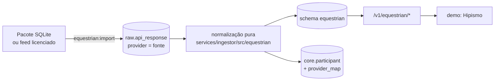

# 13 · Hipismo (esportes equestres)

> Pesquisa de fontes, cobertura e licenças: [research/hipismo-fontes.md](research/hipismo-fontes.md). Issue #140.

## 1. Por que e o que entra

Hipismo é estratégico na América Latina:
- Brasil e Argentina têm atletas no topo do circuito internacional.
- O público de TV paga e streaming que acompanha a modalidade tem alto poder de compra.

A api-sports não cobre o esporte, e nenhum provedor comercial grande tem hipismo verificável. Por isso o hipismo entra como **esporte próprio**: schema `equestrian`, API `/v1/equestrian/*` e seção na demo.

**O que está implementado:**
- **Saltos com atletas de Argentina, Brasil, Chile e Uruguai:**
  - perfis de atletas e cavalos;
  - histórico de classificações;
  - provas com nível, altura, artigo e julgamento;
  - classificações completas onde foram lidas;
  - rodadas documentadas de Atenas 2004 e Jerez 2002;
  - equipes;
  - rankings observados;
  - divergências entre fontes.
- **No modelo, sem dado real ainda:** Adestramento, CCE (Eventing), Enduro e Rédeas, que são valores de `discipline`.
- **Destaque na demo:** atletas da América do Sul. Lucas Werthein (ARG) fica fixo nos destaques, a pedido editorial.

## 2. Fonte de dados

**Não existe fonte gratuita e licenciada para revenda.**
- A FEI é dona dos dados de todo evento internacional (Regulamento Geral 2026, Art. 133).
- LGCT e Equipe proíbem reutilizar os dados.
- CBH e FEA só publicam PDFs.

Detalhes em [research/hipismo-fontes.md](research/hipismo-fontes.md).

**Base em uso (decisão do dono do produto, 23/10/2026): pacote "FEI V3"**, um SQLite consolidado (schema versão 8) que o usuário entregou.
- **Conteúdo:** 12.889 classificações gerais, 74 atletas da consulta (60 com histórico completo), 1.186 cavalos (548 com ficha), 9.228 provas referenciadas (10 com classificação completa), 60 observações de rodadas, 37 equipes, 22 posições de ranking e 8+1 divergências.
- **Coleta da maior parte:** leitura das páginas públicas do data.fei.org no navegador do usuário, sem contornar bloqueios e sem guardar token, cookie ou senha.
- **Jerez 2002:** documento oficial público da FEI (PDF digitalizado, transcrito página a página).
- **Atenas 2004:** relatório oficial preservado na LA84.
- **Licença:** os dados continuam sendo da FEI. O lote entra com `license = fei_public_pages_unlicensed`.
- **Uso:** o hipismo fica **fora da oferta comercial** e **fora das listagens do catálogo** (§5). Toda resposta traz o aviso `notice`, e a demo mostra o selo correspondente.

**Caminho de produção (a contratar):**

| Caminho | O que dá | Condição |
|---|---|---|
| **Licença FEI** | Resultados oficiais de todo evento internacional, cavalos, atletas e Longines Ranking | Contrato com o Departamento Comercial (broadcast@fei.org) |
| **Licença FEA / CBH** | Concursos e rankings nacionais da Argentina e do Brasil | Contrato com cada federação |
| **Dados enviados pelos próprios atletas** | Resultados, cavalos e fotos de atletas em destaque | Autorização do atleta ou da equipe |
| **Provedor licenciado** | Feed pronto | Contrato com cláusula de redistribuição e evidência de licença da fonte original |
| **Longines / Swiss Timing, Equipe B2B** | Ao vivo das provas Longines; resultados do Equipe | Contrato |

**Fora de questão:**
- contornar o anti-robô da FEI, direta ou indiretamente (inclusive serviços de raspagem que fazem esse bypass);
- usar endpoints não documentados de qualquer fonte (ver [research/hipismo-fontes.md](research/hipismo-fontes.md) §3).

## 3. Arquitetura e importação



```bash
pnpm --filter @galaxie/ingestor equestrian:import --sqlite <fei-campeonatos-v3.sqlite>
pnpm --filter @galaxie/ingestor equestrian:import --from-raw <sha256 do pacote>   # renormaliza só a partir do raw
```

- **Raw store:**
  - Cada tabela do pacote vira páginas de 2.000 linhas em `raw.api_response` (`provider` = fonte, `endpoint` = `sqlite/<tabela>`, `params.package_sha256`).
  - O mesmo pacote não grava nada de novo.
  - A normalização sempre lê do raw.
- **Normalização** (`normalize.ts`): funções puras, sem I/O, com testes unitários.
  - Converte só o que é explícito: datas `dd/mm/aaaa`, números publicados, status FEI (EL, RET, WD, DSQ, NS).
  - Deriva nível e estrelas de `CSI3*`, e o julgamento (desempate, duas fases, duas voltas, Tabela C) do texto do artigo.
  - Decodifica entidades HTML deixadas pela fonte.
  - A mesma classificação vista no histórico do atleta e na lista completa da prova vira **uma** linha: o prêmio e as células das rodadas da lista completa são mesclados.
  - A classificação final de Atenas/Jerez usa a mesma prova do histórico (chave do campeonato em `show_key`) e não duplica o conjunto já registrado.
  - Cavalos que só aparecem em resultados entram como `pending` (sem ficha). Nomes parecidos nunca são fundidos.
- **Persistência** (`persist.ts`): upsert idempotente.
  - Atleta e cavalo pelo ID FEI; o resto por `(source, source_key)`.
  - `null` nunca apaga um valor conhecido (coalesce).
  - Ficha `detailed` nunca volta a `pending`.
  - Cada atleta ganha um `core.participant` (`sport = equestrian`, `kind = athlete`) e uma linha em `core.provider_map` (`fei`), criados uma única vez.
- **Auditoria:** cada carga registra `equestrian.import_run` com fonte, licença, sha256, versão do schema do pacote e contagens.

## 4. Modelo de dados (schema `equestrian`, migration `0020_equestrian`)

Regras que o modelo garante:
1. **Classificação geral e rodada são registros distintos.** `result` guarda a classificação geral. `round` guarda observações de etapa, que podem ser eliminação ou não largada.
2. **Ausente não é zero.** Colunas numéricas ficam `null` quando a fonte não publica, e o valor bruto fica em `*_raw` ou `score_raw`.
3. **Toda linha guarda a fonte** (`source`, `source_url`, `observed_at`, `import_run_id`). **Divergências** ficam em `source_disagreement`, com os dois valores e a página de cada documento, sem correção.

| Tabela | Conteúdo |
|---|---|
| `athlete` | Cavaleiro/amazona. Campos: ID FEI, nome publicado e de exibição, gênero, nascimento, nacionalidade, representação atual, `history_coverage` (`complete`, `partial`, `not_collected`), total exibido pela fonte e `participant_id` no core |
| `horse` | Cavalo. Campos: ID FEI, nome e variantes, nascimento, sexo (`mare`, `stallion`, `gelding`), castrado, pelagem, raça, stud book, criador, pai, mãe, avô materno, país de nascimento, federação e `profile_status` (`detailed`, `pending`) |
| `horse_owner` | Proprietários publicados na ficha, com "desde" e percentual quando houver, sem inferir data de fim |
| `competition` | Prova. Campos: nível (`CSI2*`, `Olympic Games-S`…), estrelas, família do nível, data, local, país, altura, artigo (código e texto), julgamento, GP, agrupamento do concurso, premiação, conjuntos exibidos/lidos e `all_entries_observed` |
| `result` | Classificação geral. Campos: posição e bruto, status, `score_raw`, faltas e tempo só quando o placar é explícito, partes do placar, células por rodada da lista completa, subtotais publicados (Jerez), prêmio, país e critério do país (`country_basis`) e `quality_flags` |
| `round` | Rodada documentada. Campos: campeonato, etapa, data e precisão da data, faltas de obstáculos e de tempo, pontuação e o significado dela (`score_semantics`), página do PDF e sha256 do documento |
| `team_result` | Classificação por equipes com os membros, mais a conferência aritmética publicada x recalculada |
| `ranking_observation` | Posição observada num ranking. A edição fica `null` quando a fonte não a mostra |
| `source_disagreement` | Divergência entre fontes, com cada valor, fonte e página |
| `import_run` | Cargas |

Encaixe no multi-esporte:
- `core.sport` ganha `equestrian`, e cada atleta é um `core.participant` com `provider_map`.
- O histórico **não** vira `core.event`: são provas encerradas, sem agenda nem estado ao vivo.
- Quando houver feed licenciado com agenda, as provas futuras entram como `core.event` (status e ao vivo), ligadas a `equestrian.competition`.

## 5. API (`/v1/equestrian`)

Módulo `core_data`. Contratos Zod em `packages/contracts/src/equestrian.ts`; OpenAPI com a tag "Hipismo".

| Rota | Descrição |
|---|---|
| `GET /v1/equestrian/overview` | Cobertura (atletas por tipo de histórico, por país, cavalos com ficha, provas com classificação completa), destaques sul-americanos, provas recentes com conjuntos da região, campeonatos com rodadas e rankings observados |
| `GET /v1/equestrian/athletes?country=&q=&coverage=` | Busca por nome ou ID FEI, país (representação atual) e cobertura do histórico |
| `GET /v1/equestrian/athletes/{id}` | Perfil, cobertura (com a nota no idioma pedido), estatísticas, resultados por ano, prêmios por moeda, cavalos, rankings, campeonatos e divergências |
| `GET /v1/equestrian/results?athlete=&horse=&competition=&country=&event_country=&from=&to=&level=&status=&podium=` | Histórico de classificações, do mais recente ao mais antigo, com cursor |
| `GET /v1/equestrian/horses?q=&detailed=` · `GET /v1/equestrian/horses/{id}` | Cavalos; ficha, proprietários, cavaleiros e rankings |
| `GET /v1/equestrian/competitions?from=&to=&country=&level=&full=&latam=` · `GET /v1/equestrian/competitions/{id}` | Provas; classificação com o selo de completude |
| `GET /v1/equestrian/championships/{key}` | Rodadas por etapa (em ordem cronológica), equipes e divergências (`athens_2004_jumping`, `jerez_2002_jumping`) |
| `GET /v1/equestrian/rankings` | Posições observadas |

- Toda resposta de detalhe traz `notice` (licença, `commercial: false` e o texto do aviso) e `source`.
- `equestrian` fica fora de `/v1/sports`, `/v1/navigation`, `/v1/explore/summary` e da busca global (`apps/api/src/off-catalog.ts`): o esporte não faz parte do catálogo comercial.

## 6. Demo

- **Sidebar:** item "Hipismo", com ícone animado (Lottie `horse.json` assado para `equestrian`) e `Award` como ícone estático de fallback.
- **`/hipismo`:**
  - aviso de licenciamento ("Fora da oferta comercial");
  - destaques da América do Sul, com Lucas Werthein fixo;
  - busca de atletas;
  - provas recentes com conjuntos da região;
  - campeonatos com rodadas documentadas;
  - cobertura da base;
  - rankings observados.
- **`/hipismo/atletas`:** busca com filtros por país e cobertura.
- **`/hipismo/atletas/[id]`:**
  - perfil e nota de cobertura do histórico;
  - estatísticas, cavalos e prêmios publicados;
  - histórico com filtros de período, cavalo e "só pódios";
  - rodadas documentadas, rankings e divergências.
- **`/hipismo/cavalos/[id]`:** ficha (raça, idade, pedigree, criador), proprietários, cavaleiros, resultados e rankings.
- **`/hipismo/provas/[id]`:** dados da prova e classificação. Mostra faltas e tempo quando o placar é explícito e, quando não, as células das rodadas como publicadas. Conjuntos sul-americanos ficam destacados, e há um selo de completude.
- **`/hipismo/campeonatos/[key]`:** rodadas por etapa com o significado da pontuação, equipes com a conferência aritmética e divergências.
- **Em toda seção:** o botão "Ver código" com a chamada da API, links "Fonte" com data de leitura e página do PDF, e "não publicado" no lugar de zero.

## 7. Próximos passos

- Contratar a fonte de produção (§2) e trocar a importação sem mexer na API nem na demo.
- Completar o histórico dos 14 atletas com cobertura parcial e as fichas dos cavalos pendentes.
- Decompor os placares de múltiplas rodadas por artigo (hoje ficam brutos).
- Adestramento, CCE e Enduro com dado real; ao vivo quando houver feed.
