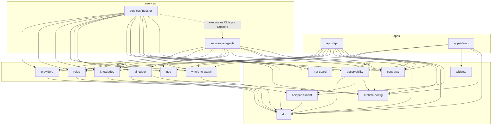

# 15 · Organização do monorepo

Este documento é o mapa do repositório: o que mora em cada pasta, quem depende de quem, o que vira imagem na VPS e
onde as fronteiras estão confusas hoje. Ele **não** move nada; as mudanças sugeridas no fim dependem de decisão.

> Levantamento de 30/10/2026, a partir do `main` em `a1b71ee`.

## 1. Por que um monorepo

O time é pequeno, o deploy é um só (uma VPS, uma stack Docker) e quase toda entrega mexe em mais de uma parte ao mesmo
tempo: uma coluna nova no banco aparece no ingestor, na API e na demo. No monorepo isso sai num PR, com um CI e uma
versão. Separar em repositórios só compensa quando uma parte ganha dono, ritmo de release ou consumidor próprio (seção 6).

O que faltava era fronteira escrita. Por isso cada pasta principal tem agora um `README.md` dizendo o que faz, como roda
e do que depende.

## 2. Mapa

| Pasta | Tipo | Pacote | O que é | Vira imagem? |
|---|---|---|---|---|
| [`apps/api`](../apps/api/README.md) | app | `@galaxie/api` | API pública Fastify: `/mirror`, `/v1`, SSE, webhooks, admin | `galaxie-sports-api` |
| [`apps/demo`](../apps/demo/README.md) | app | `@galaxie/demo` | Next.js: site, demo, portal do cliente, Builder, painel de operação | `galaxie-sports-demo` |
| [`services/ingestor`](../services/ingestor/README.md) | serviço | `@galaxie/ingestor` | Scheduler e CLIs de bootstrap, sync, ao vivo, normalização e assets | `galaxie-sports-ingestor` |
| [`services/ai-agents`](../services/ai-agents/README.md) | serviço | `@galaxie/ai-agents` | Agentes de IA (onde assistir, cenário, resumo, curadoria, vídeos, grades) | dentro da imagem do ingestor |
| [`packages/db`](../packages/db/README.md) | lib | `@galaxie/db` | Schema Drizzle, migrations e cliente do Postgres | — |
| [`packages/apisports-client`](../packages/apisports-client/README.md) | lib | `@galaxie/apisports-client` | Único ponto de saída para a api-sports (raw, cota, plano) | — |
| [`packages/providers`](../packages/providers/README.md) | lib | `@galaxie/providers` | Interface de provedor, modelo neutro, máquina de estados do evento | — |
| [`packages/contracts`](../packages/contracts/README.md) | lib | `@galaxie/contracts` | DTOs Zod → OpenAPI e cliente tipado da API | — |
| [`packages/rules`](../packages/rules/README.md) | lib | `@galaxie/rules` | Tabelas calculadas e "o que está em jogo" | — |
| [`packages/knowledge`](../packages/knowledge/README.md) | lib | `@galaxie/knowledge` | Base semântica: validação, seed, clássicos, copy | — |
| [`packages/where-to-watch`](../packages/where-to-watch/README.md) | lib | `@galaxie/where-to-watch` | Emissoras, direitos e validador do onde assistir | — |
| [`packages/geo`](../packages/geo/README.md) | lib | `@galaxie/geo` | Confederações, países e escopo das competições | — |
| [`packages/runtime-config`](../packages/runtime-config/README.md) | lib | `@galaxie/runtime-config` | Flags da operação (banco > env > padrão) | — |
| [`packages/ai-ledger`](../packages/ai-ledger/README.md) | lib | `@galaxie/ai-ledger` | Orçamento diário de IA em tokens e US$ | — |
| [`packages/observability`](../packages/observability/README.md) | lib | `@galaxie/observability` | Logger pino e métricas Prometheus | — |
| [`packages/net-guard`](../packages/net-guard/README.md) | lib | `@galaxie/net-guard` | Proteção contra SSRF nas buscas de URLs de terceiros | — |
| [`packages/widgets`](../packages/widgets/README.md) | lib | `@galaxie/widgets` | Widgets React, item de registry shadcn e embed HTML | servida pela demo |
| [`config/`](../config/README.md) | dados | — | YAML de operação: competições, direitos, emissoras, regras, planos | copiada nas imagens |
| [`data/knowledge`](../data/knowledge/SCHEMA.md) | dados | — | Base semântica versionada (times, clássicos, copy) | copiada nas imagens |
| [`infra/`](../infra/README.md) | infra | — | Compose local, stack da VPS, backup, observabilidade, scripts de operação | várias |
| `scripts/pwsh` | ferramenta | — | PowerShell de apoio (status da cota, cópia de assets) | — |
| [`tests/load`](../tests/load/README.md) | testes | — | Cenários k6 | — |
| `docs/` | docs | — | Documentação de produto, arquitetura, runbooks e pesquisas | — |

## 3. Quem depende de quem

Regras que o grafo já segue e que valem manter:

1. **Apps e serviços não importam uns aos outros.** Código compartilhado vai para `packages/`.
2. **`packages/` não importa `apps/` nem `services/`.**
3. **Toda chamada à api-sports passa pelo `@galaxie/apisports-client`** (CONTRIBUTING, regra 1).
4. **`contracts`, `net-guard`, `geo`, `runtime-config` e `widgets` não dependem de nenhum outro pacote do repo.** São os
   mais fáceis de reaproveitar fora daqui.
5. **O banco tem um dono de schema**: `packages/db`. Tabela nova entra por migration Drizzle.

## 4. O que roda onde

| Imagem (GHCR) | Feita de | Serviços na stack da VPS que o deploy usa (`infra/vps-telemetry/compose.yml`) |
|---|---|---|
| `galaxie-sports-api` | `apps/api/Dockerfile` | `api`, `api-candidate` (perfil `candidate` do deploy), `migrate` |
| `galaxie-sports-ingestor` | `services/ingestor/Dockerfile` (leva o `ai-agents` junto) | `ingestor` (`SCHEDULER_PROFILE=ingestor`), `agents` (`SCHEDULER_PROFILE=agents`) |
| `galaxie-sports-demo` | `apps/demo/Dockerfile` | `demo`, `demo-candidate` |
| `galaxie-sports-lineup-render` | `infra/lineup-render` (fora do workspace pnpm) | `lineup-render` |
| `galaxie-sports-backup` | `infra/backup` | `backup` |
| `galaxie-sports-prometheus` / `-grafana` | `infra/observability` | `prometheus`, `grafana` |
| `galaxie-sports-caddy` | `infra/caddy` | só na stack do Portainer; na VPS o `maintenance` usa o Caddy oficial |

O build e o push estão em `.github/workflows/docker.yml`; o deploy por SSH em `.github/workflows/deploy.yml`
(passo a passo em [runbooks/deploy-pelo-github.md](runbooks/deploy-pelo-github.md)).

## 5. Fronteiras confusas hoje

Nada aqui está quebrado; são pontos onde quem chega ao repo tropeça ou onde uma mudança pequena tem efeito longe.

| # | Onde | O que confunde | Sugestão |
|---|---|---|---|
| F1 | `apps/demo` | O README e a doc dizem que a demo "consome **somente** a API", mas ela também lê e grava no Postgres: `@galaxie/db` (grades, vídeos relacionados, widgets do Builder), o schema próprio `demo_auth` (login, convites, cache do change feed) e as tabelas de `ops` no painel de operação. | Assumir por escrito que a demo é também o **console de operação**, e manter a regra "nada de dado esportivo direto do banco: isso vem da API". Ver o README da demo. |
| F2 | `apps/demo` | O nome "demo" esconde que a mesma app é o site público, o portal do cliente, o Builder de widgets, a documentação e os ajustes da operação. | Renomear não vale o custo agora. Se um dia o site público ou o portal do cliente precisarem de deploy separado, essa é a primeira divisão. |
| F3 | `apps/demo` | O schema `demo_auth` é criado em tempo de execução (`src/lib/auth/setup.ts`), fora das migrations do `packages/db`. | Levar para uma migration Drizzle quando mexer no login de novo, para o banco ter um dono só. |
| F4 | `services/ingestor` × `services/ai-agents` | O scheduler do ingestor roda os CLIs dos agentes pelo caminho `../ai-agents` (`src/scheduler/schedule.ts`) e a imagem do ingestor empacota os dois. A dependência existe mas não aparece no `package.json`. A regra de "sem crédito na IA" também está duplicada (`scheduler/ai-credit.ts` repete `ai-agents/src/llm/errors.ts`). | Documentado nos dois READMEs. Quando mexer de novo, mover a classificação de erro para `@galaxie/ai-ledger` e importar dos dois lados. |
| F5 | `infra/portainer` × `infra/vps-telemetry` | Há duas stacks. A que está em produção é a `vps-telemetry` (Traefik, deploy pelo Actions); a do Portainer (Caddy) é a primeira staging e ficou como referência. O nome `vps-telemetry` é o nome da máquina, não do papel. | Ver `infra/README.md`. Decidir se a stack do Portainer ainda serve; se não, arquivar. |
| F6 | `apps/api/dump.rdb` | Um dump do Redis/Valkey está versionado dentro da API (foi gerado por um `valkey` local rodando nessa pasta). | Remover e pôr `dump.rdb` no `.gitignore` (precisa de OK, por isso não foi feito aqui). |
| F7 | Configuração | Os pacotes acham `config/` e `data/` por caminho relativo à pasta do pacote (`../../config`), e as imagens recriam esse layout em `/srv`. Mover uma pasta quebra em silêncio em produção. | A maior parte aceita uma variável (`RULES_CONFIG_DIR`, `WTW_CONFIG_DIR`, `GEO_CONFIG_DIR`, `AI_POLICY_FILE`; `KNOWLEDGE_DIR` e `MEDIA_DENYLIST_PATH` só na API), listadas em `config/README.md`. Os CLIs do `knowledge` e o `assets:mirror` só aceitam opção de linha de comando (`--dir`, `--denylist`); vale padronizar quando mexer neles. |
| F8 | `services/ingestor` | O pacote cresceu para mais de 50 CLIs: além da ingestão da api-sports, faz Wikidata, Wikimedia Commons, F1DB, hipismo, acervo de logos e qualidade. | Agrupar os CLIs por área no README (feito). Se o acervo de imagens ganhar ritmo próprio, ele é candidato a um serviço `services/assets`. |
| F9 | `apps/api` (webhooks) | O worker de entrega dos webhooks (`pnpm --filter @galaxie/api webhooks:worker`) não tem serviço em nenhuma das duas stacks. Na VPS, nenhum webhook é enfileirado nem entregue hoje. | Confirmar se é intencional (nenhum cliente com webhook ainda) e, quando houver, adicionar um serviço `webhooks` com a imagem da API. |
| F10 | `README.md` e `CONTRIBUTING.md` | A seção de estrutura dizia que a demo estava "a criar" e a tabela de organização não tinha `ai-ledger`, `net-guard`, `runtime-config`, `widgets` nem a demo. | Corrigido junto com este documento. |

## 6. Candidatos a repositório próprio

Nenhum precisa sair agora. A ordem abaixo é a de quem ganharia mais com um repo separado, e o gatilho é o que faria
valer a pena.

| Candidato | Por quê | Gatilho | Custo de sair |
|---|---|---|---|
| **SDK público** (`@galaxie/contracts` + `createGalaxieClient`) | É o que o cliente instala. Já não depende de nenhum outro pacote do repo, e os tipos saem do mesmo Zod que gera o OpenAPI. | Primeiro cliente integrando por código, ou pedido de SDK em outra linguagem. | Baixo. Publicar do monorepo no npm já resolve a maior parte; um repo próprio ajuda quando houver issues e changelog voltados ao cliente. |
| **Widgets** (`@galaxie/widgets`) | Também é instalado pelo cliente (`npx shadcn add`, `<galaxie-widget>`), só depende de React e já tem build próprio do embed. | Cliente instalando widget fora da demo, com versão própria. | Baixo. Mesmo caminho do SDK; os dois podem morar juntos num repo `galaxie-sdk`. |
| **Base semântica** (`data/knowledge` + `@galaxie/knowledge`) | É conteúdo editorial, revisado por pessoas, com ritmo diferente do código. | Alguém de fora do time de código editando a base, ou licenciamento da base separado da API. | Médio. O seed e a resolução de IDs leem o banco; o pacote teria que virar dependência versionada. |
| **`net-guard`** | Utilitário genérico de segurança, sem nada do domínio. | Uso em outro projeto da Galaxie Works. | Baixo, mas o ganho também é baixo. |
| **Infra da VPS** (`infra/vps-telemetry`, `infra/traefik`) | O Traefik já serve outras stacks da VPS além do Galaxie Sports. | Outra stack da VPS precisando mudar o Traefik sem passar por este repo. | Médio. O deploy pelo Actions usa scripts de lá no SHA do deploy. |

O que **não** deve sair: `apps/api`, `services/*`, `packages/db` e os pacotes de domínio (`providers`, `rules`,
`where-to-watch`, `geo`, `ai-ledger`, `runtime-config`, `observability`, `apisports-client`). Eles mudam juntos quase
sempre, e separar traria versionamento cruzado sem ganho.
