# 15 · Organização do monorepo

Este documento é o mapa do repositório: o que mora em cada pasta, quem depende de quem, o que vira imagem na VPS e
onde as fronteiras estão confusas hoje. Ele **não** move nada; as mudanças sugeridas no fim dependem de decisão.

> Levantamento de 30/10/2026, a partir do `main` em `a1b71ee`. O mapa da seção 3 e as regras de dependência passaram a ser
> geradas e cobradas pelo CI em 02/11/2026 (#547).

## 1. Por que um monorepo

O time é pequeno, o deploy é um só (uma VPS, uma stack Docker) e quase toda entrega mexe em mais de uma parte ao mesmo
tempo: uma coluna nova no banco aparece no ingestor, na API e na demo. No monorepo isso sai num PR, com um CI e uma
versão. Separar em repositórios só compensa quando uma parte ganha dono, ritmo de release ou consumidor próprio (seção 6).

O que faltava era fronteira escrita. Por isso cada pasta principal tem agora um `README.md` dizendo o que faz, como roda
e do que depende.

## 2. Mapa

| Pasta | Tipo | Pacote | O que é | Vira imagem? |
|---|---|---|---|---|
| [`apps/api`](../apps/api/README.md) | app | `@galaxie/api` | API pública Fastify: `/mirror`, `/v1`, SSE, webhooks, admin | `galaxie-sports-api` |
| [`apps/demo`](../apps/demo/README.md) | app | `@galaxie/demo` | Next.js: site, demo, portal do cliente, Builder, painel de operação | `galaxie-sports-demo` |
| [`services/ingestor`](../services/ingestor/README.md) | serviço | `@galaxie/ingestor` | Scheduler e CLIs de bootstrap, sync, ao vivo, normalização e assets | `galaxie-sports-ingestor` |
| [`services/ai-agents`](../services/ai-agents/README.md) | serviço | `@galaxie/ai-agents` | Agentes de IA (onde assistir, cenário, resumo, curadoria, vídeos, grades) e o scheduler deles (`dist/cli/agents-scheduler.js`) | dentro da imagem do ingestor |
| [`packages/db`](../packages/db/README.md) | lib | `@galaxie/db` | Schema Drizzle, migrations e cliente do Postgres | — |
| [`packages/apisports-client`](../packages/apisports-client/README.md) | lib | `@galaxie/apisports-client` | Único ponto de saída para a api-sports (raw, cota, plano) | — |
| [`packages/providers`](../packages/providers/README.md) | lib | `@galaxie/providers` | Interface de provedor, modelo neutro, máquina de estados do evento | — |
| [`packages/contracts`](../packages/contracts/README.md) | lib | `@galaxie/contracts` | DTOs Zod → OpenAPI e cliente tipado da API | — |
| [`packages/rules`](../packages/rules/README.md) | lib | `@galaxie/rules` | Tabelas calculadas e "o que está em jogo" | — |
| [`packages/knowledge`](../packages/knowledge/README.md) | lib | `@galaxie/knowledge` | Base semântica: validação, seed, clássicos, copy | — |
| [`packages/where-to-watch`](../packages/where-to-watch/README.md) | lib | `@galaxie/where-to-watch` | Emissoras, direitos e validador do onde assistir | — |
| [`packages/geo`](../packages/geo/README.md) | lib | `@galaxie/geo` | Confederações, países e escopo das competições | — |
| [`packages/runtime-config`](../packages/runtime-config/README.md) | lib | `@galaxie/runtime-config` | Flags da operação (banco > env > padrão) | — |
| [`packages/ai-ledger`](../packages/ai-ledger/README.md) | lib | `@galaxie/ai-ledger` | Orçamento diário de IA em tokens e US$ | — |
| [`packages/scheduler`](../packages/scheduler/README.md) | lib | `@galaxie/scheduler` | Motor de agendamento do ingestor e dos agentes (cron em UTC, um processo por job, trava, catch-up) | — |
| [`packages/core-writer`](../packages/core-writer/README.md) | lib | `@galaxie/core-writer` | Grava o lote neutro dos provedores no core (`upsertBatch`), com a máquina de estados do evento, a importância e a junção do jogo provisório | — |
| [`packages/observability`](../packages/observability/README.md) | lib | `@galaxie/observability` | Logger pino e métricas Prometheus | — |
| [`packages/net-guard`](../packages/net-guard/README.md) | lib | `@galaxie/net-guard` | Proteção contra SSRF nas buscas de URLs de terceiros | — |
| [`packages/widgets`](../packages/widgets/README.md) | lib | `@galaxie/widgets` | Widgets React, item de registry shadcn e embed HTML | servida pela demo |
| [`config/`](../config/README.md) | dados | — | YAML de operação: competições, direitos, emissoras, regras, planos | copiada nas imagens |
| [`data/knowledge`](../data/knowledge/SCHEMA.md) | dados | — | Base semântica versionada (times, clássicos, copy) | copiada nas imagens |
| [`infra/`](../infra/README.md) | infra | — | Compose local, stack da VPS, backup, observabilidade, scripts de operação | várias |
| [`tests/integration`](../tests/integration/README.md) | testes | `@galaxie/integration-tests` | Integração que cruza API e ingestor (o ingestor semeia o core, a API serve) | — |
| [`tests/load`](../tests/load/README.md) | testes | — | Cenários k6 | — |
| `docs/` | docs | — | Documentação de produto, arquitetura, runbooks e pesquisas | — |

## 3. Quem depende de quem

O mapa abaixo **é gerado** pela mesma ferramenta que cobra as regras no CI ([dependency-cruiser](https://github.com/sverweij/dependency-cruiser),
configurada em [`scripts/deps`](../scripts/deps)): uma seta por par de pacotes em que o código de produção de um importa
o outro (testes ficam de fora do desenho, mas entram nas regras). Não edite à mão:

```bash
pnpm deps:map     # reescreve o mapa e a tabela de regras abaixo; commite o resultado
pnpm lint:deps    # o que o CI roda: reprova violação de regra e mapa desatualizado
```

```mermaid
flowchart TB
  subgraph apps
    apps_api[apps/api]
    apps_demo[apps/demo]
  end
  subgraph services
    services_ai_agents[services/ai-agents]
    services_ingestor[services/ingestor]
  end
  subgraph domínio
    packages_ai_ledger[ai-ledger]
    packages_core_writer[core-writer]
    packages_explore[explore]
    packages_geo[geo]
    packages_knowledge[knowledge]
    packages_providers[providers]
    packages_rules[rules]
    packages_where_to_watch[where-to-watch]
  end
  subgraph base
    packages_apisports_client[apisports-client]
    packages_contracts[contracts]
    packages_db[db]
    packages_net_guard[net-guard]
    packages_observability[observability]
    packages_runtime_config[runtime-config]
    packages_scheduler[scheduler]
  end
  subgraph interface
    packages_widgets[widgets]
  end
  subgraph testes
    tests_integration[tests/integration]
  end

  apps_api --> packages_apisports_client & packages_contracts & packages_db & packages_explore & packages_geo & packages_knowledge & packages_observability & packages_providers & packages_rules & packages_runtime_config & packages_where_to_watch
  apps_demo --> packages_contracts & packages_db & packages_runtime_config & packages_where_to_watch & packages_widgets
  packages_ai_ledger --> packages_db & packages_runtime_config
  packages_apisports_client --> packages_db
  packages_core_writer --> packages_apisports_client & packages_db & packages_knowledge & packages_observability & packages_providers & packages_rules
  packages_explore --> packages_contracts & packages_db & packages_geo & packages_providers
  packages_knowledge --> packages_db
  packages_observability --> packages_apisports_client & packages_db & packages_runtime_config
  packages_providers --> packages_apisports_client
  packages_rules --> packages_db
  packages_scheduler --> packages_db & packages_observability & packages_runtime_config
  packages_where_to_watch --> packages_db
  packages_widgets --> packages_contracts
  services_ai_agents --> packages_ai_ledger & packages_contracts & packages_db & packages_geo & packages_knowledge & packages_net_guard & packages_observability & packages_providers & packages_rules & packages_runtime_config & packages_scheduler & packages_where_to_watch
  services_ingestor --> packages_ai_ledger & packages_apisports_client & packages_contracts & packages_core_writer & packages_db & packages_explore & packages_geo & packages_knowledge & packages_net_guard & packages_observability & packages_providers & packages_rules & packages_runtime_config & packages_scheduler & packages_where_to_watch
```

<!-- deps-map:start — gerado por `pnpm deps:map`; não edite à mão -->

<!-- deps-map:end -->

As camadas vêm de `scripts/deps/rules.mjs`: **app** (`apps/*`), **serviço** (`services/*`), **domínio**
(`providers`, `rules`, `knowledge`, `where-to-watch`, `geo`, `ai-ledger`, `core-writer`), **base** (`db`, `contracts`, `observability`,
`runtime-config`, `net-guard`, `apisports-client`, `scheduler`) **interface** (`widgets`) e **testes** (`tests/integration`, a folha do grafo que cruza API e ingestor, #563). Pacote novo em `packages/`
precisa entrar numa delas, senão o `lint:deps` reprova.

O CI (`pnpm lint:deps`, passo "Regra de dependência" do job `checks`) cobra estas regras, e o PR que viola é reprovado com o
nome da regra:

<!-- deps-rules:start — gerado por `pnpm deps:map`; não edite à mão -->
| Regra | O que exige | Por quê |
|---|---|---|
| `app-nao-importa-app` | Um app não importa outro app. | Cada app vira uma imagem e um processo próprios; o que os dois precisam vai para packages/. |
| `app-nao-importa-servico` | Nenhum app (apps/*) importa serviço (services/*). | App e serviço sobem e caem separados: o app que importa o serviço leva o código dele junto na imagem. |
| `servico-nao-importa-servico` | Um serviço não importa outro serviço. | Serviços rodam em contêineres separados; o que é comum a dois serviços vai para packages/. |
| `pacote-nao-importa-app-nem-servico` | Nenhum pacote (packages/*) importa app ou serviço. | Pacote é a camada de baixo: se ele depende de quem o usa, o grafo vira um nó e o Turborepo perde o que isolar. |
| `ninguem-importa-teste` | Ninguém importa o pacote de testes de integração (tests/integration). | Ele é uma folha do grafo de propósito: depende da API e do ingestor, e nada depende dele, então não entra na imagem nem na entrada de nenhuma delas (#563). |
| `base-nao-importa-dominio` | Pacote de base não importa pacote de domínio. | A base (banco, contratos, logs, flags, SSRF, cliente da api-sports) é reaproveitável sem a regra de negócio; o domínio é quem a usa. |
| `so-o-apisports-client-fala-com-a-api-sports` | Só o pacote apisports-client fala com a api-sports. | Cota, raw, plano e limite por minuto vivem no cliente; chamada por fora gasta cota sem contar e sem guardar o raw. |
| `pacote-sem-camada` | Todo pacote de packages/ está numa camada. | Sem camada, as regras acima não sabem de que lado do pacote ficam; adicione-o a PACKAGE_LAYERS em scripts/deps/rules.mjs. |
<!-- deps-rules:end -->

Outras convenções do grafo, que a ferramenta ainda não cobra:

1. **`contracts`, `net-guard`, `geo` e `runtime-config` não dependem de nenhum outro pacote do repo** (`widgets` só do
   `contracts`). São os mais fáceis de reaproveitar fora daqui.
2. **O banco tem um dono de schema**: `packages/db`. Tabela nova entra por migration Drizzle.

**Exceções.** A lista de [`scripts/deps/exceptions.json`](../scripts/deps/exceptions.json) está vazia desde 03/11/2026 (#577):
quem precisar de uma exceção escreve a linha com o motivo, e a lista só encolhe (exceção que não cobre mais nada também reprova). Para adicionar uma regra ou
mudar uma camada, edite `scripts/deps/rules.mjs` e rode `pnpm deps:map`.

## 4. O que roda onde

| Imagem (GHCR) | Feita de | Serviços na stack da VPS (`infra/vps-telemetry/compose.yml`, o único que o deploy automático usa, salvo onde indicado) |
|---|---|---|
| `galaxie-sports-api` | `apps/api/Dockerfile` | `api`, `api-candidate` (perfil `candidate` do deploy), `migrate`, `webhooks` |
| `galaxie-sports-ingestor` | `services/ingestor/Dockerfile` (leva o `ai-agents` junto) | `ingestor` (`dist/cli/scheduler.js`), `agents` (`SCHEDULER_PROFILE=agents`: o `CMD` sobe o `dist/cli/agents-scheduler.js` do `ai-agents`) |
| `galaxie-sports-demo` | `apps/demo/Dockerfile` | `demo`, `demo-candidate` |
| `galaxie-sports-lineup-render` | `infra/lineup-render` (fora do workspace pnpm) | `lineup-render` |
| `galaxie-sports-backup` | `infra/backup` | `backup` (`compose.dados.yml`, só por runbook) |
| `galaxie-sports-prometheus` / `-grafana` | `infra/observability` | `prometheus`, `grafana` (`compose.obs.yml`, `deploy.yml -f project=obs`) |

O build e o push estão em `.github/workflows/docker.yml`; o deploy por SSH em `.github/workflows/deploy.yml`
(passo a passo em [runbooks/deploy-pelo-github.md](runbooks/deploy-pelo-github.md)). A página de manutenção da VPS usa o
Caddy oficial (imagem de terceiros, sem build nosso).

### Unidades de deploy

A stack da VPS se divide em sete unidades que sobem, caem e voltam de versão sozinhas (épico #558). O que cada uma roda, o
smoke dela, como voltar uma versão (`TAG_*` no `.env` ou `deploy.yml -f sha=<sha> -f force=1`) e com quem ela conversa estão
em [`infra/vps-telemetry/UNIDADES.md`](../infra/vps-telemetry/UNIDADES.md). Onde mora o código de cada uma:

| Unidade | Código e arquivos |
|---|---|
| [Borda](../infra/vps-telemetry/UNIDADES.md#borda) | [`infra/traefik`](../infra/traefik/README.md); `maintenance` no `compose.yml` |
| [Dados](../infra/vps-telemetry/UNIDADES.md#dados) | `compose.dados.yml`, [`infra/backup`](../infra/backup/README.md), [`packages/db`](../packages/db/README.md) (migrations) |
| [Observabilidade](../infra/vps-telemetry/UNIDADES.md#observabilidade) | `compose.obs.yml`, `infra/observability` |
| [API](../infra/vps-telemetry/UNIDADES.md#api) | [`apps/api`](../apps/api/README.md) (`api`, `webhooks`, `migrate`) |
| [Web](../infra/vps-telemetry/UNIDADES.md#web) | [`apps/demo`](../apps/demo/README.md) |
| [Ao vivo](../infra/vps-telemetry/UNIDADES.md#ao-vivo) | `live-run` em [`services/ingestor`](../services/ingestor/README.md) (serviço próprio em breve) |
| [Processamento](../infra/vps-telemetry/UNIDADES.md#processamento) | [`services/ingestor`](../services/ingestor/README.md), [`services/ai-agents`](../services/ai-agents/README.md), `infra/lineup-render` |

## 5. Fronteiras confusas hoje

Nada aqui está quebrado; são pontos onde quem chega ao repo tropeça ou onde uma mudança pequena tem efeito longe.

| # | Onde | O que confunde | Sugestão |
|---|---|---|---|
| F1 | `apps/demo` | O README e a doc dizem que a demo "consome **somente** a API", mas ela também lê e grava no Postgres: `@galaxie/db` (grades, vídeos relacionados, widgets do Builder), o schema próprio `demo_auth` (login, convites, cache do change feed) e as tabelas de `ops` no painel de operação. | Assumir por escrito que a demo é também o **console de operação**, e manter a regra "nada de dado esportivo direto do banco: isso vem da API". Ver o README da demo. |
| F2 | `apps/demo` | O nome "demo" esconde que a mesma app é o site público, o portal do cliente, o Builder de widgets, a documentação e os ajustes da operação. | Renomear não vale o custo agora. Se um dia o site público ou o portal do cliente precisarem de deploy separado, essa é a primeira divisão. |
| F3 | `apps/demo` | O schema `demo_auth` é criado em tempo de execução (`src/lib/auth/setup.ts`), fora das migrations do `packages/db`. | Levar para uma migration Drizzle quando mexer no login de novo, para o banco ter um dono só. |
| F4 | `services/ingestor` × `services/ai-agents` | **Resolvido em 02/11/2026 (#547)**: o motor do scheduler virou o pacote `@galaxie/scheduler`, e os agentes ganharam entrada própria (`dist/cli/agents-scheduler.js`, jobs em `src/scheduler/jobs.ts`); o ingestor não conhece mais o pacote deles. O que sobra: a imagem do ingestor ainda empacota os dois e o `CMD` escolhe a entrada pelo `SCHEDULER_PROFILE`, e a regra de "sem crédito na IA" segue duplicada (`packages/scheduler/src/ai-credit.ts` repete `ai-agents/src/llm/errors.ts`). | Quando a stack passar o `command` do serviço `agents`, o `CMD` volta a ser só o do ingestor. Mover a classificação de erro para `@galaxie/ai-ledger` e importar dos dois lados. |
| F5 | `infra/portainer` × `infra/vps-telemetry` | Havia duas stacks; a do Portainer (Caddy) era a primeira staging e não recebia mais as mudanças. | **Resolvido em 30/10/2026**: a stack do Portainer saiu e o backup/restore dela foi para `infra/backup/README.md`. A imagem do Caddy dela e o `build caddy` saíram em 03/11/2026 (#553). |
| F6 | `apps/api/dump.rdb` | Um dump do Redis/Valkey estava versionado dentro da API. | **Resolvido em 30/10/2026**: removido e `dump.rdb` no `.gitignore`. |
| F7 | Configuração | Os pacotes acham `config/` e `data/` por caminho relativo à pasta do pacote (`../../config`), e as imagens recriam esse layout em `/srv`. Mover uma pasta quebra em silêncio em produção. | A maior parte aceita uma variável (`RULES_CONFIG_DIR`, `WTW_CONFIG_DIR`, `GEO_CONFIG_DIR`, `AI_POLICY_FILE`; `KNOWLEDGE_DIR` e `MEDIA_DENYLIST_PATH` só na API), listadas em `config/README.md`. Os CLIs do `knowledge` e o `assets:mirror` só aceitam opção de linha de comando (`--dir`, `--denylist`); vale padronizar quando mexer neles. |
| F8 | `services/ingestor` | O pacote cresceu para mais de 50 CLIs: além da ingestão da api-sports, faz Wikidata, Wikimedia Commons, F1DB, hipismo, acervo de logos e qualidade. | Agrupar os CLIs por área no README (feito). Se o acervo de imagens ganhar ritmo próprio, ele é candidato a um serviço `services/assets`. |
| F9 | `apps/api` (webhooks) | O worker de entrega dos webhooks não tinha serviço na VPS: nenhum webhook era enfileirado nem entregue. | **Resolvido em 30/10/2026**: serviço `webhooks` na stack da VPS, com a imagem da API. |
| F10 | `README.md` e `CONTRIBUTING.md` | A seção de estrutura dizia que a demo estava "a criar" e a tabela de organização não tinha `ai-ledger`, `net-guard`, `runtime-config`, `widgets` nem a demo. | Corrigido junto com este documento. |

## 6. Candidatos a repositório próprio

Nenhum precisa sair agora. A ordem abaixo é a de quem ganharia mais com um repo separado, e o gatilho é o que faria
valer a pena.

| Candidato | Por quê | Gatilho | Custo de sair |
|---|---|---|---|
| **SDK público** (`@galaxie/contracts` + `createGalaxieClient`) | É o que o cliente instala. Já não depende de nenhum outro pacote do repo, e os tipos saem do mesmo Zod que gera o OpenAPI. | Primeiro cliente integrando por código, ou pedido de SDK em outra linguagem. | Baixo. Já sai do monorepo como pacote privado no GitHub Packages, para o app Expo; para o cliente, falta um registro público ou dar acesso a esse pacote; um repo próprio ajuda quando houver issues e changelog voltados ao cliente. |
| **Widgets** (`@galaxie/widgets`) | Também é instalado pelo cliente (`npx shadcn add`, `<galaxie-widget>`), só depende de React e já tem build próprio do embed. | Cliente instalando widget fora da demo, com versão própria. | Baixo. Mesmo caminho do SDK; os dois podem morar juntos num repo `galaxie-sdk`. |
| **Base semântica** (`data/knowledge` + `@galaxie/knowledge`) | É conteúdo editorial, revisado por pessoas, com ritmo diferente do código. | Alguém de fora do time de código editando a base, ou licenciamento da base separado da API. | Médio. O seed e a resolução de IDs leem o banco; o pacote teria que virar dependência versionada. |
| **`net-guard`** | Utilitário genérico de segurança, sem nada do domínio. | Uso em outro projeto da Galaxie Works. | Baixo, mas o ganho também é baixo. |
| **Infra da VPS** (`infra/vps-telemetry`, `infra/traefik`) | O Traefik já serve outras stacks da VPS além do Galaxie Sports. | Outra stack da VPS precisando mudar o Traefik sem passar por este repo. | Médio. O deploy pelo Actions usa scripts de lá no SHA do deploy. |

O que **não** deve sair: `apps/api`, `services/*`, `packages/db` e os pacotes de domínio (`providers`, `rules`,
`where-to-watch`, `geo`, `ai-ledger`, `runtime-config`, `observability`, `apisports-client`). Eles mudam juntos quase
sempre, e separar traria versionamento cruzado sem ganho.
