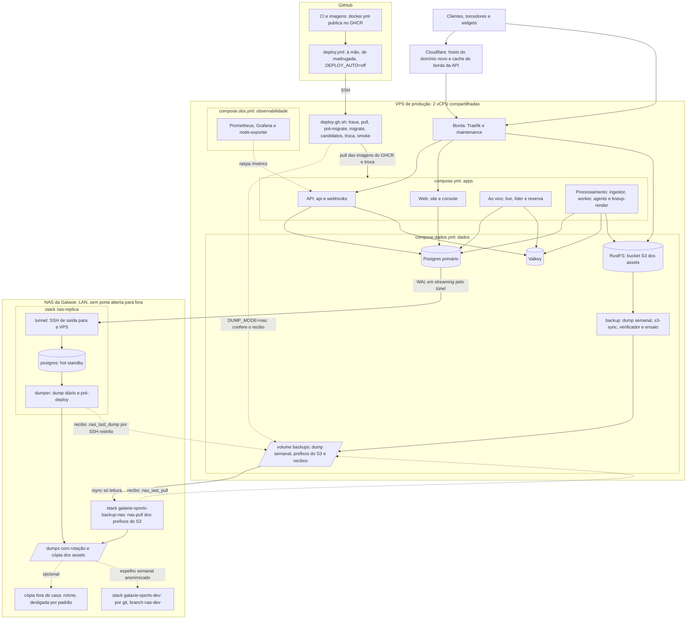

# 16 · Implantação

Onde cada parte do Galaxie Sports roda, quem depende de quem e as regras para publicar. Este desenho **substitui** o
anterior a partir de 17/11/2026 (épico #1304, issue #1313): o anterior tinha uma máquina só, com o backup nascendo
nela; no novo, o Postgres de produção tem uma réplica física em streaming no NAS e os dumps nascem lá. O desenho
anterior está em [Histórico (até 11/2026)](#histórico-até-112026).

> Os nomes do lado do NAS (stack `nas-replica` com `tunnel`, `postgres` e `dumper`; recibo `.nas_last_dump`;
> `DUMP_MODE=nas`) seguem o PR da réplica (#1306 a #1309). Se o PR mudar um nome, vale o do PR e este documento
> acompanha. O passo a passo da réplica fica no runbook `docs/runbooks/replica-no-nas.md`, que vem do #1311. O que já
> está no ar e o que falta: [Estado da troca](#7-estado-da-troca).

## 1. O desenho

As setas cheias são o caminho dos dados; as pontilhadas são conferência, recibo ou cópia opcional. Nenhuma seta sai
do NAS para servir tráfego: o NAS só recebe (WAL, prefixos do S3) e devolve recibos.

## 2. O que roda onde

| Onde | O quê | Como sobe | Detalhe |
|---|---|---|---|
| VPS, `/docker/traefik` | Traefik (TLS e roteamento por labels) | à mão | [infra/traefik](../infra/traefik/README.md) |
| VPS, `compose.yml` (apps) | `api`, `webhooks`, `site`, `console`, `live` (duas cópias), `ingestor`, `worker`, `agents`, `lineup-render`, `maintenance`, `migrate` e os candidatos do deploy (`api-candidate`, `site-candidate`, `console-candidate`) | `deploy.yml` | [UNIDADES.md](../infra/vps-telemetry/UNIDADES.md), [README da stack](../infra/vps-telemetry/README.md) |
| VPS, `compose.dados.yml` | Postgres **primário**, Valkey, RustFS (S3 dos assets), `backup` | só por runbook; a imagem do `backup` por `dados-backup.yml` | [Dados e observabilidade](runbooks/stack-dados-e-observabilidade.md) |
| VPS, `compose.obs.yml` | Prometheus, Grafana, node-exporter | `deploy.yml -f project=obs` | [Alertas e monitoramento](runbooks/alertas-e-monitoramento.md) |
| VPS, systemd | A carga (serviço `galaxie-carga`) | à mão | pausada em todo deploy (§5) |
| NAS, stack `nas-replica` | `tunnel` (SSH de saída que traz a porta do Postgres da VPS para o NAS), `postgres` em hot standby, `dumper` (dump diário e pré-deploy a partir da réplica, com rotação e recibo) | Portainer do NAS | `replica-no-nas.md` (#1311) |
| NAS, stack `galaxie-sports-backup-nas` | `nas-pull`: copia da VPS os prefixos do S3 (e, durante a transição, os dumps) | Portainer do NAS | [Exercício de DR › Cópia no NAS](runbooks/exercicio-dr.md#cópia-no-nas) |
| NAS, stack `galaxie-sports-dev` | O ambiente de **desenvolvimento**: Postgres, Valkey e RustFS do dev, `migrate` a cada commit, workers desligados por padrão, `espelho` semanal produção → dev | Portainer do NAS, **a partir do git** (branch `nas-dev`) | [Ambiente de dev](runbooks/ambiente-de-dev.md) |
| GitHub Actions | CI, imagens no GHCR, deploy por SSH, notas de versão | merge na `main` (imagens) e disparo à mão (deploy) | [Merge e deploy pelo GitHub](runbooks/deploy-pelo-github.md) |
| Cloudflare | Zona do domínio novo e o Worker de cache de borda da API (`api-edge-cache`, rota `/v1/*` do host novo da API) | à mão (wrangler) | [infra/cloudflare](../infra/cloudflare/README.md), #635, #1257 |

No NAS há **dois** Postgres, em stacks separadas: a réplica da produção (`nas-replica`, só leitura, ninguém escreve
nela) e o banco do dev (`galaxie-sports-dev`). O dev nunca lê a réplica: recebe o espelho semanal, anonimizado, a
partir dos dumps.

Como está hoje na Cloudflare: só os hosts do domínio novo passam por ela; os hosts atuais apontam direto para a VPS e
chegam ao Traefik sem borda na frente. A troca de domínio (#635) leva tudo para trás da Cloudflare.

## 3. Quem depende de quem

| Quem | Depende de | Se cair |
|---|---|---|
| API, Web, Ao vivo, Processamento | Postgres e Valkey da VPS; API e processamento também do RustFS | a unidade para; as outras seguem ([UNIDADES › Quem conversa com quem](../infra/vps-telemetry/UNIDADES.md#quem-conversa-com-quem)) |
| Borda (Traefik) | os contêineres com label | página de manutenção (`maintenance`) enquanto API, site ou console são recriados |
| Deploy | GitHub Actions, GHCR, SSH até a VPS e, com `DUMP_MODE=nas`, o recibo do dump do NAS em dia | sem Actions: plano B da máquina de dev; sem recibo em dia: o deploy com migration nova para antes de tocar em nada |
| Réplica no NAS | a VPS (túnel SSH de saída e o slot de replicação) | ressincroniza quando volta; enquanto isso o dump diário não nasce e o alerta do recibo avisa |
| Ambiente de dev | só o NAS (e os dumps, para o espelho semanal) | nada na produção muda |

**A produção não depende do NAS.** Se o NAS cair, a VPS segue igual: API, ao vivo e processamento não leem nem
escrevem nada nele. O que muda é só onde o backup nasce:

- O slot de replicação na VPS tem **teto** (`max_slot_wal_keep_size`): com o NAS fora por muito tempo, o Postgres
  abandona o slot em vez de encher o disco com WAL, e a réplica precisa de uma sincronização inteira de novo.
- O **dump semanal na VPS** continua (pior caso: NAS e disco da VPS perdidos na mesma semana).
- Deploy com migration nova e recibo do NAS atrasado não publica com `DUMP_MODE=nas`; a saída é esperar o NAS ou, com
  o OK do dono, publicar com `DUMP_MODE=vps` (o `pg_dump` volta a rodar na VPS, com o custo de CPU da §4).

## 4. Limites conhecidos

- **CPU por crédito do provedor.** A VPS tem 2 vCPU compartilhadas e um saldo de créditos de CPU. Algumas horas
  seguidas de uso alto esgotam o saldo, e o provedor corta a CPU para uma fração do total até o uso baixar; ele também
  limita a máquina por uso alto sustentado, e esse limite só sai sozinho depois de horas. Com o corte, o ao vivo para:
  foi assim em 13, 15 e 16/11/2026. O sinal é o `st` (steal) do `vmstat`, perto de 70 com o limite ativo. O que mais
  dispara o corte é processamento (normalização em massa, carga, `pg_dump`), não tráfego da API; por isso o dump saiu
  da VPS.
- **Separar contêineres não resolve.** As unidades já são processos separados, com `cpus` e `mem_limit` próprios; o
  corte é na máquina virtual, e todas dividem o que sobra. Separar mais o código não devolve CPU; outra máquina
  devolve (§6).
- **Disco da VPS.** Banco, volume do S3, dumps e imagens dividem o mesmo disco. Nos dias com vários dumps de
  pré-deploy o uso passou de 85% (o alerta `DiskAlmostFull`), e o banco ainda cresce com a carga: o dump pré-deploy no
  disco da VPS deixaria de caber. Com os dumps no NAS, na VPS fica só o semanal.
- **RAM** não é o gargalo hoje (cada serviço tem `mem_limit`; medidas em
  [README da stack › Limites medidos](../infra/vps-telemetry/README.md#limites-medidos-533)).
- **NAS** fica na LAN do escritório, atrás de um link doméstico: serve para réplica e backup, nunca para tráfego de
  produção.

## 5. Regras operacionais

1. **Um deploy por dia, de madrugada.** `DEPLOY_AUTO=off`: o deploy automático no merge não roda
   ([deploy pelo GitHub › Configurações a ligar](runbooks/deploy-pelo-github.md#configurações-a-ligar-passo-a-passo)).
   O deploy é disparado à mão (`gh workflow run deploy.yml`), no máximo um com migrations por dia, com as migrations
   do dia juntas num lote, e só com o `st` da VPS abaixo de 20%.
2. **`DUMP_MODE`.** Com `DUMP_MODE=nas` (o modo do desenho novo), o pré-migrate confere o atraso da réplica e o recibo
   `.nas_last_dump` do dump que o `dumper` fez a partir dela, em vez de rodar `pg_dump` na VPS. `DUMP_MODE=vps` é a
   volta atrás: o `pre-migrate-dump.sh` de antes, na VPS. Detalhes no #1308 e no `replica-no-nas.md` (#1311).
3. **Carga pausada no deploy.** Antes de publicar, a carga é pausada pelo arquivo de pausa, e o deploy só começa
   quando ela diz que está pausada; depois, o arquivo sai e ela retoma. O serviço nunca é parado com `systemctl stop`.
4. **Dados e observabilidade não saem no merge.** `compose.dados.yml` só por runbook; `compose.obs.yml` só por
   `deploy.yml -f project=obs` ([Dados e observabilidade](runbooks/stack-dados-e-observabilidade.md)).
5. **Uma chave, um ingestor.** Com o ingestor da VPS no ar, nenhum outro ambiente roda jobs com a mesma chave do
   fornecedor; o dev nasce com tudo que gasta cota desligado ([Ambiente de dev](runbooks/ambiente-de-dev.md)).
6. **Regras da VPS.** As outras stacks da máquina não se tocam, e nada de `prune` de volume ou rede
   ([README da stack › Regras da VPS](../infra/vps-telemetry/README.md#regras-da-vps)).

## 6. Quando houver cliente

O caminho previsto, sem data, para quando houver produto maduro e venda:

1. **Máquina com CPU dedicada** para banco e API, no lugar da VPS com créditos. A migração usa a mesma ideia da
   réplica (cópia física em streaming e corte curto). Runbook em rascunho:
   `docs/runbooks/migracao-producao-cpu-dedicada.md` (PR #1302).
2. **Separar o processamento da API.** `ingestor`, `worker`, `agents`, a carga e os dumps numa segunda máquina, que
   aponta `DATABASE_URL` e `REDIS_URL` para a primeira; o `live` fica com a API, que é o que o cliente sente. O código
   já permite: as unidades só conversam por Postgres e Valkey.
3. **Cloudflare na API e nos widgets.** Com a troca de domínio (#635) e o cache de borda (#1257), o que é histórico e
   catálogo sai da borda, e a CPU da API fica para o que muda.

A réplica no NAS continua valendo nesse caminho, como backup fora do provedor.

## 7. Estado da troca

Decidido em 17/11/2026. Peças do épico #1304:

| Peça | Issue |
|---|---|
| Medir o WAL gerado por dia na VPS | #1305 |
| Preparar a VPS: papel de replicação, `pg_hba`, slot com teto, chaves SSH restritas | #1306 |
| Stack `nas-replica`: túnel, hot standby e `dumper` | #1307 |
| Deploy com `DUMP_MODE=nas` | #1308 |
| Dump semanal na VPS, `nas-pull` sem dumps, alerta de backup pelo recibo do NAS | #1309 |
| Cópia fora de casa, opcional e desligada | #1310 |
| Runbook `replica-no-nas.md` | #1311 |
| Executar: primeira sincronização, primeiro dump, `DUMP_MODE=nas` em produção | #1312 |

Até o #1312 terminar, o dump diário e o pré-deploy ainda rodam na VPS, como **transição**: é o desenho do histórico
abaixo, que sai quando o primeiro dump do NAS estiver conferido.

## Histórico (até 11/2026)

Até a troca, o backup nascia na VPS: o serviço `backup` fazia o `pg_dump` diário (03:30 UTC) e o do pré-deploy no
próprio volume, guardava 3 dumps, e o `nas-pull` do NAS os copiava por `rsync` só leitura, com rotação 7 diários + 4
semanais + 6 mensais e o recibo `.nas_last_pull` na VPS. Cada `pg_dump` competia com a API e o ao vivo pela mesma CPU
e ocupava o mesmo disco; com vários deploys no mesmo dia, era o que mais disparava o corte de CPU do provedor. Os
runbooks que descreviam esse fluxo ([Exercício de DR](runbooks/exercicio-dr.md),
[infra/backup](../infra/backup/README.md),
[README da stack › Backups](../infra/vps-telemetry/README.md#backups-ensaio-e-alertas)) marcam o trecho como
histórico e apontam para este documento.
