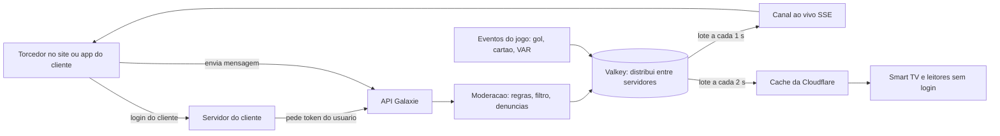

# Chat ao vivo nas partidas: estudo

Estudo de 07/11/2026. Base do épico **Chat ao vivo** (label `Chat ao vivo`).

> Pontos jurídicos deste estudo são de conhecimento geral até 2026 e **não são parecer**. Precisam de revisão de advogado antes do piloto.

**Recomendação: construir o chat nós mesmos, em cima do "Ao vivo" que já existe, e vender como módulo (add-on) para os clientes.** Os fornecedores prontos (Stream, Sendbird, Ably) cobram por usuário ativo ou por conexão simultânea, e num jogo grande de um portal (100 mil pessoas com o chat aberto ao mesmo tempo) isso vira contrato enterprise de dezenas de milhares de dólares por mês. Do nosso lado, a peça mais cara (entregar mensagens para muita gente ao mesmo tempo) já está pronta: a API tem o canal ao vivo (SSE), o Valkey distribui as mensagens entre servidores e cada cliente já recebe um token curto por tenant (`apps/api/src/realtime`). O que falta é a parte de escrever, moderar e mostrar. O MVP leva cerca de 3 a 4 dias com agentes Claude de fronteira trabalhando em paralelo; o gargalo real é a revisão jurídica e um cliente piloto, não o código.

## Decisões já tomadas (07/11/2026)

- **Nosso stack**, sem fornecedor de chat.
- **Só maiores de 18 anos escrevem**, em qualquer país. Menores podem ler.
- **Sala por jogo e por cliente (tenant).** Sem sala geral misturando clientes.
- **Moderação:** base de regras sempre ligada + o cliente escolhe a **Cosmos AI** como moderadora (pré-paga por consumo) e/ou **moderadores do próprio cliente**. Os dois podem ser usados juntos.
- **Sem bet no chat**, em nenhum país: links e menções de casas de aposta bloqueados, nenhuma casa de aposta patrocina sala.
- **Escopo:** América Latina e mundo hispânico primeiro, logo depois EUA e Canadá.
- **Quem assina:** na América Latina, a Galaxie Works Ltda; nos EUA e no Canadá, a LLC de Wyoming.

## Como funciona, em uma frase por peça

- **Sala por jogo e por cliente.** Cada cliente (portal, operadora) tem a própria sala de cada partida, com a marca, as regras e os moderadores dele. A torcida de um portal não se mistura com a de outro.
- **Quem lê não precisa de login. Quem escreve, sim, e o login é do cliente.** O site do cliente já sabe quem é o usuário; o servidor dele pede para nós um token daquele usuário (apelido, avatar, faixa de idade, time do coração). Nós nunca recebemos e-mail, CPF ou senha.
- **Escrever** é uma chamada simples para a API; **receber** usa o mesmo canal ao vivo que hoje leva placar e lances.
- **As mensagens saem em lotes de 1 segundo**, não uma a uma. Isso é o que segura o custo: com 10 pessoas ou 100 mil, cada tela recebe no máximo um pacote por segundo.
- **Em jogo grande, o chat entra em "modo multidão"**: a tela mostra até ~15 mensagens por segundo (mais do que isso ninguém consegue ler), escolhidas por um filtro; as reações viram contadores ("12 mil 🔥").
- **O jogo entra no chat sozinho.** Gol, cartão, VAR e fim de jogo aparecem como mensagens nossas, com escudo. Esse é o diferencial: nenhum fornecedor de chat tem o dado do jogo.
- **Na smart TV o chat é só leitura**, numa faixa lateral, com um QR code "participe pelo celular". Digitar com controle remoto não funciona.

## Comprar ou construir

Os fornecedores são bons para comunidades pequenas e logadas (um app de clube, um bolão). Para audiência de mídia, o modelo de preço deles trabalha contra nós. Preços públicos de novembro de 2026, em dólar:

| Opção | Como cobra | Pequeno: 50 mil usuários no mês, pico de 5 mil juntos | Grande: 1 milhão no mês, pico de 100 mil juntos | Observação |
| --- | --- | --- | --- | --- |
| [Stream Chat](https://getstream.io/chat/pricing/) | US$ 499/mês com 10 mil usuários e 500 conexões; extra US$ 0,09 por usuário e US$ 0,99 por conexão simultânea | ≈ US$ 8,5 mil/mês | só plano enterprise (negociado) | Moderação com IA não vem nos planos de prateleira |
| [Sendbird](https://www.featurebase.app/blog/sendbird-pricing) | US$ 1.349/mês com 25 mil usuários; conexões simultâneas limitadas a 5% dos usuários | já cai no enterprise | enterprise | O limite de 5% é o problema: em jogo, muita gente entra ao mesmo tempo |
| [Ably](https://ably.com/docs/pricing) | US$ 0,05 por usuário ativo no mês; acima de 50 mil, pacote sob medida | ≈ US$ 2,4 mil/mês | ≈ US$ 50 mil/mês (estimativa pela tabela) | É só o "cano" de tempo real; moderação e interface ficam com a gente |
| PubNub, Pusher | Mesma lógica (usuário ou conexão) | não cotado | não cotado | Sem vantagem clara sobre o Ably |
| **Construir no nosso stack** | Servidor + banda | VPS atual dá conta | servidor maior + Cloudflare | Custo quase não cresce com a audiência, por causa dos lotes e do cache |

Três motivos a mais para construir: (1) **o dado é nosso** e fica no mesmo contrato e no mesmo painel do cliente; (2) **o chat vira parte do produto Galaxie** (eventos do jogo dentro do chat, widget no Builder, mesmo tema da marca), em vez de uma integração com outra empresa; (3) **revender um chat de terceiros** exigiria contrato de revenda com eles, e o cliente pagaria duas margens.

O que vale **comprar** no futuro, se precisar: só peças. Por exemplo, um servidor de WebSocket de código aberto ([Centrifugo](https://centrifugal.dev)) se quisermos trocar o SSE por WebSocket, ou um serviço de moderação de imagens se um dia o chat aceitar fotos (no MVP, só texto e emoji).

## Benchmark: quem já tem chat de jogo e o que os termos dizem

**Ninguém vende chat de jogo junto com o dado do jogo.** Quem tem chat ou é dono do próprio app (TyC Sports, DAZN, Sofascore, YouTube, Twitch) ou vende só o chat (Arena, LiveLike, Stream). Os pontos em comum dos termos e políticas públicas viram a base do nosso.

| Plataforma | O que oferece | O que os termos e políticas dizem | Risco que aparece | O que levamos |
| --- | --- | --- | --- | --- |
| TyC Sports Play (Argentina) | Chat ao vivo dentro dos eventos, desde a versão 6.1.20 do app ([App Store](https://apps.apple.com/ar/app/tyc-sports-play/id1451348376)) | [Política de privacidade](https://www.tycsports.com/politica-de-privacidad.html) de 2018, única para site, apps e widgets. Comentários são "sempre públicos" e podem aparecer em buscadores; publicidade direcionada por cookies de terceiros; menor de 18 pode se cadastrar. Não há regras próprias de chat, moderação nem apelação | Texto antigo, sem prazo de guarda e sem idade mínima. Mensagem pública e indexável expõe o torcedor | Chat colado ao player do jogo. Ao contrário deles: mensagens fora dos buscadores, política própria do chat com idade, prazo de guarda e direitos por país, e revisão anual dos textos |
| [DAZN](https://help.dazn.com/hc/en-pt/articles/36707502059165-Interactive-Features-Terms-of-Use) (global) | "Recursos interativos" com três documentos: termos dos recursos, [diretrizes da comunidade](https://dazn.com/en-GB/help/articles/community) e termos entre usuários | Licença mundial e gratuita sobre o que o usuário escreve; moderação automática mais revisão humana; aviso com o motivo; reclamação em até 6 meses (DSA europeia); **proíbe dicas de aposta, odds, manipulação de resultado e cambismo**; responsabilidade limitada ao que a lei permite | Nenhum grave: é o modelo mais completo | A estrutura de três documentos e a lista de proibidos |
| Sofascore | Chat por partida com [moderadores voluntários](https://sofascore.helpscoutdocs.com/article/38-how-to-become-moderator-on-sofascore-chat), convidados e sem pagamento | [Política de privacidade](https://sofascore.com/no/personvern): serviço para maiores de 18; marketing de marcas de aposta do grupo | Voluntário sem contrato não tem prazo nem responsabilidade, e pode virar vínculo trabalhista; aposta misturada ao chat | A idade de 18+. Evitamos voluntários sem contrato e apostas |
| YouTube ao vivo | [Ferramentas](https://support.google.com/youtube/answer/9826490?hl=en): segurar mensagem para revisão, palavras bloqueadas, modo lento, só inscritos, "modo comentário" (só aprovados escrevem), suspensão temporária, dois níveis de moderador, ocultar usuário sem avisar | Conta a partir de 13 anos; desde 22/07/2025, transmitir sozinho só a partir de 16 ([Fox](https://www.fox9.com/news/youtube-live-age-limit-16)) | Assédio a menores em live foi o motivo de subir a idade | "Modo comentário" (bom para TV e jogo enorme), dois níveis de moderador, silêncio invisível |
| Twitch | AutoMod, "modo escudo" para ataques em massa, moderadores do canal | Conta a partir de 13 anos; em 2022 proibiu transmitir cassino sem licença, depois de crise pública ([NPR](https://www.npr.org/2022/09/22/1124384092/twitch-bans-some-gambling-content-after-an-outcry-from-streamers)) | Aposta em plataforma com menor vira crise de imagem | Confirma a decisão de não ter bet; um "modo escudo" para ataque coordenado |
| Arena (B2B, origem brasileira) | Chat white-label para mídia; no Big Brother Brasil, login pelo SSO da emissora com 4,2 milhões de logins únicos ([estudo de caso](https://www.casestudies.com/company/arenaim/case-study/arena-live-chat-allowed-big-brother-brasils-huge-audience-to-engage-and-interact-with-each-other-during-live-broadcasts)) | Termos de cliente não são públicos | É o concorrente mais direto na venda para mídia no Brasil | Mesmo modelo de login (SSO do cliente) |
| LiveLike (B2B, EUA) | Chat, enquetes, quiz e [moderação com IA](https://www.livelike.com/community-social-moderation) (banir, silêncio invisível, perfil de risco); três modelos: equipe do cliente, IA ou empresa terceirizada | A página não fala de apelação, COPPA nem GDPR | Sem apelação, a decisão automática fica exposta (direito de revisão da LGPD art. 20, DSA) | Os três modelos de moderação; a nossa diferença é o dado do jogo e a apelação |
| [Stream](https://getstream.io/legal/) (B2B, EUA) | API de chat | O conteúdo é "responsabilidade exclusiva do cliente"; o cliente deve remover o que viola as regras; consentimento dos pais (COPPA) é do cliente; responsabilidade limitada ao que o cliente pagou em 12 meses; contrato de tratamento de dados pronto | Para o cliente, tudo cai nele | É o padrão do mercado B2B e serve de modelo para o nosso contrato |

**O que todos têm em comum, e entra no nosso:**

1. O conteúdo é do usuário, que responde por ele; a plataforma recebe licença gratuita só para exibir e moderar.
2. No B2B, o cliente responde pelos usuários e pela moderação. Nós vamos um passo além: racismo, ameaça e abuso infantil são bloqueados pela base sempre, porque no Brasil a plataforma tem dever de agir sozinha nesses casos.
3. Lista de proibidos: ódio, assédio, dados pessoais de outras pessoas, spam, apostas e odds, manipulação de resultado e cambismo.
4. Escada de punição, aviso com o motivo e apelação.
5. Teto de responsabilidade e contrato de tratamento de dados.

**Como ajudamos o cliente juridicamente** (tudo como modelo, revisado pelo advogado antes de sair):

- **Kit de termos para o usuário final**, em português, espanhol, inglês e francês: termos do chat, diretrizes da comunidade em linguagem simples (mostradas na primeira vez que a pessoa escreve) e texto de privacidade do chat. O cliente adapta e publica com a marca dele.
- **Contrato B2B pronto, em duas versões:** cliente responsável pelos dados e pela moderação, Galaxie operadora, nosso dever de agir em racismo e abuso infantil, teto de responsabilidade. **América Latina:** em nome da Galaxie Works Ltda, lei brasileira, cláusulas-padrão de transferência por país. **EUA e Canadá:** em nome da LLC de Wyoming, em inglês, lei americana, com o contrato de tratamento de dados no formato que as leis estaduais pedem; entre empresas, arbitragem e foro americano são aceitáveis. Como a operação técnica fica no Brasil, a LLC precisa de um contrato com a Ltda que a autorize a tratar os dados dos clientes americanos (subcontratação).
- **Relatório de transparência** por mês: quantas mensagens bloqueadas e por quê, denúncias, apelações e prazos.
- **Canal para ordem judicial:** como pedir e receber os registros de um usuário, com prazo.
- **Checklist de lançamento por país**, tirado da ficha de regras.

## O que aguenta e quanto custa num pico

Conta de um jogo grande num portal grande: 2 milhões de pessoas na página do jogo, 5% abrem o chat (100 mil leitores ao mesmo tempo), 2% deles escrevem (2 mil pessoas digitando).

- **Mensagens chegando:** com "modo lento" de 10 segundos por pessoa, no máximo ~200 mensagens por segundo. Um único processo da API filtra isso com folga.
- **Mensagens saindo:** o problema clássico é multiplicar 200 mensagens por 100 mil telas (20 milhões de entregas por segundo). Com lotes de 1 segundo e limite de ~15 mensagens visíveis, cada tela recebe um pacote de ~1 KB por segundo.
- **Banda:** 100 mil telas × 1 KB/s = ~100 MB/s. Isso derruba um VPS, mas não a Cloudflare. Por isso, **leitores sem login e TVs leem o lote pelo cache da Cloudflare** (um arquivo por sala renovado a cada 2 segundos): nosso servidor responde uma vez por região, e a Cloudflare entrega para todo mundo. Só quem está logado e escrevendo fica no canal direto.
- **Na VPS atual**, sem a Cloudflare na frente, o limite seguro é algo como **5 mil pessoas com o chat aberto por jogo**. Suficiente para piloto. Para os números de portal grande, precisa do domínio atrás da Cloudflare (#635) e do servidor maior.
- **Teste de carga** antes de vender: o k6 já está no repositório; simulamos 100 mil leitores e 2 mil escritores antes do piloto.

## Moderação

Chat de futebol sem moderação vira racismo, ameaça e link de bet pirata em minutos. **O cliente escolhe entre dois modos de moderação, e pode usar os dois juntos.** Uma base de regras vem sempre ligada, em qualquer modo, porque é o mínimo que a lei exige.

### Base, sempre ligada (sem custo extra)

Limite de mensagens por pessoa, modo lento ajustável, bloqueio de links (com lista do que é permitido), listas de palavras em português, espanhol e inglês que pegam variações ("m4c4co", espaços, acentos), bloqueio de telefone, Pix e CPF, bloqueio de links e menções de casas de aposta, botão "denunciar" em cada mensagem e registro de acesso por 6 meses. O que o autor vê depende do motivo. **Bloqueio comum** (link fora da lista, telefone, Pix ou CPF, menção de aposta, modo lento): a mensagem não é publicada e o autor recebe um aviso curto com o motivo ("links não são permitidos nesta sala"), sem punição e sem precisar de apelação. **Abuso** (ódio, racismo, ameaça, assédio, spam em massa, tentativa repetida de driblar o filtro com outra grafia): a mensagem some só para os outros e o autor não percebe; se isso virar punição (silêncio, banimento), ela é avisada com o motivo e pode recorrer.

### Modo 1: Cosmos AI como moderadora (pré-paga por consumo)

**Cada cliente tem uma carteira de créditos pré-paga**, com pacotes pagos por Pix, cartão ou Google Pay, e o crédito só entra com o pagamento confirmado. Cada uso converte os tokens no custo do provedor e depois em créditos, com um mínimo por função, e cada lançamento guarda o saldo antes e depois. A moderação é só mais uma função dessa carteira, que é a mesma usada pelos outros recursos da Cosmos AI. Para o chat: o cliente reparte o orçamento por produto ou por sala (em %); só a etapa em que o modelo de IA roda desconta crédito; no jogo ao vivo o débito é feito em lote, não mensagem a mensagem; o painel avisa em 90% do orçamento. **Se o saldo zerar no meio do jogo, o chat não para:** volta para a base de regras e para os moderadores humanos, e o cliente é avisado. (O desenho detalhado da Cosmos AI é tratado num estudo próprio.)

- **Entende contexto**, que lista de palavras não pega: zoeira de rival ("vai cair de novo") passa; racismo disfarçado, ameaça e assédio não. Conhece as gírias de cada torcida pela nossa base semântica.
- **Três níveis de rigor** que o cliente escolhe: tolerante, padrão e família. Por tipo de problema, o cliente decide se a Cosmos apaga, segura para revisão ou só marca.
- **Ações automáticas em escada:** apaga a mensagem, avisa a pessoa com o motivo, silencia por 5 minutos, silencia pelo jogo inteiro. Banimento definitivo ela só sugere; quem confirma é uma pessoa do cliente, ou uma regra automática que o cliente deixou ligada.
- **Atende as denúncias** na hora, em vez de deixá-las numa fila.
- **Revisa a primeira apelação** com o contexto completo da conversa e explica a decisão.
- **Relatório no fim do jogo:** quantas mensagens bloqueou, por qual motivo, quem reincidiu, picos de tensão (sempre colados num lance).
- **Como o consumo fica sob controle:** um filtro rápido no nosso servidor (sem custo de tokens) passa tudo primeiro; a Cosmos AI só gasta tokens com o que ele marcou como suspeito, com as denúncias e com uma amostra do resto. O cliente pode pôr um teto de consumo por jogo e ver no painel quanto cada partida gastou. Ler 100% das mensagens de um jogo grande, uma a uma, queimaria o saldo sem ganho.

### Modo 2: moderadores do próprio cliente

O cliente convida funcionários com o perfil **Moderador** no painel do Galaxie (Ajustes → Chat). Recursos:

- **Painel ao vivo** de cada sala, com fila de denúncias e de mensagens seguradas, ordenada por gravidade.
- **Ações:** apagar, fixar mensagem, silenciar por tempo (5 min, 1 h, o jogo, 24 h), modo lento, congelar a sala, banir de uma sala, de todas as salas do cliente ou da comunidade inteira, e o "silêncio invisível" (a pessoa continua escrevendo, mas só ela vê).
- **Ficha do usuário:** histórico de avisos, silêncios, banimentos e apelações, com notas internas da equipe.
- **Apelação:** a pessoa punida recorre por um botão; o pedido cai numa fila com prazo (por exemplo, 72 horas) e é decidido por outro moderador, não por quem puniu. A resposta vai para a pessoa com o motivo.
- **Perfis:** Moderador (age nas salas), Moderador sênior (decide apelações e banimentos definitivos) e Administrador (regras, listas de palavras próprias, quem é moderador).
- **Registro de tudo:** quem fez o quê, quando e por quê, para responder à Justiça ou ao próprio torcedor.

### Os dois juntos

Deve ser o arranjo mais comum em cliente grande: a Cosmos AI resolve o volume (a grande maioria dos casos é óbvia) e a equipe do cliente cuida dos casos difíceis, dos banimentos definitivos e das apelações. Cliente que não assina a Cosmos AI fica com a base de regras e a própria equipe.

**Apelação de decisão automática chega a uma pessoa (regra nossa de produto).** A LGPD (artigo 20) dá ao titular o direito de pedir revisão de decisão tomada só com base em tratamento automatizado; desde a Lei 13.853/2019 a lei não exige que essa revisão seja feita por pessoa. Mesmo assim, decidimos que, no modo só Cosmos AI, a segunda apelação vai para o administrador do cliente: é mais seguro diante de outras leis (como a DSA europeia e leis estaduais americanas), é o que o torcedor espera e protege o cliente. Isso fica no contrato como compromisso, não como exigência legal; o advogado confirma.

**Quem responde pela moderação é o cliente**, com as nossas ferramentas. Nós damos a base, a Cosmos AI e o painel; o cliente decide o que é aceitável na comunidade dele.

## Lado jurídico: América Latina, EUA e Canadá (precisa de advogado antes do piloto)

**O chat nasce para a região inteira, então a regra base é a mais rígida de todas, e o que muda por país vira configuração.** Só maiores de 18 escrevem, em qualquer país. A idade vem do cadastro do cliente, dentro do token; menores podem ler. Com isso, as leis de menores de todos os países abaixo deixam de pesar sobre a parte mais arriscada, que é o menor publicando e sendo abordado por adulto.

O que vale em todos os países:

- **Nenhuma propaganda direcionada a menores** e nenhum dado de criança guardado (só a faixa "menor de 18", sem data de nascimento).
- **O cliente é o responsável pelos dados e a Galaxie trabalha para ele** (controlador e operador, no vocabulário da LGPD; "responsable" e "encargado" nas leis hispânicas). Recebemos só um identificador e um apelido.
- **Dados saindo do país.** Argentina, Colômbia, Chile, Peru e Quebec exigem garantia em contrato quando o dado do cidadão vai para servidor em outro país. Resolve com cláusulas-padrão no contrato com cada cliente, não com servidor em cada país.
- **Ódio e discriminação são crime em todos**, com nomes diferentes. As listas de palavras e a Cosmos AI trabalham por idioma e por país (o insulto de uma torcida argentina não é o de uma mexicana).
- **Registro de acesso por 6 meses** (exigência do Brasil) serve de padrão para todos.

| País | Dados pessoais | Menores | Apostas (só contexto: o chat não tem bet) | Atenção específica |
| --- | --- | --- | --- | --- |
| Brasil | LGPD (ANPD) | ECA Digital, em vigor desde 17/03/2026 | Situação em mudança (MP 1.394/2026, contestada; [Senado](https://www12.senado.leg.br/noticias/materias/2026/09/28/mp-proibe-bets-e-determina-encerramento-das-operacoes-em-30-dias)) | Marco Civil: log de 6 meses e dever de remover depois de avisado; racismo e injúria racial são o mesmo crime |
| Argentina | Lei 25.326 (AAIP) | Regras gerais de consentimento dos pais | Licença por província | Cada província é um mercado de apostas diferente |
| México | Lei federal de dados nova (2025) | Consentimento dos pais para menor | Permissão federal | Lei federal contra discriminação |
| Colômbia | Lei 1.581/2012 (SIC) | Dado de menor só em casos excepcionais | Licença da Coljuegos | Lei mais rígida da região com dado de menor |
| Chile | Lei 21.719, nova, entra em vigor em dez/2026 | Menor de 14 só com os pais | Sem lei aprovada para aposta online | A lei nova chega junto com o produto; confirmar a data exata |
| Peru | Lei 29.733 com regulamento novo (2025) | Menor de 14 só com os pais | Regulada desde 2024 | — |
| Uruguai, Paraguai, Equador, Bolívia e outros | Cada um com a sua lei geral de dados | Regras gerais | Varia | Entram com a mesma regra base |
| EUA | Sem lei federal; Califórnia (CCPA) e outros estados | COPPA para menor de 13; leis estaduais de design para menores | Legal estado por estado | Seção 230 protege pelo que o usuário escreve, salvo crime federal e propriedade intelectual |
| Canadá | PIPEDA (federal); Lei 25 no Quebec, mais rígida | Quebec: menor de 14 só com os pais | Ontário regula (AGCO) | **Quebec exige o produto em francês** (Lei 96) |

**Sem bet no chat.** Em todos os países, links e menções de casas de aposta são bloqueados pela base de regras e nenhuma casa de aposta patrocina sala, nem a parceira do cliente.

**Como isso vira produto:** cada cliente tem os países onde opera, e cada país tem uma **ficha de regras** no Galaxie: idade mínima para escrever (18 em todos, por enquanto), idioma das listas e textos legais do termo de uso. País novo = ficha nova, sem código novo.

**Para o advogado:** um escritório brasileiro com correspondentes na região (Argentina, México, Colômbia e Chile primeiro) para os contratos da Ltda; e o advogado americano da LLC para EUA e Canadá, que assina os contratos e termos de lá em nome da LLC.

## Como ganhar dinheiro

- **Módulo "Chat ao vivo"** no plano do cliente, como os módulos que já existem. Cobrança por faixa de pico de pessoas com o chat aberto (até 5 mil, 25 mil, 100 mil), que é o que mexe no nosso custo.
- **Cosmos AI pré-paga**, separada do módulo de chat: a moderação desconta do mesmo saldo de créditos que o cliente usa para os outros recursos da Cosmos AI. Receita cresce com o tamanho do jogo, sem risco de calote.
- **Patrocínio da sala:** "Chat do jogo oferecido por …", mensagem fixada do patrocinador, cor da marca. O cliente vende, nunca para casa de aposta; nós cobramos o módulo.
- **Enquetes e palpites ligados ao jogo** ("quem marca primeiro?", "nota do juiz") com o resultado vindo do nosso dado. Engaja e dá espaço para patrocinador, sem ser aposta.
- **Dados agregados para o cliente:** pico de pessoas, momentos de maior conversa (sempre colados num lance), reações por time. Nunca vender mensagem individual.

## Fases

Prazos considerando que todo o desenvolvimento é feito por agentes Claude de fronteira (Opus, Sonnet, Fable), várias issues em paralelo, com revisão automática e CI em cada PR. Referência: as 15 issues de widgets do épico #820 viraram PRs em cerca de um dia. O que o prazo não comprime é o que depende de gente ou de infraestrutura: revisão e merge, advogado, piloto e as dependências da última coluna.

| Fase | O que entra | Prazo de desenvolvimento | Depende de |
| --- | --- | --- | --- |
| 0. Jurídico | Rascunho do termo de uso do chat e da parte do contrato (quem modera, LGPD, logs) | Rascunho no mesmo dia + advogado | Advogado |
| 1. MVP para piloto | Sala por jogo e cliente; token de usuário pedido pelo servidor do cliente; enviar e receber em lotes; eventos do jogo dentro do chat; reações; modo lento; regras e listas de palavras (pt, es, en); denúncia; painel de moderação em Ajustes → Chat; logs de 6 meses; widget `live_chat` no Builder e no embed; página do jogo no demo. Limite de ~5 mil pessoas por jogo | ~3 a 4 dias | Nada novo de infraestrutura |
| 2. Escala | Leitura pelo cache da Cloudflare; modo multidão; teste de carga com 100 mil leitores; métricas no Grafana (pessoas na sala, mensagens por segundo, bloqueios) | ~1 a 2 dias | Domínio atrás da Cloudflare (#635) e servidor maior |
| 3. Moderação inteligente e TV | Cosmos AI como moderadora (pré-pago por tokens); apelação com fila e prazo; perfis Moderador sênior e Administrador; chat só leitura na smart TV com QR code; enquetes e palpites; patrocínio da sala | ~3 a 4 dias | Migração para galaxiesports.com (apps de TV) |
| 4. EUA e Canadá | Fichas de regras por país (idade, idioma); listas e Cosmos AI afinadas para inglês, espanhol de cada país e francês (Quebec); termos e revisão jurídica americana e canadense; fuso e textos | ~1 a 2 dias | LLC pronta e advogado nos EUA |

## Fontes

- Preços: [Stream Chat](https://getstream.io/chat/pricing/), [Ably](https://ably.com/docs/pricing), [Sendbird (resumo de out/2026)](https://www.featurebase.app/blog/sendbird-pricing)
- ECA Digital: [Confidata, o que muda para empresas](https://confidata.com.br/blog/eca-digital-o-que-muda-empresas)
- Servidor de tempo real de código aberto: [Centrifugo](https://centrifugal.dev)
- Nosso stack: `apps/api/src/realtime` (canal SSE, distribuição pelo Valkey, token curto por tenant)
- Pontos de Marco Civil (art. 15 e decisão do STF sobre o art. 19), Lei 14.532/2023 e COPPA são do conhecimento geral até 2026 e precisam de confirmação do advogado. Apostas no Brasil: MP 1.394/2026 ([Senado](https://www12.senado.leg.br/noticias/materias/2026/09/28/mp-proibe-bets-e-determina-encerramento-das-operacoes-em-30-dias)).
