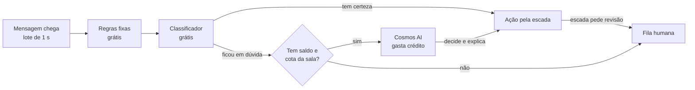

# Estudo: Cosmos AI

> Data: **2026-11-07**. Mercados: América Latina, mundo hispânico e, em breve, EUA e Canadá.
> Épico: #989, label `Cosmos AI`. Estudos irmãos: [Comunidades](comunidades.md), Chat ao vivo, Gamificação e Shop the game.
> Base: a Suzette, assistente de IA com carteira de créditos do Only Chefs 3 (protótipo da mesma empresa).
> Política editorial: nenhum cliente é citado pelo nome.

---

## Resumo

A Cosmos AI é a IA que o cliente do Galaxie liga e paga por uso. Ela modera o chat ao vivo e as comunidades e é a assistente do cliente em todo o app. Tudo gasta de um saldo só, numa carteira de créditos pré-pagos.

- **Mesmo esqueleto da Suzette:** carteira por cliente, pacotes, extrato com saldo antes e depois, cota repartida por sala ou produto, recursos com travas e o mesmo desenho de tela.
- **Quatro abas em vez de uma página longa:** Visão geral, Moderação, Uso e extrato, Permissões.
- **Escada de autonomia** no lugar da lista plana de travas: só sinaliza → age e avisa → age sozinha. Banir e suspender nunca são automáticos.
- **Só a dúvida gasta crédito:** regras e classificador decidem o que é claro, de graça; o modelo de linguagem entra só na dúvida. Saldo zerado devolve a moderação para regras e pessoas; o chat nunca desliga.
- **Assistente no app todo:** um painel lateral que sabe em que tela o cliente está e prepara o trabalho para ele aprovar, como montar o tema do Builder a partir do PDF do brandbook.
- **A organização da Suzette vira o padrão de todas as configurações do Galaxie:** menu lateral agrupado e um kit de blocos de tela.

## 1. O que herdamos da Suzette

A Suzette mora numa página de configurações, montada com componentes ReUI/shadcn (`Card`, `Switch`, `Accordion`, `Progress`, `Alert`, `Badge`, `Dialog`, `Tabs`, `Field`). Oito regras se repetem em todos os blocos e viram o padrão da Cosmos:

1. **Um cartão, uma decisão.** Título, uma linha do que faz e um controle principal à direita.
2. **Ligar e configurar são gestos diferentes.** O switch liga; a engrenagem abre os detalhes.
3. **Explicar antes de pedir.** Todo recurso aberto começa com "O que esta opção permite?" e termina com uma nota de segurança.
4. **Seguro por padrão.** Tudo que altera algo de verdade vem desligado; travas filhas ficam desabilitadas com o pai desligado.
5. **Saldo na língua do cliente.** "71 de 250" e "72% utilizado", nunca tokens nem custo técnico.
6. **Avisos com uma ação.** O aviso de 90% ou de esgotado traz o botão que resolve.
7. **Fluxos longos em janela com passos,** cada passo com título, uma frase, voltar e seguir.
8. **Vazio também explica** o que fazer.

### O que melhorar

| O que acontece na Suzette | Na Cosmos |
| --- | --- |
| Uma página com seis blocos empilhados | Quatro abas |
| Extrato existe nos dados, sem tela | Aba Uso e extrato, com filtros e CSV |
| Janela de compra com altura fixa corta os botões em telas baixas | Altura pelo conteúdo, rodapé sempre visível |
| Aviso fala em "créditos gratuitos" mesmo após compra | Texto conforme a origem do saldo |
| Recarregar começa por um carrossel de conquistas | Recarregar vai direto aos pacotes |
| Cota por filial passa de 100% e é cortada em silêncio | Linha "Sem destino: X%" e aviso |
| Travas misturam sugerir, rascunho, aplicar e agir sozinha | Escada de autonomia por ação |
| Limite máximo é um switch sem campo | Todo limite com campo e unidade |
| Uso por usuário só mostra o total | Uso por sala, por função e por moderador |
| Sem recarga automática nem alerta configurável | Alertas 80% e 90%, recarga automática opcional |

## 2. A Cosmos no painel do cliente

| Aba | O que tem |
| --- | --- |
| Visão geral | Habilitar Cosmos AI, aviso de saldo, créditos disponíveis, cota por sala, resultados da semana |
| Moderação | Recursos com switch e engrenagem, categorias com régua, escada de autonomia, "testar com uma mensagem" |
| Uso e extrato | Consumo por dia e por sala, extrato, histórico de decisões com motivo, compras e recibos |
| Permissões | Cargos (dono, admin, moderador, júnior) e o que cada um pode; pedidos de créditos ao dono |

A equipe Galaxie tem uma visão à parte em Ajustes com todas as carteiras, o custo real e os ajustes manuais.

## 3. Moderação

### Recursos (desligados por padrão)

- **Moderar o chat ao vivo:** lotes de 1 segundo por sala.
- **Moderar comunidades:** mural, comentários, nomes e fotos de perfil, ligas privadas.
- **Revisar apelações:** prepara parecer; nunca decide sozinha a segunda apelação.
- **Relatório da sala:** resumo pós-jogo.

### Categorias e régua

Cada categoria tem uma régua de 0 a 4, mais um nível geral (como o AutoMod da Twitch): ofensa e xingamento, ódio e discriminação, assédio e ameaça, conteúdo sexual, spam e golpe, dados pessoais. Ficam travadas no máximo, sem régua: links e menções a casas de aposta, e conteúdo sexual envolvendo menores.

### Escada de autonomia

| Ação | Só sinaliza | Age e avisa | Age sozinha | Padrão |
| --- | --- | --- | --- | --- |
| Esconder mensagem | fila | esconde e mostra na fila para desfazer | esconde | age e avisa |
| Silenciar a pessoa | sugere | silencia e avisa | silencia (até 24 h) | só sinaliza |
| Suspender da comunidade | sugere | suspende e avisa | bloqueado | só sinaliza |
| Banir | sugere | bloqueado | bloqueado | só sinaliza |

### Caminho de uma mensagem

### Estados do saldo

| Estado | O que o cliente vê | Moderação |
| --- | --- | --- |
| Nunca ativada | Cartão explicando e o switch | Regras + moderadores do cliente |
| Teste | "Você recebeu créditos para testar" | Cosmos ligada |
| 80% e 90% | Aviso com Recarregar; e-mail e webhook ao dono | Cosmos ligada |
| Cota da sala esgotada | Aviso ao moderador, "pedir mais créditos" | Aquela sala volta para regras + fila |
| Saldo zerado | Aviso com Recarregar | Todas as salas em regras + fila; o chat segue no ar |

Créditos de teste vencem em 90 dias; créditos comprados não vencem enquanto o contrato estiver ativo.

### Preços e custos

**Do token ao crédito.** Cada uso registra tokens de entrada, entrada em cache e saída. O custo real no provedor (preço por milhão de tokens do modelo, convertido em reais a uma cotação fixa operacional) vira créditos. Créditos cobrados = maior entre (custo × multiplicador de margem ÷ valor do crédito) e o mínimo da função. O multiplicador fica em 1 por padrão; a margem está no preço do pacote. Contratos grandes podem ter multiplicador próprio e fatura mensal no lugar do pré-pago.

**Valor do crédito.** Na Suzette, 1 crédito = 1/25 de uma ação média (2.000 tokens de entrada + 800 de saída), cerca de R$ 0,0003 de provedor. Na Cosmos, 1 crédito = 1/10 dessa ação, cerca de R$ 0,00075 de provedor. Os 250 créditos de teste rendem umas 25 ações ou cerca de 150 dúvidas de moderação, contra umas 10 ações na Suzette.

**Pacotes em reais (Brasil e Latam), mesma tabela da Suzette:**

| Pacote | Créditos | Preço | Custo de provedor | Margem bruta sobre o provedor |
| --- | --- | --- | --- | --- |
| Essencial | 5.000 | R$ 49 | ~R$ 3,75 | ~13× |
| Pro | 15.000 | R$ 99 | ~R$ 11,25 | ~9× |
| Turbo | 40.000 | R$ 199 | ~R$ 30 | ~6,6× |

Com o IOF absorvido (abaixo), a receita líquida de cada pacote cai cerca de 3,4% (o IOF sai de dentro do preço), antes das taxas do Stripe. Na Suzette o mesmo pacote Essencial custava cerca de R$ 1,50 de provedor; a margem cai porque o crédito rende 2,5 vezes mais, e continua alta.

**EUA e Canadá:** tabela própria em dólar, aprovada pelo Wagner em 07/11.

Referências de mercado (preço de lista, novembro de 2026):

| Quem | Como cobra | Preço |
| --- | --- | --- |
| [Intercom Fin](https://www.featurebase.app/blog/fin-ai-pricing) | Por conversa resolvida pela IA | US$ 0,99 por resolução; mínimo de 50 por mês no avulso |
| [Zendesk AI](https://www.robylon.ai/blog/zendesk-ai-pricing-per-resolution) | Por resolução automática | ~US$ 1,00 a 1,50 com contrato; US$ 2,00 no avulso (estimativa de terceiros) |
| [Stream Moderation](https://getstream.io/moderation/pricing) | Por mensagem de texto analisada | US$ 2,00 por mil mensagens; US$ 100 grátis por mês |

Tabela:

| Pacote | Créditos | Preço | Por crédito | Ação média (10 créditos) | Custo de provedor | Margem bruta |
| --- | --- | --- | --- | --- | --- | --- |
| Starter | 5.000 | US$ 29 | US$ 0,0058 | US$ 0,06 | ~US$ 0,70 | ~40× |
| Pro | 15.000 | US$ 69 | US$ 0,0046 | US$ 0,05 | ~US$ 2,10 | ~33× |
| Scale | 40.000 | US$ 149 | US$ 0,0037 | US$ 0,04 | ~US$ 5,60 | ~27× |
| Enterprise | a partir de 250 mil por mês | fatura mensal | negociado | | | multiplicador próprio |

Por que esses valores:

- **Cerca de 3 vezes o preço em reais.** R$ 49 dá uns US$ 9; US$ 29 segue a diferença de poder de compra que SaaS costuma aplicar entre Brasil e EUA, e o crédito rende o mesmo nos dois países. O custo de provedor em dólar usa ~R$ 5,40 por dólar; conferir com a cotação operacional.
- **Muito abaixo de quem cobra por resultado.** Uma ação média da Cosmos sai entre US$ 0,04 e 0,06, contra US$ 0,99 a 2,00 por resolução no Fin e no Zendesk. É o argumento de venda: o cliente paga centavos por ação e vê o custo antes.
- **Moderação mais barata que a Stream por mensagem.** Uma dúvida de moderação gasta ~1,7 crédito (~US$ 0,01), mas só a dúvida paga: regras e classificador decidem o resto de graça. Se 5% das mensagens chegam ao modelo, sai ~US$ 0,50 por mil mensagens, contra US$ 2,00 na Stream.
- **Pacote mínimo de US$ 29** para a taxa fixa do Stripe pesar pouco (abaixo).
- **Teste igual ao do Brasil:** 250 créditos, vencem em 90 dias.

Taxas e impostos nos EUA e no Canadá:

- **Stripe na conta dos EUA:** 2,9% + US$ 0,30 por cartão americano; +1,5% para cartão emitido fora dos EUA, o que inclui os canadenses; +1% se cobrar em outra moeda ([fonte](https://checkoutpage.com/blog/stripe-international-fees)). No Starter, um cartão americano custa ~US$ 1,14 (3,9%) e um canadense ~US$ 1,58 (5,4%).
- **Cobrar o Canadá em dólar americano no começo.** Preço em dólar canadense soma +1% de conversão do nosso lado; uma tabela em CAD pode vir depois.
- **Imposto sobre venda nos EUA:** SaaS é tributado em parte dos estados, e a obrigação de recolher começa quando as vendas num estado passam do limite dele. O Stripe Tax monitora isso e cobra 0,5% do volume onde estivermos registrados ([fonte](https://support.stripe.com/questions/understanding-stripe-tax-pay-as-you-go-pricing)). Confirmar com o contador da LLC.
- **GST/HST no Canadá:** o regime simplificado para vendedor de fora vale para quem não tem registro de GST/HST e passa de CAD 30 mil por ano ([fonte](https://www.canada.ca/en/revenue-agency/services/tax/businesses/topics/gst-hst-businesses/digital-economy-gsthst/register-get-ready.html)). Nossos clientes são empresas: pedir o número de GST/HST na compra mostra que a venda é B2B. Confirmar com o contador.
- **Quebec:** telas, recibos e termos em francês para clientes de lá (Lei 96).

**Cobrança pelo Stripe da Galaxie Works LLC, para todos os países (decidido em 07/11):**

- **Pix funciona.** Uma conta do Stripe nos EUA aceita Pix de clientes no Brasil (processamento pelo parceiro EBANX) e recebe em dólar, em até 2 dias úteis.
- **IOF de 3,5%.** Como é compra internacional, o banco do cliente cobra 3,5% de IOF. A LLC absorve esse valor (`amount_includes_iof = always`), para o preço anunciado ser o preço pago.
- **Limites.** Cada cliente brasileiro paga até US$ 3.000 por dia e US$ 10.000 por mês a uma empresa de fora. Os pacotes cabem com folga; contratos grandes vão por fatura.
- **Fatura do banco mostra EBANX,** não Galaxie. O recibo precisa dizer isso para evitar contestação.
- **Sem nota fiscal brasileira.** Para cliente empresa no Brasil, pagar a LLC é importação de serviço e pode gerar impostos do lado dele. Confirmar com o contador antes de vender para portais brasileiros.

## 4. A Cosmos no app todo

Um painel lateral abre em qualquer tela do app de demonstração e do painel do cliente. Ele recebe a rota e os dados visíveis, mostra de 2 a 3 pedidos prontos por tela, diz o custo estimado antes de rodar e prepara rascunhos que o cliente aplica. Nada que muda o que o público do cliente vê é publicado sozinho.

| Área | Tela | O que a Cosmos faz | Créditos (mínimo) |
| --- | --- | --- | --- |
| Painel do cliente | Temas | Monta o tema a partir do brandbook em PDF ou do site, nas versões clara e escura, com contraste conferido | 60 |
| Painel do cliente | Builder | Monta o widget a partir de uma frase; sugere widgets para a página | 10 |
| Painel do cliente | Builder | Gera o código de instalação (WordPress, React, Next, HTML, WebView) | 5 |
| Painel do cliente | Minha lista de canais | Lê lista em PDF, print ou planilha e explica o que não casou | 40 |
| Painel do cliente | Grade e ofertas | Preenche o pedido de revisão a partir de texto livre | 5 |
| Painel do cliente | Chaves | Explica erros de acesso olhando o uso da chave | 5 |
| Painel do cliente | Webhooks | Explica entregas falhas; gera o receptor com verificação de assinatura | 5 |
| Painel do cliente | Visão geral | Resume o uso do mês e sugere economia | 15 |
| App de demonstração | Páginas de dados | Responde perguntas com os dados da API e mostra a origem | 3 |
| App de demonstração | Documentação | Responde com base na documentação; monta a chamada na linguagem do cliente | 0 a 3 |
| App de demonstração | Página do jogo | Texto de pré ou pós-jogo no tom da marca | 20 |
| Chat ao vivo | Sala do jogo | Modera, resume a sala, sugere enquete | 1 por lote; 15 o resumo |
| Comunidades | Mural e bolão | Modera; escreve o regulamento do bolão | 30 |
| Gamificação | Conquistas | Sugere conquistas e escreve os textos | 20 |
| Shop the game | Vitrine | Sugere produtos ligados ao jogo e escreve o texto; nunca promete ponto por compra | 10 |

Créditos cobrados = maior entre o custo real convertido e o mínimo da função. Os agentes internos do Galaxie (cenário, resumo, onde assistir, curador, conteúdo relacionado) ficam fora da Cosmos e mantêm o orçamento próprio.

### Exemplo: tema a partir do brandbook

1. Cliente → Temas → Novo → "Criar com a Cosmos".
2. Envia o PDF do brandbook (até 20 MB) e, se quiser, o site.
3. Vê o custo estimado e confirma.
4. A Cosmos extrai paleta, fontes, raio e densidade, monta as versões clara e escura e confere o contraste.
5. Abre o editor preenchido, com prévia nos widgets reais e nota do que decidiu.
6. O cliente ajusta e salva. A Cosmos nunca salva sozinha.

### Cuidados

- Arquivo do cliente fica guardado só enquanto o rascunho existe (no máximo 30 dias), não treina nada e só o tenant vê.
- Texto dentro de arquivo é dado, não instrução.
- No app de demonstração a Cosmos só lê a API com o plano do cliente.
- O cargo decide quem usa o quê; quem não pode vê "pedir ao dono".

## 5. Configurações do Galaxie no padrão da Suzette

Hoje Ajustes tem 7 abas horizontais, e Sistema tem mais 9 abas dentro; o painel do cliente tem 7 abas e ganharia mais 5 com os produtos novos. A proposta, aprovada em 07/11:

- **Menu lateral agrupado** com o exemplo `c-collapsible-9` do ReUI (`pnpm dlx shadcn@latest add @reui/c-collapsible-9`), com cada item como link de verdade e gaveta no celular. Itens em ordem alfabética.
- **Grupos do Cliente:** Conta (Chaves de API, Cobrança e créditos, Usuários e cargos, Visão geral), Conteúdo (Builder, Canais, Grade, Temas), Engajamento (Chat ao vivo, Comunidades, Gamificação, Shop the game), Inteligência (Cosmos AI), Integrações (Webhooks).
- **Grupos de Ajustes:** Clientes (Carteiras da Cosmos, Usuários, Webhooks), Dados (Escudos, Esportes e features, Grades, Revisão), Plataforma (IA interna, Operação, Sistema).
- **Kit de blocos:** seção, linha de opção, nota de segurança, aviso com ação, medidor, janela com passos e vazio que explica.

## 6. Benchmark

| Plataforma | O que fazem bem | O que levamos |
| --- | --- | --- |
| [Twitch AutoMod](https://twitch4j.github.io/javadoc/com/github/twitch4j/helix/domain/AutoModSettings.AutoModSettingsBuilder.html) | Régua por categoria e nível geral; mensagem retida para o moderador | Nível geral + ajuste fino; "reter para revisão" |
| [Discord AutoMod](https://support.discord.com/hc/articles/4421269296535) | Bloquear, alertar e silenciar por regra; exceções por cargo e canal; mensagem personalizada; filtro de nome | Exceções por sala e cargo; texto ao torcedor; moderar perfil |
| [Stream](https://getstream.io/chat/docs/node/moderation/) | Fila de revisão no painel e por API; listas e domínios bloqueados | Fila também por API; domínios de bet bloqueados |
| [Sightengine](https://sightengine.com/faq/pricing-for-text-moderation) | Cobra por operação e informa o consumo em cada resposta | Custo de cada decisão no histórico |
| [Créditos da Anthropic](https://www.anthropic.com/legal/credit-terms) | Pré-pago com recarga automática por limiar | Recarga automática com aceite explícito e recibo |

### O que o cliente precisa ter nos termos dele

Aviso de que as mensagens passam por moderação automática, canal para pedir revisão de decisão automática (direito previsto na LGPD art. 20 no Brasil; a revisão por uma pessoa na segunda instância é regra do nosso produto, não exigência da lei), guarda dos registros de acesso por 6 meses (Marco Civil art. 15, que vale só para registros de acesso; mensagens e decisões de moderação têm prazo próprio, definido pela finalidade) e a proibição de apostas no chat.

## 7. Fases

Com o código escrito por agentes Claude em paralelo; o ritmo real depende da revisão e do merge.

| Fase | Entrega | Prazo | Issues |
| --- | --- | --- | --- |
| 1. Kit e menu | Blocos de tela, menu lateral, painel do cliente migrado | 1 a 2 dias | #990, #991 |
| 2. Carteira | Carteira, extrato, compra, alertas, teste, tela, permissões | 2 a 3 dias | #992 a #996 |
| 3. Moderação | Configuração, motor, fila e histórico | 3 a 4 dias | #997 a #999 |
| 4. Ajustes | Menu lateral em Ajustes, carteiras para a equipe | 1 a 2 dias | #1001, #1002 |
| 5. Assistente no app | Painel e funções por tela | 3 a 4 dias | #1003 a #1009 |
