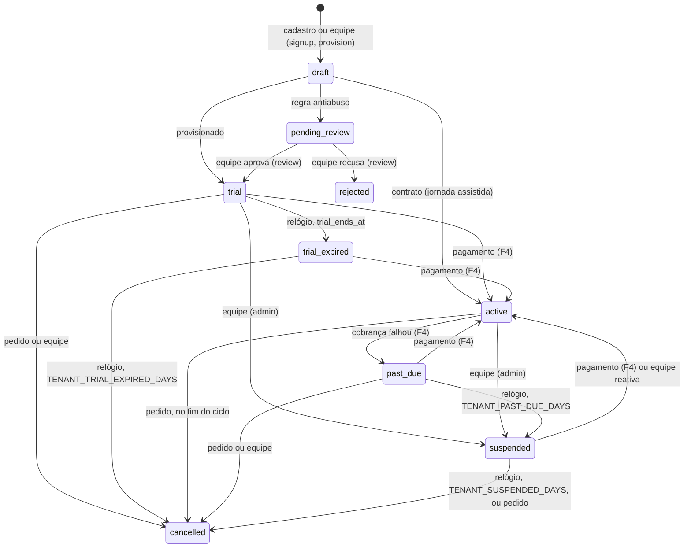

# Ciclo de vida do tenant (plataforma comercial, F3)

O estado de cada marca (`api.tenant.state`) é uma máquina de estados gravada no banco, com histórico em
`billing.tenant_state_event` (migration 0185). Nenhum código escreve `state` direto: tudo passa por
`transitionTenantState` (`packages/billing/src/tenant-state/transition.ts`), que confere a transição pela tabela do
diagrama, grava o evento, atualiza `state`, `state_since` e o espelho de `status`, invalida o cache de direitos e publica
`tenant.state_changed` no `ops.change_feed`. Desenho: doc 02 da plataforma (§Máquina de estados do tenant), sabatina
de 10/11 (PL15, PL17) e o brief da F3 (`.fila-merge/briefs/plataforma-f3.md`).

## Os estados

| Estado | Quando | API (chave secreta e publicável) | Console (PR b) |
| --- | --- | --- | --- |
| `draft` | Cadastro gravado, provisionando (dura a transação do provisionamento) | 401 `TENANT_PENDING_REVIEW` | tela de progresso |
| `pending_review` | Caiu numa regra antiabuso (e-mail grátis, limite por IP, faixa C3/C4): espera a equipe | 401 `TENANT_PENDING_REVIEW` | só a tela de espera |
| `rejected` | A equipe recusou o cadastro. Final | 401 `TENANT_REJECTED` | aviso e contato |
| `trial` | Provisionado; `trial_ends_at` é o prazo | sim, nos limites do teste; SSE sim, webhooks não | tudo, com o prazo no cabeçalho |
| `trial_expired` | Prazo do trial venceu sem contratação | 401 `TRIAL_EXPIRED` com `upgrade_url` | só Planos e módulos, Cobrança e Chaves |
| `active` | Pagou um módulo, ou contrato (jornada assistida) | sim | tudo |
| `past_due` | A cobrança falhou (F4); 7 dias de graça | sim, como `active` | tudo, com faixa de aviso |
| `suspended` | Sem pagamento depois da graça, ou a equipe suspendeu | 402 `SUBSCRIPTION_SUSPENDED` com `upgrade_url` | só Cobrança e Chaves |
| `cancelled` | Pedido do cliente, ou prazo vencido em `trial_expired`/`suspended`. Final; os dados ficam pelo prazo de guarda | 401 `TENANT_CANCELLED` | aviso de guarda |

Os estados sem acesso (`STATES_WITHOUT_ACCESS` em `@galaxie/billing`): `draft`, `pending_review`, `rejected`,
`trial_expired`, `suspended`, `cancelled`. Neles os direitos (`entitlements()`) não têm módulo nenhum. Webhooks só são
entregues em `active` e `past_due` (`TENANT_STATES_WITH_WEBHOOKS`): o trial tem SSE, mas não webhooks (doc 02, tabela
"O trial"); a entrega enfileirada de um tenant em trial vai para a DLQ com `tenant em trial: sem webhooks`, e o teste de
webhook do console nem entra na fila. `status` (`active`/`suspended`) segue gravado em espelho, `suspended` só quando
`state = 'suspended'`, até o PR `contrair` que o retira.

A API diz o motivo só a quem provou ter a chave: quem só tem o prefixo (ou erra o segredo) continua vendo o 401
`INVALID_KEY` comum, para o estado de um cliente não vazar pelo prefixo público. A chave publicável, que é pública,
responde o código do estado direto. Enquanto o job do relógio não gravou a transição, `trial` com `trial_ends_at`
vencido já responde `TRIAL_EXPIRED` (o mesmo fallback vale nos direitos).

## As transições

Toda transição tem um evento em `billing.tenant_state_event` com `cause` (`signup`, `provision`, `review`, `payment`,
`clock`, `admin`, `request`, `migration`), `actor` (`signup:<id>`, `galaxie:<id do usuário>`, `job:tenant.lifecycle`,
`api:admin`, `migration:0185`), `reason` e `payload`. A criação do tenant grava um evento com `from_state` nulo e
`to_state = 'draft'`. Transição fora da tabela lança `TenantStateError` e não grava nada. Tabela completa em
`packages/billing/src/tenant-state/state.ts` (`TENANT_TRANSITIONS`, `canTransition`).

As transições de pagamento (`trial → active`, `trial_expired → active`, `active → past_due`, `past_due → active`,
`suspended → active`) já existem na função; quem as dispara é a F4 (webhook do Stripe). Nada na F3 as chama.

## Os prazos (Ajustes › Clientes › Cadastros, trials e ciclo de vida)

Nunca número fixo no código (PL15): os prazos moram em `ops.runtime_setting`, seção `signup` do registro
(`packages/runtime-config/src/registry.ts`), e o advogado os confirma nos termos.

| Chave | Padrão | O que faz |
| --- | --- | --- |
| `TRIAL_DAYS` | 30 | Prazo do trial no cadastro: `trial_ends_at = agora + dias` (F2) |
| `TENANT_TRIAL_EXPIRED_DAYS` | 60 | `trial_expired` há mais de N dias → `cancelled` |
| `TENANT_PAST_DUE_DAYS` | 7 | `past_due` há mais de N dias → `suspended` (a graça: o cliente nunca descobre a falha do cartão pelo site fora do ar) |
| `TENANT_SUSPENDED_DAYS` | 30 | `suspended` há mais de N dias → `cancelled` |
| `TENANT_CANCELLED_RETENTION_DAYS` | 90 | Guarda depois de `cancelled`. Vencida, o job só avisa: **o produto não apaga nada** sem decisão do dono |
| `TRIAL_REMINDER_DAYS` | `23,29` | Dias do trial em que o e-mail de lembrete sai (PR c) |
| `MODULE_TRIAL_REMINDER_DAYS_BEFORE` | 2 | Dias antes do fim do teste de um módulo para o lembrete (PR c) |

Os dias contam a partir de `state_since`. Mudar um prazo no painel vale na próxima rodada do job.

## O relógio: `tenant.lifecycle`

Tarefa da fila (`@galaxie/db/queue-types`, executor em `services/ingestor/src/tasks/lifecycle.ts`), sem prévia, não
destrutiva, 3 tentativas. O scheduler do ingestor a enfileira uma vez por dia (`SCHEDULE_TENANT_LIFECYCLE`, padrão
`15 4 * * *` UTC; `off` desliga; com `QUEUE_MODE=run` o CLI `dist/cli/tenant-lifecycle.js` roda direto) e o painel
tem o "Rodar agora" (Ajustes › Sistema › Agenda dos jobs). Numa rodada ela:

1. lê os prazos de `runtime_setting`;
2. para cada tenant em `trial`, `trial_expired`, `past_due`, `suspended` e `cancelled`, aplica a transição devida (causa
   `clock`, ator `job:tenant.lifecycle`, o prazo e os dias no `payload`); a transição que a máquina recusa (outro
   processo mudou o tenant no meio) fica no log, sem derrubar a tarefa;
3. conta os `cancelled` com a guarda vencida (aviso; nada é apagado);
4. reenfileira `tenant.verify_domain` (`dedupe_key` = id do domínio) para cada domínio comprovado conferido há mais de
   24 h: se o TXT sumiu, `verified_at` fica e `last_error` registra (nenhuma origem sai sem decisão do dono).

Idempotente: a segunda rodada do dia não encontra nada a mudar. Ensaio na mão:
`pnpm --filter @galaxie/ingestor tenant:lifecycle --agora 2026-11-16T04:15:00Z`. Os e-mails de lembrete, trial vencido,
suspensão e cancelamento entram nesta tarefa no PR (c) da F3.

## Como a equipe age (Ajustes › Clientes › Organizações e marcas)

Na ficha da organização, cada marca mostra o estado, desde quando e o fim do trial, e só as ações que cabem no estado
atual, todas com motivo obrigatório (5 caracteres no mínimo), gravado em `billing.staff_action` (`brand.<ação>`, com o
antes e o depois) e no evento da máquina de estados (`cause = 'admin'`, ou `review` quando é a decisão da revisão):

| Ação | De → para | O que mais faz |
| --- | --- | --- |
| Aprovar | `pending_review → trial` | Marca a revisão da organização como aprovada e emite as chaves que faltavam (aparecem uma vez) |
| Recusar | `pending_review → rejected` | Marca a revisão da organização como recusada |
| Suspender | `trial`, `active`, `past_due → suspended` | As chaves respondem 402; `status` vira `suspended` |
| Reativar | `suspended → active` | — |
| Cancelar conta | `trial`, `trial_expired`, `active`, `past_due`, `suspended → cancelled` | Final; nada é apagado |
| Estender trial | `trial → trial` | Muda `trial_ends_at`; evento `admin` com o prazo antes e depois, sem mudar o estado |

Editar a organização e mudar a **revisão do cadastro** para "Aprovado" ou "Recusado" tem o mesmo efeito sobre as
marcas em `pending_review` (e, aprovando, emite as chaves como antes).

As rotas internas de admin da API (`PATCH /internal/admin/tenants/{id}`) continuam aceitando `status`: `suspended`
suspende pela máquina de estados (de `trial`, `active` ou `past_due`), `active` reativa um `suspended`; nos demais
estados `status` não reativa (409 `CONFLICT`: o estado manda). Trocar um plano com prazo (`trial`) por um pago leva
`trial`/`trial_expired` a `active`. O onboarding por essas rotas nasce em `draft` e vai a `trial` (plano com prazo) ou
`active` (contrato), com causa `provision` e ator `api:admin`.

## A migration 0185

Só expande: `api.tenant.state` (CHECK nos 9 estados, padrão `active` para a coluna nova), `state_since`, índice
`(state, state_since)` e `billing.tenant_state_event`. O backfill (entre `-- galaxie:backfill-0185:start/end`,
idempotente: só tenants sem evento) deriva o estado inicial: `status = 'suspended'` → `suspended`; organização com
`review_status = 'pending'` → `pending_review`, `'rejected'` → `rejected` (antes do prazo do trial, porque o cadastro
em revisão também nasce com `trial_ends_at`); `trial_ends_at <= now()` → `trial_expired`; `trial_ends_at > now()` ou
plano `trial` → `trial`; o resto → `active`. Cada tenant ganha um evento `migration` com o que foi lido. Tenants
legados com trial vencido ganham os 60 dias de `trial_expired` a partir da migration (`state_since = now()`), não do
fim do trial: nenhum vai a `cancelled` na primeira madrugada depois do deploy.

## O que ficou de fora

- **PR (b) `plataforma/f3-loja`:** o console por estado (menu, faixas de aviso, crachá; decisão 8), o teste por módulo
  pela loja (`billing.module_trial`, migration 0186; decisão 9).
- **PR (c) `plataforma/f3-checklist`:** o checklist da primeira sessão, o widget de exemplo, os e-mails do worker e do
  console (`billing.tenant_notification`, migration 0187; decisões 10 e 11).
- **F4:** as transições de pagamento (`trial → active`, `past_due`, reativação por pagamento), o Stripe, o cancelamento
  pelo cliente no fim do ciclo (`request`) e a exportação de dados.
- **Sem decisão do dono:** o expurgo depois da guarda de `cancelled` (o job só avisa), remover origem de domínio cujo
  TXT sumiu, e o job `tenant.provision` do doc 02 (o provisionamento segue síncrono até haver passo externo).
