# Avaliação de navegação da demo

Outubro de 2026. Avaliação da área logada da demo (`apps/demo`) com a pergunta "onde a pessoa se perde?".

## Como foi feita

- Demo e API rodando localmente contra a infra de dev, com login pelo usuário de teste admin da base de dev (o código de acesso sai no log do servidor quando não há SMTP).
- Caminhos percorridos no navegador, em desktop (1366 px) e celular (375 px):
  - Explorar → Futebol → Brasileirão Série A (temporadas, classificação, jogos) → jogo → time → jogador;
  - Fórmula 1 → campeonato → piloto;
  - Ao vivo, clássicos, países, locais, Olimpíadas e Pan, hipismo, MMA, busca e Ajustes/Operação;
  - troca de idioma e de temporada no meio do caminho.
- Varredura automática dos links: cerca de 170 páginas abertas a partir de todas as páginas de topo, com até três exemplos de cada tipo de link. Cada página foi conferida por status, "não encontrado" (404) e erro de execução.
- Heurísticas usadas:
  - saber onde se está: título, trilha e item ativo no menu;
  - voltar: botão do navegador, links para o pai, filtros e temporada mantidos;
  - rotas: becos sem saída e páginas quebradas;
  - consistência de links e do menu entre desktop e celular;
  - estados vazios e de carregamento.

## O que já funciona bem

- O botão **voltar do navegador** restaura a página como estava, com a aba, a rodada e a rolagem.
- **Temporada na URL** (`?temporada=`) no time, no jogador e na competição: link compartilhável, e a troca de idioma recarrega a mesma URL e mantém a temporada.
- **Piloto de F1 em `/times/{id}`**: abre de verdade (o piloto é um participante, como um time). Lutadores de MMA também.
- Fora o caso do item 6, nenhum link levou a 404 ou a erro na varredura.
- O **menu é o mesmo** no desktop e na gaveta do celular.
- Os links de times, competições e jogadores são consistentes nos cards: escudo e nome levam ao time, o card do jogo leva ao jogo, a tabela leva ao time.

## Problemas, em ordem de impacto

Legenda: ✅ corrigido neste PR · 📝 proposta (não implementada).

### 1. A tela inicial (Explorar) some do mapa ✅

**Onde:** em toda a área logada. Depois do login a pessoa cai no Explorar (`/`), mas o menu não tem item para ele. O único caminho de volta é clicar no logo, e nada indica que o logo leva para lá. Na prática, quem sai do Explorar não volta mais.

**Correção:** item **Explorar** no topo do menu, acima de Ao vivo, aceso quando a pessoa está nele. Ele aparece no desktop, no menu recolhido (só o ícone) e na gaveta do celular.

### 2. A trilha some quando se chega por link, aba nova ou troca de idioma ✅

**Onde:** jogo, competição, time, jogador, local, clássico e hipismo. A trilha (breadcrumb) guarda o caminho que a pessoa percorreu na aba. Ela fica vazia em três casos:

- quando a pessoa chega por um link compartilhado;
- quando abre o jogo numa aba nova;
- quando troca de idioma (a troca apaga a trilha de propósito, porque os rótulos estavam no idioma anterior).

Nesses casos o cabeçalho mostra só o nome da página, e não há por onde subir para a competição ou o esporte.

| Entrada direta no jogo | Piloto depois de trocar o idioma |
| --- | --- |
|  |  |

**Correção:** cada página informa os **pais** na hierarquia: esporte → competição → jogo; esporte → time; time → jogador; país → local; Hipismo → atleta, cavalo, prova ou campeonato. Quando a trilha começaria nesta página, ela começa pelos pais. Quando há caminho percorrido, vale o caminho, como antes.

| Depois: entrada direta no jogo | Depois: piloto sem trilha anterior |
| --- | --- |
|  |  |

### 3. O menu não mostra onde se está nas páginas internas ✅

**Onde:** competição, jogo, time, jogador, clássico e local. O item do menu só acende quando a URL é a do próprio item (`/esportes/football`). Na competição, no jogo e no time, nenhum item fica aceso.

**Correção:** o primeiro pai da página acende o item do menu. Um jogo do Brasileirão acende **Futebol**, um piloto acende **Fórmula 1** e um estádio acende o país, quando o país está no menu. Veja os prints "depois" dos itens 2 e 4.

### 4. Voltar do jogo para a competição perde a aba, a rodada e a temporada ✅

**Onde:** na página da competição (`/competicoes/{slug}`) e no link da competição no placar do jogo.

- A aba Classificação/Jogos não ia para a URL. O link do jogo para a competição, a trilha e um recarregamento sempre caíam em Classificação, na temporada padrão. Para um jogo de 2024, a pessoa via a tabela de 2026.
- Na fileira de rodadas, a rodada ativa (ex.: 32 de 38) ficava fora da tela, à direita. Não dava para ver qual rodada estava aberta.
- Trocar a temporada na aba Jogos voltava para Classificação.

**Correção:**

- A aba vai para a URL (`?aba=jogos`) com o `UrlTabs` que a página do jogo já usa.
- O link da competição no jogo, e o pai "competição" da trilha, abrem na aba Jogos, na rodada do jogo e na temporada que contém a data do jogo (`?aba=jogos&rodada=…&data=AAAA-MM-DD`).
- O chip ativo fica centralizado na fileira, que rola só na horizontal: a página não pula.
- Os chips de temporada mantêm a aba.

### 5. Celular: o menu não fecha depois de escolher um item ✅

**Onde:** no menu lateral (gaveta) do celular. A navegação acontece por trás e a gaveta continua aberta, cobrindo a página nova. A pessoa precisa fechar o menu na mão e não percebe que a página mudou.

| Antes | Depois |
| --- | --- |
|  |  |

**Correção:** a gaveta fecha quando a página muda. A busca já fazia isso.

### 6. Rota quebrada: `/paises/world` ✅

**Onde:** na competição de F1, onde o país "World" virava link. O mesmo valeria para qualquer competição, time ou local cujo "país" da API não seja um país. A API responde 400 ("Parâmetro inválido") para `world`, e a demo mostrava a tela de erro.

**Correção:**

- `countryHref()` só gera link para código de país (ISO2 ou extensão como `GB-ENG`); fora disso, o nome aparece sem link.
- A página de país responde "não encontrado" para um código inválido (links antigos) em vez de chamar a API.

### 7. Páginas de topo viravam "filhas" de qualquer página ✅

**Onde:** na trilha, para Ao vivo, Explorar, esportes, ajustes e documentação abertos por outro caminho que não o menu: URL digitada, voltar do navegador, link na página. A trilha mostrava, por exemplo, "Max Verstappen › Ao vivo".

**Correção:** essas páginas sempre começam uma trilha nova, como já acontecia com o clique no menu.

### 8. Toda aba do navegador se chamava "Galaxie Sports" ✅ (parcial)

**Onde:** esporte, competição, jogo, time, jogador e país. No histórico do navegador (clique longo no voltar) e nas abas, todas as páginas internas tinham o mesmo título, e não dava para achar a página certa.

**Correção:** `generateMetadata` com o nome da página ("Cruzeiro x Remo · Galaxie Sports", "Brasileirão Série A · Galaxie Sports"…). Os dados vêm das mesmas funções cacheadas que a página usa.

**Falta (📝):** local, clássico e as páginas internas do hipismo, no mesmo padrão.

### 9. Piloto e lutador usam a página de time 📝

**Onde:** `/times/{id}` de um piloto de F1 ou de um lutador. A página abre, mas mostra o card "Elenco · Sem elenco nem escalações registrados", que é um beco sem saída e não faz sentido para um piloto.

**Proposta:**

- Esconder o card de elenco quando o participante não é um time (`team.kind !== 'team'`).
- A médio prazo, uma rota própria (`/pilotos/{id}`, `/lutadores/{id}`) com campeonato, equipe e corridas ou lutas. Mantém `/times/{id}` redirecionando.

### 10. Temporada divergente na F1 📝

**Onde:** na página da Fórmula 1 e no campeonato. O card do esporte mostra "2026" (temporada corrente do catálogo), mas o campeonato abre em 2024, a única temporada com dados. A aba de corridas se chama "Jogos".

**Proposta:** mostrar no card do esporte a temporada com dados (a mesma que a competição vai abrir) e chamar a aba de "Corridas" quando a competição tem sessões.

### 11. Seções vazias sem aviso (hipismo) 📝

**Onde:** `/hipismo` na base de dev, que não tem dados de hipismo. "Destaques", "Provas recentes" e "Campeonatos" aparecem só com o título, sem conteúdo nem explicação. Parece que a página está quebrada ou carregando.

**Proposta:** usar o `EmptyState` existente em cada seção vazia, com um texto curto ("Nenhuma prova recente na base"). Precisa de textos novos nos três idiomas.

### 12. Detalhes menores 📝

- **Trilha no celular:** mostra só o item anterior, truncado ("Fórm… › Campeonato Mundial…"). Proposta: no celular, trocar por um botão "‹ Fórmula 1" (voltar ao pai) e deixar o título da página na linha de baixo.
- **Esqueleto das páginas de topo:** durante o carregamento, mostra por um instante a trilha anterior antes de começar a nova. Proposta: passar o tipo da página também ao esqueleto.
- **Grupo "World"** na página do esporte vinha da API sem tradução. ✅ Corrigido na segunda rodada (item 13): agora entra em "Internacionais".
- **Idioma do conteúdo:** com a interface em inglês, as sessões da F1 aparecem em espanhol ("Carrera", "Clasificación"), porque o conteúdo segue a voz do país. Não é navegação, mas confunde quem acabou de trocar o idioma. Vale revisar a regra do idioma do conteúdo para corridas.
- **Busca (⌘K):** abre e leva aos resultados sem problema. Não entra na trilha como pai, o que é o esperado.

## Segunda rodada: celular, ordem e organização

Depois da primeira entrega, o pedido foi olhar o celular e a organização das listas. O exemplo: no Explorar, o Brasil abre "uma montanha de campeonatos" e fica difícil achar a Libertadores, que o Brasil disputa. Medi a altura das páginas no celular (375 px) antes e depois.

| Página (celular) | Antes | Depois |
| --- | --- | --- |
| País: Brasil | 12.900 px; Libertadores a 3.540 px do topo | 1.950 px (só o futebol); Libertadores a 900 px |
| Esporte: Futebol | 13.200 px; Libertadores e Champions no fim, depois dos 17 países | 8.900 px; Champions, Libertadores e Copa do Mundo no topo |
| Explorar | 9.500 px | 6.100 px |

### 13. País: uma montanha de campeonatos, Libertadores escondida ✅

**Onde:** `/paises/{código}`. O Brasil tinha 142 competições de 7 esportes numa página só. No futebol vinham primeiro as 40 nacionais (Série A, Copa do Brasil, 27 estaduais, divisões de acesso, copas regionais) e só depois as continentais.

| Antes (celular) | Depois (celular) |
| --- | --- |
| 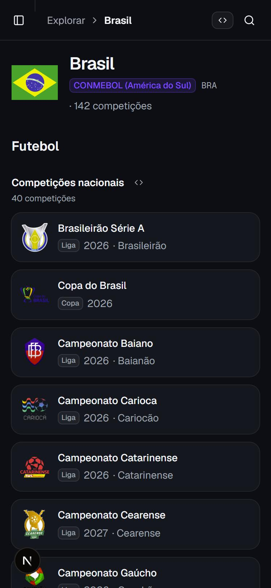 | 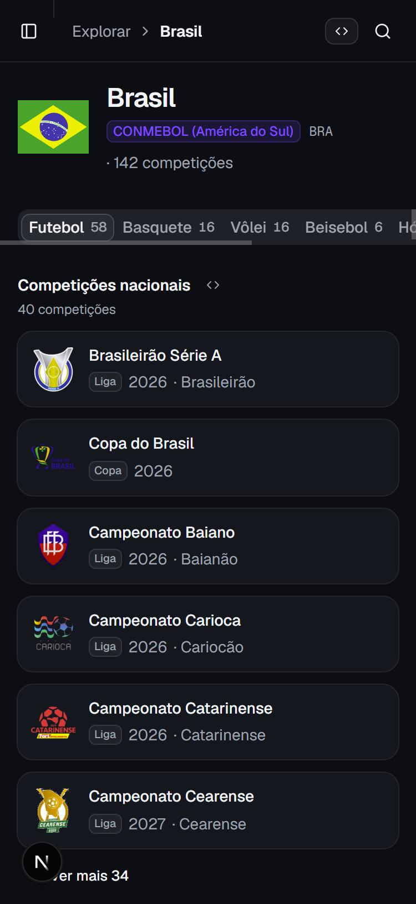 |

**Correção:**

- **Um esporte por vez**, em abas com a contagem (Futebol 58, Basquete 16…), na URL (`?esporte=basketball`). O futebol abre por padrão. O "Ver país" da página do esporte já abre na aba daquele esporte.
- **Clubes juntos, seleção no fim:** nacionais → copas continentais → mundiais de clubes → seleção.
- **Cada grupo mostra as 6 primeiras** competições (na ordem de importância da API) e esconde o resto atrás de "Ver mais 34", que abre na própria página.

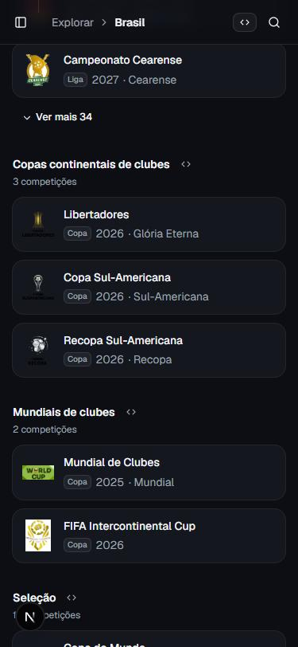

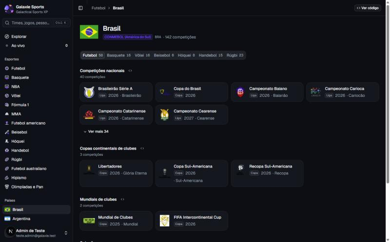

### 14. Esporte: as internacionais ficavam no fim ✅

**Onde:** `/esportes/{esporte}`. Os grupos seguiam a ordem do menu de países, e "World" (Champions, Libertadores, Copa do Mundo) caía no fim, depois de 20 países. Dentro de cada grupo a ordem era alfabética: a Conference League vinha antes da Champions.

| Antes | Depois |
| --- | --- |
| 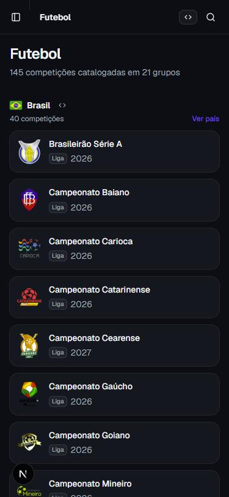 | 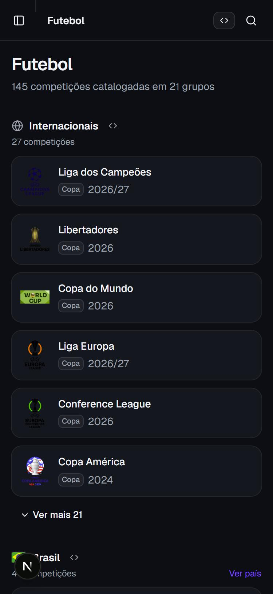 |

**Correção:**

- O grupo **Internacionais** vem primeiro, e "World" entra nele com o rótulo traduzido.
- Dentro de cada grupo, os **destaques da API** vêm na frente: os mesmos do "Em destaque" do Explorar e a liga principal de cada país. Depois vêm tier e nome.
- Cada grupo mostra 6 competições, com "Ver mais" para o resto.

### 15. Explorar no celular: um esporte por tela ✅

**Onde:** home, no celular. Cada esporte era um card de largura inteira, com três contadores e logos: 12 esportes ocupavam quase 3.000 px antes de chegar aos países.

**Correção:** esportes em **duas colunas** no celular. O card compacto mostra só o número de competições e os logos; o futebol (destaque) continua com a linha inteira. Do tablet para cima nada muda.

| Antes | Depois |
| --- | --- |
| 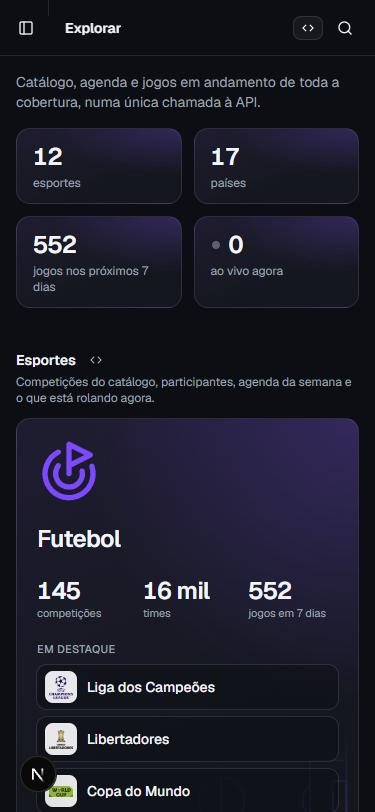 | 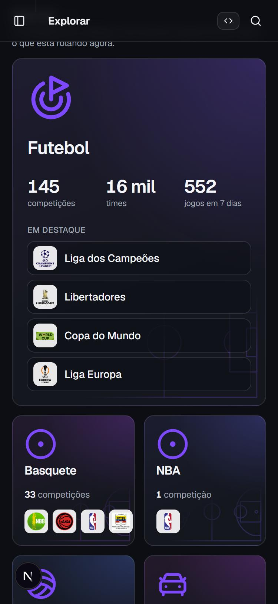 |

### 16. Busca: "liber" mostrava o Libertad antes da Libertadores ✅

**Onde:** na busca (⌘K e lupa no celular). No empate de casamento, os grupos vinham na ordem times → competições, então os times Libertad (Paraguai e Equador), Slovan Liberec e Libéria apareciam antes da Libertadores.

| Antes | Depois |
| --- | --- |
| 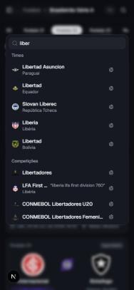 | 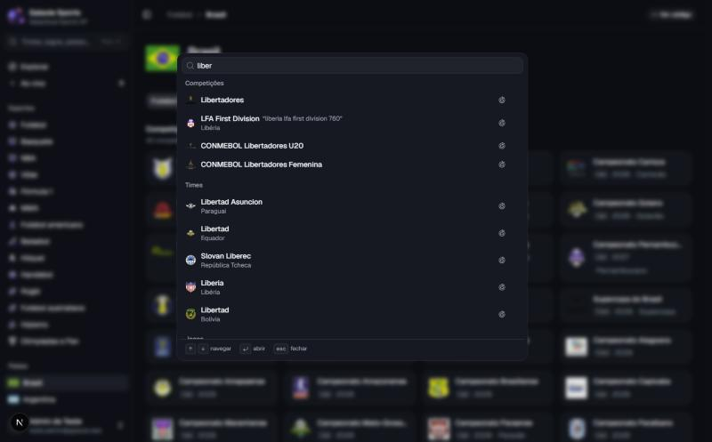 |

**Correção:** no empate, **competições antes de times**. São poucas e levam a muitas páginas. Os casamentos exatos continuam vencendo: "flamengo" mostra o time.

### 17. Campanha do time: nome cortado no celular ✅

**Onde:** o card "Nas competições" do time. Ao lado do selo da fase ("Eliminado nos 16 avos de final"), "Copa do Brasil" virava "Copa do …".

**Correção:** o nome passa a ocupar até duas linhas, em vez de ser cortado numa linha só.

### 18. Ainda no celular: propostas 📝

- **Países no Explorar:** os 17 cards de país ainda somam uns 3.000 px. Proposta: no celular, uma lista compacta (bandeira, nome, liga principal e jogo em destaque) e o card rico só a partir do tablet.
- **Estaduais separados das nacionais:** ✅ feito no item 20.
- **Fileira de abas e de rodadas:** no celular rolam na horizontal sem indicar que há mais. Proposta: um degradê na borda direita.
- **Página do jogo no celular:** o card "Sobre o jogo" (relevância por país, com 11 países) vem antes do contexto e dos detalhes. Proposta: no celular, recolher a relevância por país num "Ver por país".

### 19. Ao vivo: a liga não dizia de que país é ✅

**Onde:** nos grupos do Ao vivo e nos cards de jogo em todas as listas. Os grupos traziam só o logo e o nome da liga: "First NL", "Iraqi League", "Liga Leumit" e até um "League" sozinho. Quem não conhece a liga não sabia de onde ela era.

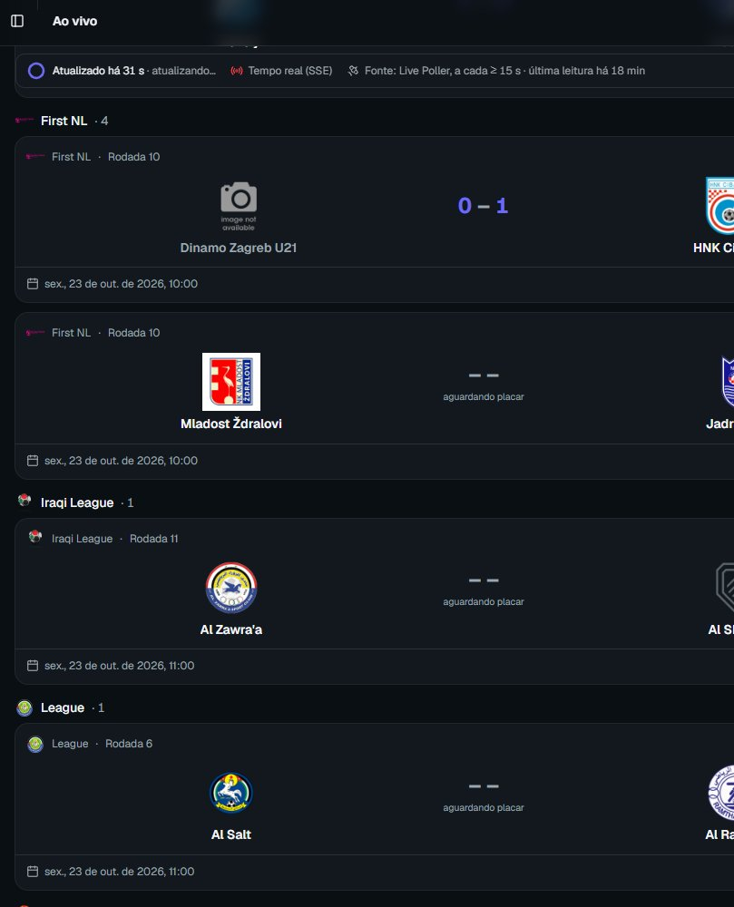

**Correção:**

- A API passa a mandar o país da competição junto com o jogo (`competition.country`, com código, nome no idioma pedido e bandeira). Vale para qualquer país, não só os 17 do menu. É uma mudança aditiva no contrato `EventCompetitionRef`.
- O grupo do Ao vivo mostra a **bandeira e o nome do país antes da liga** ("Colômbia · Campeonato Colombiano").
- O card de jogo mostra a bandeira ao lado do logo da liga.
- As competições internacionais (`WORLD`) ficam sem bandeira: Champions e Libertadores dizem por si de onde são.

| Desktop | Celular |
| --- | --- |
| 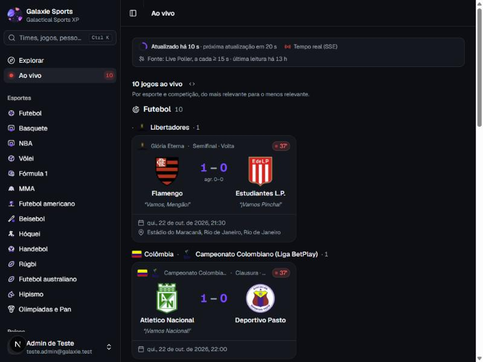 | 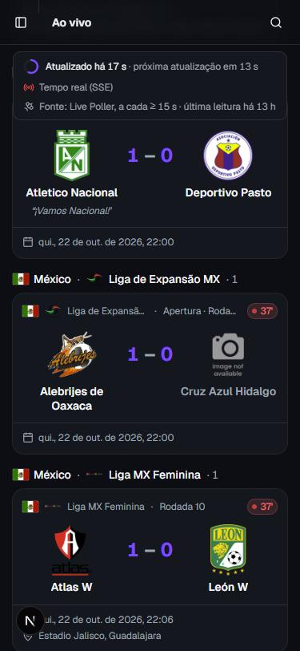 |

## Terceira rodada: backlog de navegação

Os épicos do backlog de navegação, um PR cada. A ordem e as decisões de produto estão no próprio backlog.

### 20. Nacionais × estaduais e regionais (E1) ✅

**Onde:** página do país e página do esporte. A API não dizia o que é estadual. O Brasil mostrava 40 "competições nacionais" misturadas (Série A, Copa do Brasil, 27 estaduais, divisões de acesso, copas regionais). A Série B, de tier 2, ficava atrás dos estaduais de tier 1. Na página do Futebol, a Copa do Brasil caía entre os estaduais por ordem alfabética.

| Antes (celular) | Depois (celular) |
| --- | --- |
| 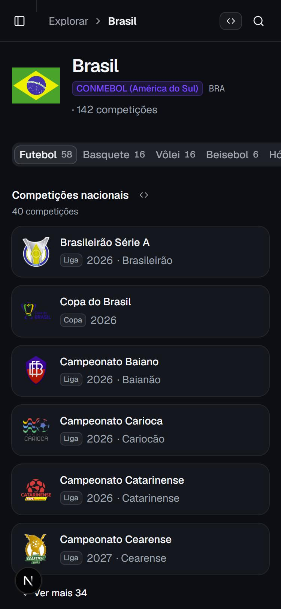 | 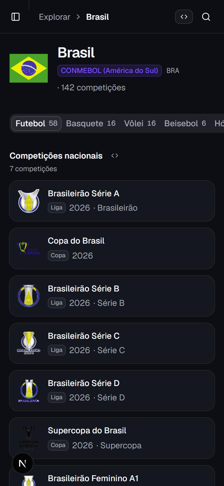 |

**Decisão de produto:** as divisões de acesso (Série B, C e D) ficam **junto das nacionais**, em ordem de divisão. Os estaduais e as copas regionais vão para um grupo próprio, no fim.

**Correção:**

- **Configuração:** uma lista `regional` por esporte em `config/geo/competition-scope.yaml`, ao lado do `featured`. No Brasil, os 27 estaduais, o Paulistão A2 e as copas regionais (Nordeste, Verde, Norte, Sul-Sudeste, Centro-Oeste). Os grandes estaduais vêm primeiro.
- **API:**
  - Na página do país (`/v1/countries/{code}/competitions`), o novo escopo `regional` vira o grupo "Estaduais e regionais". O grupo doméstico fica só com as nacionais, na ordem do `featured`: Série A, Copa do Brasil, Série B, C, D, Supercopa e Feminino A1.
  - O catálogo (`/v1/competitions` e o detalhe) ganha `level` (`national`, `regional` ou `null` nas internacionais) e `order` (posição editorial no país). Os dois campos são aditivos.
- **Demo:**
  - Na página do país, a ordem dos grupos fica Nacionais → Copas continentais → Mundiais → Seleção → Estaduais e regionais.
  - Na página do esporte, dentro do país, as nacionais vêm antes das regionais, na ordem editorial da API.
- **Teste:** toda doméstica do Brasil de tier 1 ou 2 precisa estar no `featured` (nacional) ou no `regional`. Uma competição nova sem nível quebra o teste em vez de voltar a misturar.

| Estaduais e regionais no fim do Brasil | Futebol: Brasil em ordem de divisão |
| --- | --- |
| 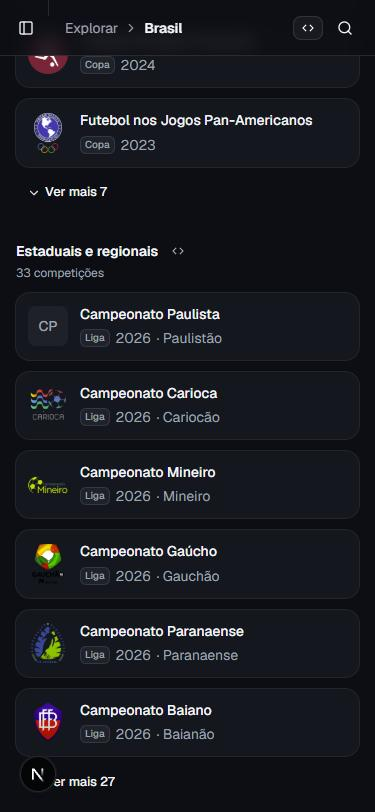 | 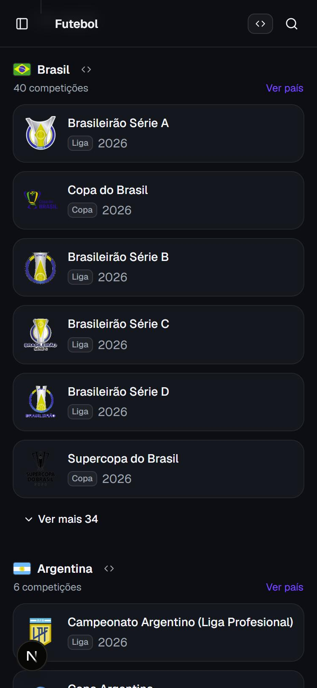 |

No celular, a Libertadores fica a 943 px do topo do Brasil (antes do #200 ficava a 3.540 px).

## Proposta maior: trilha hierárquica fixa 📝

A causa de boa parte dos problemas é a trilha contar o **histórico** da aba, e não **onde a página fica**. A correção deste PR resolve os casos sem histórico, porque a trilha passa a começar pelos pais. Mesmo assim, a mesma página ainda mostra trilhas diferentes conforme o caminho:

- "Ao vivo › Cruzeiro x Remo";
- "Brasil › Brasileirão › Cruzeiro x Remo".

Isso é útil para voltar, mas não ensina a estrutura do site. Proposta para discutir:

- **Trilha sempre hierárquica** (Futebol › Brasileirão Série A › Rodada 32 › Cruzeiro x Remo).
- **Botão "voltar para …"** separado, com a origem real da visita (Ao vivo, Brasil, busca).

O código já está preparado: os `parents` de cada página são essa hierarquia.

## O que mudou no código

- `lib/trail.ts`:
  - `ROOT_KINDS`: Explorar, Ao vivo, esportes, ajustes e documentação sempre começam trilha nova;
  - `applyVisit(…, parents)` começa pelos pais quando a trilha estaria vazia.
- `PageHeader`: recebe `parents`. O primeiro deles acende o item do menu, por `lib/active-section.ts` e `SectionMarker`.
- `AppSidebar`:
  - item Explorar;
  - item ativo pela seção da página;
  - fecha a gaveta do celular ao navegar.
- `lib/navigation.ts`:
  - `countryHref` (só códigos de país);
  - `sportParent` e `equestrianParent`;
  - `eventCompetitionHref` (aba, rodada e data do jogo).
- Competição:
  - aba na URL com `UrlTabs`;
  - `?data=` escolhe a temporada;
  - chips por `FilterChip`, que mantém a aba e centraliza o chip ativo.
- Jogo, time, jogador, local, clássico, país e hipismo: `parents` e links de país seguros.
- Títulos de aba (`generateMetadata`) em esporte, competição, jogo, time, jogador e país.
- Testes: `lib/trail.test.ts` (páginas de topo e pais) e `lib/navigation.test.ts`.

Segunda rodada:

- `ShowMore` (`components/sport/show-more.tsx`): grade com os N primeiros e "Ver mais N".
- País:
  - abas por esporte com `UrlTabs` (`?esporte=`);
  - grupos na ordem `SCOPE_ORDER`.
- Esporte:
  - Internacionais primeiro, com "World" incluído;
  - destaques do `/v1/explore/summary` na frente.
- Explorar: `SPORT_GRID` em duas colunas no celular, com o card compacto.
- Busca: `GROUP_ORDER` com competições antes de times (teste em `lib/search/entries.test.ts`).
- Campanha: `line-clamp-2` no nome da competição.
