# Avaliação de navegação da demo

Outubro de 2026. Avaliação da área logada da demo (`apps/demo`) com a pergunta "onde a pessoa se perde?".

## Como foi feita

- Demo e API rodando localmente contra a infra de dev, com login pelo usuário de teste admin da base de dev (o código de acesso sai no log do servidor quando não há SMTP).
- Caminhos percorridos no navegador, em desktop (1366 px) e celular (375 px):
  - Explorar → Futebol → Brasileirão Série A (temporadas, classificação, jogos) → jogo → time → jogador;
  - Fórmula 1 → campeonato → piloto;
  - Ao vivo, clássicos, países, locais, Olimpíadas e Pan, hipismo, MMA, busca e Ajustes/Operação;
  - troca de idioma e de temporada no meio do caminho.
- Varredura automática dos links: cerca de 170 páginas abertas a partir de todas as páginas de topo, com até três exemplos de cada tipo de link. Cada página foi conferida por status, "não encontrado" (404) e erro de execução.
- Heurísticas usadas:
  - saber onde se está: título, trilha e item ativo no menu;
  - voltar: botão do navegador, links para o pai, filtros e temporada mantidos;
  - rotas: becos sem saída e páginas quebradas;
  - consistência de links e do menu entre desktop e celular;
  - estados vazios e de carregamento.

## O que já funciona bem

- O botão **voltar do navegador** restaura a página como estava, com a aba, a rodada e a rolagem.
- **Temporada na URL** (`?temporada=`) no time, no jogador e na competição: link compartilhável, e a troca de idioma recarrega a mesma URL e mantém a temporada.
- **Piloto de F1 em `/times/{id}`**: abre de verdade (o piloto é um participante, como um time). Lutadores de MMA também.
- Fora o caso do item 6, nenhum link levou a 404 ou a erro na varredura.
- O **menu é o mesmo** no desktop e na gaveta do celular.
- Os links de times, competições e jogadores são consistentes nos cards: escudo e nome levam ao time, o card do jogo leva ao jogo, a tabela leva ao time.

## Problemas, em ordem de impacto

Legenda: ✅ corrigido neste PR · 📝 proposta (não implementada).

### 1. A tela inicial (Explorar) some do mapa ✅

**Onde:** em toda a área logada. Depois do login a pessoa cai no Explorar (`/`), mas o menu não tem item para ele. O único caminho de volta é clicar no logo, e nada indica que o logo leva para lá. Na prática, quem sai do Explorar não volta mais.

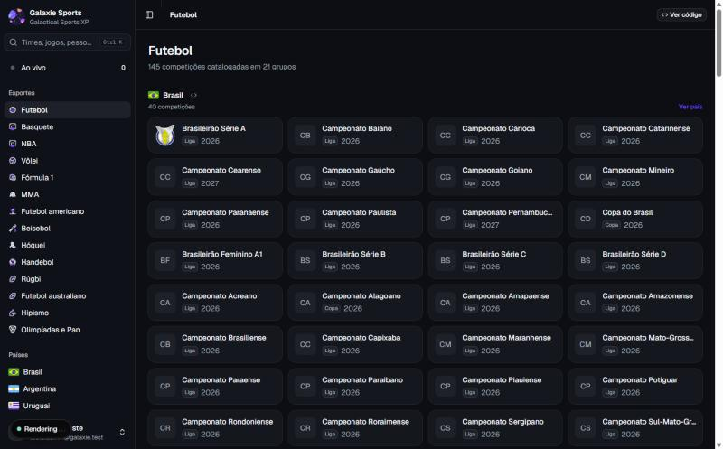

**Correção:** item **Explorar** no topo do menu, acima de Ao vivo, aceso quando a pessoa está nele. Ele aparece no desktop, no menu recolhido (só o ícone) e na gaveta do celular.

### 2. A trilha some quando se chega por link, aba nova ou troca de idioma ✅

**Onde:** jogo, competição, time, jogador, local, clássico e hipismo. A trilha (breadcrumb) guarda o caminho que a pessoa percorreu na aba. Ela fica vazia em três casos:

- quando a pessoa chega por um link compartilhado;
- quando abre o jogo numa aba nova;
- quando troca de idioma (a troca apaga a trilha de propósito, porque os rótulos estavam no idioma anterior).

Nesses casos o cabeçalho mostra só o nome da página, e não há por onde subir para a competição ou o esporte.

| Entrada direta no jogo | Piloto depois de trocar o idioma |
| --- | --- |
| 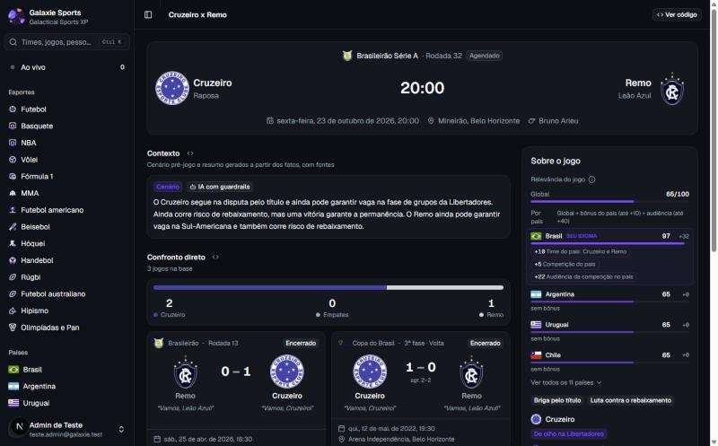 | 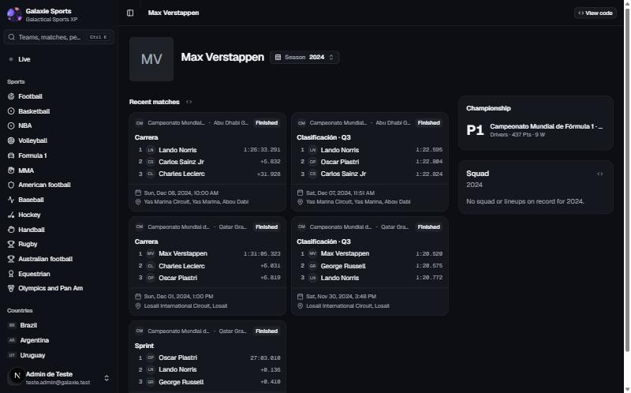 |

**Correção:** cada página informa os **pais** na hierarquia: esporte → competição → jogo; esporte → time; time → jogador; país → local; Hipismo → atleta, cavalo, prova ou campeonato. Quando a trilha começaria nesta página, ela começa pelos pais. Quando há caminho percorrido, vale o caminho, como antes.

| Depois: entrada direta no jogo | Depois: piloto sem trilha anterior |
| --- | --- |
| 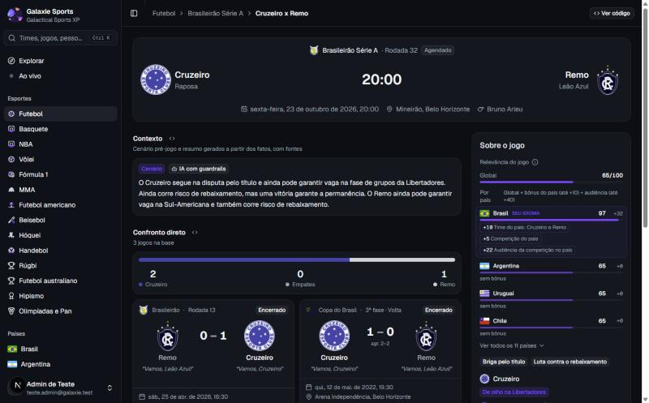 | 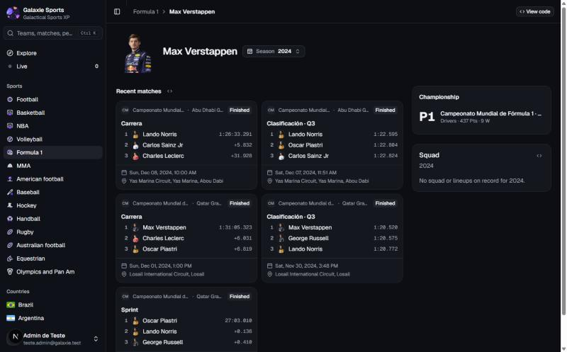 |

### 3. O menu não mostra onde se está nas páginas internas ✅

**Onde:** competição, jogo, time, jogador, clássico e local. O item do menu só acende quando a URL é a do próprio item (`/esportes/football`). Na competição, no jogo e no time, nenhum item fica aceso.

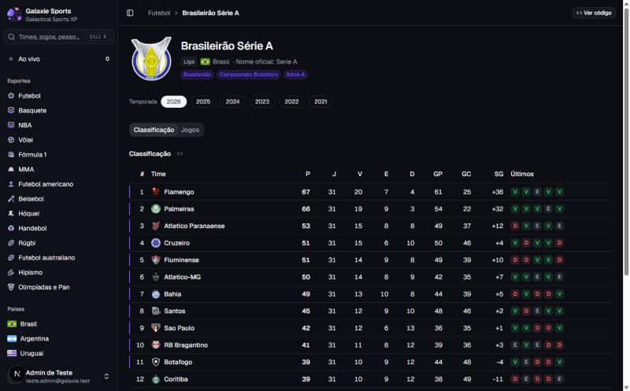

**Correção:** o primeiro pai da página acende o item do menu. Um jogo do Brasileirão acende **Futebol**, um piloto acende **Fórmula 1** e um estádio acende o país, quando o país está no menu. Veja os prints "depois" dos itens 2 e 4.

### 4. Voltar do jogo para a competição perde a aba, a rodada e a temporada ✅

**Onde:** na página da competição (`/competicoes/{slug}`) e no link da competição no placar do jogo.

- A aba Classificação/Jogos não ia para a URL. O link do jogo para a competição, a trilha e um recarregamento sempre caíam em Classificação, na temporada padrão. Para um jogo de 2024, a pessoa via a tabela de 2026.
- Na fileira de rodadas, a rodada ativa (ex.: 32 de 38) ficava fora da tela, à direita. Não dava para ver qual rodada estava aberta.
- Trocar a temporada na aba Jogos voltava para Classificação.

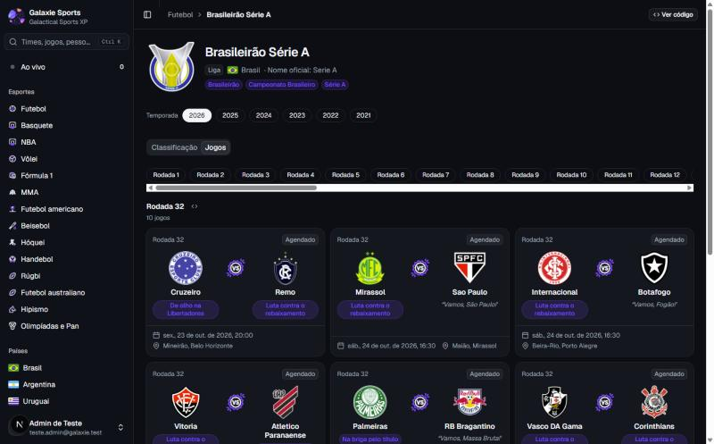

**Correção:**

- A aba vai para a URL (`?aba=jogos`) com o `UrlTabs` que a página do jogo já usa.
- O link da competição no jogo, e o pai "competição" da trilha, abrem na aba Jogos, na rodada do jogo e na temporada que contém a data do jogo (`?aba=jogos&rodada=…&data=AAAA-MM-DD`).
- O chip ativo fica centralizado na fileira, que rola só na horizontal: a página não pula.
- Os chips de temporada mantêm a aba.

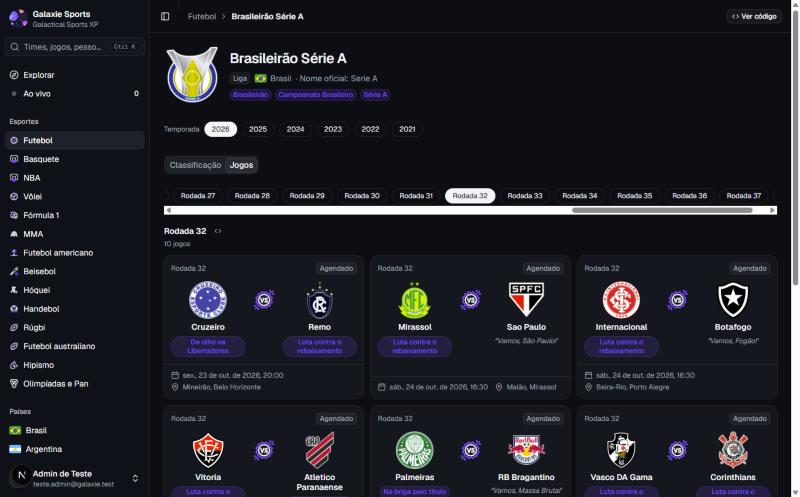

### 5. Celular: o menu não fecha depois de escolher um item ✅

**Onde:** no menu lateral (gaveta) do celular. A navegação acontece por trás e a gaveta continua aberta, cobrindo a página nova. A pessoa precisa fechar o menu na mão e não percebe que a página mudou.

| Antes | Depois |
| --- | --- |
| 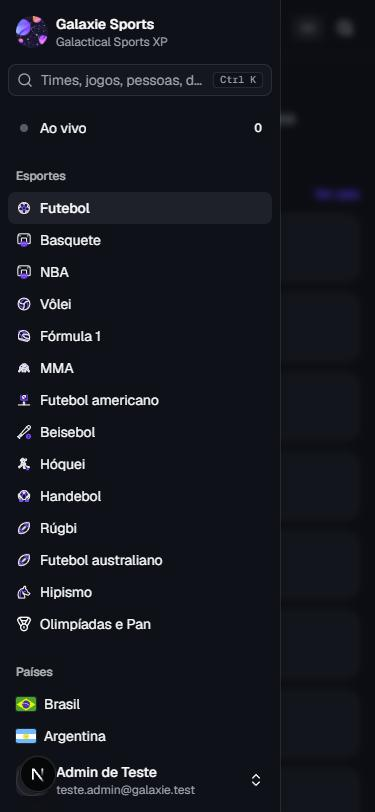 | 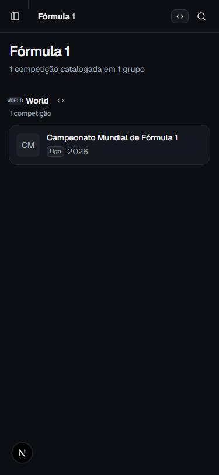 |

**Correção:** a gaveta fecha quando a página muda. A busca já fazia isso.

### 6. Rota quebrada: `/paises/world` ✅

**Onde:** na competição de F1, onde o país "World" virava link. O mesmo valeria para qualquer competição, time ou local cujo "país" da API não seja um país. A API responde 400 ("Parâmetro inválido") para `world`, e a demo mostrava a tela de erro.

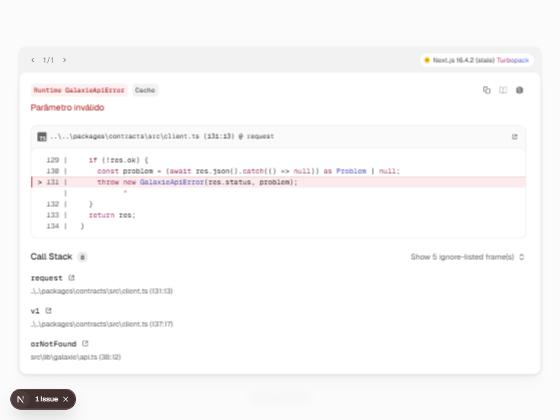

**Correção:**

- `countryHref()` só gera link para código de país (ISO2 ou extensão como `GB-ENG`); fora disso, o nome aparece sem link.
- A página de país responde "não encontrado" para um código inválido (links antigos) em vez de chamar a API.

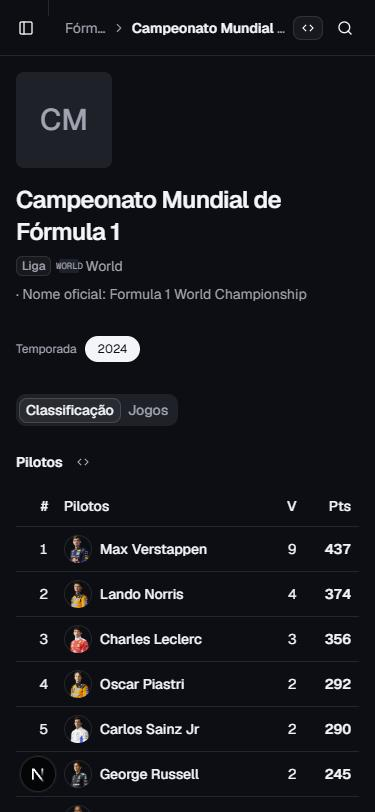

### 7. Páginas de topo viravam "filhas" de qualquer página ✅

**Onde:** na trilha, para Ao vivo, Explorar, esportes, ajustes e documentação abertos por outro caminho que não o menu: URL digitada, voltar do navegador, link na página. A trilha mostrava, por exemplo, "Max Verstappen › Ao vivo".

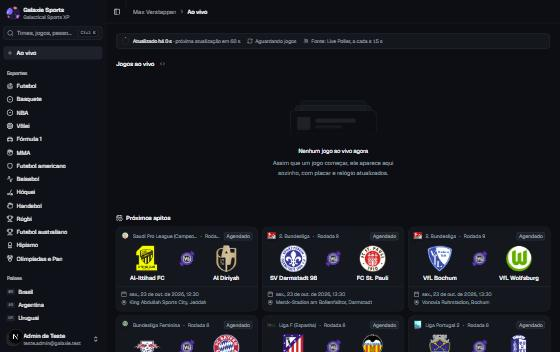

**Correção:** essas páginas sempre começam uma trilha nova, como já acontecia com o clique no menu.

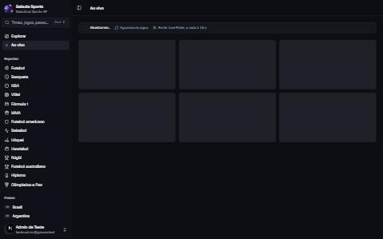

### 8. Toda aba do navegador se chamava "Galaxie Sports" ✅ (parcial)

**Onde:** esporte, competição, jogo, time, jogador e país. No histórico do navegador (clique longo no voltar) e nas abas, todas as páginas internas tinham o mesmo título, e não dava para achar a página certa.

**Correção:** `generateMetadata` com o nome da página ("Cruzeiro x Remo · Galaxie Sports", "Brasileirão Série A · Galaxie Sports"…). Os dados vêm das mesmas funções cacheadas que a página usa.

**Falta (📝):** local, clássico e as páginas internas do hipismo, no mesmo padrão.

### 9. Piloto e lutador usam a página de time 📝

**Onde:** `/times/{id}` de um piloto de F1 ou de um lutador. A página abre, mas mostra o card "Elenco · Sem elenco nem escalações registrados", que é um beco sem saída e não faz sentido para um piloto.

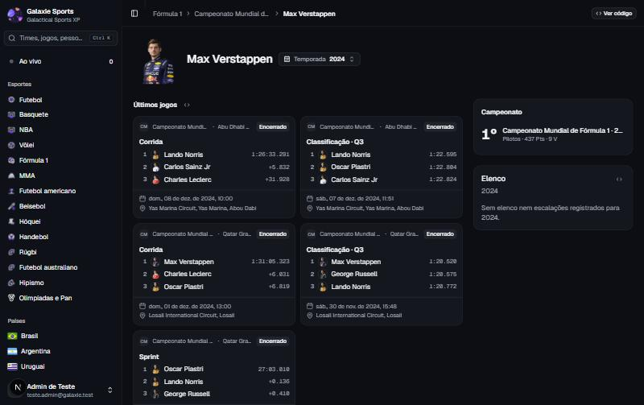

**Proposta:**

- Esconder o card de elenco quando o participante não é um time (`team.kind !== 'team'`).
- A médio prazo, uma rota própria (`/pilotos/{id}`, `/lutadores/{id}`) com campeonato, equipe e corridas ou lutas. Mantém `/times/{id}` redirecionando.

### 10. Temporada divergente na F1 📝

**Onde:** na página da Fórmula 1 e no campeonato. O card do esporte mostra "2026" (temporada corrente do catálogo), mas o campeonato abre em 2024, a única temporada com dados. A aba de corridas se chama "Jogos".

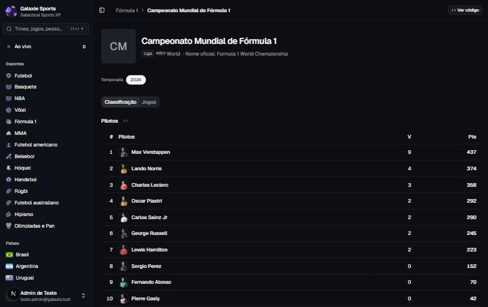

**Proposta:** mostrar no card do esporte a temporada com dados (a mesma que a competição vai abrir) e chamar a aba de "Corridas" quando a competição tem sessões.

### 11. Seções vazias sem aviso (hipismo) 📝

**Onde:** `/hipismo` na base de dev, que não tem dados de hipismo. "Destaques", "Provas recentes" e "Campeonatos" aparecem só com o título, sem conteúdo nem explicação. Parece que a página está quebrada ou carregando.

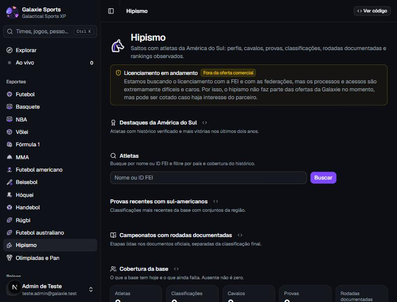

**Proposta:** usar o `EmptyState` existente em cada seção vazia, com um texto curto ("Nenhuma prova recente na base"). Precisa de textos novos nos três idiomas.

### 12. Detalhes menores 📝

- **Trilha no celular:** mostra só o item anterior, truncado ("Fórm… › Campeonato Mundial…"). Proposta: no celular, trocar por um botão "‹ Fórmula 1" (voltar ao pai) e deixar o título da página na linha de baixo.
- **Esqueleto das páginas de topo:** durante o carregamento, mostra por um instante a trilha anterior antes de começar a nova. Proposta: passar o tipo da página também ao esqueleto.
- **Grupo "World"** na página do esporte vem da API sem tradução. Proposta: rótulo do dicionário ("Internacional"), como já acontece com as competições sem país.
- **Idioma do conteúdo:** com a interface em inglês, as sessões da F1 aparecem em espanhol ("Carrera", "Clasificación"), porque o conteúdo segue a voz do país. Não é navegação, mas confunde quem acabou de trocar o idioma. Vale revisar a regra do idioma do conteúdo para corridas.
- **Busca (⌘K):** abre e leva aos resultados sem problema. Não entra na trilha como pai, o que é o esperado.

## Proposta maior: trilha hierárquica fixa 📝

A causa de boa parte dos problemas é a trilha contar o **histórico** da aba, e não **onde a página fica**. A correção deste PR resolve os casos sem histórico, porque a trilha passa a começar pelos pais. Mesmo assim, a mesma página ainda mostra trilhas diferentes conforme o caminho:

- "Ao vivo › Cruzeiro x Remo";
- "Brasil › Brasileirão › Cruzeiro x Remo".

Isso é útil para voltar, mas não ensina a estrutura do site. Proposta para discutir:

- **Trilha sempre hierárquica** (Futebol › Brasileirão Série A › Rodada 32 › Cruzeiro x Remo).
- **Botão "voltar para …"** separado, com a origem real da visita (Ao vivo, Brasil, busca).

O código já está preparado: os `parents` de cada página são essa hierarquia.

## O que mudou no código

- `lib/trail.ts`:
  - `ROOT_KINDS`: Explorar, Ao vivo, esportes, ajustes e documentação sempre começam trilha nova;
  - `applyVisit(…, parents)` começa pelos pais quando a trilha estaria vazia.
- `PageHeader`: recebe `parents`. O primeiro deles acende o item do menu, por `lib/active-section.ts` e `SectionMarker`.
- `AppSidebar`:
  - item Explorar;
  - item ativo pela seção da página;
  - fecha a gaveta do celular ao navegar.
- `lib/navigation.ts`:
  - `countryHref` (só códigos de país);
  - `sportParent` e `equestrianParent`;
  - `eventCompetitionHref` (aba, rodada e data do jogo).
- Competição:
  - aba na URL com `UrlTabs`;
  - `?data=` escolhe a temporada;
  - chips por `FilterChip`, que mantém a aba e centraliza o chip ativo.
- Jogo, time, jogador, local, clássico, país e hipismo: `parents` e links de país seguros.
- Títulos de aba (`generateMetadata`) em esporte, competição, jogo, time, jogador e país.
- Testes: `lib/trail.test.ts` (páginas de topo e pais) e `lib/navigation.test.ts`.
