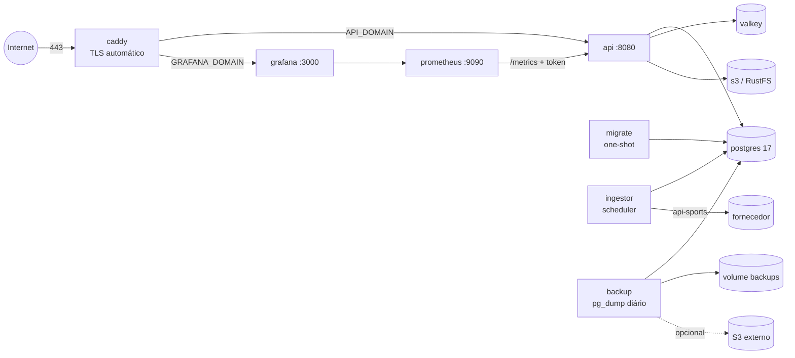

# Staging na VPS com Portainer

Stack de staging do Galaxie Sports (ADR-08, issues #5 e #6): API, ingestor agendado, Postgres 17, Valkey, RustFS (S3),
backup diário do Postgres, Prometheus + Grafana (painel de cota) e Caddy com TLS automático — tudo em
[`stack.yml`](stack.yml), reproduzível a partir do repositório.



| Serviço | Imagem | Função |
|---|---|---|
| `postgres` | `postgres:17-alpine` | Banco (volume `pgdata`) |
| `valkey` | `valkey/valkey:8-alpine` | Cache/filas (volume `valkeydata`) |
| `s3` + `s3-init` | `rustfs/rustfs:1.0.2` | Object storage dos assets (só rede interna) |
| `migrate` | imagem da API | Aplica as migrations e termina; API e ingestor só sobem depois |
| `api` | `apps/api/Dockerfile` | API pública + `/metrics` |
| `ingestor` | `services/ingestor/Dockerfile` | Scheduler que roda os CLIs do ingestor em horários fixos (UTC) |
| `backup` | `infra/backup/Dockerfile` | `pg_dump` diário, retenção de 30 dias, cópia opcional para S3, restore scriptado |
| `prometheus` | `infra/observability/prometheus/Dockerfile` | Coleta `/metrics` e avalia os alertas |
| `grafana` | `infra/observability/grafana/Dockerfile` | Painel "Cota, ingestão e API" provisionado |
| `caddy` | `infra/caddy/Dockerfile` | Proxy reverso com HTTPS (ACME); bloqueia `/metrics` e `/internal/*` |

As imagens próprias são construídas pelo próprio Portainer a partir do repositório (`PULL_POLICY=build`); nenhum
arquivo de configuração é montado do host — tudo vai dentro das imagens.

## O que você precisa providenciar

1. **VPS** com Docker 24+ e **Portainer CE ≥ 2.20** (stacks a partir de repositório Git). Recomendado: 2 vCPU, 4 GB de
   RAM, 40 GB de disco (o schema `raw` cresce; backups ficam no mesmo disco — por isso a cópia remota).
2. **Domínio** com registros DNS `A`/`AAAA` de `API_DOMAIN` e `GRAFANA_DOMAIN` apontando para a VPS, e as portas
   **80 e 443** liberadas no firewall (o desafio ACME do certificado usa a 80).
3. **Segredos** (definidos só no Portainer): `POSTGRES_PASSWORD`, `S3_ACCESS_KEY`/`S3_SECRET_KEY`, `APISPORTS_KEY`,
   `METRICS_TOKEN`, `GRAFANA_ADMIN_PASSWORD` e, para a cópia remota dos backups, credenciais de um bucket S3-compatível
   **fora desta VPS**.
4. Acesso de leitura do Portainer ao repositório (repositório privado: token de leitura do GitHub em
   _Authentication_ ao criar a stack).

## Deploy passo a passo

1. Gere os segredos (hex evita problemas de escape na `DATABASE_URL`):
   ```bash
   for v in POSTGRES_PASSWORD S3_SECRET_KEY METRICS_TOKEN GRAFANA_ADMIN_PASSWORD; do echo "$v=$(openssl rand -hex 24)"; done
   ```
2. Portainer → **Stacks → Add stack** → nome `galaxie-sports-staging` → **Repository**:
   - Repository URL: `https://github.com/galaxie-works/galaxie-sports`
   - Repository reference: `refs/heads/main`
   - Compose path: `infra/portainer/stack.yml`
3. **Environment variables** → _Load variables from .env file_ com [`stack.env.example`](stack.env.example) e preencha
   os valores (domínios, segredos, chave da api-sports). Nada disso vai para o Git.
4. **Deploy the stack**. O primeiro deploy constrói as imagens na VPS (alguns minutos). Ordem de subida:
   `postgres` saudável → `migrate` conclui → `api`/`ingestor`; o `backup` faz um dump logo na partida.
5. (Opcional) **GitOps updates**: ative _polling_ (ex.: 5 min) ou o webhook da stack para redeploy a cada push na `main`.
   Com `PULL_POLICY=build` cada redeploy reconstrói as imagens (com cache de camadas).

### Verificação pós-deploy

```bash
curl -fsS https://$API_DOMAIN/health          # {"status":"ok",...}
curl -fsS https://$API_DOMAIN/health/db       # {"status":"ok"}
curl -s -o /dev/null -w '%{http_code}\n' https://$API_DOMAIN/metrics   # 404 (bloqueado no proxy)
```

- Grafana em `https://$GRAFANA_DOMAIN` (usuário `GRAFANA_ADMIN_USER`): o painel **Galaxie Sports · Cota, ingestão e API**
  abre como home e mostra a cota de cada API em tempo real.
- Portainer → container `ingestor` → _Console_ (`/bin/sh`): `node dist/cli/scheduler.js --list` mostra a agenda efetiva.
- Container `backup` → _Logs_: `backup concluído: ...`.

## Variáveis de ambiente

Referência completa e valores padrão em [`stack.env.example`](stack.env.example).

| Variável | Obrigatória | Padrão | Uso |
|---|---|---|---|
| `API_DOMAIN` | sim | — | Domínio público da API (Caddy emite o certificado) |
| `GRAFANA_DOMAIN` | não | `grafana.localhost` | Domínio do Grafana |
| `HTTP_PORT` / `HTTPS_PORT` | não | `80` / `443` | Portas publicadas pelo Caddy |
| `IMAGE_PREFIX` / `IMAGE_TAG` | não | `galaxie-sports` / `staging` | Nome das imagens (`<prefixo>-api:<tag>`...) |
| `PULL_POLICY` | não | `build` | `build` constrói na VPS; `always` baixa de um registry (GHCR) |
| `POSTGRES_USER` / `POSTGRES_DB` | não | `galaxie` / `galaxie_sports` | Banco |
| `POSTGRES_PASSWORD` | **sim** | — | Senha do Postgres (use hex) |
| `S3_ACCESS_KEY` / `S3_SECRET_KEY` | **sim** | — | Credenciais do RustFS interno |
| `S3_BUCKET` / `ASSETS_PUBLIC_BASE_URL` | não | `galaxie-sports-assets` / vazio | Assets |
| `APISPORTS_KEY` | **sim** | — | Chave do dashboard da api-sports (só o ingestor recebe) |
| `APISPORTS_PLAN` / `QUOTA_RESERVE_PERCENT` | não | `free` / `15` | Plano padrão de todas as APIs e reserva — regras do plano, limite por minuto e política do Quota Governor (ingestor e métricas) |
| `APISPORTS_PLAN_<ESPORTE>` | não | vazio (= `APISPORTS_PLAN`) | Plano de uma API específica (cada API tem assinatura própria): nome da API em maiúsculas com `-` → `_`, ex.: `APISPORTS_PLAN_FOOTBALL=pro`, `APISPORTS_PLAN_FORMULA_1=free` |
| `SCHEDULE_SYNC_DAILY` | não | `5 0 * * *` | Sync diário do futebol logo após a virada do dia de cota |
| `SCHEDULE_LIVE_RUN` | não | `*/5 * * * *` | Ao vivo: inicia o Live Scheduler/Poller (sai sozinho sem janela próxima; não sobrepõe) |
| `LIVE_FEATURED` / `LIVE_MAX_INTERVAL_MINUTES` / `LIVE_IDLE_EXIT_MINUTES` / `LIVE_PROTECT_DAILY` | não | `off` / `15` / `15` / fatia DAILY | Detalhe do jogo principal por tick (`off`, `auto`, `on`), teto do intervalo, ociosidade antes de sair e saldo DAILY protegido |
| `SCHEDULE_NORMALIZE_FOOTBALL` | não | `35 0 * * *` | Normalização raw → core depois do sync |
| `SCHEDULE_EVENTS_CLOCK` | não | `* * * * *` | Relógio dos eventos (sem cota) |
| `SCHEDULE_ASSETS_MIRROR` | não | `30 1 * * *` | Espelho de assets (não consome cota) |
| `SCHEDULE_CHANGE_FEED_PRUNE` / `CHANGE_FEED_RETENTION_DAYS` | não | `45 2 * * *` / `7` | Retenção do `ops.change_feed`: apaga mudanças mais velhas que N dias, mantendo a última de cada entidade e o que os webhooks ainda não leram (limita a retomada do SSE por `Last-Event-ID` a N dias) |
| `SCHEDULE_QUOTA_STATUS` | não | `5 * * * *` | Reconciliação da cota via `/status` (não consome cota); `off` desliga |
| `SCHEDULE_BOOTSTRAP_CATALOG` | não | `15 3 * * 1` | Catálogo do futebol (segunda, 03:15 UTC; ~8 chamadas BOOTSTRAP) |
| `SCHEDULER_RUN_ON_START` | não | vazio | Jobs para rodar já na partida (ex.: `quota-status`) |
| `SCHEDULER_TIMEOUT_MINUTES` | não | por job | Tempo limite de cada execução (o `live-run` mantém o próprio, 20 h) |
| `LOG_LEVEL` | não | `info` | `debug` mostra também as respostas servidas do raw |
| `METRICS_TOKEN` | recomendado | vazio | Bearer exigido em `/metrics` (o Prometheus da stack já envia) |
| `LIVE_POLL_INTERVAL_SECONDS` | não | `300` | Intervalo esperado do ao vivo (placeholder até o Live Scheduler) |
| `WEBHOOK_SIGNING_SECRET` | não | vazio | Assinatura de webhooks (quando existirem) |
| `BACKUP_TIME` | não | `03:30` | Horário do dump diário (UTC) |
| `BACKUP_RETENTION_DAYS` | não | `30` | Retenção local |
| `BACKUP_ON_START` | não | `true` | Faz um dump ao (re)iniciar o serviço |
| `BACKUP_S3_BUCKET` / `_PREFIX` / `_ENDPOINT` / `_REGION` | não | vazio / `postgres` / vazio / `us-east-1` | Cópia remota (S3-compatível) |
| `BACKUP_S3_ACCESS_KEY` / `BACKUP_S3_SECRET_KEY` | com S3 | — | Credenciais do bucket remoto (só para backups) |
| `PROMETHEUS_RETENTION` | não | `15d` | Retenção das séries |
| `GRAFANA_ADMIN_USER` / `GRAFANA_ADMIN_PASSWORD` | senha **sim** | `admin` / — | Login do Grafana |

## TLS e proxy reverso

O serviço `caddy` obtém e renova certificados automaticamente (ACME) para `API_DOMAIN` e `GRAFANA_DOMAIN`, redireciona
HTTP → HTTPS, comprime respostas, **devolve 404 para `/metrics` e `/internal/*`** e grava logs de acesso em JSON com o IP
mascarado (/24 ou /48) e sem cabeçalhos de credencial (docs/11 §3).

Se a VPS **já tem um proxy** (Traefik, por exemplo), remova o serviço `caddy` da stack, conecte `api` e `grafana` à rede
do proxy e use labels como estas (ajuste o nome do _certresolver_):

```yaml
  api:
    networks: [default, proxy]
    labels:
      traefik.enable: 'true'
      traefik.http.routers.galaxie-api.rule: Host(`${API_DOMAIN}`) && !PathPrefix(`/metrics`) && !PathPrefix(`/internal`)
      traefik.http.routers.galaxie-api.entrypoints: websecure
      traefik.http.routers.galaxie-api.tls.certresolver: letsencrypt
      traefik.http.services.galaxie-api.loadbalancer.server.port: '8080'
networks:
  proxy:
    external: true
```

Com CDN/proxy na frente do DNS, use TLS "estrito" até a origem (o Caddy continua emitindo o certificado da origem).

## Segredos

- Ficam **só** nas variáveis da stack no Portainer (criptografadas no banco do Portainer). Nunca em arquivos do
  repositório; `stack.env.example` contém apenas marcadores.
- `APISPORTS_KEY` só é entregue ao `ingestor`; a API não fala com o fornecedor.
- Rotação: altere a variável no Portainer → _Update the stack_. Para `POSTGRES_PASSWORD`, troque antes a senha no banco
  (`ALTER ROLE galaxie PASSWORD '...'` pelo console do `postgres`) — a variável só vale na criação do volume.
- Prometheus e Postgres não publicam portas; para consultas pontuais use o console do container ou um túnel SSH.

## Ingestor agendado

O container `ingestor` roda `node dist/cli/scheduler.js`: cada job é um CLI existente executado num processo filho, com
tempo limite, sem sobreposição e registrado em `ops.job_run` (alimenta as métricas e o alerta "job falhando 3×").

| Job | Agenda padrão (UTC) | CLI | Cota |
|---|---|---|---|
| `sync-daily` | `5 0 * * *` | `dist/cli/sync-daily.js` | DAILY (agenda D-1/D0/D+1, lesões, detalhes, rodízio) direto ao core + tabelas calculadas; idempotente no dia |
| `live-run` | `*/5 * * * *` | `dist/cli/live-run.js` | LIVE: planeja o orçamento do dia (LIVE = 0 sem jogos relevantes) e roda o poller enquanto houver janela |
| `normalize-football` | `35 0 * * *` | `dist/cli/normalize-football.js` | 0 (raw → core incremental) |
| `events-clock` | `* * * * *` | `dist/cli/events-clock.js` | 0 (transições de estado pelo horário previsto) |
| `events-importance` | `20 * * * *` | `dist/cli/events-importance.js --esporte football --proximos-dias 7` | 0 (sinais da tabela pelo motor de regras e prestígio do catálogo na importância, docs/06 §3.1) |
| `assets-mirror` | `30 1 * * *` | `dist/cli/mirror-assets.js --descobrir-raw --limite 2000` | 0 (CDN de mídia → S3 interno) |
| `assets-palette` | `10 3 * * *` | `dist/cli/assets-palette.js --limite 5000` | 0 (lê escudos do S3 e grava as cores dos times) |
| `quota-status` | `5 * * * *` | `dist/cli/quota.js` | 0 (`/status`) — reconcilia o Governor com o contador do fornecedor |
| `bootstrap-catalog` | `15 3 * * 1` | `dist/cli/bootstrap-catalog.js` | ≤ 8 BOOTSTRAP (reaproveita o raw dentro do TTL) |

Execução manual (registrada): console do `ingestor` → `node dist/cli/scheduler.js --run quota-status`.
Plano do ao vivo sem chamar nada: `node dist/cli/live-run.js --plan` (ou `--plan --dia amanha`).
O `live-run` fica no ar enquanto houver janela ao vivo (um processo por vez — o cron a cada 5 min só o reinicia
quando ele saiu ocioso); no encerramento do container o scheduler repassa SIGTERM e ele termina o tick em
andamento. `SCHEDULER_TIMEOUT_MINUTES` vale para todos os jobs menos o `live-run`, que mantém o tempo limite
próprio (20 h). Novos jobs (bootstraps de temporadas/detalhes/pessoas quando houver cota) entram em
`services/ingestor/src/scheduler/schedule.ts` à medida que forem necessários.

## Observabilidade (issue #6)

**Logs** — todos os serviços escrevem JSON de uma linha em stdout (`level`, `time`, `service`, `env`, `msg`), com rotação
do Docker (10 MB × 5). Campos padronizados: `job_id`, `sport`, `endpoint`, `priority`, `source` (`cache`/`network`),
`outcome`, `duration_ms`, `quota_remaining`; o scheduler acrescenta `job` e `scheduler_run_id`. A API registra o IP do
cliente mascarado e nunca chaves. Leia pelo Portainer (_Logs_) ou `docker logs <container> | jq`.

**Métricas** — `GET /metrics` da API (Prometheus). Tudo que vem do banco é **consultado** a cada coleta (cache de 5 s),
nunca contado em memória: várias réplicas da API reportam o mesmo número e nada é contado em dobro.

| Métrica | Labels | Fonte |
|---|---|---|
| `galaxie_provider_calls` | `api`, `day_utc`, `period` (`today`/`yesterday`), `priority`, `outcome` | `ops.quota_ledger` |
| `galaxie_quota_daily_limit`, `_reserve`, `_used`, `_remaining`, `_remaining_ratio`, `_provider_used` | `api` | ledger + `ops.quota_snapshot` + política do Governor |
| `galaxie_quota_budget` | `api`, `priority` | `ops.quota_budget` ou fatia padrão |
| `galaxie_job_runs` (24 h), `galaxie_job_consecutive_failures`, `galaxie_job_last_run_timestamp_seconds`, `galaxie_job_last_success_timestamp_seconds`, `galaxie_job_last_duration_seconds` | `job_name` (+ `status`) | `ops.job_run` |
| `galaxie_raw_last_fetched_timestamp_seconds` | `sport` | `raw.api_response` (janela de 7 dias) |
| `galaxie_live_events`, `galaxie_live_event_max_staleness_seconds` | `sport` | `core.event` em andamento |
| `galaxie_live_poll_interval_seconds` | — | `LIVE_POLL_INTERVAL_SECONDS` (base do alerta `LiveEventStale`) |
| `galaxie_live_scheduler_interval_seconds`, `_ticks_left`, `_window_minutes`, `_active_events`, `_updated_timestamp_seconds` | `sport` | Estado publicado pelo `live-run` em `ops.sync_cursor` (`live:scheduler`) |
| `galaxie_http_request_duration_seconds` | `method`, `route`, `status_code` | Fastify (histograma) |
| `galaxie_metrics_collector_up`, `_duration_seconds` | `collector` | saúde das consultas |
| `process_*`, `nodejs_*` | — | prom-client |

**Alertas** ([`alerts.yml`](../observability/prometheus/alerts.yml), testados com `promtool` no CI):
`QuotaBelow20Percent` (cota < 20% por 5 min), `JobFailingRepeatedly` (≥ 3 falhas seguidas), `LiveEventStale` (evento em
andamento sem atualização há mais de 2 intervalos), `BackupStale` (último backup OK há mais de 26 h), `FootballRawStale` (nada novo no raw do futebol há 26 h), `ApiDown`,
`MetricsCollectorDown`, `ApiLatencyP95High` (p95 > 150 ms). Eles aparecem como _firing_ no Prometheus e no Grafana
(_Alerting → Alert rules_, fonte Prometheus). **Notificação** (e-mail, chat) exige um Alertmanager ou contact point do
Grafana com o canal que você escolher — ver "O que fica de fora".

Teste simulado dos alertas, localmente:

```bash
docker run --rm -v "$PWD/infra/observability/prometheus:/w" -w /w --entrypoint promtool \
  prom/prometheus:v3.15.1 test rules alerts.test.yml
```

## Backups

- O serviço `backup` faz `pg_dump --format=custom --compress=zstd:5` do banco inteiro (o schema `raw` é o ativo mais caro
  de reconstruir) todo dia às `BACKUP_TIME` UTC e na partida, valida o arquivo com `pg_restore --list`, grava
  `.sha256` e apaga dumps com mais de `BACKUP_RETENTION_DAYS` dias do volume `backups`.
- Com `BACKUP_S3_BUCKET` definido, cada dump também vai para o bucket remoto (`BACKUP_S3_PREFIX/`); configure no bucket
  uma **regra de ciclo de vida** de 30 dias para a retenção remota. Use um bucket fora desta VPS — o RustFS da stack não
  serve como cópia externa.
- Cada execução vira uma linha `pg-backup` em `ops.job_run` → métricas e alerta `BackupStale`. O healthcheck do container
  fica _unhealthy_ se o último sucesso tiver mais de 26 h.
- Backup avulso: console do `backup` → `backup.sh`.

## Restore (testado)

Os scripts ficam na imagem `backup` (fonte em [`infra/backup`](../backup)). O restore real é feito num banco novo,
conferido (contagens de `raw`, `ops`, `core` e migrations) e só então trocado pelo nome; o banco anterior é preservado como
`<db>_pre_restore_<data>` para rollback.

1. **Ensaio** (não toca no banco real; faça mensalmente):
   ```bash
   restore.sh --list
   restore.sh --verify latest
   ```
2. **Restauração real**:
   1. Portainer → pare os containers `api` e `ingestor` (evita escrita entre o dump e a troca).
   2. Console do `backup`: `restore.sh --yes latest` (ou `restore.sh --yes galaxie_sports_<data>.dump`, ou
      `restore.sh --yes s3://<bucket>/postgres/<arquivo>.dump` para baixar da cópia remota).
   3. Inicie `api` e `ingestor`; confira `https://$API_DOMAIN/health/db` e o painel.
3. **Rollback** (se o restaurado não servir), no console do `postgres`:
   ```sql
   ALTER DATABASE galaxie_sports RENAME TO galaxie_sports_descartado;
   ALTER DATABASE galaxie_sports_pre_restore_<data> WITH ALLOW_CONNECTIONS true;
   ALTER DATABASE galaxie_sports_pre_restore_<data> RENAME TO galaxie_sports;
   ```
   Quando estiver tudo certo, apague o banco `_pre_restore_` antigo (`DROP DATABASE ... WITH (FORCE)`).
4. **VPS nova / desastre**: suba a stack, copie o dump para o volume (`docker cp arquivo.dump <container-backup>:/backups/`)
   ou use o caminho `s3://...`, e siga o passo 2.

O ciclo completo (backup → perda de dados → ensaio → restore real → conferência) é automatizado em
[`infra/backup/e2e-test.sh`](../backup/e2e-test.sh) e roda no CI (`.github/workflows/docker.yml`).

## Imagens: build no CI e publicação opcional no GHCR

O workflow `Imagens e stack de staging` constrói as seis imagens (sem publicar), valida a stack, os alertas, o Caddyfile
e os scripts, e roda o teste de backup/restore. Para publicar no GHCR (opcional), acrescente ao job `build`:

```yaml
    permissions:
      contents: read
      packages: write
    steps:
      # ...checkout e setup-buildx...
      - uses: docker/login-action@v3
        with:
          registry: ghcr.io
          username: ${{ github.actor }}
          password: ${{ secrets.GITHUB_TOKEN }}
      - uses: docker/build-push-action@v6
        with:
          push: ${{ github.ref == 'refs/heads/main' }}
          tags: |
            ghcr.io/galaxie-works/galaxie-sports-${{ matrix.image }}:${{ github.sha }}
            ghcr.io/galaxie-works/galaxie-sports-${{ matrix.image }}:staging
```

e na stack use `IMAGE_PREFIX=ghcr.io/galaxie-works/galaxie-sports`, `IMAGE_TAG=staging` (ou o SHA) e `PULL_POLICY=always`
(com registry privado, cadastre as credenciais em Portainer → _Registries_).

## Rodar a stack localmente

Útil para testar mudanças na stack sem VPS (zero chamadas ao fornecedor com os jobs desligados):

```bash
cat > /tmp/stack-local.env <<'EOF'
API_DOMAIN=localhost
HTTP_PORT=18081
HTTPS_PORT=18443
POSTGRES_PASSWORD=0123456789abcdef
S3_ACCESS_KEY=localkey
S3_SECRET_KEY=localsecret123
APISPORTS_KEY=nao-usada
SCHEDULE_QUOTA_STATUS=off
SCHEDULE_BOOTSTRAP_CATALOG=off
SCHEDULE_LIVE_RUN=off
METRICS_TOKEN=local
GRAFANA_ADMIN_PASSWORD=local
EOF
docker compose -p galaxie-staging-local -f infra/portainer/stack.yml --env-file /tmp/stack-local.env up -d --build
curl -k https://localhost:18443/health
docker compose -p galaxie-staging-local -f infra/portainer/stack.yml --env-file /tmp/stack-local.env down -v
```

## O que fica de fora (próximos passos)

- **Notificações de alerta**: falta escolher o canal (e-mail, chat, pager) e configurar Alertmanager ou contact point
  do Grafana.
- **Alerta com o intervalo dinâmico**: o Live Scheduler já publica `galaxie_live_scheduler_interval_seconds`, mas o
  `LiveEventStale` segue sobre `LIVE_POLL_INTERVAL_SECONDS`: com 15 s (Pro) ele dispararia em todo intervalo de jogo
  (o poller pula o HT e os eventos em `break` ficam sem atualização). Falta excluir `break` da idade máxima e trocar a base.
- **Latência por chamada ao fornecedor** vai para os logs (`duration_ms`), não para o Prometheus: os jobs são processos
  curtos. Um _pushgateway_ ou métricas no próprio scheduler resolvem quando houver worker contínuo (live poller).
- **Assets públicos**: o RustFS fica só na rede interna; publicar `ASSETS_PUBLIC_BASE_URL` (CDN ou rota no proxy) é outra issue.
- **Hardening** (firewall, fail2ban, atualizações automáticas, DR completo) — issue #84.
