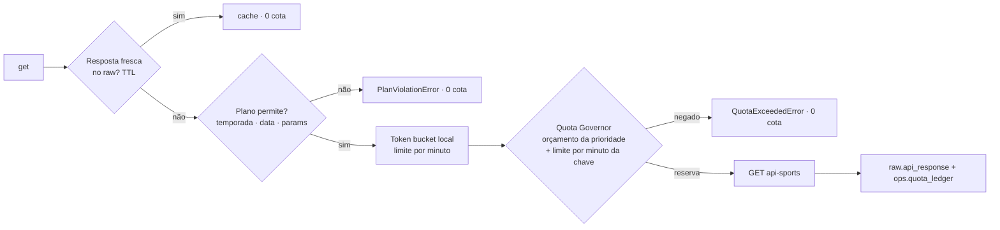

# @galaxie/apisports-client

Cliente único das 12 APIs da [api-sports.io](https://api-sports.io), com **economia de cota por design** (docs/03).

Toda chamada passa por esta sequência:



## Uso

```ts
import { ApiSportsClient, PgQuotaGovernor, PgRawStore, PlanRules, defaultPolicy, plansFromEnv } from '@galaxie/apisports-client';
import { createDb } from '@galaxie/db';

const db = createDb(process.env.DATABASE_URL!);
// Plano por API: APISPORTS_PLAN_<ESPORTE> (ex.: APISPORTS_PLAN_FOOTBALL=pro), senão APISPORTS_PLAN (free | pro | ultra | mega)
const planFor = plansFromEnv(process.env);
const client = new ApiSportsClient({
  apiKey: process.env.APISPORTS_KEY!,
  store: new PgRawStore(db),
  // perMinute na política: o Governor espaça os envios da API somando todos os processos da chave
  governor: new PgQuotaGovernor(db, (api) => defaultPolicy(planFor(api).dailyLimit, 25, planFor(api).perMinute)),
  // uma PlanRules e um limitador por minuto por API (a opção `plan` ainda aceita regras únicas para todas)
  planFor: (sport) => new PlanRules(planFor(sport)),
});

const { envelope, source } = await client.get({
  sport: 'football',
  endpoint: '/fixtures',
  params: { date: '2026-10-21' },
  priority: 'DAILY', // BOOTSTRAP | DAILY | LIVE | ADHOC
  jobId: 'daily-sync',
});

await client.status('football'); // /status não consome cota e reconcilia o Governor

// Ambiente local sem chave (ex.: depois de `snapshot:import`): só lê o raw, de qualquer idade,
// e lança OfflineMissError em vez de chamar o fornecedor.
const offline = new ApiSportsClient({ apiKey: '', store, governor, offline: true });
```

## Peças

| Módulo | Função |
|---|---|
| `client.ts` | `get`, `getAllPages` (cada página = 1 requisição), `status`; pedidos idênticos simultâneos (no processo ou entre processos) geram uma única chamada |
| `plan.ts` | Restrições do plano (free: temporadas 2022–2024, `date` ontem→amanhã, sem `ids`/`last`/`next`, `page ≤ 3`); aprende a nova janela quando o fornecedor a desloca. Plano por API a partir do ambiente: `plansFromEnv`, `planForSport`, `planEnvVar` (`formula-1` → `APISPORTS_PLAN_FORMULA_1`) |
| `ttl.ts` | Por quanto tempo reutilizar uma resposta do raw (referência 24 h, entidades lentas 7 dias, jogos antigos para sempre, ao vivo 10 s) |
| `rate-limiter.ts` | Espaçamento por API dentro do processo: 1 chamada a cada 60/perMinute s (6 s no free), sem rajada inicial |
| `raw-store.ts` | `PgRawStore` / `InMemoryRawStore` — grava todo envelope e só reaproveita respostas HTTP 2xx sem erro no envelope |
| `media.ts` | URLs da CDN de mídia (`media.api-sports.io`, não consome cota): normalização, chave no bucket (`api-sports/<caminho>`), tipo do asset, extração de URLs de um JSON, lista de bloqueio e reescrita para o nosso CDN (`rewriteMediaUrl`, `rewriteMediaUrls`, `publicAssetUrl`) |
| `quota/policy.ts` | Decisão pura: limite − reserva (na produção o LIVE pode usar a reserva; no dev ninguém), fatia por prioridade, empréstimo só da folga não protegida |
| `quota/pg-governor.ts` | Reserva atômica (advisory lock por API/dia) em `ops.quota_ledger`, plano do dia em `ops.quota_budget`, contador e limite do fornecedor em `ops.quota_snapshot` (o limite menor prevalece; leituras atrasadas não reduzem o piso). Com `perMinute` na política, a reserva espera a vaga do limite por minuto somando todos os processos (o scheduler roda cada job num processo filho): `sent_at` do ledger é o instante do envio. Uma resposta `quota_exhausted` (sem cota restante no header) nega a API por 15 min, inclusive o LIVE; nos 5 primeiros minutos do dia UTC ela é ignorada (contador do fornecedor ainda no dia anterior). O header `x-ratelimit-requests-remaining` de cada resposta (conta inteira: dev + produção) vira piso em `ops.quota_snapshot`, no máximo a cada 5 s por API e processo. Um `rate_limited` (429 ou `errors.rateLimit`) pausa a API por 30 s para todas as reservas do banco |

## Política padrão (free, 100/dia)

| Prioridade | Fatia | Observação |
|---|---|---|
| DAILY | 40 | protegida |
| LIVE | 40 | protegida (só o que a reserva não cobre); pode usar a reserva |
| ADHOC | 5 | não protegida |
| BOOTSTRAP | 0 | vive da folga; em dia sem jogos, `governor.plan(api, dia, { LIVE: 0, DAILY: 20 })` libera 65 |
| Reserva | 15 | só LIVE (`liveUsesReserve`). Os serviços usam `quotaPolicyFromEnv` (@galaxie/observability): produção 25%, dev ≥ 70% e sem exceção para o LIVE |

## Testes

```bash
pnpm --filter @galaxie/apisports-client test              # unitários (servidor falso, simulação de um dia)
pnpm --filter @galaxie/apisports-client test:integration  # Postgres: concorrência do Governor, raw + ledger
```
