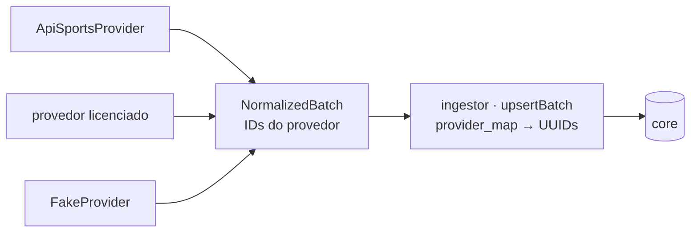

# @galaxie/providers

Camada de provedores plugável (ADR-09, [docs/03 §8](../../docs/03-ingestao-e-economia-de-chamadas.md)) e a lógica pura do evento canônico ([docs/04 §3](../../docs/04-modelo-de-dados.md)). Sem banco e sem rede: tudo aqui é função pura ou contrato.



## Peças

| Módulo | Função |
|---|---|
| `provider.ts` | Interface `SportsDataProvider` e `ProviderResult` (`ok` / `empty` / `error`) |
| `model.ts` | Lote neutro `NormalizedBatch` (competições, fases, estádios, participantes, pessoas, eventos, timeline, elencos, classificação) |
| `precedence.ts` | `canOverride`: quem pode sobrescrever o estado de um evento descrito por vários provedores |
| `fake-provider.ts` | Provedor em memória para testes |
| `event/state-machine.ts` | `initialState`, `applyObservation` (dado válido ou falha), `tick` (relógio) — *last-known-good* e *fallback* temporal |
| `event/status.ts` | Estados canônicos, `expectedEnd` por esporte, janela T-10 |
| `event/momentum.ts` | `momentum(event, now, tz)`: D-3+ … live no fuso do cliente |
| `event/importance.ts` | `importance({ tier, stageKind, derby, decisive })` → 0–100 com detalhamento |
| `api-sports/football/*` | Mapa de status, rodada → fase, normalizadores puros dos envelopes v3 (`fixtures`, `fixtures/headtohead`, `teams`, `players/squads`, `coachs`, `players`, `standings`, `leagues`) |
| `api-sports/provider.ts` | `ApiSportsProvider` sobre o `ApiSportsClient` (cache no raw, plano e cota) |

## Uso

```ts
import { ApiSportsProvider, momentum, importance } from '@galaxie/providers';
import { ingestProviderResult } from '@galaxie/ingestor';

const provider = new ApiSportsProvider(client, { priority: 'LIVE', jobId: 'live-poller' });
const result = await provider.getEventDetail('football', '1492407');
await ingestProviderResult(db, result, { provider: provider.id, sport: 'football', expectedEventIds: ['1492407'] });

momentum({ status: 'scheduled', startsAt }, new Date(), 'America/Sao_Paulo'); // 'T-30', 'today', 'D-1'...
importance({ tier: 1, stageKind: 'final', derby: { derbyId, intensity: 5 } }).score; // 100
```

Para plugar um provedor novo: implemente `SportsDataProvider`, traduza o formato dele para `NormalizedBatch` (IDs do próprio provedor, status já no enum canônico) e grave o raw com `provider = '<id>'`. Nada no core nem na API /v1 muda.

## Testes

```bash
pnpm --filter @galaxie/providers test   # tabelas de casos + envelopes reais recortados e anonimizados (test/fixtures)
```
